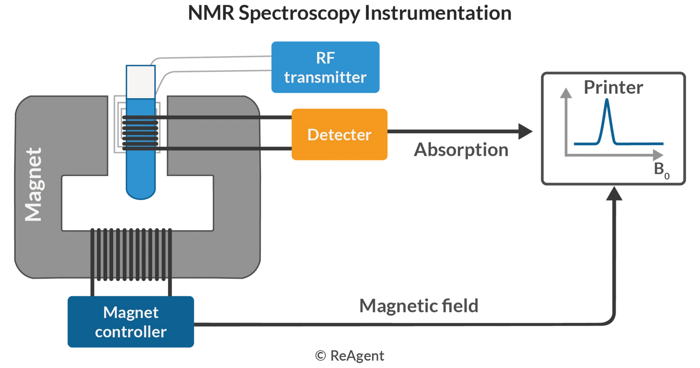
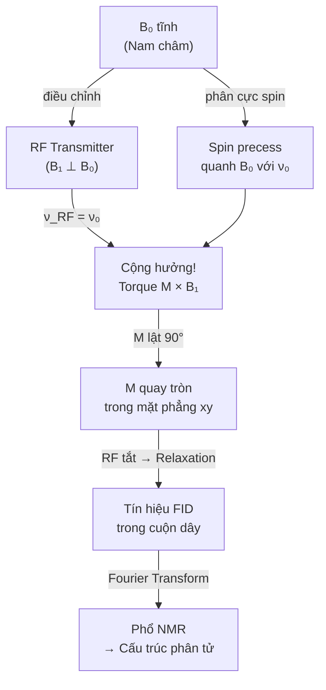

# Cộng hưởng Từ Hạt nhân (NMR Spectroscopy)
> Tổng hợp kiến thức theo hành trình tư duy từ sơ đồ thiết bị đến cơ chế vật lý

---

## 🗺️ Lộ trình tư duy

```
Sơ đồ thiết bị
    ↓
RF và B₀ có độc lập nhau không?
    ↓
Nếu không có RF thì sao?
    ↓
Khi cộng hưởng thì spin làm gì?
    ↓
RF là từ trường — 2 vector B₀ và B₁ sắp xếp thế nào?
    ↓
Hạt nhân trong cuộn cảm — hướng spin so với B₁?
    ↓
M đi vào mặt phẳng x hay y sau xung RF?
    ↓
Hình dung như con quay gyroscope!
```

---

## 1. Cấu tạo thiết bị NMR



### Các bộ phận chính

| Bộ phận | Vai trò |
|---|---|
| **Magnet** | Tạo từ trường tĩnh B₀ mạnh, đồng đều |
| **Magnet Controller** | Quét/điều chỉnh cường độ B₀ chính xác |
| **RF Transmitter** | Phát sóng vô tuyến B₁ kích thích hạt nhân |
| **Detector** | Thu tín hiệu hấp thụ từ hạt nhân cộng hưởng |
| **Printer** | Vẽ phổ NMR (peak tại tần số cộng hưởng) |

### Luồng hoạt động

```
Magnet Controller → B₀ tĩnh
        ↓
Mẫu đặt trong B₀ → spin phân cực
        ↓
RF Transmitter → B₁ kích thích
        ↓
Cộng hưởng xảy ra (ν_RF = ν₀)
        ↓
Detector → thu tín hiệu hấp thụ
        ↓
Printer → vẽ phổ NMR
        ↓
Magnet Controller ← phản hồi để quét tiếp
```

---

## 2. RF và B₀ — Hai nguồn độc lập

> **Câu hỏi dẫn dắt:** *"Sóng RF là điều khiển riêng chứ không phải sinh ra do từ trường B₀?"*

### Trả lời: Hoàn toàn độc lập — nhưng phải phối hợp

$$\nu_{RF} = \frac{\gamma \cdot B_0}{2\pi}$$

| | **B₀ (Nam châm)** | **RF Transmitter (B₁)** |
|---|---|---|
| Nguồn gốc | Nam châm siêu dẫn / điện từ | Máy phát điện tử riêng |
| Chức năng | Phân cực spin hạt nhân | Cung cấp năng lượng lật spin |
| Điều chỉnh | Magnet Controller | RF Transmitter độc lập |

### Phép so sánh
> 🎸 **B₀** = căng dây đàn (quyết định tần số tự nhiên)  
> 🤌 **RF** = gảy đàn (cung cấp năng lượng để dây rung)

### Hai phương pháp NMR

| Phương pháp | Cái gì thay đổi |
|---|---|
| **CW-NMR** (cũ) | Giữ RF cố định, **quét B₀** dần dần |
| **FT-NMR** (hiện đại) | Giữ B₀ cố định, **phát xung RF ngắn** bao phủ nhiều tần số |

---

## 3. Nếu không có RF

> **Câu hỏi dẫn dắt:** *"Thế nếu không có RF?"*

```
Chỉ có B₀:
    Spin phân thành 2 mức năng lượng (thấp & cao)
            ↓
    Phần lớn spin ở mức THẤP (cân bằng nhiệt)
            ↓
    Hệ thống... chỉ đứng yên ở đó
    → KHÔNG có tín hiệu, KHÔNG có NMR!
```

**Lý do RF không thể thiếu:**

$$\Delta E = h\nu = h \cdot \frac{\gamma B_0}{2\pi}$$

- Khoảng cách năng lượng giữa 2 mức quá nhỏ
- Nhiệt độ phòng không đủ để kích thích ngẫu nhiên
- Chỉ sóng RF (cỡ MHz) mới có đúng bước sóng để hạt nhân hấp thụ

> 🔋 B₀ = cắm điện cho lò vi sóng  
> ▶️ RF = bấm nút START  
> → Không START thì không bao giờ nóng dù có điện!

---

## 4. Khi cộng hưởng — Spin làm gì?

> **Câu hỏi dẫn dắt:** *"Vậy khi cộng hưởng thì spin như thế nào?"*

### Bước 1: Trước RF — Spin precessing trong B₀
```
        B₀
        ↑
        |    ← spin quay tuế sai (precess) quanh B₀
       /🔄      tần số quay = tần số Larmor (ν₀)
      /
```

Phần lớn spin ở mức thấp (song song B₀), thiểu số ở mức cao (ngược B₀).

### Bước 2: RF bật — Hấp thụ năng lượng
- RF có tần số **ν_RF = ν₀** → năng lượng được hấp thụ
- Spin bị "lật" từ mức thấp lên mức cao
- Vector từ hóa tổng **M** bị nghiêng ra khỏi trục B₀

### Bước 3: RF tắt — Relaxation
```
Spin mức cao → phát năng lượng → Spin mức thấp
                    ↓
             Detector bắt tín hiệu FID
```

> 💡 Chính tín hiệu phát ra lúc **relaxation** là thứ Detector đo — không phải lúc hấp thụ RF!

---

## 5. Hình học hai vector B₀ và B₁

> **Câu hỏi dẫn dắt:** *"RF cũng là từ trường — sự sắp xếp 2 vector từ trường này giúp đo cộng hưởng thế nào?"*

### Bố cục không gian
```
        z
        ↑
        |   ← B₀ (tĩnh, mạnh, dọc z)
        |
        +————————→ x
       /
      /← B₁ (RF, yếu, nằm trong mặt phẳng xy, QUAY TRÒN)
     y
```

**B₁ phải vuông góc với B₀** — đây là điều kiện bắt buộc.

### Tại sao phải vuông góc?

$$\vec{\tau} = \vec{M} \times \vec{B_1}$$

- Nếu B₁ **song song B₀** → tích = 0 → **không tác dụng gì**
- Nếu B₁ **vuông góc B₀** → torque **cực đại** → lật M hiệu quả nhất

### Tại sao B₁ phải quay đúng tần số Larmor?

| Tình huống | Kết quả |
|---|---|
| B₁ quay **chậm hơn** ν₀ | Lực đẩy lúc thuận lúc nghịch → triệt tiêu → không lật được M |
| B₁ quay **đúng** ν₀ | B₁ luôn "nhìn thấy" M cùng vị trí → lực đẩy liên tục → M bị lật ✅ |

---

## 6. Hướng spin trong cuộn cảm

> **Câu hỏi dẫn dắt:** *"Hạt nhân nằm trong cuộn cảm sẽ có hướng trục như nào với từ trường của cuộn cảm?"*

### Hình học trong thiết bị (theo sơ đồ)
```
     ↕ B₁ (trục cuộn, thẳng đứng)

 ════╪════  ← cuộn dây quanh ống mẫu

←————————→  B₀ (nằm ngang, giữa 2 cực nam châm)
```

| Vector | Hướng |
|---|---|
| B₀ | Nằm ngang (trục x) |
| Trục cuộn / B₁ | Thẳng đứng (trục z) |
| Spin hạt nhân M | Dọc theo B₀ → **vuông góc với B₁** |

### Cuộn dây vừa phát vừa thu!
```
Phát RF:    Cuộn tạo B₁ → lật spin M
Thu tín hiệu: M quay tròn → cảm ứng ngược vào chính cuộn đó
              → Detector đo dòng điện cảm ứng
```
> 📡 Giống anten vừa phát vừa thu sóng — **cùng một cuộn dây!**

---

## 7. Hành trình của vector M

> **Câu hỏi dẫn dắt:** *"Tức là ban đầu phương của M trùng với B₀, bật RF, phương của M trùng phương trục x hay y?"*

### Trả lời: M đi vào mặt phẳng xy, hướng x hay y tùy pha RF

| RF phát theo hướng | M bị lật về hướng |
|---|---|
| B₁ dọc x | M lật về **−y** |
| B₁ dọc y | M lật về **+x** |

Nhưng sau đó M **quay tròn** trong xy — không quan trọng lật về x hay y:

```
B₀ bật   →  M ↑ (dọc z)
RF 90°   →  M → (vào mặt phẳng xy)
RF tắt   →  M 🔄 (quay tròn trong xy, tắt dần về z)
Detector →  đo tín hiệu xoay chiều tắt dần này (FID)
```

---

## 8. Mô hình tư duy: Con quay Gyroscope

> **Câu hỏi dẫn dắt:** *"Để dễ hình dung thì nó sẽ giống con quay gyrocopter?"*

### So sánh song song

| Con quay Gyroscope | Spin hạt nhân |
|---|---|
| Trọng lực kéo xuống | B₀ kéo spin về trục z |
| Không đổ — **quay tròn quanh trục thẳng đứng** | Không thẳng hàng — **precess quanh B₀** |
| Tần số quay phụ thuộc tốc độ & trọng lực | Tần số Larmor phụ thuộc γ & B₀ |
| Dùng tay **hích ngang** → con quay **lắc lư** | RF **B₁ ngang** → M **bị lật** |
| Sau hích → con quay **lắc rồi ổn định** | Sau RF tắt → M **precesses rồi relaxation** về z |

### Phương trình chuyển động — Giống hệt nhau!

$$\frac{d\vec{M}}{dt} = \gamma \vec{M} \times \vec{B}$$

> Đây **chính xác là phương trình con quay hồi chuyển** trong cơ học cổ điển!

---

## 9. Tổng hợp toàn bộ quy trình NMR

```
┌─────────────────────────────────────────────────────┐
│                   QUY TRÌNH NMR                      │
├─────────────────────────────────────────────────────┤
│                                                     │
│  1. B₀ bật                                         │
│     → Spin phân cực, M ↑ dọc z                     │
│     → Hệ cân bằng (nhiều spin mức thấp hơn)         │
│                                                     │
│  2. Xung RF bật (B₁ ⊥ B₀, ν_RF = ν₀)              │
│     → Torque M × B₁ ≠ 0                            │
│     → M bị lật 90° vào mặt phẳng xy                │
│                                                     │
│  3. RF tắt                                         │
│     → M quay tròn trong xy (precession)             │
│     → M dần hồi phục về z (relaxation)             │
│     → Sinh tín hiệu FID trong cuộn dây             │
│                                                     │
│  4. Detector thu FID                               │
│     → Fourier Transform                            │
│     → Phổ NMR: peak tại tần số cộng hưởng         │
│     → Xác định cấu trúc phân tử                    │
│                                                     │
└─────────────────────────────────────────────────────┘
```

---

## 📌 Công thức cốt lõi

| Công thức | Ý nghĩa |
|---|---|
| $\nu_0 = \frac{\gamma B_0}{2\pi}$ | Tần số Larmor — điều kiện cộng hưởng |
| $\Delta E = h\nu_0$ | Năng lượng RF cần hấp thụ |
| $\vec{\tau} = \vec{M} \times \vec{B_1}$ | Torque lật spin |
| $\frac{d\vec{M}}{dt} = \gamma \vec{M} \times \vec{B}$ | Phương trình chuyển động spin (= gyroscope!) |

---

## 🔗 Liên kết tư duy


