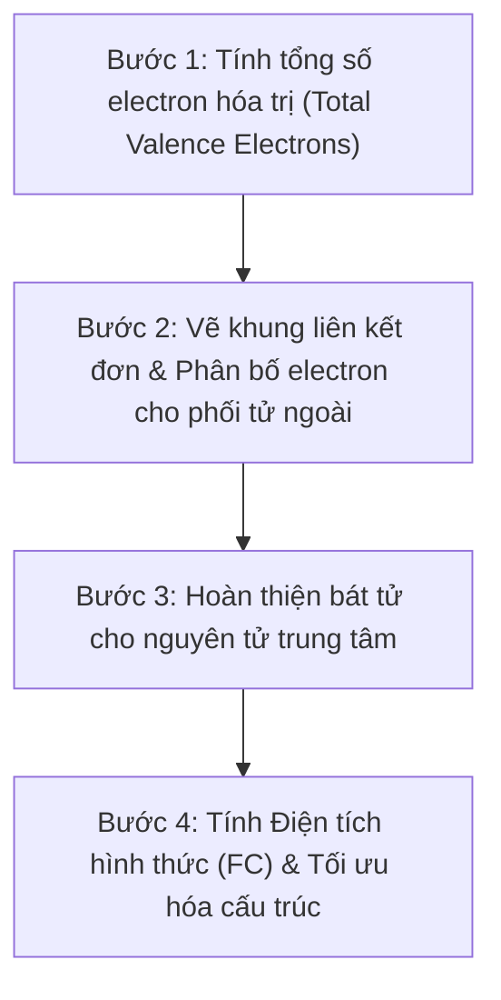
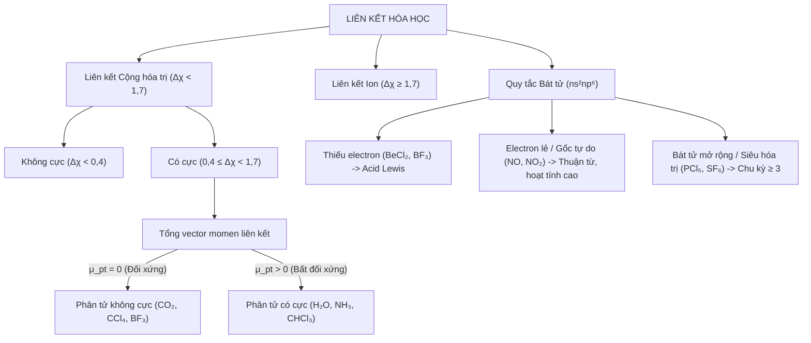

# Chương 1: Đại cương Liên kết Hóa học, Thuyết Lewis & Quy tắc Bát tử

---

## 1. Tổng quan chương (Chapter Overview) {T-01.1}

### 1.1 Tên chương, giới thiệu & phạm vi kiến thức {T-01.1.1}
[ADDED: structural frame]
Chương 1 mở đầu cho toàn bộ học trình Hóa vô cơ Dược bằng việc hệ thống hóa bản chất của liên kết hóa học – lực tương tác cơ bản gắn kết các nguyên tử tạo nên phân tử và tinh thể hợp chất thuốc. Nội dung chương tập trung vào hai trụ cột chính: (1) Các đại lượng vật lý đặc trưng cho liên kết (năng lượng liên kết, độ dài liên kết, góc liên kết và momen lưỡng cực); và (2) Thuyết biểu diễn liên kết kinh điển của Gilbert N. Lewis, công thức tính điện tích hình thức (Formal Charge), hiện tượng giải tỏa electron qua các cấu trúc cộng hưởng, cùng ba nhóm ngoại lệ quan trọng của quy tắc bát tử.

Phạm vi kiến thức giới hạn trong khuôn khổ hóa học cấu tạo đại cương ứng dụng cho sinh viên Dược năm 1–2, làm cơ sở giải thích độ bền hóa học, độ phân cực, tính tan trong nước/lipid và khả năng tương tác bước đầu của các phân tử vô cơ cũng như dược chất tại các thụ thể sinh học.

### 1.2 Kiến thức tiên quyết & Thời lượng học tập dự kiến {T-01.1.2}
[ADDED: study rule estimate]
- **Kiến thức tiên quyết:** Sinh viên cần nắm vững cấu hình electron nguyên tử, quy tắc Hund, nguyên lý Pauli, vị trí các nguyên tố nhóm A trong bảng hệ thống tuần hoàn và khái niệm cơ bản về độ âm điện.
- **Thời lượng học tập dự kiến:** 1,5 giờ học tập cá nhân (bao gồm 60 phút nghiên cứu lý thuyết nền tảng và 30 phút tự lượng giá, giải quyết bài tập định lượng tại Mục 7).

---

## 2. Mục tiêu học tập (Learning Objectives) {T-01.2}

### 2.1 Chuẩn đầu ra về Kiến thức, Kỹ năng và Năng lực vận dụng {T-01.2.1}
[ADDED: learning objectives]
Sau khi hoàn thành chương này, sinh viên có khả năng:
1. **LO-1 (Kiến thức):** Định nghĩa chính xác và phân tích mối liên hệ tương quan giữa năng lượng liên kết ($E_{lk}$), độ dài liên kết ($r$), góc liên kết ($\theta$) và bậc liên kết; phát biểu nội dung quy tắc bát tử ($ns^2np^6$) và đặc điểm của 3 nhóm ngoại lệ bát tử.
2. **LO-2 (Thông hiểu):** Vận dụng hiệu độ âm điện theo thang Pauling ($\Delta\chi$) và tổng vector momen lưỡng cực ($\vec{\mu}_{pt}$) để phân biệt bản chất liên kết (cộng hóa trị không cực, có cực, ion) và dự đoán tính phân cực của phân tử.
3. **LO-3 (Kỹ năng):** Áp dụng thành thạo quy trình 4 bước thiết lập công thức Lewis; tính toán chính xác điện tích hình thức ($FC$) cho từng nguyên tử và lựa chọn cấu trúc cộng hưởng ưu thế nhất.
4. **LO-4 (Vận dụng & Phân tích):** Phân tích được nguyên nhân tồn tại của các hợp chất thiếu electron, gốc tự do và hợp chất siêu hóa trị (bát tử mở rộng); liên hệ được tính phân cực và cấu tạo phân tử nitric oxide ($NO$) với vai trò sinh học trong Dược học.

---

## 3. Đặt vấn đề & Ý nghĩa thực tiễn (Introduction) {T-01.3}

### 3.1 Vai trò của liên kết hóa học trong thiết kế và tác dụng của dược chất {T-01.3.1}
[ADDED: pedagogical context]
Mỗi phân tử dược chất vô cơ hay hữu cơ khi đưa vào cơ thể đều hoạt động trong môi trường dịch thể phân cực (dung dịch nước) và tiếp xúc với các đại phân tử sinh học phức tạp (protein, enzyme, receptor, acid nucleic). Hiệu quả điều trị, độ bền phân tử, tốc độ chuyển hóa và độc tính của thuốc đều bắt nguồn từ cấu trúc liên kết nội phân tử.

Hiểu rõ liên kết hóa học cho phép dược sĩ giải thích tại sao một hoạt chất có độ bền nhiệt cao hay thấp (thông qua năng lượng liên kết), tại sao một phân tử thuốc có thể dễ dàng đi qua màng tế bào phospholipid hay chỉ phân bố ở dịch ngoại bào (thông qua momen lưỡng cực và độ phân cực), và làm thế nào các chất có phân bố điện tích đặc thù hoặc có cấu trúc gốc tự do (như $NO$) có thể tham gia vào các quá trình truyền tin sinh hóa phức tạp. Thuyết Lewis và quy tắc bát tử chính là ngôn ngữ mô tả cấu trúc phân tử căn bản nhất giúp kết nối bản chất hóa học với tác động sinh học.

---

## 4. Nội dung bài giảng chính (Main Content) {T-01.4}

### 4.1 Các đại lượng đặc trưng của liên kết hóa học {T-01.4.1}

Năng lượng liên kết, độ dài liên kết và bậc liên kết là bộ ba thông số nhiệt động - hình học phản ánh trực tiếp độ bền và bản chất của liên kết giữa hai nguyên tử.

#### 4.1.1 Năng lượng liên kết ($E_{lk}$) và độ bền phân tử
Năng lượng liên kết ($E_{lk}$) được định nghĩa là năng lượng cần cung cấp để bẻ gãy 1 mol liên kết xác định ở trạng thái khí thành các nguyên tử cô lập ở trạng thái cơ bản, đơn vị đo tiêu chuẩn là $\text{kJ/mol}$. 

[ADDED: thermodynamics definition] 
Năng lượng liên kết luôn mang giá trị dương ($E_{lk} > 0$), và giá trị $E_{lk}$ càng lớn chứng tỏ liên kết càng bền vững, phân tử càng có độ ổn định nhiệt động học cao.

#### 4.1.2 Độ dài liên kết ($r$) và mối quan hệ với bậc liên kết
Độ dài liên kết ($r$ hoặc $r_{lk}$) là khoảng cách cân bằng giữa hai tâm hạt nhân của hai nguyên tử tham gia liên kết trực tiếp, tại đó thế năng tương tác tĩnh điện đạt giá trị cực tiểu. Đơn vị đo hệ SI chuẩn là picomet ($\text{pm}$) hoặc angstrom ($\text{Å}$), với hệ số chuyển đổi $1\text{ Å} = 100\text{ pm} = 10^{-10}\text{ m}$.

[ADDED: bond order concept]
Bậc liên kết biểu thị số lượng cặp electron liên kết được chia sẻ giữa hai nguyên tử (liên kết đơn có bậc 1, liên kết đôi có bậc 2, liên kết ba có bậc 3). Bậc liên kết càng lớn thì lực hút tĩnh điện giữa các hạt nhân với vùng mật độ electron chung càng mạnh, kéo hai hạt nhân lại gần nhau hơn, làm độ dài liên kết co ngắn lại và năng lượng liên kết tăng lên rõ rệt.

#### 4.1.3 Mối quan hệ thực nghiệm giữa bậc liên kết, độ dài và năng lượng
Khảo sát thực nghiệm trên chuỗi liên kết giữa hai nguyên tử Carbon minh họa rõ ràng quy luật tỷ lệ nghịch giữa độ dài và độ bền:
- [VERIFY: handbook value] Về năng lượng liên kết:
  $$E_{lk}(C \equiv C) > E_{lk}(C = C) > E_{lk}(C - C) \quad (839 > 614 > 348 \text{ kJ/mol})$$
- [VERIFY: bond length data] Về độ dài liên kết:
  $$r(C - C) \approx 154\text{ pm } (1,54\text{ Å}) > r(C = C) \approx 134\text{ pm } (1,34\text{ Å}) > r(C \equiv C) \approx 120\text{ pm } (1,20\text{ Å})$$

Quy luật tổng quát: **Bậc liên kết tăng $\rightarrow$ Độ dài liên kết giảm $\rightarrow$ Năng lượng liên kết tăng $\rightarrow$ Độ bền phân tử tăng.**

---

### 4.2 Góc liên kết, Momen lưỡng cực & Độ phân cực phân tử {T-01.4.2}

#### 4.2.1 Góc liên kết ($\theta$)
Góc liên kết ($\theta$) là góc tạo bởi hai trục liên kết hóa học xuất phát từ cùng một nguyên tử trung tâm, được đo bằng độ ($^\circ$). Góc liên kết cùng với độ dài liên kết quy định cấu trúc hình học không gian 3 chiều của phân tử, chi phối khả năng khớp nối không gian (steric fit) giữa dược chất và thụ thể thuốc.

#### 4.2.2 Momen lưỡng cực liên kết và quy tắc cộng vector
Momen lưỡng cực liên kết ($\vec{\mu}_{lk}$) đặc trưng cho mức độ bất đối xứng trong phân bố điện tích giữa hai nguyên tử có độ âm điện khác nhau. Về mặt toán học, momen lưỡng cực được xác định bởi biểu thức:
$$\vec{\mu} = q \cdot \vec{d}$$
Trong đó:
- $q$: Độ lớn điện tích hữu hiệu phân tách tại các cực ($C$, Coulomb).
- $\vec{d}$: Vector khoảng cách giữa hai trọng tâm điện tích âm và dương ($m$, mét), chiều quy ước hướng từ cực dương sang cực âm (hoặc ngược lại tùy quy ước lý thuyết).
- Đơn vị đo: Hệ SI là $\text{C}\cdot\text{m}$. Trong thực hành hóa học, đơn vị truyền thống thường dùng là Debye ($\text{D}$), với [VERIFY: SI constant] $1\text{ D} = 3,336 \times 10^{-30}\text{ C}\cdot\text{m}$.

#### 4.2.3 Momen lưỡng cực toàn phân tử ($\vec{\mu}_{pt}$) và tiêu chuẩn phân cực
Momen lưỡng cực toàn phân tử ($\vec{\mu}_{pt}$) là tổng vector của tất cả các momen liên kết thành phần và các momen của các cặp electron tự do trong phân tử:
$$\vec{\mu}_{pt} = \sum \vec{\mu}_i$$

Dựa vào giá trị $\vec{\mu}_{pt}$, phân tử được phân thành hai nhóm:
1. **Phân tử không cực ($\mu_{pt} = 0$):** Xảy ra khi các liên kết trong phân tử không phân cực, HOẶC phân tử chứa các liên kết phân cực mạnh nhưng có cấu trúc hình học đối xứng cao khiến các vector momen liên kết triệt tiêu nhau hoàn toàn.
   - *Ví dụ:* $CO_2$ (đường thẳng), $BF_3$ (tam giác phẳng), $CCl_4$ (tứ diện đều), $SF_6$ (bát diện đều).
2. **Phân tử có cực ($\mu_{pt} > 0$):** Xảy ra khi phân tử có cấu trúc bất đối xứng hoặc dạng hình học không cho phép các vector liên kết triệt tiêu nhau.
   - *Ví dụ:* $H_2O$ (góc gấp khúc, $\mu \approx 1,85\text{ D}$), $NH_3$ (hình chóp tam giác, $\mu \approx 1,47\text{ D}$), $CHCl_3$ (tứ diện biến dạng).

---

### 4.3 Bản chất liên kết & Hiệu độ âm điện Pauling {T-01.4.3}

Độ âm điện ($\chi$) là đại lượng đặc trưng cho khả năng hút electron liên kết về phía nguyên tử khi hình thành phân tử. Dựa trên thang độ âm điện thực nghiệm của Linus Pauling, hiệu độ âm điện giữa hai nguyên tử ($\Delta\chi = |\chi_A - \chi_B|$) cung cấp tiêu chí quy ước để phân định bản chất liên kết:

| Khoảng $\Delta\chi$ | Phân loại liên kết | Bản chất tương tác | Ví dụ điển hình |
|---|---|---|---|
| $\Delta\chi < 0,4$ | Cộng hóa trị không cực | Cặp electron dùng chung phân bố đều giữa 2 nguyên tử | $H_2$, $Cl_2$, liên kết $C-H$ ($\Delta\chi = 0,35$) |
| $0,4 \le \Delta\chi < 1,7$ | Cộng hóa trị có cực | Cặp electron dùng chung lệch về phía nguyên tử có $\chi$ lớn hơn | $H-Cl$ ($\Delta\chi = 0,96$), liên kết $C-O$ ($\Delta\chi = 0,89$) |
| $\Delta\chi \ge 1,7$ | Liên kết ion | Chuyển dịch electron hoàn toàn; tương tác hút tĩnh điện đa hướng, không bão hòa | $NaCl$ ($\Delta\chi = 2,23$), $KBr$ |

> [!NOTE]
> [VERIFY: Pauling scale convention] Ranh giới $\Delta\chi = 0,4$ và $1,7$ là quy ước thực nghiệm tương đối. Nhiều liên kết có tính chất trung gian (tính cộng hóa trị có một phần đặc tính ion và ngược lại).

---

### 4.4 Thuyết Lewis & Điện tích hình thức (Formal Charge) {T-01.4.4}

#### 4.4.1 Quy tắc Bát tử (Octet Rule)
Năm 1916, Gilbert N. Lewis đề xuất mô hình liên kết cộng hóa trị dựa trên nguyên lý: Các nguyên tử có xu hướng góp chung, nhường hoặc nhận electron hóa trị trong phản ứng hóa học để đạt được cấu hình vỏ electron bền vững giống khí hiếm liền kề, tức có 8 electron lớp ngoài cùng dạng $ns^2np^6$ (hoặc 2 electron $1s^2$ như khí Helium).

#### 4.4.2 Định nghĩa và công thức tính Điện tích hình thức ($FC$)
Điện tích hình thức ($FC$ - Formal Charge) là điện tích giả định gán cho một nguyên tử trong công thức Lewis, dựa trên giả thiết rằng tất cả các electron liên kết được chia đều tuyệt đối cho hai nguyên tử tham gia liên kết (bỏ qua sự chênh lệch độ âm điện).

Công thức chuẩn:
$$FC = V - N - \frac{B}{2}$$
Trong đó:
- $V$: Số electron hóa trị của nguyên tử tự do (bằng số thứ tự nhóm A trong bảng tuần hoàn).
- $N$: Số electron tự do không liên kết (Lone pair electrons, tính theo từng electron: $N = 2 \times \text{số cặp electron đơn độc}$).
- $B$: Số electron tham gia tạo liên kết xung quanh nguyên tử ($B = 2 \times \text{số liên kết}$, kể cả liên kết đơn, đôi, ba).

#### 4.4.3 Tiêu chuẩn cấu trúc Lewis bền vững tối ưu
Khi có nhiều công thức Lewis khả dĩ cho một phân tử hoặc ion, việc lựa chọn cấu trúc ưu thế nhất dựa trên 3 tiêu chuẩn định lượng:
1. **Tuân thủ bát tử:** Các nguyên tử (đặc biệt là nguyên tố chu kỳ 2 như C, N, O, F) phải thỏa mãn quy tắc bát tử nếu có thể.
2. **Bảo toàn điện tích:** Tổng đại số điện tích hình thức của tất cả các nguyên tử trong cấu trúc phải bằng đúng điện tích thực của phân tử hay ion:
   $$\sum FC = q_{phân\ tử}$$
3. **Cực tiểu hóa điện tích hình thức:** Cấu trúc bền vững nhất là cấu trúc có:
   - Các giá trị $|FC|$ của từng nguyên tử càng gần 0 càng tốt (tổng $\sum |FC|$ nhỏ nhất).
   - Sự phân tách điện tích là tối thiểu.
   - Nếu bắt buộc xuất hiện điện tích âm ($FC < 0$), điện tích âm phải ưu tiên định vị trên nguyên tử có độ âm điện lớn hơn. Hai nguyên tử liền kề không nên mang cùng dấu điện tích hình thức.

---

### 4.5 Cấu trúc cộng hưởng (Resonance Structures) {T-01.4.5}

Trong nhiều trường hợp, một công thức Lewis đơn lẻ không thể phản ánh chính xác cấu trúc thực tế và các tính chất hóa lý của phân tử hoặc ion đa nguyên tử. Khi đó, cấu trúc thực của phân tử được mô tả như một **cấu trúc cộng hưởng lai (resonance hybrid)** tổng hợp từ nhiều cấu trúc Lewis tương đương (các cấu trúc thành phần).

#### 4.5.1 Bản chất của hiện tượng cộng hưởng
Cộng hưởng không phải là sự chuyển hóa qua lại giữa các phân tử thực tế, mà là sự giải tỏa (delocalization) của các electron liên kết $\pi$ và electron không liên kết trên một khung nguyên tử cố định. Hiện tượng giải tỏa electron làm giảm thế năng của hệ thống, giúp phân tử đạt trạng thái bền vững hơn so với bất kỳ cấu trúc Lewis đơn lẻ nào; năng lượng chênh lệch này được gọi là **năng lượng cộng hưởng (resonance energy)**.

#### 4.5.2 Phân tích các trường hợp kinh điển
- **Ion Carbonate ($CO_3^{2-}$):** Nếu mô tả bằng 1 công thức Lewis, $CO_3^{2-}$ sẽ có 1 liên kết đôi $C=O$ ngắn và 2 liên kết đơn $C-O$ dài. Tuy nhiên, thực nghiệm tinh thể học chứng minh cả 3 liên kết $C-O$ hoàn toàn tương đương nhau về mặt hình học:
  - [VERIFY: crystallographic data] Độ dài liên kết thực nghiệm: $r(C-O) = 128\text{ pm } (1,28\text{ Å})$ (nằm trung gian giữa liên kết đơn 143 pm và liên kết đôi 120 pm).
  - Bậc liên kết thực nghiệm: $1\frac{1}{3} \approx 1,33$.
  - Điện tích âm $-2$ được giải tỏa đều trên cả 3 nguyên tử Oxy (mỗi Oxy mang điện tích trung bình $-2/3$).
- **Ion Nitrate ($NO_3^-$):** Tương tự, ion $NO_3^-$ là tổ hợp lai của 3 cấu trúc cộng hưởng tương đương, với bậc liên kết $N-O$ là $1\frac{1}{3}$, độ dài các liên kết hoàn toàn đồng nhất.
- **Ion Sulfate ($SO_4^{2-}$):** Có thể biểu diễn dưới dạng cấu trúc đạt bát tử (với 4 liên kết đơn $S-O$, $S$ mang $FC = +2$) hoặc cấu trúc mở rộng bát tử (với 2 liên kết đôi $S=O$ và 2 liên kết đơn $S-O^-$ để triệt tiêu điện tích hình thức trên $S$, $FC(S) = 0$).
- **Phân tử Benzen ($C_6H_6$):** 6 liên kết $C-C$ trong vòng thơm hoàn toàn đồng nhất với bậc liên kết $1,5$, tạo nên độ bền nhân thơm đặc trưng.

---

### 4.6 Các ngoại lệ của Quy tắc Bát tử {T-01.4.6}

Mặc dù quy tắc bát tử giải thích thành công phần lớn các liên kết của các nguyên tố chu kỳ 2, có ba nhóm ngoại lệ quan trọng không tuân theo quy tắc 8 electron:

#### 4.6.1 Phân tử thiếu electron (Incomplete Octet / Electron-deficient Molecules)
Nguyên tử trung tâm thuộc chu kỳ 2 hoặc đầu chu kỳ 3 chỉ có ít hơn 8 electron hóa trị sau khi đã tạo liên kết. Điển hình là Beri ($Be$, có 4 electron hóa trị quanh nguyên tử trung tâm) và Bo, Nhôm ($B, Al$, có 6 electron hóa trị).
- *Ví dụ:* $BeCl_2$ ($Cl-Be-Cl$), $BF_3$, $AlCl_3$.
- *Đặc tính hóa học:* [VERIFY: Lewis acidity comparison] Do còn orbital hóa trị trống và chưa bão hòa bát tử, các phân tử này là những **Acid Lewis mạnh**, có ái lực cực mạnh với các cặp electron tự do, dễ dàng phản ứng phối trí với các Base Lewis (như $NH_3, H_2O$, ion halide) để hoàn thiện cấu hình 8 electron bền vững:
  $$BF_3 + :NH_3 \rightarrow F_3B \leftarrow NH_3$$

#### 4.6.2 Phân tử có số electron lẻ (Odd-Electron Molecules / Gốc tự do)
Là những phân tử có tổng số electron hóa trị của tất cả các nguyên tử cấu thành là một số lẻ. Do tổng lẻ, một electron bắt buộc phải tồn tại ở trạng thái độc thân (không ghép đôi), tạo thành một **gốc tự do (free radical)**.
- *Ví dụ:* [VERIFY: valence calculation] Nitric oxide ($NO$, tổng 11 electron hóa trị: $N(5) + O(6) = 11$), Nitrogen dioxide ($NO_2$, 17 electron), Chlorine dioxide ($ClO_2$, 19 electron).
- *Đặc tính hóa lý:* Do chứa electron độc thân, các phân tử này có **tính thuận từ** (bị hút bởi từ trường ngoài) và có hoạt tính hóa học cực kỳ cao, dễ tham gia các phản ứng dimer hóa hoặc phản ứng oxi hóa - khử gốc tự do.

#### 4.6.3 Bát tử mở rộng (Expanded Octet / Hợp chất Siêu hóa trị - Hypervalent)
Nguyên tử trung tâm liên kết với nhiều nguyên tử phối tử và có nhiều hơn 8 electron hóa trị ở lớp ngoài cùng (thường là 10, 12 hoặc 14 electron).
- *Điều kiện hình thành:* Chỉ xảy ra đối với các nguyên tố phi kim từ chu kỳ 3 trở đi trong bảng tuần hoàn (như $P, S, Cl, Br, I, Xe$). Các nguyên tố này có bán kính nguyên tử đủ lớn để tránh cản trở lập phương, đồng thời [VERIFY: modern bonding models] sở hữu các phân lớp orbital $d$ trống ($3d, 4d$) có mức năng lượng đủ gần để kích thích electron hóa trị tham gia lai hóa mở rộng vỏ liên kết. Các nguyên tố chu kỳ 2 ($C, N, O, F$) tuyệt đối không có khả năng mở rộng bát tử vì không có phân lớp $d$ ở lớp vỏ thứ 2 ($n=2$).
- *Ví dụ điển hình:*
  - $PCl_5$: Có 5 liên kết $P-Cl$, tương đương 10 electron quanh nguyên tử Phosphor.
  - $SF_6$: Có 6 liên kết $S-F$, tương đương 12 electron quanh nguyên tử Lưu huỳnh.
  - $H_2SO_4$: [VERIFY: formalism] Khi viết 2 liên kết đôi $S=O$ và 2 liên kết đơn $S-OH$, quanh nguyên tử Lưu huỳnh có 12 electron hóa trị (giúp đưa $FC(S)$ về 0).
  - $XeF_4$ (12 electron quanh Xe), $IF_7$ (14 electron quanh I).

---

### 4.7 Ý nghĩa và ứng dụng trong Dược học {T-01.4.7}

Kiến thức về các đại lượng liên kết, cấu trúc Lewis, điện tích hình thức và các ngoại lệ bát tử có ý nghĩa thực tiễn cốt lõi trong khoa học Dược:

#### 4.7.1 Độ phân cực, tính tan và phân bố sinh học của dược chất
Momen lưỡng cực toàn phân tử ($\vec{\mu}_{pt}$) quy định trực tiếp tính ưa nước (hydrophilic) hay ưa lipid (lipophilic) của hoạt chất:
- Các phân tử có $\mu_{pt} = 0$ hoặc giá trị rất bé (như các hydrocarbon, dẫn xuất halogen đối xứng) thường kém tan trong nước nhưng tan tốt trong dung môi hữu cơ và lipid màng tế bào.
- Các phân tử có $\mu_{pt} > 0$ và chứa các nhóm chức phân cực mạnh dễ hình thành liên kết hydro hoặc tương tác lưỡng cực - lưỡng cực với phân tử nước, quyết định độ hòa tan của thuốc trong dịch đường tiêu hóa và huyết tương.
- Việc kiểm soát điện tích hình thức giúp dược sĩ dự đoán được vị trí mang điện tích cục bộ trên phân tử thuốc, từ đó thiết kế các tương tác tĩnh điện đặc hiệu với trung tâm hoạt động của receptor protein.

#### 4.7.2 Phân tử Nitric Oxide ($NO$) trong truyền tín hiệu sinh học
[VERIFY: pharmacology reference needed] Trong dược lý học phân tử, **Nitric oxide ($NO$)** là một trong những phân tử truyền tin nội sinh quan trọng bậc nhất của hệ tim mạch:
- Bản chất cấu tạo của $NO$ là một phân tử có số electron lẻ (11 e) với một electron độc thân trên nguyên tử Nitơ. Nhờ kích thước siêu nhỏ, không tích điện và tính chất gốc tự do phân cực yếu, $NO$ có khả năng khuếch tán tức thì qua màng tế bào nội mô mạch máu vào các tế bào cơ trơn liền kề.
- Tại tế bào cơ trơn, $NO$ gắn vào nhóm heme của enzyme **Guanylyl Cyclase (sGC)**, kích hoạt enzyme này chuyển đổi GTP thành cGMP (cyclic guanosine monophosphate). Sự gia tăng nồng độ cGMP nội bào kích hoạt protein kinase G, làm giảm nồng độ canxi tự do trong cơ trơn, dẫn đến giãn cơ trơn thành mạch và hạ huyết áp động mạch. Đây là cơ chế nền tảng giải thích tác dụng của các thuốc giãn mạch kinh điển như Nitroglycerin trong điều trị cơn đau thắt ngực.

---

## 5. Ví dụ minh họa & Quy trình thực hành (Examples & Illustrations) {T-01.5}

### 5.1 Ví dụ tính toán chi tiết: Xác định điện tích hình thức của $CO_2$ và $NO_3^-$ {T-01.5.1}

#### Ví dụ 1: Tính điện tích hình thức cho phân tử Carbon dioxide ($CO_2$)
- **Given (Cho biết):** Phân tử $CO_2$ có cấu trúc $O=C=O$. Cấu hình electron nguyên tử: C thuộc nhóm IVA ($V=4$), O thuộc nhóm VIA ($V=6$).
- **Find (Yêu cầu):** Tính điện tích hình thức ($FC$) của nguyên tử C và các nguyên tử O; kiểm tra tính bền vững của cấu trúc.
- **Approach (Phương pháp):** Áp dụng công thức $FC = V - N - B/2$.
- **Solution (Các bước giải):**
  1. *Nguyên tử C trung tâm:* 
     - Không có electron tự do: $N = 0$.
     - Có 2 liên kết đôi, tổng cộng 4 liên kết: $B = 4 \times 2 = 8$ electron liên kết.
     $$FC(C) = 4 - 0 - \frac{8}{2} = 4 - 4 = 0$$
  2. *Mỗi nguyên tử O:*
     - Mỗi nguyên tử O có 2 cặp electron tự do: $N = 2 \times 2 = 4$ electron.
     - Tham gia 1 liên kết đôi: $B = 2 \times 2 = 4$ electron liên kết.
     $$FC(O) = 6 - 4 - \frac{4}{2} = 6 - 4 - 2 = 0$$
- **Check (Kiểm tra):**
  $$\sum FC = FC(C) + 2 \times FC(O) = 0 + 2(0) = 0$$
  Tổng điện tích hình thức bằng 0, hoàn toàn phù hợp với điện tích phân tử trung hòa.
- **Interpretation (Nhận định):** Tất cả các nguyên tử đều có $FC = 0$ và thỏa mãn bát tử, đây là cấu trúc Lewis bền vững tuyệt đối của $CO_2$.

#### Ví dụ 2: Tính điện tích hình thức cho ion Nitrate ($NO_3^-$)
- **Given (Cho biết):** Cấu trúc Lewis của ion $NO_3^-$ gồm nguyên tử N trung tâm liên kết với 1 nguyên tử O bằng liên kết đôi và 2 nguyên tử O bằng liên kết đơn. Nhóm tuần hoàn: N (nhóm VA, $V=5$), O (nhóm VIA, $V=6$).
- **Find (Yêu cầu):** Tính $FC$ cho nguyên tử N, nguyên tử O liên kết đôi ($O_{đôi}$) và hai nguyên tử O liên kết đơn ($O_{đơn}$).
- **Approach (Phương pháp):** Áp dụng công thức $FC = V - N - B/2$.
- **Solution (Các bước giải):**
  1. *Nguyên tử N:*
     - Đã dùng hết electron hóa trị tham gia liên kết, không còn electron tự do: $N = 0$.
     - Tham gia 1 liên kết đôi và 2 liên kết đơn (tổng 4 liên kết): $B = 4 \times 2 = 8$.
     $$FC(N) = 5 - 0 - \frac{8}{2} = 5 - 4 = +1$$
  2. *Nguyên tử $O_{đôi}$:*
     - Còn 2 cặp electron tự do: $N = 4$.
     - Tham gia 1 liên kết đôi: $B = 4$.
     $$FC(O_{đôi}) = 6 - 4 - \frac{4}{2} = 0$$
  3. *Mỗi nguyên tử $O_{đơn}$:*
     - Còn 3 cặp electron tự do: $N = 3 \times 2 = 6$.
     - Tham gia 1 liên kết đơn: $B = 2$.
     $$FC(O_{đơn}) = 6 - 6 - \frac{2}{2} = -1$$
- **Check (Kiểm tra):**
  $$\sum FC = FC(N) + FC(O_{đôi}) + 2 \times FC(O_{đơn}) = (+1) + 0 + (-1) + (-1) = -1$$
  Tổng điện tích hình thức bằng $-1$, hoàn toàn khớp với điện tích thực của anion $NO_3^-$.
- **Interpretation (Nhận định):** Các điện tích âm nằm trên các nguyên tử O (nguyên tử có độ âm điện lớn hơn so với N), thỏa mãn hoàn hảo tiêu chuẩn cấu trúc Lewis bền vững.

---

### 5.2 Các ví dụ minh họa ngoại lệ bát tử {T-01.5.2}
1. **Ví dụ hợp chất thiếu electron ($BF_3$):** Nguyên tử Bo (B) nhóm IIIA có 3 electron hóa trị, tạo 3 liên kết đơn với 3 nguyên tử Fluorine ($F$). Quanh B chỉ có 6 electron. Để bù đắp sự thiếu hụt này, $BF_3$ hoạt động như một chất nhận electron mạnh, dễ dàng tạo liên kết phối trí với phân tử Amoniac ($:NH_3$) tạo phức chất cộng $F_3B \leftarrow NH_3$, trong đó cả B và N đều đạt cấu hình bát tử hoàn chỉnh.
2. **Ví dụ hợp chất siêu hóa trị ($PCl_5$ và $SF_6$):**
   - $PCl_5$: Nguyên tử Phosphor chu kỳ 3 kích thích electron từ phân lớp $3s$ lên phân lớp $3d$ trống, hình thành 5 liên kết cộng hóa trị với 5 nguyên tử Clo. Vỏ hóa trị của P mở rộng chứa 10 electron.
   - $SF_6$: Nguyên tử Lưu huỳnh kích thích đồng thời 2 electron lên phân lớp $3d$, tạo 6 liên kết cộng hóa trị hướng về 6 đỉnh của một hình bát diện đều, chứa 12 electron quanh S.
3. **Ví dụ gốc tự do Nitric Oxide ($NO$):** Tổng electron hóa trị là 11. Cấu trúc Lewis tối ưu được biểu diễn với một liên kết đôi $N=O$ và một liên kết ba bán phần, trong đó electron độc thân định vị chủ yếu trên nguyên tử Nitơ (do N có độ âm điện nhỏ hơn O).

---

### 5.3 Quy trình chuẩn 4 bước thiết lập công thức Lewis tối ưu {T-01.5.3}

Để thiết lập chính xác công thức Lewis cho một phân tử hay ion bất kỳ, sinh viên áp dụng quy trình thuật toán 4 bước sau:

1. **Bước 1 — Tính tổng số electron hóa trị của hệ ($e_{tổng}$):**
   - Cộng tổng số electron hóa trị $V$ của tất cả các nguyên tử trong phân tử.
   - Đối với anion (ion âm): Cộng thêm số electron bằng độ lớn điện tích âm ($e_{tổng} = \sum V + |q_{-}|$).
   - Đối với cation (ion dương): Trừ bớt số electron bằng độ lớn điện tích dương ($e_{tổng} = \sum V - q_{+}$).
2. **Bước 2 — Vẽ khung liên kết và rải electron:**
   - Chọn nguyên tử có độ âm điện nhỏ nhất (trừ Hydro luôn ở vị trí ngoài) làm nguyên tử trung tâm.
   - Nối các nguyên tử biên với nguyên tử trung tâm bằng các liên kết đơn (mỗi liên kết đơn tiêu tốn 2 electron).
   - Rải các electron còn lại thành các cặp electron tự do ($N$) cho các nguyên tử biên có độ âm điện lớn hơn trước để chúng đạt bát tử hoàn chỉnh (riêng H chỉ cần 2 e).
3. **Bước 3 — Kiểm tra và hoàn thiện bát tử cho nguyên tử trung tâm:**
   - Đặt các electron còn dư (nếu có) lên nguyên tử trung tâm.
   - Nếu nguyên tử trung tâm vẫn chưa đạt bát tử (có ít hơn 8 electron), hãy chuyển đổi một hoặc nhiều cặp electron tự do của các nguyên tử biên thành liên kết đôi hoặc liên kết ba giữa nguyên tử biên và nguyên tử trung tâm.
4. **Bước 4 — Tính điện tích hình thức ($FC$) và chọn cấu trúc tối ưu:**
   - Áp dụng công thức $FC = V - N - B/2$ cho từng nguyên tử trong cấu trúc.
   - Kiểm tra điều kiện bảo toàn: $\sum FC = q$.
   - Nếu có nhiều cách tạo liên kết đôi/ba (nhất là với các nguyên tố chu kỳ 3 trở đi), ưu tiên cấu trúc có $\sum |FC|$ nhỏ nhất và điện tích âm định vị trên nguyên tử có độ âm điện lớn hơn.

---

### 5.4 Sơ đồ hệ thống hóa các dạng liên kết hóa học {T-01.5.4}
[ADDED: diagram]
Sơ đồ quan hệ phân loại bản chất liên kết và các nhóm ngoại lệ bát tử:

---

## 6. Tóm tắt chương (Chapter Summary) {T-01.6}

### 6.1 Bảng đối chiếu các đại lượng đặc trưng và 3 nhóm ngoại lệ {T-01.6.1}
[ADDED: summary]

| Nội dung trọng tâm | Bản chất khoa học | Điểm cần ghi nhớ | Ý nghĩa Dược học |
|---|---|---|---|
| **Năng lượng liên kết ($E_{lk}$)** | Năng lượng bẻ gãy 1 mol liên kết ($kJ/mol$) | Bậc liên kết tăng $\rightarrow E_{lk}$ tăng | Độ bền nhiệt và độ ổn định bảo quản của thuốc |
| **Độ dài liên kết ($r$)** | Khoảng cách cân bằng giữa 2 hạt nhân ($pm, Å$) | Bậc liên kết tăng $\rightarrow r$ giảm | Kích thước không gian và khả năng tiếp cận receptor |
| **Momen lưỡng cực ($\vec{\mu}_{pt}$)** | Tổng vector momen lưỡng cực các liên kết | Phụ thuộc độ âm điện và hình học đối xứng | Quyết định tính tan (dịch thể vs. lipid màng) |
| **Điện tích hình thức ($FC$)** | Điện tích giả định chia đều electron ($FC = V - N - B/2$) | Cấu trúc bền có $\|FC\|$ nhỏ nhất | Nhận diện trung tâm ái nhân / ái điện tử |
| **Cấu trúc cộng hưởng** | Sự giải tỏa electron $\pi$ trên khung nguyên tử | Làm tăng độ bền phân tử | Tạo độ bền thơm và phân bố điện tích ion thuốc |
| **Ngoại lệ: Thiếu electron** | Nguyên tử trung tâm có $<8$ electron ($Be, B, Al$) | Đóng vai trò là Acid Lewis mạnh | Tạo phức phối trí với các phối tử sinh học |
| **Ngoại lệ: Electron lẻ** | Chứa electron độc thân ($NO, NO_2$) | Thuận từ, hoạt tính gốc tự do rất mạnh | Chất truyền tin giãn mạch máu ($NO$) |
| **Ngoại lệ: Mở rộng bát tử** | Có $>8$ electron hóa trị (nguyên tố chu kỳ $\ge 3$) | Nhờ bán kính lớn và phân lớp $d$ trống | Giải thích cấu tạo các acid vô cơ ($H_2SO_4, H_3PO_4$) |

### 6.2 Hệ thống công thức, đơn vị và quy tắc then chốt {T-01.6.2}
[ADDED: formula sheet]
1. **Công thức momen lưỡng cực:**
   $$\vec{\mu} = q \cdot \vec{d} \quad (1\text{ D} = 3,336 \times 10^{-30}\text{ C}\cdot\text{m})$$
2. **Tổng vector momen lưỡng cực phân tử:**
   $$\vec{\mu}_{pt} = \sum \vec{\mu}_i$$
3. **Công thức tính điện tích hình thức:**
   $$FC = V - N - \frac{B}{2}$$
4. **Quy tắc bảo toàn điện tích hình thức:**
   $$\sum FC = q_{phân\ tử}$$

---

## 7. Đánh giá & Bài tập tự lượng giá (Review & Assessment) {T-01.7}

[ADDED: assessment questions]

### 7.1 Câu hỏi nhận biết và thông hiểu (LO-1, LO-2) {T-01.7.1}

**Câu 1 (Nhận biết - LO-1):** Khi so sánh các liên kết giữa hai nguyên tử Carbon trong các phân tử ethane ($C_2H_6$), ethylene ($C_2H_4$) và acetylene ($C_2H_2$), nhận định nào sau đây là **đúng**?
A. Liên kết $C \equiv C$ có độ dài lớn nhất và năng lượng liên kết nhỏ nhất.  
B. Liên kết $C - C$ có độ dài ngắn nhất và năng lượng liên kết lớn nhất.  
C. Liên kết $C \equiv C$ có độ dài ngắn nhất và năng lượng liên kết lớn nhất.  
D. Cả ba liên kết có độ dài và năng lượng tương đương nhau.

**Câu 2 (Nhận biết - LO-1):** Cặp phân tử nào sau đây đều thuộc nhóm ngoại lệ quy tắc bát tử do **thiếu electron** ở nguyên tử trung tâm?
A. $PCl_5$ và $SF_6$  
B. $BeCl_2$ và $BF_3$  
C. $NO$ và $NO_2$  
D. $CH_4$ và $NH_3$

**Câu 3 (Thông hiểu - LO-2):** Phân tử Carbon tetrachloride ($CCl_4$) chứa 4 liên kết $C-Cl$ phân cực mạnh ($\Delta\chi = 3,16 - 2,55 = 0,61$). Tuy nhiên, $CCl_4$ lại là một dung môi không phân cực ($\mu_{pt} = 0$). Nguyên nhân là do:
A. Độ dài các liên kết $C-Cl$ quá ngắn khiến điện tích không phân tách được.  
B. Các liên kết $C-Cl$ bị ion hóa hoàn toàn.  
C. Phân tử có cấu trúc hình học tứ diện đều đối xứng, các vector momen liên kết triệt tiêu nhau hoàn toàn.  
D. Nguyên tử Carbon trung tâm không có cặp electron tự do.

**Câu 4 (Thông hiểu - LO-2):** Cho độ âm điện của $H$ là 2,20; $Cl$ là 3,16; $Na$ là 0,93; $C$ là 2,55. Hãy xếp các liên kết sau theo thứ tự **tăng dần tính phân cực**: $C-H$, $H-Cl$, $Na-Cl$.
A. $Na-Cl < H-Cl < C-H$  
B. $C-H < H-Cl < Na-Cl$  
C. $H-Cl < C-H < Na-Cl$  
D. $C-H < Na-Cl < H-Cl$

---

### 7.2 Bài tập áp dụng tính toán điện tích hình thức & độ phân cực (LO-3) {T-01.7.2}

**Bài tập 5 (Áp dụng - LO-3):** 
Xác định điện tích hình thức ($FC$) của từng nguyên tử trong ion Ozone ($O_3$) với cấu trúc góc: $O_{(1)} = O_{(2)} - O_{(3)}$ (trong đó $O_{(2)}$ là nguyên tử trung tâm liên kết đôi với $O_{(1)}$ và liên kết đơn với $O_{(3)}$). Kiểm tra tổng đại số điện tích hình thức.

**Bài tập 6 (Áp dụng - LO-3):** 
Đối với anion Tetrafluoroborate ($BF_4^-$), hãy:
a) Vẽ cấu trúc Lewis của ion.  
b) Tính điện tích hình thức của nguyên tử Bo và các nguyên tử Fluorine.  
c) Nhận xét về quy tắc bát tử xung quanh nguyên tử Bo trong phức chất này so với phân tử $BF_3$ tự do.

---

### 7.3 Câu hỏi phân tích, ngoại lệ và liên hệ dược lý học (LO-4) {T-01.7.3}

**Câu 7 (Phân tích - LO-4):** 
Phosphor và Nitơ cùng thuộc nhóm VA trong bảng tuần hoàn. Tại sao phân tử $PCl_5$ tồn tại bền vững ở điều kiện thường, trong khi phân tử tương ứng $NCl_5$ hoàn toàn không thể tổng hợp được? Giải thích dựa trên cấu trúc vỏ electron nguyên tử.

**Câu 8 (Vận dụng nâng cao - LO-4):** 
Khí Nitric oxide ($NO$) là một chất truyền tin quan trọng trong hệ tuần hoàn.
a) Dựa trên cấu tạo electron hóa trị, hãy giải thích tại sao $NO$ có tính thuận từ và có thời gian bán thải sinh học ($t_{1/2}$) rất ngắn trong huyết tương (chỉ vài giây).  
b) Vì sao đặc tính không tích điện và kích thước phân tử nhỏ của $NO$ lại có ý nghĩa quyết định đối với cơ chế tác động dược lý của nó?

---

### 7.4 Hướng dẫn giải chi tiết và biểu điểm đánh giá {T-01.7.4}

#### Đáp án phần trắc nghiệm
- **Câu 1: C.** (Bậc liên kết 3 có $E_{lk} = 839\text{ kJ/mol}$ cao nhất và độ dài $120\text{ pm}$ ngắn nhất).
- **Câu 2: B.** ($BeCl_2$ có 4 e quanh Be, $BF_3$ có 6 e quanh B; nhóm A là mở rộng bát tử; nhóm C là electron lẻ).
- **Câu 3: C.** (Cấu trúc tứ diện đều đối xứng hoàn hảo khiến $\sum \vec{\mu}_i = \vec{0}$).
- **Câu 4: B.** ($\Delta\chi(C-H) = 0,35 < \Delta\chi(H-Cl) = 0,96 < \Delta\chi(Na-Cl) = 2,23$).

#### Lời giải chi tiết phần bài tập
- **Bài tập 5 ($O_3$):**
  - Nguyên tử Oxy nhóm VIA có $V = 6$.
  - Nguyên tử $O_{(1)}$ (liên kết đôi): có 2 cặp e tự do ($N = 4$), tham gia 1 liên kết đôi ($B = 4$):
    $$FC(O_{(1)}) = 6 - 4 - \frac{4}{2} = 0$$
  - Nguyên tử $O_{(2)}$ (trung tâm): có 1 cặp e tự do ($N = 2$), tham gia 1 liên kết đôi và 1 liên kết đơn ($B = 6$):
    $$FC(O_{(2)}) = 6 - 2 - \frac{6}{2} = +1$$
  - Nguyên tử $O_{(3)}$ (liên kết đơn): có 3 cặp e tự do ($N = 6$), tham gia 1 liên kết đơn ($B = 2$):
    $$FC(O_{(3)}) = 6 - 6 - \frac{2}{2} = -1$$
  - Tổng điện tích: $\sum FC = 0 + (+1) + (-1) = 0$, khớp với phân tử $O_3$ trung hòa.

- **Bài tập 6 ($BF_4^-$):**
  - a) Tổng e hóa trị: $B(3) + 4 \times F(7) + 1 (e\text{ âm}) = 3 + 28 + 1 = 32$ electron. Khung gồm B ở tâm nối với 4 nguyên tử F bằng 4 liên kết đơn, mỗi F mang 3 cặp electron tự do.
  - b) Tính $FC$:
    - Nguyên tử Bo: $V = 3, N = 0, B = 8 \Rightarrow FC(B) = 3 - 0 - \frac{8}{2} = -1$.
    - Mỗi nguyên tử Fluorine: $V = 7, N = 6, B = 2 \Rightarrow FC(F) = 7 - 6 - \frac{2}{2} = 0$.
    - Tổng: $\sum FC = (-1) + 4(0) = -1$, đúng điện tích anion.
  - c) Nhận xét: Trong $BF_3$, Bo chỉ có 6 electron (thiếu bát tử). Khi nhận thêm ion $F^-$ bằng liên kết phối trí để tạo $BF_4^-$, lớp vỏ ngoài của Bo đã đạt đủ 8 electron bát tử bền vững.

- **Câu 7 (Phân tích $PCl_5$ vs $NCl_5$):**
  - Nitơ thuộc chu kỳ 2, cấu hình vỏ ngoài là $2s^2 2p^3$, không có phân lớp $2d$. Số orbital hóa trị tối đa chỉ là 4 (một $2s$ và ba $2p$), do đó Nitơ chỉ có thể tạo tối đa 4 liên kết cộng hóa trị, không thể mở rộng vỏ chứa 10 electron để tạo $NCl_5$.
  - Phosphor thuộc chu kỳ 3, cấu hình vỏ ngoài là $3s^2 3p^3 3d^0$. P có phân lớp $3d$ trống có năng lượng gần kề, cho phép kích thích electron tạo 5 electron độc thân và lai hóa mở rộng vỏ hóa trị chứa 10 electron, hình thành phân tử lưỡng tháp tam giác $PCl_5$ bền vững.

- **Câu 8 ($NO$ trong sinh học):**
  - a) $NO$ có tổng 11 electron hóa trị, mang một electron độc thân trên orbital phản liên kết $\pi^*$. Do có electron không ghép đôi, phân tử có tính thuận từ. Tính chất gốc tự do này làm cho $NO$ có hoạt tính phản ứng cực cao, dễ dàng bị oxy hóa bởi oxy phân tử, superoxide hoặc các gốc tự do khác trong huyết tương, dẫn đến $t_{1/2}$ rất ngắn (1–5 giây).
  - b) Phân tử $NO$ rất nhỏ gọn và không tích điện hình thức lớn, giúp nó không bị cản trở bởi lực đẩy tĩnh điện của đầu ưa nước phospholipid màng, dễ dàng khuếch tán thụ động tự do qua màng tế bào nội mô để tiếp cận trực tiếp trung tâm enzyme nội bào Guanylyl Cyclase ở lớp cơ trơn mạch máu lân cận.

---

## 8. Tài liệu tham khảo (References) {T-01.8}

### 8.1 Danh mục tài liệu tham khảo & Ghi chú học thuật {T-01.8.1}
[ADDED / VERIFY: references needed]

*Ghi chú về nguồn gốc học thuật (tuân thủ Nguyên tắc Liêm chính R4):* Bản thảo gốc `ch01_doc-hvc-1.html` không chứa bất kỳ danh mục tài liệu tham khảo nào. Danh mục dưới đây đề xuất các giáo trình đại học chuẩn mực của ngành Dược để đối soát và thẩm định nội dung:

1. [VERIFY: reference needed] Bộ Y tế Việt Nam. *Hóa vô cơ Dược* (Giáo trình đào tạo Dược sĩ Đại học). NXB Y học, Hà Nội.
2. [VERIFY: reference needed] Miessler, G. L., Fischer, P. J., & Tarr, D. A. *Inorganic Chemistry* (5th ed.). Pearson. (Tham khảo chương Molecular Symmetry and Chemical Bonding).
3. [VERIFY: reference needed] Chang, R., & Goldsby, K. A. *Chemistry* (12th ed.). McGraw-Hill Education. (Tham khảo chương Chemical Bonding: Basic Concepts).
4. [VERIFY: reference needed] Rang, H. P., Ritter, J. M., Flower, R. J., & Henderson, G. *Rang & Dale's Pharmacology* (9th ed.). Elsevier. (Tham khảo cơ chế tác dụng sinh hóa của Nitric Oxide và enzym Guanylyl Cyclase).
