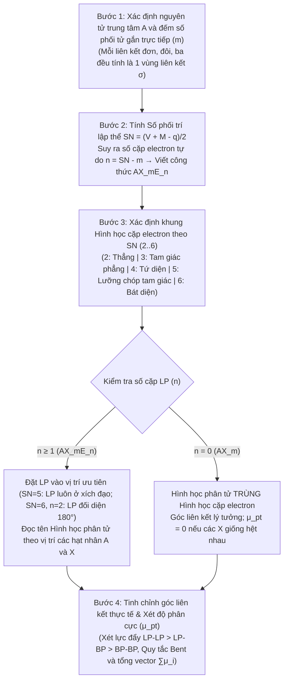

# Chương 2: Thuyết Đẩy Cặp Electron Vỏ Hóa Trị (VSEPR) & Cấu trúc Không gian Phân tử

---

## 1. Tổng quan chương (Chapter Overview) {T-02.1}

### 1.1 Chương 2: Thuyết Đẩy Cặp Electron Vỏ Hóa Trị (VSEPR) & Cấu trúc Không gian Phân tử {T-02.1.1}
[ADDED: structural frame]
Sau khi nắm vững bản chất của liên kết hóa học, công thức cấu tạo phẳng Lewis, điện tích hình thức ($FC$) và quy tắc bát tử ở Chương 1, Chương 2 chuyển sang giải quyết bài toán cốt lõi tiếp theo của Hóa học cấu tạo: **Xác định hình học không gian 3 chiều (3D) của phân tử và ion đa nguyên tử**. Công cụ lý thuyết trung tâm của chương là **Thuyết đẩy cặp electron vỏ hóa trị (Valence Shell Electron Pair Repulsion – VSEPR)** do Ronald Gillespie và Ronald Nyholm phát triển.

Nội dung chương được tổ chức theo trình tự logic từ nguyên lý đến ứng dụng: (1) Nguyên lý cực tiểu hóa lực đẩy tĩnh điện giữa các miền electron vỏ hóa trị và thứ tự độ lớn lực đẩy $\text{LP–LP} > \text{LP–BP} > \text{BP–BP}$; (2) Quy ước ký hiệu tổng quát $AX_mE_n$ và công thức đại số tính **Số phối trí lập thể (Steric Number – $SN$)**: $SN = m + n = \frac{V + M - q}{2}$; (3) Hệ thống phân loại toàn diện 13 kiểu hình học phân tử tương ứng với $SN$ từ $2$ đến $6$; (4) Sự bất đối xứng giữa vị trí trục (axial) và vị trí xích đạo (equatorial) trong khung lưỡng chóp tam giác ($SN = 5$) cùng **Quy tắc Bent** giải thích sự lệch góc liên kết thực tế do độ âm điện phối tử; và (5) Ứng dụng hình học VSEPR để đánh giá sự triệt tiêu momen lưỡng cực toàn phân tử ($\vec{\mu}_{pt}$), tính hòa tan và sự định hướng không gian của phân tử thuốc khi gắn kết vào đích tác dụng sinh học (enzyme/thụ thể).

### 1.2 Phạm vi, Kiến thức Tiên quyết & Thời lượng Học tập {T-02.1.2}
[ADDED: study time estimate]
- **Phạm vi kiến thức:** Chương học bao quát các phân tử cộng hóa trị và ion đa nguyên tử của các nguyên tố nhóm chính (có $SN = 2 \div 6$), đồng thời giới thiệu sơ bộ hình học không gian của một số ion phức chất điển hình để làm cầu nối sang học phần Hóa học Phối trí.
- **Kiến thức tiên quyết:** Sinh viên cần nắm vững cách xác định số electron hóa trị ($V$) theo nhóm trong bảng tuần hoàn, quy trình viết công thức cấu tạo phẳng Lewis, khái niệm cấu trúc cộng hưởng và ba nhóm ngoại lệ của quy tắc bát tử – đặc biệt là phân tử thiếu electron ($BeCl_2, BF_3$) và hợp chất siêu hóa trị mở rộng bát tử ($PCl_5, SF_6, XeF_4$) (Chương 1, Mục 4.4–4.6), cùng quy tắc cộng vector momen lưỡng cực $\vec{\mu}_{pt} = \sum \vec{\mu}_i$ (Chương 1, Mục 4.2).
- **Thời lượng học tập dự kiến:** Áp dụng quy tắc `STUDY_TIME_RULE` (`1 giờ / 1.500 từ lý thuyết + 20 phút / 5 bài tập`):
  - *Lộ trình đọc hiểu trọng tâm (theo kế hoạch ma trận M-02.02 trên ~2.000 từ cốt lõi + 10 bài tập):* **2,0 giờ (120 phút)**, gồm **80 phút** nghiên cứu lý thuyết/ví dụ trọng tâm và **40 phút** làm 10 câu hỏi/bài tập tự lượng giá.
  - *Lộ trình nghiên cứu toàn văn bản thảo chi tiết (~3.750 từ phần lý thuyết và ví dụ tại Mục 1–6 $\approx 2,5\text{ giờ} = 150\text{ phút}$, cộng với $\frac{10}{5} \times 20\text{ phút} = 40\text{ phút}$ cho 10 câu hỏi/bài tập tại Mục 7):* **3,2 giờ (190 phút)**.

---

## 2. Mục tiêu học tập (Learning Objectives) {T-02.2}

### 2.1 Mục tiêu Học tập Chuẩn đầu ra (Learning Objectives) {T-02.2.1}
[ADDED: learning objectives]
Sau khi hoàn thành chương này, sinh viên có khả năng:
1. **LO-1 (Kiến thức – Nhận biết & Thông hiểu):** Phát biểu được nguyên lý cơ bản của thuyết VSEPR (Gillespie–Nyholm), giải thích được thứ tự độ lớn lực đẩy tĩnh điện $\text{LP–LP} > \text{LP–BP} > \text{BP–BP}$, vai trò của liên kết bội và phân biệt được bản chất của *hình học cặp electron (Electron Geometry)* với *hình học phân tử (Molecular Shape)*.
2. **LO-2 (Kỹ năng – Vận dụng):** Áp dụng thành thạo công thức $SN = m + n = \frac{V + M - q}{2}$ kết hợp cấu trúc Lewis để xác định công thức VSEPR ($AX_mE_n$), số phối trí lập thể ($SN = 2 \div 6$) và gọi đúng tên hình học không gian của các phân tử cộng hóa trị cũng như các ion đa nguyên tử phổ biến.
3. **LO-3 (Phân tích – Biện luận lập thể):** Biện luận được quy tắc ưu tiên vị trí xích đạo (equatorial) của cặp electron tự do trong khung lưỡng chóp tam giác ($SN = 5$) dựa trên tương tác đẩy góc $90^\circ$, đồng thời vận dụng Quy tắc Bent cùng độ lớn lực đẩy cặp electron để giải thích sự lệch góc liên kết thực tế (như dãy $CH_4, NH_3, H_2O$; cặp $H_2O/OF_2$; $NH_3/NF_3$; $SF_4, ClF_3, BrF_5$).
4. **LO-4 (Năng lực tích hợp – Liên hệ Hóa dược):** Kết hợp hình học không gian VSEPR với quy tắc cộng vector momen lưỡng cực ($\vec{\mu}_{pt}$) từ Chương 1 để dự đoán tính phân cực, khả năng hòa tan và giải thích vai trò của cấu trúc không gian đối với sự định hướng gắn kết của phối tử hoặc phân tử thuốc tại đích tác dụng sinh học (enzyme/thụ thể).

---

## 3. Đặt vấn đề & Ý nghĩa thực tiễn (Introduction) {T-02.3}

### 3.1 Đặt vấn đề: Từ Công thức Phẳng Lewis đến Hình học Không gian 3 Chiều {T-02.3.1}
[ADDED: pedagogical context]
Ở Chương 1, công thức cấu tạo Lewis đã cho phép chúng ta biết các nguyên tử liên kết với nhau theo trật tự nào, có bao nhiêu liên kết đơn, đôi, ba và bao nhiêu cặp electron tự do. Tuy nhiên, công thức viết trên mặt giấy phẳng không tự trả lời được câu hỏi về hình dạng thực sự của phân tử trong không gian 3 chiều: Tại sao hai phân tử cùng có một nguyên tử trung tâm gắn với hai nguyên tử biên như Carbon dioxide ($CO_2$) và Nước ($H_2O$) lại có hình dạng hoàn toàn khác nhau – $CO_2$ thẳng hàng với góc liên kết $\theta = 180^\circ$ và không phân cực ($\mu_{pt} = 0$), trong khi $H_2O$ lại gấp khúc hình chữ V với góc $\theta \approx 104,5^\circ$ và phân cực rất mạnh ($\mu_{pt} > 0$)?

Câu trả lời nằm ở tương tác đẩy tĩnh điện giữa toàn bộ các cặp electron trong lớp vỏ hóa trị của nguyên tử trung tâm. Trong lĩnh vực Dược học, cấu trúc không gian 3 chiều không chỉ quyết định tính phân cực và độ hòa tan của hoạt chất trong dịch sinh học, mà còn trực tiếp chi phối sự nhận diện phân tử. Các đích tác dụng sinh học như trung tâm hoạt động của enzyme hay túi gắn kết của thụ thể (receptor) đều có cấu trúc không gian 3 chiều đặc hiệu; do đó, hình học phân tử và góc liên kết quyết định cách thức phân tử thuốc định hướng trong không gian để khớp nối với đích tác dụng, nơi mà một sự sai lệch hình học cũng có thể làm thay đổi hoạt tính sinh học.

---

## 4. Nội dung bài giảng chính (Main Content) {T-02.4}

### 4.1 Nguyên lý Cơ bản của Thuyết VSEPR (Gillespie – Nyholm) {T-02.4.1}

#### 4.1.1 Sự đẩy tĩnh điện giữa các miền electron vỏ hóa trị
Các cặp electron ở lớp vỏ hóa trị của nguyên tử trung tâm tích điện âm và đẩy nhau. Do đó, chúng sẽ tự sắp xếp trong không gian sao cho **lực đẩy tĩnh điện là cực tiểu** (khoảng cách giữa các cặp electron là cực đại).

[ADDED: concept definition]
Trong mô hình **Thuyết đẩy cặp electron vỏ hóa trị (Valence Shell Electron Pair Repulsion – VSEPR)** do Ronald Gillespie và Ronald Nyholm hoàn thiện, mỗi tập hợp electron định xứ xung quanh nguyên tử trung tâm (dù là một cặp electron liên kết đơn, các cặp electron của một liên kết bội hay một cặp electron tự do) được gọi chung là một **miền electron (electron domain)** hay một **vùng liên kết / vùng mật độ điện tích âm**. Để năng lượng tĩnh điện của toàn phân tử đạt mức thấp nhất và bền vững nhất, các miền electron này phải phân bố trên mặt cầu bao quanh nguyên tử trung tâm sao cho góc hình học giữa chúng là lớn nhất có thể.

#### 4.1.2 Phân biệt cặp electron liên kết ($\text{BP}$) và cặp electron tự do ($\text{LP}$)
Không phải mọi cặp electron ở lớp vỏ hóa trị đều chiếm thể tích không gian như nhau. **Thứ tự độ lớn lực đẩy giữa các cặp electron** tuân theo bất đẳng thức thực nghiệm và lý thuyết sau:
$$\text{LP - LP} \ > \ \text{LP - BP} \ > \ \text{BP - BP} \qquad (2.1)$$
*(Trong đó: $\text{LP}$ = Lone Pair – Cặp electron tự do; $\text{BP}$ = Bonding Pair – Cặp electron liên kết).*

- **Nguyên nhân vật lý:** Cặp electron liên kết ($\text{BP}$) bị hút giữ đồng thời bởi hai hạt nhân nguyên tử (hạt nhân nguyên tử trung tâm và hạt nhân nguyên tử phối tử biên) nên đám mây electron bị kéo dãn dọc theo trục liên kết và thu hẹp lại về mặt tiết diện góc; trong khi đó, cặp electron tự do ($\text{LP}$) chỉ chịu lực hút của một hạt nhân nguyên tử trung tâm duy nhất nên đám mây electron phình to hơn, trải rộng ra xung quanh hạt nhân trung tâm và chiếm thể tích không gian lớn hơn, từ đó đẩy các cặp electron liên kết và các cặp electron tự do khác mạnh hơn.
- [ADDED: bond angle consequence] **Hệ quả hình học:** Khi nguyên tử trung tâm có chứa một hoặc nhiều cặp electron tự do ($\text{LP}$), lực đẩy $\text{LP–LP}$ và $\text{LP–BP}$ vượt trội so với lực đẩy $\text{BP–BP}$ sẽ ép các trục liên kết cộng hóa trị lại gần nhau hơn, làm cho góc liên kết thực tế ($\theta$) bị thu hẹp so với góc hình học lý tưởng của đa diện đều.

#### 4.1.3 Ảnh hưởng của liên kết bội (đôi, ba) đến mật độ electron và góc liên kết
Liên kết bội (liên kết đôi, liên kết ba) có mật độ electron lớn hơn liên kết đơn nên lực đẩy tĩnh điện của nó lên các liên kết lân cận lớn hơn lực đẩy của liên kết đơn; tuy nhiên, khi xác định **số phối trí lập thể ($SN$)** [ADDED: forward reference note] *(đại lượng được định nghĩa và thiết lập công thức tại Mục 4.2)*, liên kết bội chỉ được tính là **một vùng liên kết** (một miền electron) duy nhất vì toàn bộ 2 cặp electron của liên kết đôi hoặc 3 cặp electron của liên kết ba đều định xứ cùng một hướng giữa nguyên tử trung tâm và một nguyên tử biên.

- **Ý nghĩa cốt lõi:** Lực đẩy giữa các miền electron giải thích hình dạng phân tử và ảnh hưởng của cặp electron tự do tới góc liên kết; là cơ sở dự đoán tính phân cực và cách phân tử tiếp xúc với đích thuốc.

---

### 4.2 Ký hiệu VSEPR ($AX_mE_n$) & Phương pháp Xác định Số Phối trí Lập thể ($SN$) {T-02.4.2}

#### 4.2.1 Quy ước công thức tổng quát $AX_mE_n$
Trong thuyết VSEPR, công thức tổng quát của một phân tử hoặc ion đa nguyên tử được ký hiệu là **$AX_mE_n$**, trong đó:
- $A$: Nguyên tử trung tâm.
- $X$: Phối tử bao quanh ($m$ là số phối tử tạo liên kết $\sigma$ trực tiếp với nguyên tử trung tâm $A$).
- $E$: Cặp electron tự do trên nguyên tử trung tâm $A$ ($n$ là số cặp electron tự do không tham gia liên kết trên $A$).

> **Important Note.**
> [ADDED: terminology clarification for sigma bond and ligand]
> 1. **Về khái niệm "liên kết $\sigma$ (sigma)":** Liên kết $\sigma$ là liên kết cộng hóa trị hình thành do sự xen phủ orbital dọc theo trục nối tâm hai hạt nhân nguyên tử. Giữa nguyên tử trung tâm $A$ và mỗi nguyên tử biên $X$ luôn có đúng **1 liên kết $\sigma$** (dù liên kết giữa $A$ và $X$ là liên kết đơn $\sigma$, liên kết đôi $\sigma + \pi$, hay liên kết ba $\sigma + 2\pi$). Do đó, chỉ số $m$ chính bằng **tổng số nguyên tử biên $X$ gắn trực tiếp vào $A$**. Bản chất cơ học lượng tử của liên kết $\sigma$ và $\pi$ sẽ được trình bày chi tiết tại Chương 3 (Thuyết Liên kết Hóa trị VB & Lai hóa Orbital).
> 2. **Về thuật ngữ "phối tử" ($X$) và "số phối trí lập thể" ($SN$):** Trong thuyết VSEPR, từ "phối tử" được dùng theo nghĩa hình học rộng để chỉ mọi nguyên tử hoặc nhóm nguyên tử gắn quanh nguyên tử trung tâm $A$ (như $H, F, Cl, O$). Cần phân biệt thuật ngữ này với "phối tử" (ligand – phân tử/ion cho cặp electron tạo liên kết phối trí) và "số phối trí" ($CN$ – chỉ tính số liên kết với phối tử, không cộng cặp electron tự do) trong Hóa học Phối trí ở Chương 6.

#### 4.2.2 Công thức đại số tính Số phối trí lập thể ($SN$)
[ADDED: standardized terminology] **Số phối trí lập thể (Steric Number – $SN$)** *(trong tài liệu còn được gọi ngắn gọn là **Số lập thể ($SN$)**, **tổng số miền electron** hay **số vùng liên kết** quanh nguyên tử trung tâm)* được xác định theo công thức:
$$SN = m + n = \frac{V + M - q}{2} \qquad (2.2)$$
Với các biến số trong công thức $(2.2)$:
- $V$: Số electron hóa trị của nguyên tử trung tâm $A$ ở trạng thái tự do (bằng số thứ tự nhóm A trong bảng tuần hoàn).
- $M$: Số nguyên tử phối tử đơn hóa trị ($H, F, Cl, Br, I$) liên kết trực tiếp với $A$; các phối tử hai hóa trị như $O, S$ được tính $M = 0$.
- $q$: Điện tích đại số của ion (điện tích dương thì trừ đi, điện tích âm thì cộng thêm vào tử số; với phân tử trung hòa thì $q = 0$). [ADDED: symbol disambiguation] *(Lưu ý: Biến $q$ ở đây là điện tích đại số của toàn phân tử/ion tính theo đơn vị điện tích nguyên tố $e$, tương ứng với $q_{\text{phân tử}}$ ở Chương 1, Mục 4.4, không phải điện tích phần $q$ tính bằng Coulomb trong công thức momen lưỡng cực $\vec{\mu}_{lk} = q \cdot \vec{d}$).*

[ADDED: explicit equation for lone pairs] Khi đã tính được $SN$ từ công thức $(2.2)$ và biết số nguyên tử phối tử $m$ từ công thức hóa học của phân tử, số cặp electron tự do ($n$) trên nguyên tử trung tâm $A$ được xác định bằng hiệu số:
$$n = SN - m \qquad (2.3)$$

#### 4.2.3 Phạm vi áp dụng và quy tắc xử lý phối tử đa hóa trị, phân tử đồng hạch và ion đa nguyên tử
[ADDED: method clarification] [VERIFY: formula scope and rules for HCN, O3, I3- (V-02.01)]
Để giải thích vì sao các phối tử hai hóa trị ($O, S$) có $M = 0$ và mở rộng quy tắc tính $SN$ cho mọi phân tử/ion trong chương (như $HCN, O_3, I_3^-$), sinh viên có thể kết hợp hai cách tiếp cận tương đương sau:
1. **Cách 1 – Đếm trực tiếp từ công thức cấu tạo Lewis:** Sau khi viết công thức Lewis (theo quy trình 4 bước ở Chương 1, Mục 5.3), ta đếm trực tiếp quanh nguyên tử trung tâm $A$: tổng số nguyên tử biên gắn với $A$ là $m$ (mỗi liên kết đơn, đôi hay ba đều tính là $1$), cộng với số cặp electron tự do còn lại trên $A$ là $n$, thu được $SN = m + n$.
2. **Cách 2 – Giải thích và mở rộng quy tắc hệ số $M$ trong công thức $SN = \frac{V + M - q}{2}$:**
   - Trong công thức $(2.2)$, tử số $(V + M - q)$ biểu thị tổng số electron xung quanh nguyên tử trung tâm $A$ tạo nên $SN$ cặp electron ($\text{BP}$ của liên kết $\sigma$ và $\text{LP}$).
   - Mỗi phối tử đơn hóa trị ($H, F, Cl, Br, I$) góp $1$ electron để tạo $1$ liên kết đơn $\sigma$ với $A$, nên $M = 1 \times (\text{số nguyên tử đơn hóa trị})$.
   - Mỗi phối tử hai hóa trị ($O, S$) cần 2 electron từ nguyên tử trung tâm để hoàn thành bát tử (tạo 1 liên kết đôi $\sigma + \pi$: 1 electron của $A$ dùng cho liên kết $\sigma$ và 1 electron của $A$ dùng cho liên kết $\pi$ không tính vào $SN$), do đó đóng góp ròng của $O, S$ vào số cặp electron $\sigma + \text{LP}$ là $M = 0$.
   - *Quy tắc cho phối tử ba hóa trị (như Nitrogen tạo liên kết ba $-C\equiv N$ trong $HCN$):* Nguyên tử $N$ cần 3 electron từ nguyên tử trung tâm $C$ (1 cho liên kết $\sigma$ và 2 cho hai liên kết $\pi$), nên đóng góp ròng vào tử số là $M(N) = -1$. Với phân tử $HCN$ (nguyên tử trung tâm $C$ có $V = 4$, 1 nguyên tử $H$ có $M = +1$, 1 nguyên tử $N$ có $M = -1$, $q = 0$): $SN = \frac{4 + 1 + (-1) - 0}{2} = 2$ ($m = 2 \Rightarrow n = 0$, công thức $AX_2$).
   - *Quy tắc cho phân tử/ion gồm các nguyên tử cùng nguyên tố ($O_3$ và $I_3^-$):* Ta chọn 1 nguyên tử đóng vai trò nguyên tử trung tâm $A$, các nguyên tử còn lại là phối tử biên $X$:
     - Phân tử Ozone $O_3$ viết dưới dạng $O(O)_2$: nguyên tử $O$ trung tâm có $V = 6$, hai nguyên tử $O$ biên là phối tử hai hóa trị ($M = 0$), $q = 0 \Rightarrow SN = \frac{6 + 0 - 0}{2} = 3$; với $m = 2 \Rightarrow n = 3 - 2 = 1$ (công thức $AX_2E$).
     - Ion Triiodide $I_3^-$ viết dưới dạng $[I(I)_2]^-$: nguyên tử $I$ trung tâm có $V = 7$, hai nguyên tử $I$ biên là phối tử halogen đơn hóa trị ($M = 2 \times 1 = 2$), điện tích $q = -1 \Rightarrow SN = \frac{7 + 2 - (-1)}{2} = 5$; với $m = 2 \Rightarrow n = 5 - 2 = 3$ (công thức $AX_2E_3$).

- **Ý nghĩa phương pháp:** Viết công thức $AX_mE_n$ và tính số phối trí lập thể ($SN$) tạo ra một quy trình đại số nhất quán để dự đoán hình học phân tử, giúp sinh viên tránh phải ghi nhớ rời rạc từng cấu trúc riêng lẻ.

---

### 4.3 Hệ thống Phân loại Hình học Cặp Electron và Hình học Phân tử ($SN = 2 \div 6$) {T-02.4.3}

#### 4.3.1 Phân biệt bản chất Hình học cặp electron (Electron Geometry) và Hình học phân tử (Molecular Shape)
> **Definition.**
> [ADDED: Electron vs Molecular Geometry definition]
> - **Hình học cặp electron (Electron Geometry):** Là hình dạng đa diện không gian được xác định bởi hướng của **tất cả các miền electron** ($SN = m + n$, tính cả các cặp electron liên kết $\text{BP}$ và các cặp electron tự do $\text{LP}$) bao quanh nguyên tử trung tâm $A$. Mọi phân tử/ion có cùng giá trị $SN$ đều có cùng một khung Hình học cặp electron.
> - **Hình học phân tử (Molecular Shape / Molecular Geometry):** Là hình dạng không gian được xác định bởi **vị trí tương đối của các tâm hạt nhân nguyên tử** ($A$ và $m$ nguyên tử $X$) sau khi đã định vị các nguyên tử trên khung hình học cặp electron (các đám mây $\text{LP}$ không được tính là đỉnh hạt nhân khi gọi tên hình học phân tử, nhưng lực đẩy của chúng vẫn quyết định vị trí và góc giữa các liên kết $A-X$).
> - **Mối quan hệ:** Khi $n = 0$ (kiểu $AX_m$), *Hình học phân tử trùng khít với Hình học cặp electron*. Khi $n \ge 1$ (kiểu $AX_mE_n$), *Hình học phân tử là một phần dẫn xuất của Hình học cặp electron* với góc liên kết bị biến dạng do lực đẩy của $n$ cặp $\text{LP}$.

#### 4.3.2 Bảng tổng hợp toàn diện 13 kiểu hình học phân tử theo VSEPR
Toàn bộ mối liên hệ giữa số phối trí lập thể ($SN = 2 \div 6$), công thức chung $AX_mE_n$, số cặp electron tự do ($n$), hình học cặp electron, hình học phân tử, góc liên kết lý thuyết / thực tế và các ví dụ hóa học điển hình được hệ thống hóa trong **Bảng 2.1** dưới đây:

**Bảng 2.1.** Hệ thống phân loại toàn diện 13 kiểu hình học cặp electron và hình học phân tử theo thuyết VSEPR ($SN = 2 \div 6$). [VERIFY: experimental bond angle values in table: SO2, NH3, H2O, SF4, ClF3, BrF5 (V-02.03, V-02.04)]

| SN | Công thức | Cặp LP ($n$) | Hình học cặp e (Electron Geometry) | Hình học phân tử (Molecular Shape) | Góc liên kết lý thuyết / thực tế | Ví dụ điển hình |
|---|---|---|---|---|---|---|
| **2** | $AX_2$ | 0 | Đường thẳng | **Thẳng hàng (Linear)** | $180^\circ$ | $BeCl_2, CO_2, HCN$ |
| **3** | $AX_3$ | 0 | Tam giác phẳng | **Tam giác phẳng (Trigonal Planar)** | $120^\circ$ | $BF_3, SO_3, CO_3^{2-}, NO_3^-$ |
| **3** | $AX_2E$ | 1 | Tam giác phẳng | **Dạng góc / Chữ V (Bent)** | $< 120^\circ$ ($SO_2 \approx 119^\circ$) | $SO_2, NO_2^-, O_3$ |
| **4** | $AX_4$ | 0 | Tứ diện đều | **Tứ diện (Tetrahedral)** | $109,5^\circ$ ($109^\circ\,28^{\prime}$) | $CH_4, CCl_4, NH_4^+, SO_4^{2-}$ |
| **4** | $AX_3E$ | 1 | Tứ diện đều | **Tháp chóp tam giác (Trigonal Pyramidal)** | $< 109,5^\circ$ ($NH_3 \approx 107,3^\circ$) | $NH_3, PCl_3, H_3O^+$ |
| **4** | $AX_2E_2$ | 2 | Tứ diện đều | **Chữ V / Dạng góc (Bent)** | $\ll 109,5^\circ$ ($H_2O \approx 104,5^\circ$) | $H_2O, H_2S, OF_2$ |
| **5** | $AX_5$ | 0 | Lưỡng chóp tam giác | **Lưỡng chóp tam giác (Trigonal Bipyramidal)** | $90^\circ, 120^\circ, 180^\circ$ | $PCl_5, PF_5, AsF_5$ |
| **5** | $AX_4E$ | 1 | Lưỡng chóp tam giác | **Cái bập bênh (Seesaw / Điệp hình)** | $< 90^\circ, < 120^\circ$ ($SF_4 \approx 87^\circ, 102^\circ$) | $SF_4, TeCl_4$ |
| **5** | $AX_3E_2$ | 2 | Lưỡng chóp tam giác | **Dạng chữ T (T-shaped)** | $< 90^\circ$ ($ClF_3 \approx 87,5^\circ$) | $ClF_3, BrF_3$ |
| **5** | $AX_2E_3$ | 3 | Lưỡng chóp tam giác | **Thẳng hàng (Linear)** | $180^\circ$ | $XeF_2, I_3^-, [ICl_2]^-$ |
| **6** | $AX_6$ | 0 | Bát diện đều | **Bát diện đều (Octahedral)** | $90^\circ, 180^\circ$ | $SF_6, [SiF_6]^{2-}, [Fe(CN)_6]^{4-}$ |
| **6** | $AX_5E$ | 1 | Bát diện đều | **Tháp chóp vuông (Square Pyramidal)** | $< 90^\circ$ ($BrF_5 \approx 84,8^\circ$) | $BrF_5, IF_5, XeOF_4$ |
| **6** | $AX_4E_2$ | 2 | Bát diện đều | **Vuông phẳng (Square Planar)** | $90^\circ, 180^\circ$ | $XeF_4, [ICl_4]^-, [PtCl_4]^{2-}$ |

#### 4.3.3 Phân tích đặc điểm các khung hình học cơ bản $SN = 2, 3, 4$
[ADDED: detailed analysis of SN=2,3,4 classes]
1. **Khung $SN = 2$ (Đường thẳng):** Hai miền electron nằm ở hai phía đối diện nhau qua nguyên tử trung tâm $A$, tạo ra cấu trúc **Thẳng hàng (Linear)** duy nhất ($AX_2, n = 0$) với góc liên kết $\theta = 180^\circ$ (như $BeCl_2, CO_2, HCN$).
2. **Khung $SN = 3$ (Tam giác phẳng):** Ba miền electron định hướng về ba đỉnh của một tam giác đều phẳng ($\theta = 120^\circ$):
   - Khi $n = 0$ ($AX_3$): Ba nguyên tử biên $X$ nằm ở 3 đỉnh tạo hình **Tam giác phẳng (Trigonal Planar)** với góc liên kết đúng bằng $120^\circ$ ($BF_3, SO_3, CO_3^{2-}, NO_3^-$).
   - Khi $n = 1$ ($AX_2E$): Một đỉnh tam giác là cặp electron tự do ($E$), hai nguyên tử $X$ còn lại cùng với $A$ tạo thành **Dạng góc / Chữ V (Bent)**. Do lực đẩy của cặp $\text{LP}$ (và liên kết đôi trong $SO_2, NO_2^-, O_3$), góc liên kết bị thu hẹp xuống $< 120^\circ$ (trong $SO_2$, góc thực tế $\approx 119^\circ$).
3. **Khung $SN = 4$ (Tứ diện đều):** Bốn miền electron phân bố đồng đều trong không gian 3 chiều về 4 đỉnh của một hình tứ diện đều với góc lý thuyết $\theta = 109,5^\circ$ ($109^\circ\,28^{\prime}$):
   - Khi $n = 0$ ($AX_4$): Phân tử có hình **Tứ diện (Tetrahedral)** với góc $109,5^\circ$ ($CH_4, CCl_4, NH_4^+, SO_4^{2-}$).
   - Khi $n = 1$ ($AX_3E$): Một đỉnh tứ diện là cặp $\text{LP}$, nguyên tử $A$ nằm ở đỉnh chóp phía trên mặt đáy tam giác tạo bởi 3 nguyên tử $X$, cho hình **Tháp chóp tam giác (Trigonal Pyramidal)** với góc $< 109,5^\circ$ ($NH_3 \approx 107,3^\circ$, cùng nhóm với $PCl_3, H_3O^+$).
   - Khi $n = 2$ ($AX_2E_2$): Hai đỉnh tứ diện bị chiếm bởi 2 cặp $\text{LP}$, ba hạt nhân $X-A-X$ tạo thành hình **Chữ V / Dạng góc (Bent)**; sự xuất hiện của tương tác đẩy cực mạnh $\text{LP–LP}$ cùng 4 tương tác $\text{LP–BP}$ ép góc liên kết giảm sâu $\ll 109,5^\circ$ ($H_2O \approx 104,5^\circ$, cùng nhóm với $H_2S, OF_2$).

#### 4.3.4 Lưu ý học thuật về phạm vi áp dụng VSEPR đối với phức chất kim loại chuyển tiếp
> **Important Note.**
> [ADDED: scope limitation note for transition-metal complexes] [VERIFY: classification of transition-metal complexes Fe(CN)6(4-) and PtCl4(2-) in VSEPR table (V-02.02)]
> Trong **Bảng 2.1**, hai ion phức chất của kim loại chuyển tiếp là $[Fe(CN)_6]^{4-}$ (hàng $AX_6$, hình học bát diện đều, góc $90^\circ, 180^\circ$) và $[PtCl_4]^{2-}$ (hàng $AX_4E_2$, hình học vuông phẳng, góc $90^\circ, 180^\circ$) được đưa vào cột ví dụ để minh họa cho hai dạng hình học không gian tương ứng rất phổ biến của phức chất vô cơ. Tuy nhiên, về mặt cơ chế liên kết, **thuyết VSEPR và công thức đại số $SN = \frac{V + M - q}{2}$ được xây dựng cho các nguyên tố nhóm chính (khối $s, p$)** và không áp dụng trực tiếp cho các ion kim loại chuyển tiếp có phân lớp orbital $d$ chưa bão hòa. Cụ thể, trong $[Fe(CN)_6]^{4-}$ (ion trung tâm $Fe^{2+}$ có cấu hình $3d^6$) và $[PtCl_4]^{2-}$ (ion trung tâm $Pt^{2+}$ có cấu hình $5d^8$), sự hình thành cấu trúc bát diện đều hay vuông phẳng được quyết định bởi hiệu ứng tách mức năng lượng orbital $d$ trong trường phối tử và sự lai hóa $d^2sp^3$ hoặc $dsp^2$ (chứ không phải do $Pt^{2+}$ có $n = 2$ cặp $\text{LP}$ kiểu $AX_4E_2$ như các hợp chất nguyên tố nhóm chính $XeF_4, [ICl_4]^-$). Bản chất liên kết của các phức chất này sẽ được giải thích đầy đủ tại Chương 3 (Lai hóa orbital) và Chương 6 (Hóa học Phối trí).

- **Ý nghĩa của bảng phân loại:** Bảng hình học VSEPR liên hệ trực tiếp số miền electron ($SN$) với dạng phân tử và góc liên kết; hình học thu được giúp đánh giá sự triệt tiêu momen lưỡng cực, độ phân cực và một phần tính hòa tan của hợp chất.

---

### 4.4 Bất đối xứng Vị trí trong Khung $SN = 5$ (Trục vs. Xích đạo) & Khung $SN = 6$ {T-02.4.4}

#### 4.4.1 Sự không tương đương giữa vị trí trục (axial) và vị trí xích đạo (equatorial) khi $SN = 5$
Trong khung hình **Lưỡng chóp tam giác (Trigonal Bipyramidal, $SN = 5$)**, 5 đỉnh không hoàn toàn tương đương nhau về mặt hình học mà phân hóa thành hai nhóm vị trí có góc liên kết khác biệt:
- **3 vị trí mặt phẳng xích đạo (equatorial – ký hiệu $\text{eq}$):** Cùng nằm trên một mặt phẳng ngang đi qua nguyên tử trung tâm $A$, tạo với nhau góc **$120^\circ$**, và tạo với trục thẳng đứng góc $90^\circ$.
- **2 vị trí trục (axial – ký hiệu $\text{ax}$):** Nằm trên trục thẳng đứng vuông góc với mặt phẳng xích đạo (một ở đỉnh trên, một ở đỉnh dưới), tạo góc **$90^\circ$** với cả 3 vị trí xích đạo và tạo góc **$180^\circ$** giữa hai vị trí trục.

[ADDED: 90-degree interaction count explanation]
Do lực đẩy tĩnh điện giữa hai đám mây electron tăng lên đột biến khi góc giữa chúng thu hẹp về $90^\circ$ (so với các góc rộng $120^\circ$ và $180^\circ$, nơi lực đẩy đã rất nhỏ), độ bền của cấu hình không gian trong khung $SN = 5$ được quyết định bởi việc **cực tiểu hóa số lượng tương tác đẩy ở góc $90^\circ$**:
- Nếu một cặp electron tự do ($\text{LP}$) chiếm **vị trí trục ($\text{ax}$)**, nó sẽ nằm vuông góc với toàn bộ mặt phẳng ngang nên phải chịu **3 tương tác đẩy ở góc $90^\circ$** với 3 miền electron xích đạo.
- Ngược lại, nếu cặp electron tự do ($\text{LP}$) chiếm **vị trí xích đạo ($\text{eq}$)**, nó chỉ vuông góc với 2 đỉnh trục nên chỉ phải chịu **2 tương tác đẩy ở góc $90^\circ$** (còn 2 miền electron xích đạo khác nằm ở góc rộng $120^\circ$ có lực đẩy yếu hơn nhiều).

#### 4.4.2 Quy tắc ưu tiên vị trí xích đạo của cặp electron tự do trong khung $SN = 5$
Do lực đẩy ở góc $90^\circ$ là bất lợi nhất ("nguy hiểm nhất" đối với độ ổn định cấu trúc), trong khung $SN = 5$, **cặp electron tự do ($\text{LP}$) LUÔN LUÔN ưu tiên chiếm vị trí xích đạo (equatorial)** để giảm thiểu số tương tác đẩy $90^\circ$.

Hệ quả là khi số cặp electron tự do ($n$) tăng dần từ $1$ đến $3$, các cặp $\text{LP}$ sẽ lần lượt lấp vào 3 vị trí xích đạo, dẫn đến các dạng hình học phân tử:
1. **Kiểu $AX_4E$ ($n = 1$, ví dụ $SF_4, TeCl_4$):** Cặp $\text{LP}$ chiếm 1 vị trí xích đạo; 4 nguyên tử $X$ còn lại (2 ở vị trí trục và 2 ở vị trí xích đạo) tạo thành hình học phân tử dạng **Cái bập bênh (Seesaw / Điệp hình)** [ADDED: Diep hinh etymology] *(thuật ngữ Hán-Việt "Điệp hình" mô tả hình dáng hai cánh mở ra như cánh bướm hoặc bập bênh)*. Do đám mây $\text{LP}$ ở xích đạo phình to và đẩy mạnh, cả hai góc liên kết đều bị ép nhỏ hơn giá trị lý thuyết: góc giữa liên kết trục và liên kết xích đạo $\widehat{X_{\text{ax}}-A-X_{\text{eq}}} < 90^\circ$ và góc giữa hai liên kết xích đạo $\widehat{X_{\text{eq}}-A-X_{\text{eq}}} < 120^\circ$ (trong phân tử $SF_4$, hai góc thực tế này lần lượt là [VERIFY: SF4 bond angles (V-02.04)] $\approx 87^\circ$ và $\approx 102^\circ$).
2. **Kiểu $AX_3E_2$ ($n = 2$, ví dụ $ClF_3, BrF_3$):** Hai cặp $\text{LP}$ chiếm 2 vị trí xích đạo; 3 nguyên tử $X$ còn lại (2 trục + 1 xích đạo) nằm trong cùng một mặt phẳng tạo nên **Dạng chữ T (T-shaped)** với góc $\widehat{X_{\text{ax}}-A-X_{\text{eq}}} < 90^\circ$ (trong $ClF_3 \approx 87,5^\circ$).
3. **Kiểu $AX_2E_3$ ($n = 3$, ví dụ $XeF_2, I_3^-, [ICl_2]^-$):** Cả 3 cặp electron tự do chiếm trọn cả 3 vị trí trong mặt phẳng xích đạo $\rightarrow$ hai nguyên tử $X$ còn lại nằm ở 2 vị trí trục đối diện nhau, làm cho phân tử trở thành dạng **Thẳng hàng (Linear)** với góc liên kết đúng bằng $180^\circ$.

#### 4.4.3 Khung bát diện $SN = 6$: Sự hình thành tháp chóp vuông ($AX_5E$) và vuông phẳng ($AX_4E_2$)
[ADDED: explanation of SN=6 symmetry and trans-LP placement]
Khác với khung $SN = 5$, trong khung **Bát diện đều (Octahedral, $SN = 6$)**, cả 6 đỉnh đều hoàn toàn đối xứng và tương đương nhau (mọi góc liền kề đều bằng $90^\circ$, mọi góc đối diện qua tâm đều bằng $180^\circ$):
- **Kiểu $AX_6$ ($n = 0$, ví dụ $SF_6, [SiF_6]^{2-}$):** Sáu nguyên tử $X$ nằm ở 6 đỉnh tạo hình **Bát diện đều (Octahedral)** với góc $90^\circ$ và $180^\circ$.
- **Kiểu $AX_5E$ ($n = 1$, ví dụ $BrF_5, IF_5, XeOF_4$):** Cặp $\text{LP}$ đầu tiên có thể vào bất kỳ đỉnh nào trong 6 đỉnh tương đương; 5 nguyên tử $X$ còn lại tạo hình **Tháp chóp vuông (Square Pyramidal)**. Lực đẩy mạnh của cặp $\text{LP}$ ở đáy đẩy 4 liên kết mặt phẳng vuông hướng lên trên, làm góc giữa liên kết đỉnh chóp và liên kết đáy thu hẹp xuống $< 90^\circ$ (trong $BrF_5 \approx 84,8^\circ$).
- **Kiểu $AX_4E_2$ ($n = 2$, ví dụ $XeF_4, [ICl_4]^-$):** Cặp $\text{LP}$ thứ hai bắt buộc phải chọn vị trí **đối diện góc $180^\circ$ (vị trí *trans*)** so với cặp $\text{LP}$ thứ nhất để tránh hoàn toàn tương tác $\text{LP–LP}$ ở góc $90^\circ$. Bốn nguyên tử $X$ còn lại nằm trên một mặt phẳng với lực đẩy từ hai phía trên/dưới cân bằng nhau, tạo thành hình **Vuông phẳng (Square Planar)** có góc liên kết $90^\circ$ và $180^\circ$.

---

### 4.5 Quy tắc Bent & Sự Lệch Góc Liên kết Thực tế do Độ Âm điện {T-02.4.5}

#### 4.5.1 Phát biểu Quy tắc Bent và khái niệm định tính về đặc tính $p$ của orbital liên kết
Khi nguyên tử trung tâm liên kết với các nhóm thế (phối tử) có độ âm điện khác nhau, góc liên kết thực tế biến đổi tuân theo **Quy tắc Bent**:

> **Key Concept (Quy tắc Bent).**
> Nguyên tử trung tâm có xu hướng hướng các orbital có **đặc tính $p$ nhiều hơn** về phía các nhóm thế có **độ âm điện lớn hơn**.

[ADDED: cross-chapter bridge to Ch03 explaining p-character and bond angle narrowing] [VERIFY: theoretical basis of Bent's rule (V-02.06)]
- **Giải thích cơ sở vật lý định tính (liên kết sang Chương 3 – Thuyết VB & Lai hóa Orbital):**
  1. *Về mặt năng lượng và đặc tính orbital:* Trong một nguyên tử, orbital $s$ có dạng cầu đối xứng, nằm gần hạt nhân hơn và có mức năng lượng thấp hơn so với các orbital $p$ ($p_x, p_y, p_z$ – có dạng hình số 8 nổi vươn xa hạt nhân hơn và định hướng vuông góc với nhau theo 3 trục tọa độ với góc **$90^\circ$**). Khi nguyên tử trung tâm $A$ tổ hợp (lai hóa) orbital $s$ và các orbital $p$ để tạo liên kết (như sẽ học chi tiết ở Chương 3), các cặp electron tự do ($\text{LP}$) luôn được giữ gần hạt nhân $A$ nên ưu tiên chiếm các orbital giàu **đặc tính $s$ ($s$-character)**; ngược lại, các phối tử $X$ có **độ âm điện lớn** (như $F$) hút mạnh mật độ electron ra xa hạt nhân $A$, nên nguyên tử $A$ sẽ hướng các orbital giàu **đặc tính $p$ ($p$-character)** về phía các phối tử âm điện mạnh đó. Vì góc giữa các orbital $p$ thuần khiết là $90^\circ$ (nhỏ hơn góc tứ diện $109,5^\circ$), nên **đặc tính $p$ trong các orbital liên kết $A-X$ càng lớn thì góc liên kết $\widehat{X-A-X}$ giữa chúng càng bị thu hẹp lại**.
  2. *Về mặt tĩnh điện VSEPR:* Phối tử $X$ có độ âm điện càng lớn thì càng kéo đám mây electron liên kết ($\text{BP}$) về phía $X$ và ra xa nguyên tử trung tâm $A$. Khi đám mây $\text{BP}$ rời xa tâm $A$, mật độ điện tích âm của các liên kết quanh $A$ giảm xuống, làm giảm lực đẩy $\text{BP–BP}$ và cho phép đám mây cặp electron tự do ($\text{LP}$) trên $A$ ép góc liên kết $\widehat{X-A-X}$ hẹp lại hơn nữa.

#### 4.5.2 Phân tích thực nghiệm sự thu hẹp góc liên kết trong các cặp $H_2O / OF_2$ và $NH_3 / NF_3$
- **Hệ quả trực tiếp của Quy tắc Bent:** Phối tử có độ âm điện càng lớn thì góc liên kết càng hẹp. Quy luật này được chứng minh rõ nét qua hai cặp phân tử thực nghiệm:
  1. **So sánh $H_2O$ và $OF_2$ (cùng nguyên tử trung tâm $O$, cùng kiểu $AX_2E_2$, $SN = 4$):**
     Do Fluorine có độ âm điện lớn hơn nhiều so với Hydrogen ($\chi_F > \chi_H$), các orbital của Oxygen dùng để liên kết với Fluorine trong $OF_2$ có đặc tính $p$ lớn hơn so với khi liên kết với Hydrogen trong $H_2O$, làm góc liên kết thu hẹp lại:
     $$\widehat{H-O-H} \ (104,5^\circ) \ > \ \widehat{F-O-F} \ (103,1^\circ) \qquad (2.4)$$
     [VERIFY: experimental bond angles H2O 104,5° vs OF2 103,1° (V-02.05)]
  2. **So sánh $NH_3$ và $NF_3$ (cùng nguyên tử trung tâm $N$, cùng kiểu $AX_3E$, $SN = 4$):**
     Hoàn toàn tương tự, việc thay thế 3 nguyên tử $H$ bằng 3 nguyên tử $F$ có độ âm điện rất lớn làm tăng đặc tính $p$ của các liên kết $N-F$ và kéo mật độ electron liên kết ra xa hạt nhân $N$, khiến góc liên kết giảm từ $107,3^\circ$ xuống $102,5^\circ$:
     $$\widehat{H-N-H} \ (107,3^\circ) \ > \ \widehat{F-N-F} \ (102,5^\circ) \qquad (2.5)$$
     [VERIFY: experimental bond angles NH3 107,3° vs NF3 102,5° (V-02.05)]

- **Ý nghĩa:** Quy tắc Bent giải thích độ lệch góc liên kết khi các nhóm thế khác nhau về độ âm điện, giúp đọc và phân tích cấu trúc phân tử thực tế chính xác hơn so với mô hình hình học lý tưởng.

---

### 4.6 Ứng dụng VSEPR: Dự đoán Độ Phân cực ($\vec{\mu}_{pt}$), Độ Tan & Định hướng Tương tác Thuốc – Đích {T-02.4.6}

#### 4.6.1 Từ hình học VSEPR đến sự triệt tiêu hoặc cộng hưởng vector momen lưỡng cực toàn phân tử ($\vec{\mu}_{pt}$)
[ADDED: integration of VSEPR geometry with Chapter 1 dipole vector sum]
Kế thừa biểu thức tổng vector momen lưỡng cực toàn phân tử $\vec{\mu}_{pt} = \sum \vec{\mu}_i$ từ Chương 1 (Mục 4.2), thuyết VSEPR cho phép thiết lập quy tắc tổng quát để dự đoán một phân tử có cực hay không cực dựa trên công thức $AX_mE_n$:

1. **Điều kiện để phân tử KHÔNG phân cực ($\mu_{pt} = 0$):** Khi toàn bộ các phối tử $X$ xung quanh nguyên tử trung tâm $A$ là **giống hệt nhau**, các vector momen liên kết $\vec{\mu}_{lk}$ sẽ tự triệt tiêu hoàn toàn ($\sum \vec{\mu}_i = \vec{0}$) nếu phân tử thuộc một trong **7 kiểu hình học đối xứng** sau đây:
   - **5 kiểu hình học không có cặp electron tự do ($n = 0$):** $AX_2$ thẳng hàng ($BeCl_2, CO_2$), $AX_3$ tam giác phẳng đều ($BF_3, SO_3$), $AX_4$ tứ diện đều ($CH_4, CCl_4$), $AX_5$ lưỡng chóp tam giác đều ($PCl_5, PF_5, AsF_5$), và $AX_6$ bát diện đều ($SF_6$).
   - **2 kiểu hình học có cặp electron tự do ($n > 0$) nhưng các cặp $\text{LP}$ bố trí đối xứng triệt tiêu nhau:**
     - Kiểu **$AX_2E_3$ ($SN = 5$, thẳng hàng $180^\circ$, ví dụ $XeF_2$):** Ba cặp $\text{LP}$ hướng về 3 đỉnh tam giác đều trên mặt phẳng xích đạo ($120^\circ$) tự triệt tiêu vector của nhau, đồng thời 2 liên kết $Xe-F$ nằm ở 2 vị trí trục đối diện ($180^\circ$) cũng triệt tiêu nhau hoàn toàn $\Rightarrow \mu_{pt} = 0$.
     - Kiểu **$AX_4E_2$ ($SN = 6$, vuông phẳng $90^\circ / 180^\circ$, ví dụ $XeF_4$):** Hai cặp $\text{LP}$ nằm đối diện qua tâm ở góc $180^\circ$ tự triệt tiêu, còn 4 liên kết $Xe-F$ nằm trên hai đường chéo hình vuông cũng triệt tiêu từng đôi một $\Rightarrow \mu_{pt} = 0$.
2. **Điều kiện để phân tử CÓ phân cực ($\mu_{pt} > 0$):**
   - Phân tử thuộc một trong **6 kiểu hình học có cặp electron tự do bố trí bất đối xứng**: $AX_2E$ dạng góc ($SO_2, O_3$), $AX_3E$ tháp chóp tam giác ($NH_3, PCl_3$), $AX_2E_2$ chữ V ($H_2O, H_2S, OF_2$), $AX_4E$ cái bập bênh ($SF_4, TeCl_4$), $AX_3E_2$ dạng chữ T ($ClF_3, BrF_3$), và $AX_5E$ tháp chóp vuông ($BrF_5, IF_5$).
   - Hoặc phân tử có các nguyên tử phối tử biên **không đồng nhất** (ví dụ $HCN$ thuộc kiểu $AX_2$ thẳng hàng nhưng $\vec{\mu}_{H-C}$ và $\vec{\mu}_{C\equiv N}$ cùng chiều nên không triệt tiêu; hoặc $XeOF_4$ thuộc kiểu $AX_5E$), dẫn đến tổng vector $\mu_{pt} > 0$.

#### 4.6.2 Vai trò của cấu trúc không gian đối với tính hòa tan và sự khớp nối lập thể tại đích tác dụng sinh học
Tổng hợp ý nghĩa thực tiễn của thuyết VSEPR trong Hóa học và Hóa dược:
- **Dự đoán độ phân cực, tương tác liên phân tử và tính hòa tan:** Thuyết VSEPR giúp dự đoán nhanh hình dạng không gian và góc liên kết của phân tử, từ đó suy ra phân tử có cực hay không cực, khả năng tham gia các tương tác liên phân tử (như tương tác lưỡng cực – lưỡng cực và liên kết hydro sẽ học ở Chương 5) và một phần tính chất vật lý, đặc biệt là tính hòa tan (các phân tử phân cực mạnh như $H_2O, NH_3$ tương tác tốt với dung môi phân cực; các phân tử đối xứng không cực như $CO_2, CCl_4, SF_6$ ít tan trong nước nhưng dễ hòa tan trong pha lipid không phân cực).
- **Định hướng không gian khi tiếp xúc với đích thuốc (enzyme / thụ thể):** [VERIFY: pharmaceutical claim on spatial orientation of drugs/ligands binding to enzymes/receptors (V-02.08)] Trong Hóa dược, lực đẩy giữa các miền electron và hình học phân tử quyết định cách phối tử hoặc phân tử thuốc định hướng trong không gian 3 chiều khi tiếp xúc và gắn vào trung tâm hoạt động của enzyme hoặc thụ thể (receptor); bất kỳ sự sai khác không gian nào (về dạng hình học hoặc góc liên kết) cũng có thể làm thay đổi khả năng tương tác với đích thuốc và làm thay đổi hoạt tính sinh học. [ADDED: cross-reference to Ch06 and Ch07] *(Vai trò của hình học không gian đối với hoạt tính sinh học của các phức chất kim loại – như cấu trúc vuông phẳng trong các phức chất platin – sẽ được tiếp tục khảo sát tại Chương 6 và Chương 7).*

---

## 5. Ví dụ minh họa & Quy trình thực hành (Examples & Illustrations) {T-02.5}

### 5.1 Ví dụ 2.1: Xác định Số Lập thể $SN$, Hình học và Xu hướng Góc của $CH_4, NH_3, H_2O, SF_6$ {T-02.5.1}

[ADDED: step-by-step SN calculation in standard worked-example format]

> **Example 2.1.** Dự đoán dạng hình học phân tử và giải thích quy luật biến đổi góc liên kết của $CH_4$, $NH_3$, $H_2O$ và $SF_6$.

- **Given (Cho biết):** Bốn phân tử cộng hóa trị trung hòa ($q = 0$): $CH_4, NH_3, H_2O, SF_6$. Số electron hóa trị của nguyên tử trung tâm theo nhóm bảng tuần hoàn: Carbon (nhóm IVA, $V = 4$), Nitrogen (nhóm VA, $V = 5$), Oxygen (nhóm VIA, $V = 6$), Sulfur (nhóm VIA, $V = 6$). Các nguyên tử biên $H$ và $F$ đều là phối tử đơn hóa trị ($M$ bằng số nguyên tử $H$ hoặc $F$).
- **Find (Yêu cầu):** Tính số phối trí lập thể ($SN$), số nguyên tử phối tử ($m$), số cặp electron tự do ($n$), xác định kiểu công thức $AX_mE_n$, dạng hình học phân tử và so sánh góc liên kết của $CH_4, NH_3, H_2O, SF_6$.
- **Approach (Phương pháp):** Áp dụng công thức $(2.2)$: $SN = \frac{V + M - q}{2}$, từ đó tính số cặp electron tự do $n = SN - m$ (kiểm tra $SN = m + n$). Tra cứu hình học từ **Bảng 2.1** và vận dụng thứ tự lực đẩy $\text{LP–LP} > \text{LP–BP} > \text{BP–BP}$ để giải thích xu hướng góc liên kết.
- **Solution (Các bước giải):**
  1. **Đối với phân tử $CH_4$ (nguyên tử trung tâm $C$):**
     - Thông số đầu vào: $V = 4$, có $4$ nguyên tử $H$ đơn hóa trị $\Rightarrow M = 4$, điện tích $q = 0$, số phối tử $m = 4$.
     - Tính số phối trí lập thể:
       $$SN = \frac{V + M - q}{2} = \frac{4 + 4 - 0}{2} = 4$$
     - Số cặp electron tự do trên $C$: $n = SN - m = 4 - 4 = 0$ (tức $SN = 4 + 0 = 4$).
     - Kết luận: Kiểu **$AX_4$** $\rightarrow$ hình học phân tử là **tứ diện (Tetrahedral)**, góc liên kết $\widehat{H-C-H} = 109,5^\circ$.
  2. **Đối với phân tử $NH_3$ (nguyên tử trung tâm $N$):**
     - Thông số đầu vào: $V = 5$, có $3$ nguyên tử $H$ đơn hóa trị $\Rightarrow M = 3$, điện tích $q = 0$, số phối tử $m = 3$.
     - Tính số phối trí lập thể:
       $$SN = \frac{V + M - q}{2} = \frac{5 + 3 - 0}{2} = 4$$
     - Số cặp electron tự do trên $N$: $n = SN - m = 4 - 3 = 1$ (tức $SN = 3 + 1 = 4$).
     - Kết luận: Kiểu **$AX_3E$** $\rightarrow$ hình học phân tử là **tháp chóp tam giác / tháp tam giác (Trigonal Pyramidal)**, góc liên kết [VERIFY: NH3 bond angle (V-02.03)] $\widehat{H-N-H} \approx 107,3^\circ$.
  3. **Đối với phân tử $H_2O$ (nguyên tử trung tâm $O$):**
     - Thông số đầu vào: $V = 6$, có $2$ nguyên tử $H$ đơn hóa trị $\Rightarrow M = 2$, điện tích $q = 0$, số phối tử $m = 2$.
     - Tính số phối trí lập thể:
       $$SN = \frac{V + M - q}{2} = \frac{6 + 2 - 0}{2} = 4$$
     - Số cặp electron tự do trên $O$: $n = SN - m = 4 - 2 = 2$ (tức $SN = 2 + 2 = 4$).
     - Kết luận: Kiểu **$AX_2E_2$** $\rightarrow$ hình học phân tử là **dạng góc / chữ V (Bent)**, góc liên kết [VERIFY: H2O bond angle (V-02.03)] $\widehat{H-O-H} \approx 104,5^\circ$.
  4. **Đối với phân tử $SF_6$ (nguyên tử trung tâm $S$):**
     - Thông số đầu vào: $V = 6$, có $6$ nguyên tử $F$ đơn hóa trị $\Rightarrow M = 6$, điện tích $q = 0$, số phối tử $m = 6$.
     - Tính số phối trí lập thể:
       $$SN = \frac{V + M - q}{2} = \frac{6 + 6 - 0}{2} = 6$$
     - Số cặp electron tự do trên $S$: $n = SN - m = 6 - 6 = 0$ (tức $SN = 6 + 0 = 6$).
     - Kết luận: Kiểu **$AX_6$** $\rightarrow$ hình học phân tử là **bát diện đều (Octahedral)**, góc liên kết $90^\circ$ và $180^\circ$.
- **Check (Kiểm tra):**
  - Tổng số electron hóa trị quanh nguyên tử trung tâm ($2 \times SN$): $CH_4, NH_3, H_2O$ đều có $2 \times 4 = 8\text{ electron}$ (tuân thủ quy tắc bát tử); $SF_6$ có $2 \times 6 = 12\text{ electron}$ (bát tử mở rộng của nguyên tố lưu huỳnh chu kỳ 3). Toàn bộ phép tính $SN = m + n$ đều nguyên dương và tự nhất quán.
- **Interpretation (Nhận xét):**
  - Ba phân tử $CH_4, NH_3, H_2O$ có **cùng $SN = 4$** (cùng khung hình học cặp electron tứ diện đều), nhưng khi số cặp electron tự do ($n$) tăng dần từ $0 \to 1 \to 2$ thì lực đẩy tĩnh điện của cặp electron tự do mạnh hơn ($\text{LP–LP} > \text{LP–BP} > \text{BP–BP}$), ép các liên kết lại gần nhau và làm góc liên kết giảm dần đều đặn:
    $$109,5^\circ \ (CH_4) \ > \ 107,3^\circ \ (NH_3) \ > \ 104,5^\circ \ (H_2O)$$

---

### 5.2 Ví dụ 2.2: Biện luận Vị trí Cặp Electron Tự do trong Khung $SN = 5$ ($PCl_5, SF_4, ClF_3, XeF_2$) {T-02.5.2}

[ADDED: step-by-step SN calculation and 90-degree interaction check in worked-example format]

> **Example 2.2.** Khi $SN = 5$: Cặp electron tự do chọn vị trí nào? Biện luận cấu trúc không gian của dãy phân tử $PCl_5, SF_4, ClF_3$ và $XeF_2$.

- **Given (Cho biết):** Bốn phân tử trung hòa ($q = 0$): $PCl_5, SF_4, ClF_3, XeF_2$. Số electron hóa trị của nguyên tử trung tâm: $P$ ($V = 5$), $S$ ($V = 6$), $Cl$ ($V = 7$), $Xe$ ($V = 8$). Các nguyên tử biên $Cl$ và $F$ đều là phối tử đơn hóa trị ($M$ bằng số nguyên tử halogen biên).
- **Find (Yêu cầu):** Tính $SN, m, n$, xác định công thức $AX_mE_n$, chỉ rõ vị trí ưu tiên của các cặp electron tự do ($E$) trong khung $SN = 5$ và gọi tên dạng hình học phân tử kèm góc liên kết đặc trưng của từng chất.
- **Approach (Phương pháp):** Tính $SN = \frac{V + M - q}{2}$ và $n = SN - m$. Trong khung lưỡng chóp tam giác ($SN = 5$), vị trí xích đạo ($\text{eq}$) chỉ có 2 tương tác đẩy ở góc $90^\circ$ (so với 3 tương tác đẩy $90^\circ$ ở vị trí trục $\text{ax}$), nên mọi cặp electron tự do ($\text{LP}$) luôn ưu tiên chiếm các vị trí xích đạo trước.
- **Solution (Các bước giải):**
  1. **Đối với $PCl_5$ (nguyên tử trung tâm $P$):**
     - Tính $SN$: $V = 5, M = 5, q = 0 \Rightarrow SN = \frac{5 + 5 - 0}{2} = 5$. Với $m = 5 \Rightarrow n = 5 - 5 = 0$ (kiểu **$AX_5$**).
     - Hình học: Không có cặp $\text{LP}$, phân tử có dạng **lưỡng chóp tam giác (Trigonal Bipyramidal)** gồm 3 vị trí xích đạo có góc $120^\circ$ và 2 vị trí trục có góc $90^\circ$ (so với mặt phẳng xích đạo) và $180^\circ$ (giữa hai trục).
  2. **Đối với $SF_4$ (nguyên tử trung tâm $S$):**
     - Tính $SN$: $V = 6, M = 4, q = 0 \Rightarrow SN = \frac{6 + 4 - 0}{2} = 5$. Với $m = 4 \Rightarrow n = 5 - 4 = 1$ (kiểu **$AX_4E$**).
     - Hình học: Cặp electron tự do duy nhất ($n = 1$) chiếm **1 vị trí xích đạo**, phần khung hạt nhân còn lại có dạng **cái bập bênh (Seesaw / Điệp hình)**. Do lực đẩy của cặp $\text{LP}$ ở xích đạo, cả góc trục–xích đạo lẫn góc xích đạo–xích đạo đều bị thu hẹp nhỏ hơn giá trị lý thuyết ($< 90^\circ$ và $< 120^\circ$): cụ thể góc [VERIFY: SF4 bond angles (V-02.04)] $\widehat{F_{\text{ax}}-S-F_{\text{eq}}} \approx 87^\circ$ (nhỏ hơn $90^\circ$) và góc $\widehat{F_{\text{eq}}-S-F_{\text{eq}}} \approx 102^\circ$ (nhỏ hơn $120^\circ$).
  3. **Đối với $ClF_3$ (nguyên tử trung tâm $Cl$):**
     - Tính $SN$: $V = 7, M = 3, q = 0 \Rightarrow SN = \frac{7 + 3 - 0}{2} = 5$. Với $m = 3 \Rightarrow n = 5 - 3 = 2$ (kiểu **$AX_3E_2$**).
     - Hình học: Hai cặp electron tự do ($n = 2$) cùng chiếm **2 vị trí xích đạo** $\rightarrow$ 3 nguyên tử $F$ còn lại (2 trục + 1 xích đạo) tạo thành **dạng chữ T (T-shaped)** với góc liên kết $< 90^\circ$ (thực tế [VERIFY: ClF3 bond angle (V-02.04)] $\approx 87,5^\circ$).
  4. **Đối với $XeF_2$ (nguyên tử trung tâm $Xe$):**
     - Tính $SN$: $V = 8, M = 2, q = 0 \Rightarrow SN = \frac{8 + 2 - 0}{2} = 5$. Với $m = 2 \Rightarrow n = 5 - 2 = 3$ (kiểu **$AX_2E_3$**).
     - Hình học: Ba cặp electron tự do ($n = 3$) chiếm trọn **cả 3 vị trí xích đạo** $\rightarrow$ 2 nguyên tử $F$ nằm ở 2 vị trí trục đối diện tạo nên phân tử **thẳng hàng (Linear)** với góc liên kết $\widehat{F-Xe-F} = 180^\circ$.
- **Check (Kiểm tra):**
  - Mọi phân tử trong dãy đều có tổng số miền electron quanh nguyên tử trung tâm bằng $5$ ($10\text{ electron}$ lớp vỏ hóa trị): $PCl_5$ ($m=5, n=0$), $SF_4$ ($m=4, n=1$), $ClF_3$ ($m=3, n=2$), $XeF_2$ ($m=2, n=3$). Tổng số cặp $\text{LP}$ luôn $\le 3$ nên toàn bộ các cặp $\text{LP}$ đều được bố trí trên mặt phẳng xích đạo.
- **Interpretation (Nhận xét):**
  - Quy tắc ưu tiên vị trí xích đạo của cặp $\text{LP}$ khi $SN = 5$ giải thích trọn vẹn vì sao $SF_4$ có dạng bập bênh (chứ không phải chóp tam giác), $ClF_3$ có dạng chữ T (chứ không phải tam giác phẳng) và $XeF_2$ có dạng thẳng hàng $180^\circ$ không phân cực ($\mu_{pt} = 0$).

---

### 5.3 Ví dụ 2.3: Dự đoán Hình học của Ion Đa nguyên tử và Phân tử Có Liên kết Bội ($CO_3^{2-}, NO_2^-, SO_4^{2-}, I_3^-$) {T-02.5.3}

[ADDED: worked example for polyatomic ions and multiple bonds]

> **Example 2.3.** Vận dụng công thức $SN = \frac{V + M - q}{2}$ để xác định công thức VSEPR ($AX_mE_n$), hình học cặp electron, hình học phân tử và góc liên kết của các ion đa nguyên tử: $CO_3^{2-}$, $NO_2^-$, $SO_4^{2-}$ và $I_3^-$.

- **Given (Cho biết):** Bốn anion đa nguyên tử có trong **Bảng 2.1**: $CO_3^{2-}$ ($q = -2$), $NO_2^-$ ($q = -1$), $SO_4^{2-}$ ($q = -2$) và $I_3^-$ ($q = -1$). Số electron hóa trị: $C$ ($V = 4$), $N$ ($V = 5$), $S$ ($V = 6$), $I$ ($V = 7$). Nguyên tử Oxygen ($O$) là phối tử hai hóa trị ($M = 0$); nguyên tử Iodine ($I$) khi đóng vai trò phối tử biên là nguyên tử halogen đơn hóa trị ($M = 1$ cho mỗi nguyên tử $I$ biên).
- **Find (Yêu cầu):** Tính $SN, m, n$, viết công thức $AX_mE_n$, xác định hình học cặp electron, hình học phân tử và góc liên kết của từng ion; kiểm tra lại bằng tổng số electron hóa trị.
- **Approach (Phương pháp):** Áp dụng công thức $(2.2)$: $SN = \frac{V + M - q}{2}$ (lưu ý với anion có điện tích âm $q < 0$ thì phép trừ $-q$ trở thành phép cộng $|q|$). Riêng với ion đồng hạch $I_3^-$, viết tách thành $[I(I)_2]^-$ với $1$ nguyên tử $I$ trung tâm và $m = 2$ nguyên tử $I$ biên đơn hóa trị ($M = 2$).
- **Solution (Các bước giải):**
  1. **Ion Carbonate ($CO_3^{2-}$ — nguyên tử trung tâm $C$):**
     - Thông số: $V(C) = 4$; 3 phối tử $O$ hai hóa trị $\Rightarrow M = 0$; điện tích $q = -2$; số nguyên tử biên $m = 3$.
     - Tính $SN$ và $n$:
       $$SN = \frac{V + M - q}{2} = \frac{4 + 0 - (-2)}{2} = \frac{6}{2} = 3 \quad \Rightarrow \quad n = SN - m = 3 - 3 = 0$$
     - Kết luận: Kiểu **$AX_3$** $\rightarrow$ Hình học cặp electron và hình học phân tử đều là **Tam giác phẳng (Trigonal Planar)**, góc liên kết $\widehat{O-C-O} = 120^\circ$.
  2. **Ion Nitrite ($NO_2^-$ — nguyên tử trung tâm $N$):**
     - Thông số: $V(N) = 5$; 2 phối tử $O$ hai hóa trị $\Rightarrow M = 0$; điện tích $q = -1$; số nguyên tử biên $m = 2$.
     - Tính $SN$ và $n$:
       $$SN = \frac{V + M - q}{2} = \frac{5 + 0 - (-1)}{2} = \frac{6}{2} = 3 \quad \Rightarrow \quad n = SN - m = 3 - 2 = 1$$
     - Kết luận: Kiểu **$AX_2E$** $\rightarrow$ Hình học cặp electron là **Tam giác phẳng**, còn hình học phân tử là **Dạng góc / Chữ V (Bent)** với góc liên kết $\widehat{O-N-O} < 120^\circ$.
  3. **Ion Sulfate ($SO_4^{2-}$ — nguyên tử trung tâm $S$):**
     - Thông số: $V(S) = 6$; 4 phối tử $O$ hai hóa trị $\Rightarrow M = 0$; điện tích $q = -2$; số nguyên tử biên $m = 4$.
     - Tính $SN$ và $n$:
       $$SN = \frac{V + M - q}{2} = \frac{6 + 0 - (-2)}{2} = \frac{8}{2} = 4 \quad \Rightarrow \quad n = SN - m = 4 - 4 = 0$$
     - Kết luận: Kiểu **$AX_4$** $\rightarrow$ Hình học cặp electron và hình học phân tử đều là **Tứ diện (Tetrahedral)** đối xứng đều với góc liên kết $\widehat{O-S-O} = 109,5^\circ$.
  4. **Ion Triiodide ($I_3^-$ hay $[I(I)_2]^-$ — nguyên tử trung tâm $I$):**
     - Thông số: Nguyên tử $I$ trung tâm có $V(I) = 7$; 2 nguyên tử $I$ biên đơn hóa trị $\Rightarrow M = 2 \times 1 = 2$; điện tích $q = -1$; số nguyên tử biên $m = 2$.
     - Tính $SN$ và $n$:
       $$SN = \frac{V + M - q}{2} = \frac{7 + 2 - (-1)}{2} = \frac{10}{2} = 5 \quad \Rightarrow \quad n = SN - m = 5 - 2 = 3$$
     - Kết luận: Kiểu **$AX_2E_3$** $\rightarrow$ Hình học cặp electron là **Lưỡng chóp tam giác** (3 cặp $\text{LP}$ chiếm trọn 3 vị trí xích đạo), còn hình học phân tử là **Thẳng hàng (Linear)** với góc liên kết $\widehat{I-I-I} = 180^\circ$.
- **Check (Kiểm tra bằng tổng số electron hóa trị toàn ion):**
  - Mỗi nguyên tử biên ($O$ hoặc $I$ biên) khi đạt cấu hình bát tử đều chiếm 8 electron (gồm 1 cặp liên kết $\sigma$ và 3 cặp tự do, hoặc liên kết bội tương đương). Do đó số electron tự do còn dư trên nguyên tử trung tâm $A$ là $E_{\text{dư}} = E_{\text{tổng}} - 8m$:
    - $CO_3^{2-}$: $E_{\text{tổng}} = 4 + 3(6) + 2 = 24\text{ e} \Rightarrow E_{\text{dư}} = 24 - 8(3) = 0 \Rightarrow n = 0, SN = 3 + 0 = 3$.
    - $NO_2^-$: $E_{\text{tổng}} = 5 + 2(6) + 1 = 18\text{ e} \Rightarrow E_{\text{dư}} = 18 - 8(2) = 2\text{ e} \Rightarrow n = 1, SN = 2 + 1 = 3$.
    - $SO_4^{2-}$: $E_{\text{tổng}} = 6 + 4(6) + 2 = 32\text{ e} \Rightarrow E_{\text{dư}} = 32 - 8(4) = 0 \Rightarrow n = 0, SN = 4 + 0 = 4$.
    - $I_3^-$: $E_{\text{tổng}} = 3(7) + 1 = 22\text{ e} \Rightarrow E_{\text{dư}} = 22 - 8(2) = 6\text{ e} \Rightarrow n = 3, SN = 2 + 3 = 5$.
  - Cả hai phương pháp đều cho kết quả trùng khớp hoàn toàn.
- **Interpretation (Nhận định):**
  - Đối với các oxoanion có cấu trúc cộng hưởng giải tỏa liên kết $\pi$ (như $CO_3^{2-}, NO_2^-, SO_4^{2-}$ đã học ở Chương 1, Mục 4.5), việc gán $M = 0$ cho phối tử Oxygen giúp tính ngay được $SN$ mà không cần xét xem liên kết giữa nguyên tử trung tâm và Oxygen là liên kết đơn hay liên kết đôi.

---

### 5.4 Quy trình Chuẩn 4 Bước & Sơ đồ Thuật toán Xác định Hình học VSEPR (Mermaid) {T-02.5.4}

[ADDED: Mermaid flowchart and standardized 4-step VSEPR procedure]
Để giải quyết nhanh và chính xác mọi bài toán xác định cấu trúc không gian phân tử và độ phân cực, ta thực hiện theo quy trình chuẩn 4 bước được minh họa trong **Hình 2.1**:

**Hình 2.1.** Sơ đồ thuật toán 4 bước xác định công thức VSEPR ($AX_mE_n$), hình học phân tử và độ phân cực.

1. **Bước 1 – Nhận diện nguyên tử trung tâm ($A$) và số nguyên tử phối tử ($m$):** Xác định nguyên tử trung tâm $A$ (thường là nguyên tử có chỉ số bằng $1$ trong công thức và có độ âm điện nhỏ hơn, trừ $H$) và đếm tổng số nguyên tử biên $X$ liên kết trực tiếp với $A$ để có giá trị $m$.
2. **Bước 2 – Tính Số phối trí lập thể ($SN$) và số cặp electron tự do ($n$):** Thay $V, M, q$ vào công thức $SN = \frac{V + M - q}{2}$ (hoặc đếm từ công thức Lewis), sau đó tính $n = SN - m$ và viết công thức chung **$AX_mE_n$**.
3. **Bước 3 – Suy ra Hình học cặp electron và Hình học phân tử:**
   - Từ giá trị $SN \in \{2, 3, 4, 5, 6\}$, xác định ngay khung hình học cặp electron chuẩn (**2: Đường thẳng – 3: Tam giác phẳng – 4: Tứ diện đều – 5: Lưỡng chóp tam giác – 6: Bát diện đều**).
   - Đặt $n$ cặp electron tự do vào khung (lưu ý: khi $SN = 5$, các cặp $\text{LP}$ luôn ngồi ở vị trí xích đạo; khi $SN = 6, n = 2$, hai cặp $\text{LP}$ ngồi đối diện nhau ở góc $180^\circ$) và đọc tên hình học phân tử dựa trên vị trí các hạt nhân còn lại.
4. **Bước 4 – Tinh chỉnh góc liên kết và đánh giá độ phân cực ($\vec{\mu}_{pt}$):** Vận dụng thứ tự lực đẩy $\text{LP–LP} > \text{LP–BP} > \text{BP–BP}$ và **Quy tắc Bent** để so sánh góc liên kết thực tế, sau đó xét tổng vector $\vec{\mu}_{pt} = \sum \vec{\mu}_i$ để kết luận tính phân cực của phân tử.

---

### 5.5 Minh họa Trực quan Cấu trúc Không gian 3D & Sự Lệch Góc Liên kết {T-02.5.5}

[ADDED: figure placeholders for 3D molecular geometries and bond-angle distortions]
Theo quy chuẩn trình bày hình học lập thể (`FIGURE_POLICY`), các cấu trúc không gian 3 chiều (biểu diễn bằng quy ước nét liền trong mặt phẳng giấy, nét đậm hình nêm hướng về phía người quan sát và nét đứt hướng ra xa người quan sát) được định nghĩa tại các khung giữ chỗ đồ họa dưới đây để phục vụ chế bản giáo trình:

**Hình 2.2.** Hệ thống mô hình không gian 3 chiều của 13 kiểu hình học phân tử VSEPR từ $SN = 2$ đến $SN = 6$.

**Hình 2.3.** Bất đối xứng vị trí trục – xích đạo và sự hình thành các dạng hình học dẫn xuất trong khung $SN = 5$.

**Hình 2.4.** Minh họa trực quan sự biến dạng góc liên kết do lực đẩy cặp electron tự do ($\text{LP}$) và do hiệu ứng độ âm điện theo Quy tắc Bent.

---

## 6. Tóm tắt chương (Chapter Summary) {T-02.6}

### 6.1 Tóm tắt Nội dung Trọng tâm & Quy tắc Ghi nhớ Nhanh {T-02.6.1}

- **Quy tắc nhận diện nhanh 5 khung hình học chuẩn:** Đếm số phối trí lập thể $SN$ bằng tổng số nguyên tử liên kết trực tiếp ($m$) cộng với số cặp electron tự do ($n$) trên nguyên tử trung tâm $A$, rồi đối chiếu bảng:
  - $SN = 2 \rightarrow$ **Thẳng hàng (Linear)** ($180^\circ$)
  - $SN = 3 \rightarrow$ **Tam giác phẳng (Trigonal Planar)** ($120^\circ$)
  - $SN = 4 \rightarrow$ **Tứ diện đều (Tetrahedral)** ($109,5^\circ$)
  - $SN = 5 \rightarrow$ **Lưỡng chóp tam giác (Trigonal Bipyramidal)** ($90^\circ, 120^\circ, 180^\circ$)
  - $SN = 6 \rightarrow$ **Bát diện đều (Octahedral)** ($90^\circ, 180^\circ$)
  - *Cụm từ ghi nhớ nhanh:* **"Thẳng – Phẳng – Tứ diện – Chóp đôi – Bát diện"** ứng với **$SN = 2 – 3 – 4 – 5 – 6$**.
- **Quy tắc kinh nghiệm về độ co góc liên kết:** [VERIFY: angle contraction heuristic 2-2.5 degrees per lone pair (V-02.07)] Mỗi cặp electron tự do ($\text{LP}$) xuất hiện trên nguyên tử trung tâm sẽ "co" (làm thu hẹp) góc liên kết khoảng **$2\text{–}2,5^\circ$**. [ADDED: scope clarification for angle contraction rule] *(Lưu ý: Quy tắc kinh nghiệm $2\text{–}2,5^\circ$ mỗi cặp $\text{LP}$ này phản ánh chính xác nhất sự giảm góc trong dãy tứ diện $SN = 4$: từ $109,5^\circ$ [$CH_4, n=0$] $\to 107,3^\circ$ [$NH_3, n=1$] $\to 104,5^\circ$ [$H_2O, n=2$]; đối với các khung $SN = 3, 5, 6$, độ lệch góc cụ thể còn phụ thuộc vào liên kết bội và kích thước nguyên tử trung tâm).*
- **Quy tắc vị trí ưu tiên của cặp electron tự do:** Đối với khung $SN = 5$, **cặp electron tự do luôn luôn ngồi ở vị trí xích đạo (equatorial)** để giảm thiểu tương tác đẩy ở góc $90^\circ$. [ADDED: SN=6 summary] Đối với khung $SN = 6$ có 2 cặp $\text{LP}$ ($AX_4E_2$), hai cặp $\text{LP}$ luôn ngồi ở 2 vị trí đối diện nhau ($180^\circ$) tạo cấu trúc **vuông phẳng**.

### 6.2 Bảng Tổng hợp Công thức, Ký hiệu và Mối quan hệ Khái niệm {T-02.6.2}
[ADDED: summary formula table]

**Bảng 2.2.** Tổng hợp các biểu thức, quy tắc bất đẳng thức và mối quan hệ lập thể cốt lõi của Chương 2.

| Nội dung / Quy tắc | Biểu thức toán học / Hóa học | Giải thích ký hiệu & Điều kiện áp dụng | Ý nghĩa cấu trúc & Hóa dược |
|---|---|---|---|
| **Thứ tự lực đẩy cặp electron** | $\text{LP–LP} > \text{LP–BP} > \text{BP–BP}$ | $\text{LP}$: cặp e tự do (chỉ bị 1 hạt nhân hút, đám mây phình to); $\text{BP}$: cặp e liên kết (bị 2 hạt nhân hút giữ). | Giải thích sự thu hẹp góc liên kết khi $n \ge 1$ ($AX_mE_n$). |
| **Số phối trí lập thể ($SN$)** | $SN = m + n = \frac{V + M - q}{2}$ | $V$: số e hóa trị của $A$; $M$: số phối tử đơn hóa trị ($O, S$ tính $M=0$; $N$ ba hóa trị tính $M=-1$); $q$: điện tích đại số của ion. | Xác định khung hình học cặp electron ($SN = 2 \div 6$) và số cặp e tự do $n = SN - m$. |
| **Quy tắc xích đạo ($SN = 5$)** | $\text{LP} \rightarrow \text{Equatorial } (120^\circ)$ | Vị trí xích đạo chỉ chịu 2 tương tác đẩy $90^\circ$ (vị trí trục chịu 3 tương tác đẩy $90^\circ$). | Quyết định dạng bập bênh ($AX_4E$), chữ T ($AX_3E_2$) và thẳng hàng ($AX_2E_3$). |
| **Quy tắc Bent** | $\chi_X \text{ tăng} \Rightarrow \text{đặc tính } p \text{ tăng} \Rightarrow \theta \text{ giảm}$ | $\widehat{H-O-H} (104,5^\circ) > \widehat{F-O-F} (103,1^\circ)$ $\widehat{H-N-H} (107,3^\circ) > \widehat{F-N-F} (102,5^\circ)$ | Giải thích ảnh hưởng của độ âm điện nhóm thế đến góc liên kết thực nghiệm. |
| **Độ phân cực phân tử ($\vec{\mu}_{pt}$)** | $\vec{\mu}_{pt} = \sum \vec{\mu}_i$ | $\mu_{pt} = 0$ (khi các $X$ giống hệt nhau): $AX_2, AX_3, AX_4, AX_5, AX_6, AX_2E_3, AX_4E_2$. $\mu_{pt} > 0$: $AX_2E, AX_3E, AX_2E_2, AX_4E, AX_3E_2, AX_5E$. | Dự đoán tính phân cực, độ tan và sự định hướng gắn kết vào enzyme/thụ thể. |

---

## 7. Đánh giá & Bài tập tự lượng giá (Review & Assessment) {T-02.7}

[ADDED: assessment section frame]

### 7.1 Câu hỏi Lý thuyết: Nhận biết & Thông hiểu {T-02.7.1}
[ADDED: knowledge and comprehension questions]

**Câu 1 (Nhận biết – LO-1):** Theo thuyết VSEPR (Gillespie – Nyholm), nhận định nào sau đây giải thích **đúng nhất** nguyên nhân dẫn đến thứ tự độ lớn lực đẩy tĩnh điện $\text{LP–LP} > \text{LP–BP} > \text{BP–BP}$?
A. Cặp electron liên kết ($\text{BP}$) có điện tích âm lớn hơn cặp electron tự do ($\text{LP}$).  
B. Cặp electron tự do ($\text{LP}$) chỉ chịu lực hút của một hạt nhân nguyên tử trung tâm nên đám mây electron phình to hơn và chiếm thể tích không gian lớn hơn so với cặp electron liên kết ($\text{BP}$) bị hút giữ bởi hai hạt nhân.  
C. Cặp electron tự do ($\text{LP}$) luôn nằm ở khoảng cách xa hạt nhân nguyên tử trung tâm hơn so với cặp electron liên kết ($\text{BP}$).  
D. Các cặp electron tự do ($\text{LP}$) luôn tạo liên kết $\pi$ với các phối tử xung quanh.

**Câu 2 (Nhận biết – LO-1, LO-2):** Khi áp dụng thuyết VSEPR và công thức $SN = m + n = \frac{V + M - q}{2}$ để xác định số phối trí lập thể ($SN$) của nguyên tử trung tâm, quy tắc nào sau đây là **đúng**?
A. Một liên kết đôi tính là 2 vùng liên kết ($m = 2$) và một liên kết ba tính là 3 vùng liên kết ($m = 3$).  
B. Các phối tử hai hóa trị như Oxygen ($O$) và Sulfur ($S$) được tính hệ số $M = 2$ cho mỗi nguyên tử.  
C. Liên kết bội (đôi hoặc ba) có mật độ electron lớn hơn liên kết đơn nên đẩy mạnh hơn, nhưng khi tính số phối trí lập thể ($SN$) thì mỗi liên kết bội chỉ tính là **1 vùng liên kết** duy nhất; đồng thời các phối tử hai hóa trị như $O, S$ được tính $M = 0$.  
D. Đối với anion mang điện tích âm ($q < 0$), ta phải lấy tổng $(V + M)$ trừ đi độ lớn của điện tích âm.

**Câu 3 (Thông hiểu – LO-1, LO-2):** Nhóm chất nào dưới đây gồm các phân tử có **cùng Hình học cặp electron (Electron Geometry) là Tứ diện đều ($SN = 4$)** nhưng có **Hình học phân tử (Molecular Shape) hoàn toàn khác nhau**?
A. $BeCl_2, BF_3, CH_4$  
B. $CH_4, NH_3, H_2O$  
C. $CO_2, SO_2, H_2O$  
D. $PCl_5, SF_4, ClF_3$

**Câu 4 (Thông hiểu – LO-2, LO-3):** Phân tử hoặc ion nào sau đây có số phối trí lập thể $SN = 5$ (khung hình học cặp electron là **Lưỡng chóp tam giác**), nhưng lại có hình học phân tử là **Thẳng hàng (Linear, góc liên kết $180^\circ$)**?
A. $CO_2$  
B. $SO_2$  
C. $SF_4$  
D. $XeF_2$ (hoặc $I_3^-$)

---

### 7.2 Bài tập Áp dụng & Tính toán Cấu trúc Lập thể {T-02.7.2}
[ADDED: application exercises]

**Bài tập 5 (Vận dụng – LO-2, LO-3):**
Áp dụng công thức $SN = m + n = \frac{V + M - q}{2}$, hãy trình bày từng bước tính các giá trị $V, M, q, SN, m, n$, viết công thức VSEPR ($AX_mE_n$), xác định hình học cặp electron, hình học phân tử và dự đoán góc liên kết cho bốn tiểu phân sau:
a) Phân tử Sulfur dioxide ($SO_2$) và phân tử Sulfur trioxide ($SO_3$).  
b) Ion Nitrate ($NO_3^-$) và ion Hydronium ($H_3O^+$).

**Bài tập 6 (Vận dụng – LO-2, LO-3):**
Xét bốn hợp chất và ion của halogen và khí hiếm: $BrF_3$, $BrF_5$, $XeF_4$ và $[ICl_4]^-$. Hãy:
a) Tính số phối trí lập thể $SN$, xác định số nguyên tử phối tử $m$, số cặp electron tự do $n$ và công thức VSEPR ($AX_mE_n$) cho từng chất.  
b) Nêu rõ vị trí của các cặp electron tự do ($\text{LP}$) trong khung đa diện tương ứng, gọi tên hình học phân tử và cho biết góc liên kết của từng chất.

**Bài tập 7 (Vận dụng – LO-2, LO-4):**
Dựa trên hình học phân tử VSEPR và quy tắc cộng vector momen lưỡng cực toàn phân tử ($\vec{\mu}_{pt} = \sum \vec{\mu}_i$), hãy phân loại 9 phân tử sau đây vào hai nhóm **Phân tử không cực ($\mu_{pt} = 0$)** và **Phân tử có cực ($\mu_{pt} > 0$)**:
$$CO_2, \quad SO_2, \quad BF_3, \quad NH_3, \quad CCl_4, \quad SF_4, \quad XeF_2, \quad SF_6, \quad XeF_4$$
Giải thích ngắn gọn lý do triệt tiêu hay không triệt tiêu vector momen lưỡng cực cho từng phân tử.

---

### 7.3 Câu hỏi Phân tích & Vận dụng Nâng cao trong Hóa dược {T-02.7.3}
[ADDED: analytical and advanced questions]

**Câu 8 (Phân tích – LO-3):**
Trong phân tử Sulfur tetrafluoride ($SF_4$, $SN = 5$, kiểu $AX_4E$), nguyên tử trung tâm $S$ có 4 liên kết $S-F$ và 1 cặp electron tự do ($\text{LP}$).
a) Giả sử cặp $\text{LP}$ có thể đặt ở vị trí trục (axial) hoặc vị trí xích đạo (equatorial) của hình lưỡng chóp tam giác. Hãy đếm số lượng tương tác đẩy ở góc $90^\circ$ giữa cặp $\text{LP}$ với các liên kết $S-F$ trong từng trường hợp để chứng minh vì sao cặp $\text{LP}$ bắt buộc phải chọn vị trí xích đạo (tạo hình cái bập bênh).  
b) Giải thích tại sao trong hình cái bập bênh của $SF_4$, góc giữa liên kết trục và liên kết xích đạo lại nhỏ hơn $90^\circ$ ($\approx 87^\circ$) và góc giữa hai liên kết xích đạo lại nhỏ hơn $120^\circ$ ($\approx 102^\circ$).

**Câu 9 (Phân tích – LO-3):**
Thực nghiệm đo cấu trúc phân tử cho thấy hai bất đẳng thức góc liên kết sau:
$$\widehat{H-O-H} \ (104,5^\circ) \ > \ \widehat{F-O-F} \ (103,1^\circ) \quad \text{và} \quad \widehat{H-N-H} \ (107,3^\circ) \ > \ \widehat{F-N-F} \ (102,5^\circ)$$
Dựa vào **Quy tắc Bent** (mối liên hệ giữa độ âm điện của nhóm thế và đặc tính $p$ của orbital liên kết) kết hợp với sự phân bố mật độ đám mây electron liên kết, hãy giải thích nguyên nhân dẫn đến sự thu hẹp góc liên kết khi thay thế nguyên tử $H$ bằng nguyên tử $F$.

**Câu 10 (Vận dụng nâng cao – LO-4):**
Phân tích vai trò của hình học không gian VSEPR đối với tính chất lý hóa và tác dụng sinh học trong Hóa dược:
a) So sánh cặp phân tử $CO_2$ ($AX_2$) với $H_2O$ ($AX_2E_2$), và cặp phân tử $CCl_4$ ($AX_4$) với $SF_4$ ($AX_4E$). Giải thích vì sao dù có cùng số nguyên tử phối tử $m$ ($m = 2$ hoặc $m = 4$), sự khác biệt về số cặp electron tự do ($n$) trên nguyên tử trung tâm lại làm thay đổi hoàn toàn hình học phân tử, momen lưỡng cực ($\vec{\mu}_{pt}$) và khả năng tương tác với dung môi phân cực (nước).  
b) Tại sao trong Hóa dược, hình học không gian 3 chiều và góc liên kết của một phân tử thuốc hoặc phối tử lại đóng vai trò quyết định khi gắn kết vào enzyme hoặc thụ thể (receptor)?

---

### 7.4 Đáp án & Hướng dẫn Giải Chi tiết (Answer Key) {T-02.7.4}
[ADDED: step-by-step answer key]

#### I. Đáp án phần câu hỏi trắc nghiệm (Mục 7.1)
- **Câu 1: Đáp án B.** Cặp electron liên kết ($\text{BP}$) chịu lực hút đồng thời của hai hạt nhân nên đám mây điện tích bị kéo dãn và thu hẹp lại; trong khi cặp electron tự do ($\text{LP}$) chỉ bị hút bởi một hạt nhân nguyên tử trung tâm nên đám mây electron phình to hơn, chiếm thể tích không gian lớn hơn và đẩy các cặp electron khác mạnh hơn ($\text{LP–LP} > \text{LP–BP} > \text{BP–BP}$).
- **Câu 2: Đáp án C.** Trong thuyết VSEPR, mỗi liên kết bội (đôi, ba) định xứ cùng một hướng giữa nguyên tử trung tâm $A$ và một nguyên tử biên $X$ nên chỉ tính là $1$ vùng liên kết khi xác định $SN$; các phối tử hai hóa trị như $O, S$ được tính $M = 0$; còn với anion ($q < 0$), biểu thức $-q$ trong tử số $\frac{V + M - q}{2}$ tương ứng với việc cộng thêm độ lớn điện tích âm.
- **Câu 3: Đáp án B.** Ba phân tử $CH_4$ ($AX_4, n=0$), $NH_3$ ($AX_3E, n=1$) và $H_2O$ ($AX_2E_2, n=2$) đều có cùng $SN = 4$ nên có cùng **Hình học cặp electron là Tứ diện đều**, nhưng **Hình học phân tử** lần lượt là **Tứ diện** ($CH_4$), **Tháp chóp tam giác** ($NH_3$) và **Chữ V / Dạng góc** ($H_2O$). *(Nhóm A khác $SN$: $2, 3, 4$; nhóm C khác $SN$: $2, 3, 4$; nhóm D có cùng $SN = 5$ là Lưỡng chóp tam giác).*
- **Câu 4: Đáp án D.** Phân tử $XeF_2$ ($V=8, M=2, q=0 \Rightarrow SN = \frac{8+2-0}{2} = 5, m=2, n=3$) và ion $I_3^-$ ($V=7, M=2, q=-1 \Rightarrow SN = \frac{7+2+1}{2} = 5, m=2, n=3$) đều thuộc kiểu **$AX_2E_3$** ($SN = 5$). Ba cặp electron tự do chiếm trọn 3 vị trí xích đạo, đẩy 2 nguyên tử biên vào 2 vị trí trục đối diện tạo nên hình học phân tử **Thẳng hàng (Linear, góc $180^\circ$)**. *(Trong khi $CO_2$ thẳng hàng nhưng có $SN = 2$; $SO_2$ có $SN = 3$ dạng góc; $SF_4$ có $SN = 5$ dạng cái bập bênh).*

---

#### II. Hướng dẫn giải chi tiết phần bài tập & câu hỏi phân tích (Mục 7.2 & 7.3)

- **Bài tập 5 (Tính $SN$ và xác định hình học của $SO_2, SO_3, NO_3^-, H_3O^+$):**
  - **a1) Phân tử $SO_2$ (nguyên tử trung tâm $S$):**
    - $V(S) = 6$; có 2 nguyên tử phối tử $O$ hai hóa trị $\Rightarrow M = 0$; phân tử trung hòa $q = 0$; số nguyên tử biên $m = 2$.
    - Tính $SN$: $SN = \frac{V + M - q}{2} = \frac{6 + 0 - 0}{2} = 3$.
    - Số cặp $\text{LP}$ trên $S$: $n = SN - m = 3 - 2 = 1$ (*Kiểm tra tổng e hóa trị:* $6 + 2(6) = 18\text{ e}$; 2 nguyên tử $O$ chiếm $16\text{ e}$, còn $2\text{ e}$ tức $n = 1$ cặp $\text{LP}$ trên $S$).
    - Công thức VSEPR: **$AX_2E$** $\rightarrow$ Hình học cặp electron: **Tam giác phẳng**; Hình học phân tử: **Dạng góc / Chữ V (Bent)**; Góc liên kết: $\widehat{O-S-O} < 120^\circ$ (thực nghiệm $\approx 119^\circ$).
  - **a2) Phân tử $SO_3$ (nguyên tử trung tâm $S$):**
    - $V(S) = 6$; có 3 nguyên tử phối tử $O$ hai hóa trị $\Rightarrow M = 0$; $q = 0$; số nguyên tử biên $m = 3$.
    - Tính $SN$: $SN = \frac{6 + 0 - 0}{2} = 3 \Rightarrow n = SN - m = 3 - 3 = 0$ (*Kiểm tra:* $6 + 3(6) = 24\text{ e} = 3 \times 8\text{ e} \Rightarrow n = 0$).
    - Công thức VSEPR: **$AX_3$** $\rightarrow$ Hình học cặp electron và Hình học phân tử đều là **Tam giác phẳng (Trigonal Planar)**; Góc liên kết: $\widehat{O-S-O} = 120^\circ$.
  - **b1) Ion Nitrate $NO_3^-$ (nguyên tử trung tâm $N$):**
    - $V(N) = 5$; có 3 nguyên tử phối tử $O$ hai hóa trị $\Rightarrow M = 0$; điện tích $q = -1$; số nguyên tử biên $m = 3$.
    - Tính $SN$: $SN = \frac{5 + 0 - (-1)}{2} = \frac{6}{2} = 3 \Rightarrow n = SN - m = 3 - 3 = 0$ (*Kiểm tra:* $5 + 3(6) + 1 = 24\text{ e} \Rightarrow n = 0$).
    - Công thức VSEPR: **$AX_3$** $\rightarrow$ Hình học cặp electron và Hình học phân tử đều là **Tam giác phẳng (Trigonal Planar)**; Góc liên kết: $\widehat{O-N-O} = 120^\circ$.
  - **b2) Ion Hydronium $H_3O^+$ (nguyên tử trung tâm $O$):**
    - $V(O) = 6$; có 3 nguyên tử phối tử $H$ đơn hóa trị $\Rightarrow M = 3$; điện tích cation $q = +1$; số nguyên tử biên $m = 3$.
    - Tính $SN$: $SN = \frac{6 + 3 - (+1)}{2} = \frac{8}{2} = 4 \Rightarrow n = SN - m = 4 - 3 = 1$ (*Kiểm tra:* $6 + 3(1) - 1 = 8\text{ e}$, gồm 3 liên kết đơn $O-H$ [$6\text{ e}$] và $n = 1$ cặp $\text{LP}$ [$2\text{ e}$] trên $O$).
    - Công thức VSEPR: **$AX_3E$** $\rightarrow$ Hình học cặp electron: **Tứ diện đều**; Hình học phân tử: **Tháp chóp tam giác (Trigonal Pyramidal)**; Góc liên kết: $\widehat{H-O-H} < 109,5^\circ$.

- **Bài tập 6 (Xác định cấu trúc lập thể của $BrF_3, BrF_5, XeF_4, [ICl_4]^-$):**
  - **1. Phân tử $BrF_3$ (nguyên tử trung tâm $Br$):**
    - $V(Br) = 7$; 3 nguyên tử $F$ đơn hóa trị $\Rightarrow M = 3$; $q = 0$; $m = 3$.
    - $SN = \frac{7 + 3 - 0}{2} = 5 \Rightarrow n = SN - m = 5 - 3 = 2$ (*Tổng e hóa trị:* $7 + 3(7) = 28\text{ e}$).
    - Công thức VSEPR: **$AX_3E_2$** ($SN = 5$, khung cặp electron **Lưỡng chóp tam giác**). Hai cặp $\text{LP}$ chiếm **2 vị trí xích đạo**, tạo hình học phân tử **Dạng chữ T (T-shaped)** với góc liên kết $< 90^\circ$.
  - **2. Phân tử $BrF_5$ (nguyên tử trung tâm $Br$):**
    - $V(Br) = 7$; 5 nguyên tử $F$ đơn hóa trị $\Rightarrow M = 5$; $q = 0$; $m = 5$.
    - $SN = \frac{7 + 5 - 0}{2} = 6 \Rightarrow n = SN - m = 6 - 5 = 1$ (*Tổng e hóa trị:* $7 + 5(7) = 42\text{ e}$).
    - Công thức VSEPR: **$AX_5E$** ($SN = 6$, khung cặp electron **Bát diện đều**). Một cặp $\text{LP}$ chiếm 1 đỉnh bát diện, 5 nguyên tử $F$ còn lại tạo hình học phân tử **Tháp chóp vuông (Square Pyramidal)** với góc liên kết $< 90^\circ$ (thực nghiệm $\approx 84,8^\circ$).
  - **3. Phân tử $XeF_4$ (nguyên tử trung tâm $Xe$):**
    - $V(Xe) = 8$; 4 nguyên tử $F$ đơn hóa trị $\Rightarrow M = 4$; $q = 0$; $m = 4$.
    - $SN = \frac{8 + 4 - 0}{2} = 6 \Rightarrow n = SN - m = 6 - 4 = 2$ (*Tổng e hóa trị:* $8 + 4(7) = 36\text{ e}$).
    - Công thức VSEPR: **$AX_4E_2$** ($SN = 6$, khung cặp electron **Bát diện đều**). Hai cặp $\text{LP}$ chiếm **2 vị trí đối diện nhau ở góc $180^\circ$ (vị trí *trans*)**, 4 nguyên tử $F$ tạo hình học phân tử **Vuông phẳng (Square Planar)** với góc liên kết $90^\circ$ và $180^\circ$.
  - **4. Anion $[ICl_4]^-$ (nguyên tử trung tâm $I$):**
    - $V(I) = 7$; 4 nguyên tử $Cl$ đơn hóa trị $\Rightarrow M = 4$; điện tích $q = -1$; $m = 4$.
    - $SN = \frac{7 + 4 - (-1)}{2} = \frac{12}{2} = 6 \Rightarrow n = SN - m = 6 - 4 = 2$ (*Tổng e hóa trị:* $7 + 4(7) + 1 = 36\text{ e}$).
    - Công thức VSEPR: **$AX_4E_2$** ($SN = 6$, khung cặp electron **Bát diện đều**). Tương tự $XeF_4$, 2 cặp $\text{LP}$ nằm đối diện góc $180^\circ$, cho hình học phân tử **Vuông phẳng (Square Planar)** với góc liên kết $90^\circ$ và $180^\circ$.

- **Bài tập 7 (Phân loại độ phân cực $\vec{\mu}_{pt}$ của 9 phân tử):**
  1. **Nhóm phân tử KHÔNG cực ($\mu_{pt} = 0$) — gồm 6 chất ($CO_2, BF_3, CCl_4, XeF_2, SF_6, XeF_4$):**
     - $CO_2$ ($AX_2, SN=2$, thẳng hàng $180^\circ$): Hai vector $\vec{\mu}_{C=O}$ có độ lớn bằng nhau, ngược chiều nhau ($180^\circ$) nên triệt tiêu hoàn toàn.
     - $BF_3$ ($AX_3, SN=3$, tam giác phẳng đều $120^\circ$): Ba vector $\vec{\mu}_{B-F}$ hợp với nhau góc $120^\circ$ trong một mặt phẳng nên tổng vector bằng $\vec{0}$.
     - $CCl_4$ ($AX_4, SN=4$, tứ diện đều $109,5^\circ$): Bốn vector $\vec{\mu}_{C-Cl}$ hướng về 4 đỉnh tứ diện đều tự triệt tiêu hoàn toàn.
     - $XeF_2$ ($AX_2E_3, SN=5$, thẳng hàng $180^\circ$): Ba cặp $\text{LP}$ ở 3 đỉnh tam giác đều xích đạo ($120^\circ$) tự triệt tiêu, và 2 liên kết $Xe-F$ ở 2 vị trí trục đối diện ($180^\circ$) cũng tự triệt tiêu $\Rightarrow \mu_{pt} = 0$.
     - $SF_6$ ($AX_6, SN=6$, bát diện đều $90^\circ, 180^\circ$): Sáu vector $\vec{\mu}_{S-F}$ hướng về 6 đỉnh bát diện đều triệt tiêu từng cặp đối diện qua tâm $S$.
     - $XeF_4$ ($AX_4E_2, SN=6$, vuông phẳng $90^\circ, 180^\circ$): Hai cặp $\text{LP}$ đối diện góc $180^\circ$ tự triệt tiêu, và 4 liên kết $Xe-F$ hướng về 4 đỉnh hình vuông cũng tự triệt tiêu từng cặp đối diện $\Rightarrow \mu_{pt} = 0$.
  2. **Nhóm phân tử CÓ cực ($\mu_{pt} > 0$) — gồm 3 chất ($SO_2, NH_3, SF_4$):**
     - $SO_2$ ($AX_2E, SN=3$, dạng góc chữ V $\approx 119^\circ$): Có 1 cặp $\text{LP}$ và 2 liên kết $S-O$ tạo góc gấp khúc nên tổng vector $\vec{\mu}_{pt} \ne \vec{0}$.
     - $NH_3$ ($AX_3E, SN=4$, tháp chóp tam giác $\approx 107,3^\circ$): Ba liên kết $N-H$ cùng hướng về một phía chóp cùng với cặp $\text{LP}$ trên đỉnh $N$, tạo momen lưỡng cực tổng hợp khác không.
     - $SF_4$ ($AX_4E, SN=5$, dạng cái bập bênh): Có 1 cặp $\text{LP}$ chiếm vị trí xích đạo làm mất tính đối xứng tâm, các vector liên kết $S-F$ không triệt tiêu nhau $\Rightarrow \mu_{pt} > 0$.

- **Câu 8 (Phân tích vị trí cặp $\text{LP}$ và độ lệch góc trong $SF_4$):**
  - **a) Chứng minh bằng số tương tác đẩy góc $90^\circ$:**
    - Trong khung lưỡng chóp tam giác ($SN = 5$), lực đẩy tĩnh điện ở góc $90^\circ$ lớn hơn rất nhiều so với ở góc $120^\circ$ hoặc $180^\circ$.
    - *Trường hợp 1 (Giả sử cặp $\text{LP}$ đặt ở vị trí trục – axial):* Trục thẳng đứng vuông góc với toàn bộ mặt phẳng xích đạo, nên cặp $\text{LP}$ sẽ tạo góc $90^\circ$ với cả **3** liên kết $S-F_{\text{eq}}$ nằm trên mặt phẳng xích đạo $\rightarrow$ có **3 tương tác đẩy $\text{LP–BP}$ ở góc $90^\circ$** (rất kém bền).
    - *Trường hợp 2 (Cặp $\text{LP}$ đặt ở vị trí xích đạo – equatorial):* Vị trí xích đạo chỉ vuông góc với 2 liên kết trục $S-F_{\text{ax}}$ (còn 2 liên kết xích đạo kia nằm ở góc rộng $120^\circ$) $\rightarrow$ chỉ có **2 tương tác đẩy $\text{LP–BP}$ ở góc $90^\circ$**.
    - Vì $2 < 3$, để cực tiểu hóa lực đẩy tĩnh điện, cặp $\text{LP}$ bắt buộc phải chiếm vị trí xích đạo, tạo nên hình học phân tử dạng **cái bập bênh (Seesaw)**.
  - **b) Giải thích hai góc thực tế $\approx 87^\circ$ và $\approx 102^\circ$:**
    - Do đám mây của cặp $\text{LP}$ ở vị trí xích đạo phình to, lực đẩy $\text{LP–BP} > \text{BP–BP}$ đẩy hai liên kết trục $S-F_{\text{ax}}$ nghiêng về phía hai liên kết xích đạo (làm góc $\widehat{F_{\text{ax}}-S-F_{\text{eq}}}$ giảm từ $90^\circ$ xuống $\approx 87^\circ < 90^\circ$), đồng thời ép hai liên kết xích đạo $S-F_{\text{eq}}$ lại gần nhau hơn (làm góc $\widehat{F_{\text{eq}}-S-F_{\text{eq}}}$ giảm mạnh từ $120^\circ$ xuống $\approx 102^\circ < 120^\circ$).

- **Câu 9 (Giải thích các bất đẳng thức góc liên kết theo Quy tắc Bent):**
  - Theo **Quy tắc Bent**, nguyên tử trung tâm ($O$ hoặc $N$) có xu hướng tập trung các orbital có **đặc tính $p$ nhiều hơn** về phía các nhóm thế có **độ âm điện lớn hơn** (và tập trung đặc tính $s$ nhiều hơn về phía nhóm thế có độ âm điện nhỏ hơn hoặc cặp electron tự do $\text{LP}$).
  - Vì Fluorine có độ âm điện lớn hơn rất nhiều so với Hydrogen ($\chi_F \gg \chi_H$), nên trong $OF_2$ và $NF_3$, nguyên tử trung tâm $O$ và $N$ dành nhiều đặc tính $p$ hơn cho các orbital liên kết $O-F$ và $N-F$ (so với liên kết $O-H$ trong $H_2O$ và $N-H$ trong $NH_3$). Do các orbital $p$ thuần khiết vuông góc với nhau (góc $90^\circ$), việc tăng đặc tính $p$ trong các orbital liên kết làm cho góc liên kết tiến gần về $90^\circ$ hơn, tức góc liên kết bị thu hẹp lại.
  - Bổ trợ theo góc nhìn tĩnh điện VSEPR: Nguyên tử $F$ âm điện mạnh kéo đám mây cặp electron liên kết ($\text{BP}$) ra xa hạt nhân $O$ và $N$ hơn so với nguyên tử $H$, làm giảm mật độ điện tích âm của các liên kết quanh tâm $O, N$. Nhờ đó, lực đẩy $\text{BP–BP}$ giữa các liên kết $O-F$ (hoặc $N-F$) yếu đi và bị các đám mây $\text{LP}$ trên nguyên tử trung tâm ép lại gần nhau hơn, dẫn đến $\widehat{H-O-H} (104,5^\circ) > \widehat{F-O-F} (103,1^\circ)$ và $\widehat{H-N-H} (107,3^\circ) > \widehat{F-N-F} (102,5^\circ)$.

- **Câu 10 (Phân tích ứng dụng VSEPR trong Hóa dược):**
  - **a) So sánh $CO_2$ vs. $H_2O$ ($m = 2$) và $CCl_4$ vs. $SF_4$ ($m = 4$):**
    - *Cặp $CO_2$ và $H_2O$:* Cùng có $m = 2$ nguyên tử biên nhưng trong $CO_2$, nguyên tử $C$ không có cặp $\text{LP}$ ($n = 0, SN = 2, AX_2$) nên phân tử có dạng **thẳng hàng ($180^\circ$)**, hai vector momen liên kết triệt tiêu hoàn toàn ($\mu_{pt} = 0$, chất khí không cực, ít tan trong nước). Ngược lại, trong $H_2O$, nguyên tử $O$ có $n = 2$ cặp $\text{LP}$ ($SN = 4, AX_2E_2$) đẩy hai liên kết $O-H$ tạo hình **chữ V ($\approx 104,5^\circ$)** bất đối xứng, làm các vector momen liên kết không triệt tiêu mà cộng hưởng với nhau tạo ra độ phân cực rất lớn ($\mu_{pt} > 0$).
    - *Cặp $CCl_4$ và $SF_4$:* Cùng có $m = 4$ nguyên tử biên nhưng $CCl_4$ không có cặp $\text{LP}$ ($n = 0, SN = 4, AX_4$) nên có hình **tứ diện đều ($109,5^\circ$)** đối xứng hoàn hảo ($\mu_{pt} = 0$, dung môi hữu cơ không phân cực, không trộn lẫn với nước). Ngược lại, $SF_4$ có $n = 1$ cặp $\text{LP}$ ($SN = 5, AX_4E$) chiếm vị trí xích đạo tạo hình **cái bập bênh** bất đối xứng nên là phân tử phân cực ($\mu_{pt} > 0$).
  - **b) Ý nghĩa đối với sự định hướng gắn kết thuốc – thụ thể:**
    - Trong cơ thể, các đích tác dụng của thuốc như enzyme và thụ thể (receptor) là các đại phân tử sinh học có trung tâm hoạt động được cấu tạo bởi các nhóm chức sắp xếp trong không gian 3 chiều rất nghiêm ngặt. Hình học phân tử (thẳng, phẳng, tứ diện, tháp chóp, bập bênh, vuông phẳng hay bát diện) và góc liên kết cụ thể quyết định vị trí không gian của các nguyên tử/nhóm chức trên phân tử thuốc hoặc phối tử, từ đó quyết định cách phân tử thuốc định hướng để tiếp xúc và gắn kết vừa khít vào enzyme/thụ thể. Nếu cấu trúc không gian hoặc góc liên kết bị sai lệch, phân tử không thể khớp nối đúng hướng với đích sinh học, dẫn đến suy giảm hoặc làm thay đổi hoạt tính dược học.

---

## 8. Tài liệu tham khảo (References) {T-02.8}

### 8.1 Tài liệu Tham khảo & Đọc thêm {T-02.8.1}
[ADDED: reference section structure]

*Ghi chú về nguồn gốc học thuật (tuân thủ Nguyên tắc Liêm chính R4):* Tài liệu nguồn gốc (`00_source_original/ch02_doc-hvc-2.html`) không chứa danh mục tài liệu tham khảo (0 trích dẫn) và cấu hình dự án hiện đặt `APPROVED_REFERENCE_LIST: none`. Để đảm bảo tuyệt đối không tự ý bịa đặt thông tin xuất bản, các vị trí cần bổ sung giáo trình và sổ tay tra cứu chuẩn được đánh dấu dưới đây để giảng viên/chuyên gia bộ môn phê duyệt:

1. [VERIFY: reference needed for Inorganic Pharmaceutical Chemistry textbook (V-02.09)] — Giáo trình Hóa vô cơ Dược chính thức của Bộ môn (đối chiếu nội dung thuyết VSEPR, hình học phân tử và ứng dụng dự đoán tính phân cực, định hướng gắn kết thuốc – đích sinh học).
2. [VERIFY: reference needed for VSEPR Theory (Gillespie-Nyholm), Steric Number Calculation, and Bent's Rule (V-02.09)] — Giáo trình Hóa đại cương / Hóa vô cơ chuẩn (đối chiếu nguyên lý Gillespie–Nyholm, công thức xác định số phối trí lập thể $SN = \frac{V + M - q}{2}$, sự ưu tiên vị trí xích đạo trong khung $SN = 5$, giới hạn áp dụng với phức chất kim loại chuyển tiếp và Quy tắc Bent).
3. [VERIFY: reference needed for Experimental Bond Angles of Main-Group and Hypervalent Molecules (V-02.09)] — Sổ tay dữ liệu hóa lý và cấu trúc phân tử chuẩn (đối chiếu các số đo góc liên kết thực nghiệm của $SO_2 \approx 119^\circ$, $NH_3 \approx 107,3^\circ$, $H_2O \approx 104,5^\circ$, $OF_2 = 103,1^\circ$, $NF_3 = 102,5^\circ$, $SF_4 \approx 87^\circ, 102^\circ$, $ClF_3 \approx 87,5^\circ$ và $BrF_5 \approx 84,8^\circ$).
