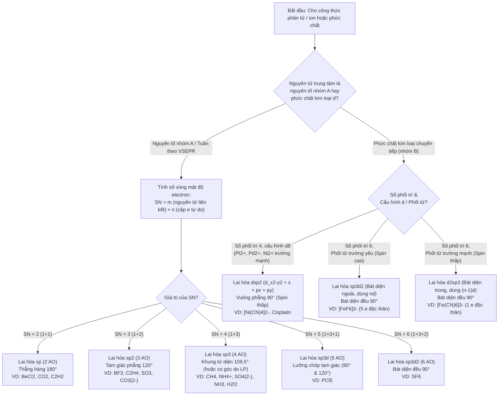

# Chương 3: Thuyết Liên kết Hóa trị (Valence Bond – VB) & Cơ chế Lai hóa Orbital

---

## 1. Tổng quan chương (Chapter Overview) {T-03.1}

### 1.1 Giới thiệu khái quát & Phạm vi nội dung {T-03.1.1}

Ở Chương 1 và Chương 2, chúng ta đã khảo sát cấu trúc electron hóa trị theo công thức chấm Lewis và dự đoán hình học không gian 3 chiều của các phân tử dựa trên lực đẩy tĩnh điện giữa các miền electron theo thuyết VSEPR (`AX_mE_n`). Tuy nhiên, cả hai mô hình đó vẫn chưa trả lời được câu hỏi cơ học lượng tử nền tảng: *Bằng cách nào hai orbital nguyên tử (Atomic Orbitals – AO) tương tác với nhau để tạo thành liên kết cộng hóa trị bền vững, và vì sao một nguyên tử trung tâm có các phân lớp $s, p, d$ khác nhau về hình dạng lẫn năng lượng lại tạo ra được các liên kết hoàn toàn đồng nhất hướng về các đỉnh của hình tứ diện đều, tam giác phẳng hay bát diện đều?* `[ADDED: structural frame and pedagogical overview]`

Chương 3 giải đáp trọn vẹn câu hỏi trên thông qua **Thuyết Liên kết Hóa trị (Valence Bond Theory – VB)** do Heitler, London khởi xướng và được Linus Pauling cùng Slater phát triển hoàn thiện, kết hợp với **Thuyết Lai hóa Orbital (Orbital Hybridization)**. Nội dung chương trình bày có hệ thống từ các luận điểm cốt lõi về sự xen phủ orbital nguyên tử, ghép đôi spin đối song song ($\uparrow\downarrow$), nguyên lý xen phủ cực đại, tính định hướng và tính bão hòa của liên kết cộng hóa trị; đi sâu phân loại ba kiểu xen phủ tạo liên kết sigma ($\sigma$), pi ($\pi$) và delta ($\delta$); thiết lập mối liên hệ định lượng giữa **Số phối trí lập thể ($SN = m + n$)** với các trạng thái lai hóa $sp, sp^2, sp^3, sp^3d, sp^3d^2, dsp^2, d^2sp^3$ và tỷ lệ phần trăm đặc tính $s/p$; đồng thời đánh giá khách quan những hạn chế chí mạng của thuyết VB trước tính thuận từ của $O_2$, quang phổ phức chất và liên kết đa tâm thiếu electron trong $B_2H_6$ để làm cầu nối sang Thuyết Orbital Phân tử (MO) ở Chương 4 `[ADDED: chapter scope summary]`.

### 1.2 Kiến thức tiên quyết & Thời lượng học tập dự kiến {T-03.1.2}

- **Kiến thức tiên quyết (Prerequisites):**
  1. Nắm vững cấu hình electron nguyên tử, quy tắc Hund, nguyên lý loại trừ Pauli và hình dạng không gian của các orbital nguyên tử $s$ (đối xứng cầu), $p_x, p_y, p_z$ (hình số tám nổi gồm 2 thùy đối xứng qua tâm) và 5 orbital phân lớp $d$ ($d_{xy}, d_{yz}, d_{xz}, d_{x^2-y^2}, d_{z^2}$) từ Hóa học đại cương `[ADDED: prerequisite knowledge]`.
  2. Thành thạo cách viết công thức cấu tạo Lewis, tính điện tích hình thức ($FC = V - N - B/2$), nhận diện phân tử thiếu electron ($BeCl_2, BF_3$) và siêu hóa trị ($PCl_5, SF_6$) đã học ở Chương 1 (Mục 4.4 và Mục 4.6) `[ADDED: cross-reference to Chapter 1]`.
  3. Thành thạo cách xác định **Số phối trí lập thể ($SN = m + n = \frac{V + M - q}{2}$)**, phân biệt hình học cặp electron với hình học phân tử và nắm vững nội dung Quy tắc Bent đã học ở Chương 2 (Mục 4.2 đến Mục 4.5) `[ADDED: cross-reference to Chapter 2]`.
- **Thời lượng học tập dự kiến (Estimated Study Time):** Khoảng **3,0 giờ** (gồm **2,3 giờ** đọc hiểu lý thuyết, phân tích 2 bảng hệ thống hóa cùng 3 ví dụ giải mẫu + **40 phút** tự giải 10 câu hỏi và bài tập tự lượng giá cuối chương theo quy tắc `STUDY_TIME_RULE`: $1\text{ giờ}/1.500\text{ từ}$ lý thuyết + $20\text{ phút}/5\text{ bài tập}$) `[ADDED: study time estimate]`.

---

## 2. Mục tiêu học tập (Learning Objectives) {T-03.2}

### 2.1 Chuẩn đầu ra về Kiến thức, Kỹ năng và Năng lực vận dụng {T-03.2.1}

Sau khi học xong chương này, sinh viên có khả năng `[ADDED: learning objectives header]`:

- **`LO-1` (Kiến thức – Luận điểm VB & Phân loại xen phủ $\sigma, \pi, \delta$):** Phát biểu chính xác các luận điểm cơ bản của thuyết Liên kết Hóa trị (VB: sự xen phủ AO, ghép đôi electron có spin đối song song $\uparrow\downarrow$, cơ chế kích thích electron hóa trị, cơ chế cho – nhận cặp electron, nguyên lý xen phủ cực đại Pauling, tính định hướng và tính bão hòa); phân biệt được bản chất cơ học lượng tử, quy ước trục liên nhân $Oz$, số mặt phẳng nút (nodal planes), khả năng quay tự do và độ bền tương đối của liên kết sigma ($\sigma$), liên kết pi ($\pi$) và liên kết delta ($\delta$) `[ADDED: learning objective LO-1]`.
- **`LO-2` (Kỹ năng – Xác định trạng thái lai hóa, đặc tính $s/p$ & đếm liên kết $\sigma/\pi$):** Giải thích được khái niệm và điều kiện năng lượng của sự lai hóa orbital; tính được tỷ lệ phần trăm đặc tính $s$ và đặc tính $p$ ($\%s, \%p$) để giải thích cơ sở định lượng của Quy tắc Bent; kết nối trực tiếp Số phối trí lập thể ($SN = m + n$) với trạng thái lai hóa ($sp, sp^2, sp^3, sp^3d, sp^3d^2$) và đếm chính xác số lượng liên kết $\sigma, \pi$ trong các phân tử và ion vô cơ/hữu cơ tiêu biểu `[ADDED: learning objective LO-2]`.
- **`LO-3` (Phân tích – Lai hóa phân lớp $d$ trong phức chất & Hóa lập thể dược học):** Vận dụng được mô hình lai hóa có sự tham gia của phân lớp $d$ và sơ đồ ô lượng tử để phân biệt phức chất vuông phẳng $dsp^2$ của kim loại $d^8$ ($[Ni(CN)_4]^{2-}$, thuốc chống ung thư Cisplatin $cis\text{-}[Pt(NH_3)_2Cl_2]$), phức bát diện ngoài $sp^3d^2$ ($[FeF_6]^{3-}$, spin cao) và phức bát diện trong $d^2sp^3$ ($[Fe(CN)_6]^{3-}$, spin thấp), đồng thời giải thích được cơ sở xuất hiện đồng phân hình học *cis–trans* và vai trò dung môi phân cực của $H_2O$ `[ADDED: learning objective LO-3]`.
- **`LO-4` (Năng lực đánh giá mô hình):** Phân tích được ưu điểm trực quan và 3 hạn chế chí mạng của thuyết VB (bất lực trước tính thuận từ của $O_2$ lỏng, không định lượng được sự tách mức năng lượng orbital $d$ gây ra màu sắc/quang phổ phức chất, và không mô tả được liên kết đa tâm thiếu electron $3c\text{–}2e$ trong Diborane $B_2H_6$), từ đó biết lựa chọn thuyết Orbital Phân tử (MO) hoặc thuyết Trường phối tử khi giải quyết các bài toán cấu trúc hiện đại `[ADDED: learning objective LO-4]`.

---

## 3. Đặt vấn đề & Ý nghĩa thực tiễn (Introduction) {T-03.3}

### 3.1 Từ hình học không gian VSEPR đến cơ chế xen phủ orbital nguyên tử (AO) {T-03.3.1}

Ở Chương 2, thuyết VSEPR đã cho phép chúng ta dự đoán nhanh chóng rằng phân tử methane ($CH_4$, kiểu $AX_4, SN = 4$) có cấu trúc tứ diện đều với bốn góc liên kết $\widehat{H-C-H} = 109^\circ\,28^{\prime}$ ($109,5^\circ$), phân tử ethene ($C_2H_4$, mỗi nguyên tử C thuộc kiểu $AX_3, SN = 3$) có khung tam giác phẳng $120^\circ$, và phân tử nước ($H_2O$, kiểu $AX_2E_2, SN = 4$) có dạng chữ V với góc liên kết $\widehat{H-O-H} = 104,5^\circ$ `[ADDED: bridge from Chapter 2 VSEPR]`. Tuy nhiên, nếu đối chiếu trực tiếp với cấu hình electron trạng thái cơ bản của nguyên tử carbon tự do ($Z = 6$: $1s^2 2s^2 2p_x^1 2p_y^1 2p_z^0$), một nghịch lý lập tức xuất hiện `[ADDED: pedagogical problem statement]`:

1. Nguyên tử carbon ở trạng thái cơ bản chỉ có **2 electron độc thân** trên hai orbital $2p_x$ và $2p_y$, nhưng thực tế carbon luôn tạo **4 liên kết cộng hóa trị** bền vững trong $CH_4, CCl_4, CO_2$ `[ADDED: carbon tetravalency puzzle]`.
2. Ngay cả khi 1 electron từ phân lớp $2s$ được kích thích lên orbital trống $2p_z$ để tạo ra 4 electron độc thân ($2s^1 2p_x^1 2p_y^1 2p_z^1$), thì 1 orbital $2s$ (hình cầu không định hướng) và 3 orbital $2p$ (hình số tám nổi đôi một vuông góc với nhau tạo góc $90^\circ$) cũng không thể tạo ra 4 liên kết $\text{C–H}$ hoàn toàn tương đương nhau với góc $109,5^\circ$ như thực nghiệm đo được `[ADDED: orbital geometry puzzle]`.

Để giải quyết triệt để mâu thuẫn giữa hình dạng của các orbital nguyên tử tự do và hình học phân tử thực tế, **Thuyết Liên kết Hóa trị (Valence Bond – VB)** và **Thuyết Lai hóa Orbital (Orbital Hybridization)** đã ra đời `[ADDED: transition to VB and hybridization]`. Thuyết VB và lai hóa cung cấp mô hình trực quan để giải thích liên kết định hướng qua sự xen phủ orbital, giúp hình dung cấu trúc cục bộ, cách các nguyên tử liên kết và bản chất của liên kết $\sigma/\pi$ `[SRC: S-03.1, S-03.5]`. Điều này hỗ trợ trực tiếp cho việc hiểu cấu trúc phân tử, độ bền liên kết, sự phân cực của dung môi dược dụng và hiện tượng đồng phân hình học *cis–trans*; đồng thời, việc nhận biết rõ giới hạn của mô hình VB (nhất là với từ tính, liên kết đa tâm và quang phổ phức chất) sẽ giúp người học biết khi nào cần chuyển sang thuyết Orbital Phân tử (MO) hoặc các mô hình lượng tử hiện đại hơn `[SRC: S-03.4, S-03.5]`.

---

## 4. Nội dung bài giảng chính (Main Content) {T-03.4}

### 4.1 Luận điểm cơ bản của Thuyết Liên kết Hóa trị (Heitler – London – Pauling) {T-03.4.1}

Năm 1927, Walter Heitler và Fritz London đã vận dụng cơ học lượng tử giải phương trình sóng Schrödinger cho phân tử hydro ($H_2$), đặt nền móng cho **Thuyết Liên kết Hóa trị (Valence Bond Theory – VB)**; sau đó Linus Pauling và John C. Slater mở rộng lý thuyết này cho các phân tử đa nguyên tử `[ADDED: historical context of Heitler-London-Pauling VB theory]`. Nội dung cốt lõi của thuyết VB được tóm lược trong bốn luận điểm cơ bản sau đây `[SRC: S-03.1]`:

#### 4.1.1 Sự xen phủ orbital nguyên tử (AO) và ghép đôi electron có spin đối song song ($\uparrow\downarrow$)

- **Sự xen phủ orbital và ghép đôi spin:** Liên kết cộng hóa trị hình thành khi hai orbital nguyên tử (**Atomic Orbitals – AO**) hóa trị của hai nguyên tử khác nhau tiến lại gần và **xen phủ (overlap)** lên nhau. Cặp electron dùng chung phải có **spin đối song song** ($\uparrow\downarrow$, tức hai số lượng tử từ spin trái dấu $m_s = +\frac{1}{2}$ và $m_s = -\frac{1}{2}$) theo nguyên lý loại trừ Pauli `[SRC: S-03.1]` `[ADDED: Pauli spin quantum number clarification]`.
- Khi hai AO xen phủ cùng pha sóng, mật độ đám mây electron tích tụ cao ở vùng không gian nằm giữa hai hạt nhân mang điện dương, làm tăng lực hút tĩnh điện hạt nhân – electron và làm giảm thế năng của hệ xuống mức cực tiểu, nhờ đó hình thành liên kết hóa học bền vững `[ADDED: quantum mechanical phase and potential energy explanation]`.

#### 4.1.2 Hai cơ chế hình thành cặp electron liên kết: Ghép đôi (kèm kích thích electron) và Cho – nhận

Để có các orbital hóa trị tham gia xen phủ tạo cặp electron dùng chung ($\uparrow\downarrow$), các nguyên tử có thể thực hiện theo một trong hai cơ chế cơ bản sau `[ADDED: two VB bond formation mechanisms header]`:

1. **Cơ chế góp chung (ghép đôi hai electron độc thân) và sự kích thích electron hóa trị (Electron Promotion):**
   - Mỗi nguyên tử đưa ra 1 AO hóa trị chứa 1 electron độc thân ($\uparrow$) có spin ngược dấu nhau để xen phủ tạo thành cặp electron liên kết ($\uparrow\downarrow$). Ví dụ: hai nguyên tử H ($1s^1$) xen phủ hai AO $1s$ tạo phân tử $H_2$ `[ADDED: radical pairing mechanism]`.
   - **Sự kích thích electron hóa trị:** Ở nhiều nguyên소 nhóm chính (như $Be, B, C, P, S$), số lượng liên kết cộng hóa trị thực tế lớn hơn số electron độc thân ở trạng thái cơ bản. Khi hình thành liên kết, nguyên tử hấp thụ một lượng năng lượng nhỏ để chuyển electron từ cặp ghép đôi ở phân lớp thấp lên orbital trống cùng lớp lượng tử (hoặc phân lớp lân cận có năng lượng xấp xỉ) nhằm tăng số lượng electron độc thân `[ADDED: electron promotion principle]`:
     $$\text{Beryllium } ({}_4Be): \quad [\text{He}]\,2s^2\,2p^0 \text{ (0 e độc thân)} \xrightarrow{\text{kích thích}} [\text{He}]\,2s^1\,2p_x^1\,2p_y^0\,2p_z^0 \text{ (2 e độc thân} \rightarrow \text{hóa trị II trong } BeH_2, BeCl_2\text{)}$$
     $$\text{Boron } ({}_5B): \quad [\text{He}]\,2s^2\,2p_x^1\,2p_y^0\,2p_z^0 \text{ (1 e độc thân)} \xrightarrow{\text{kích thích}} [\text{He}]\,2s^1\,2p_x^1\,2p_y^1\,2p_z^0 \text{ (3 e độc thân} \rightarrow \text{hóa trị III trong } BF_3\text{)}$$
     $$\text{Carbon } ({}_6C): \quad [\text{He}]\,2s^2\,2p_x^1\,2p_y^1\,2p_z^0 \text{ (2 e độc thân)} \xrightarrow{\text{kích thích}} [\text{He}]\,2s^1\,2p_x^1\,2p_y^1\,2p_z^1 \text{ (4 e độc thân} \rightarrow \text{hóa trị IV trong } CH_4, CO_2\text{)}$$
     $$\text{Phosphorus } ({}_{15}P): \quad [\text{Ne}]\,3s^2\,3p^3\,3d^0 \text{ (3 e độc thân)} \xrightarrow{\text{kích thích}} [\text{Ne}]\,3s^1\,3p^3\,3d^1 \text{ (5 e độc thân} \rightarrow \text{hóa trị V trong } PCl_5\text{)}$$
     Năng lượng tỏa ra khi hình thành thêm các liên kết cộng hóa trị mới lớn hơn rất nhiều so với năng lượng tiêu tốn để kích thích electron, do đó quá trình tạo liên kết hoàn toàn thuận lợi về mặt nhiệt động học `[ADDED: promotion equations and energetic justification]`.

2. **Cơ chế cho – nhận (liên kết cộng hóa trị phối trí / Coordinate Covalent Bond):**
   - Liên kết hình thành do sự xen phủ giữa một orbital hóa trị đã có sẵn **1 cặp electron tự do ($\uparrow\downarrow$, chất cho / Base Lewis)** của nguyên tử này với một **orbital hóa trị hoàn toàn trống ($\square$, chất nhận / Acid Lewis)** của nguyên tử hoặc ion kia `[ADDED: donor-acceptor coordinate bond mechanism]`.
   - Ví dụ điển hình: Sự kết hợp giữa phân tử amoniac ($:NH_3$, có 1 cặp electron tự do trên nguyên tử N) với proton $H^+$ (có orbital $1s^0$ trống) tạo thành ion amoni $NH_4^+$, trong đó cả 4 liên kết $\text{N–H}$ sau khi hình thành đều hoàn toàn tương đương nhau; hoặc sự tạo thành các phức chất kim loại chuyển tiếp ($[Ni(CN)_4]^{2-}$, $cis\text{-}[Pt(NH_3)_2Cl_2]$, $[FeF_6]^{3-}$, $[Fe(CN)_6]^{3-}$) khi các phối tử dùng cặp electron tự do xen phủ vào các orbital lai hóa trống của ion kim loại trung tâm `[ADDED: NH4+ and coordination complex examples]`.

#### 4.1.3 Nguyên lý xen phủ cực đại (Pauling), tính định hướng và tính bão hòa của liên kết

- **Nguyên lý xen phủ cực đại (Maximum Overlap Principle – Pauling):** Độ xen phủ của các AO càng lớn thì mật độ xác suất tìm thấy electron ở vùng giữa hai hạt nhân càng cao $\rightarrow$ liên kết được tạo thành càng bền vững `[SRC: S-03.1]`.
- **Tính định hướng của liên kết (Directionality of Covalent Bonds):** Các orbital nguyên tử ($p, d$ và các orbital lai hóa) có định hướng xác định trong không gian, do đó liên kết cộng hóa trị luôn được hình thành theo hướng mà sự xen phủ giữa các AO đạt giá trị cực đại $\rightarrow$ quyết định trực tiếp góc liên kết và cấu trúc không gian của phân tử `[SRC: S-03.1]`. *(Lưu ý: Đây là đặc điểm cốt lõi phân biệt liên kết cộng hóa trị với liên kết ion vốn mang tính bất định hướng do trường tĩnh điện đối xứng cầu — xem lại Chương 1, Mục 4.3)* `[ADDED: contrast with non-directional ionic bond from Chapter 1]`.
- **Tính bão hòa của liên kết (Saturation of Covalent Bonds):** Số lượng liên kết cộng hóa trị tối đa mà một nguyên tử có thể tạo thành bị giới hạn chặt chẽ bởi số orbital hóa trị có electron độc thân (cơ chế ghép đôi) hoặc số orbital hóa trị trống/cặp electron tự do có thể tham gia xen phủ (cơ chế cho – nhận) `[SRC: S-03.1]` `[ADDED: donor-acceptor saturation nuance]`. Ví dụ: Các nguyên소 chu kỳ 2 ($C, N, O, F$) chỉ có tối đa 4 orbital hóa trị ($1\text{ AO } 2s + 3\text{ AO } 2p$) nên số liên kết cộng hóa trị không bao giờ vượt quá 4 (phù hợp với quy tắc bát tử ở Chương 1) `[ADDED: period 2 valence orbital limit]`.

> **Ý nghĩa cốt lõi:** Thuyết VB mô tả liên kết định hướng thông qua sự xen phủ các orbital nguyên tử, giúp hình dung trực quan cấu trúc cục bộ của phân tử và bản chất lượng tử của từng liên kết hóa học `[SRC: S-03.1]`.

---

### 4.2 Phân loại kiểu xen phủ tạo liên kết ($\sigma, \pi, \delta$), Mặt phẳng nút & Độ bền {T-03.4.2}

Khi hai nguyên tử tiến lại gần nhau để tạo liên kết, tùy thuộc vào **hướng định hướng của các orbital nguyên tử** so với **trục nối tâm hai hạt nhân (trục liên nhân)**, sự xen phủ orbital được chia thành ba kiểu cơ bản: **liên kết Sigma ($\sigma$)**, **liên kết Pi ($\pi$)** và **liên kết Delta ($\delta$)** `[SRC: S-03.2]`.

> **Quy ước hệ trục tọa độ chuẩn trong Hóa học lượng tử:** Để thống nhất ký hiệu các orbital $p_x, p_y, p_z$ và $d$ trong toàn bộ giáo trình, **trục nối hai hạt nhân nguyên tử (trục liên nhân / internuclear axis) được quy ước là trục $Oz$**. Khi đó, hai trục $Ox$ và $Oy$ nằm vuông góc với trục liên kết $Oz$ `[ADDED: standard z-axis internuclear convention resolving I-03.05]`.

#### 4.2.1 Liên kết Sigma ($\sigma$): Xen phủ trục, đối xứng xoay và độ bền vượt trội

- **Định nghĩa và các kiểu xen phủ trục:** **Liên kết Sigma ($\sigma$)** được hình thành khi sự xen phủ giữa hai orbital xảy ra **dọc theo trục nối hai hạt nhân nguyên tử** (gọi là **xen phủ trục** hay xen phủ đầu đối đầu – *head-on / axial overlap*) `[SRC: S-03.2]` `[ADDED: English term axial overlap]`. Với trục liên nhân là trục $Oz$, các tổ hợp xen phủ tạo liên kết $\sigma$ bao gồm:
  - Xen phủ giữa hai AO thuần khiết: $s\text{–}s$ (như trong $H_2$), $s\text{–}p_z$ (như trong $HF, HCl$), $p_z\text{–}p_z$ (như trong $F_2, Cl_2$), và $d_{z^2}\text{–}d_{z^2}$ `[SRC: S-03.2]` `[ADDED: diatomic examples]`.
  - Xen phủ giữa các orbital lai hóa (sẽ khảo sát ở Mục 4.3–4.4) với AO thuần khiết hoặc giữa hai orbital lai hóa với nhau dọc theo trục liên nhân: $sp^n\text{–}s$ (như liên kết $\text{C–H}$ trong $CH_4$), $sp^n\text{–}p_z$ hoặc $sp^n\text{–}sp^n$ (như liên kết $\text{C–C}$ trong $C_2H_6, C_2H_4, C_2H_2$) `[ADDED: hybrid orbital sigma overlap resolving I-03.20]`.
- **Đặc điểm cấu trúc và độ bền của liên kết $\sigma$:**
  1. **Vùng mật độ electron cực đại** nằm ngay trên đường thẳng nối tâm hai hạt nhân nguyên tử (**0 mặt phẳng nút** đi qua trục liên nhân $Oz$) `[SRC: S-03.2]` `[ADDED: zero nodal planes along internuclear axis]`.
  2. **Có tính đối xứng trục xoay (cylindrical symmetry):** Đám mây electron liên kết $\sigma$ đối xứng tròn xoay quanh trục liên nhân $Oz$, do đó hai nguyên tử hoặc nhóm nguyên tử có thể **quay tự do quanh trục liên kết đơn ($\sigma$)** mà không làm thay đổi độ xen phủ và không phá vỡ liên kết `[SRC: S-03.2]`.
  3. **Độ bền rất cao:** Do xen phủ trực diện dọc theo trục nối hai hạt nhân nên **độ xen phủ rất lớn $\rightarrow$ liên kết $\sigma$ rất bền vững**. Mọi liên kết đơn trong hóa học đều là liên kết $\sigma$; trong các liên kết bội (đôi, ba, bốn), luôn có **đúng 1 liên kết $\sigma$** đóng vai trò làm bộ khung chịu lực chính của phân tử `[SRC: S-03.2]` `[ADDED: single sigma bond in multiple bonds]`.

#### 4.2.2 Liên kết Pi ($\pi$): Xen phủ bên, mặt phẳng nút, sự cản trở quay tự do và đồng phân hình học *cis–trans*

- **Định nghĩa và các kiểu xen phủ bên:** **Liên kết Pi ($\pi$)** được hình thành khi sự xen phủ giữa các orbital xảy ra ở **hai phía (phía trên và phía dưới, hoặc phía trước và phía sau) của trục nối hai hạt nhân nguyên tử**, với trục của các orbital tham gia xen phủ đặt song song với nhau và vuông góc với trục liên nhân $Oz$ (gọi là **xen phủ bên** – *side-by-side / lateral overlap*) `[SRC: S-03.2]` `[ADDED: parallel orbital orientation and English term]`. Các kiểu xen phủ bên tạo liên kết $\pi$ bao gồm:
  - Xen phủ $p\text{–}p$: $p_x\text{–}p_x$ hoặc $p_y\text{–}p_y$ (ví dụ trong $O_2, N_2, C_2H_4, C_2H_2, CO_2$) `[SRC: S-03.2]` `[ADDED: molecular examples]`.
  - Xen phủ $p\text{–}d$: giữa một orbital $p$ ($p_x$ hoặc $p_y$) với một orbital $d$ có cùng tính đối xứng mặt phẳng ($d_{xz}$ hoặc $d_{yz}$), thường gặp trong các oxoanion hoặc oxit của nguyên소 chu kỳ $\ge 3$ như $SO_3, SO_4^{2-}, PO_4^{3-}$ `[SRC: S-03.2]` `[ADDED: p-d pi bonding explanation and examples]`.
  - Xen phủ $d\text{–}d$: giữa hai orbital $d$ định hướng giữa các trục ($d_{xz}\text{–}d_{xz}$ hoặc $d_{yz}\text{–}d_{yz}$), xuất hiện trong các liên kết bội kim loại – kim loại như trong ion phức $[Re_2Cl_8]^{2-}$ `[ADDED: d-d pi overlap resolving I-03.04]`.
- **Đặc điểm cấu trúc, mặt phẳng nút và hệ quả lập thể của liên kết $\pi$:**
  1. **Mặt phẳng nút (Nodal Plane):** Mặt phẳng chứa trục liên kết nối hai hạt nhân nguyên tử chính là **mặt phẳng nút (nơi mật độ xác suất tìm thấy electron bằng $0$, $\psi^2 = 0$)**, do hàm sóng orbital đổi dấu pha ($+$ sang $-$) khi đi qua mặt phẳng này. Như vậy, mỗi liên kết $\pi$ có **1 mặt phẳng nút** đi qua trục liên nhân $Oz$, chia đám mây electron $\pi$ thành hai vùng nằm ở hai phía đối diện của trục liên kết `[SRC: S-03.2]` `[ADDED: wavefunction phase explanation of nodal plane resolving I-03.11]`.
  2. **Độ bền kém hơn liên kết $\sigma$:** Vì sự xen phủ bên diễn ra ngoài trục nối hai hạt nhân nên **độ xen phủ nhỏ hơn đáng kể so với liên kết $\sigma$ $\rightarrow$ liên kết $\pi$ kém bền hơn và dễ bị bẻ gãy hơn** trong các phản ứng hóa học (như phản ứng cộng mở vòng $\pi$ của alkene/alkyne) `[SRC: S-03.2]` `[ADDED: chemical reactivity implication]`. *(Điều này giải thích vì sao ở Chương 1, Mục 4.1, năng lượng liên kết đôi $\text{C=C}$ không gấp đôi liên kết đơn $\text{C–C}$: phần năng lượng tăng thêm của liên kết $\pi$ nhỏ hơn năng lượng của liên kết $\sigma$)* `[ADDED: cross-reference to Chapter 1 bond energy]`.
  3. **Cản trở sự quay tự do và sinh ra đồng phân hình học *cis–trans*:** Khác với liên kết $\sigma$, liên kết $\pi$ **không có tính đối xứng trục xoay**. Nếu xoay một nguyên tử quanh trục liên kết, hai AO tạo liên kết $\pi$ sẽ lệch khỏi vị trí song song, làm triệt tiêu sự xen phủ bên và đòi hỏi phải cung cấp năng lượng đủ lớn để bẻ gãy liên kết $\pi$. Do đó, các nguyên tử không thể quay tự do quanh trục liên kết đôi hoặc liên kết ba, giữ cho khung nguyên tử gắn với liên kết đôi cố định đồng phẳng `[SRC: S-03.2]`. Khi mỗi nguyên tử của liên kết đôi mang hai nhóm thế khác nhau (dạng $ab\text{C=C}ab$ hoặc $ab\text{C=C}cd$ với $a \neq b, c \neq d$), sự cố định đồng phẳng này chính là nguyên nhân sinh ra **đồng phân hình học *cis–trans* (hay *Z–E*)** `[SRC: S-03.2]` `[ADDED: exact substitution condition abC=Cab for cis-trans isomerism resolving I-03.08] [VERIFY: cis-trans condition in substituted alkenes (V-03.04)]`.

#### 4.2.3 Liên kết Delta ($\delta$): Xen phủ 4 thùy orbital $d$ và liên kết kim loại – kim loại bậc 4

- **Định nghĩa và cơ chế xen phủ:** **Liên kết Delta ($\delta$)** hình thành do sự **xen phủ đối diện cả 4 thùy (face-to-face / four-lobe overlap)** của hai orbital $d$ ($d_{xy}\text{–}d_{xy}$ hoặc $d_{x^2-y^2}\text{–}d_{x^2-y^2}$) nằm trên hai mặt phẳng song song và cùng vuông góc với trục liên nhân $Oz$ `[SRC: S-03.2]` `[ADDED: z-axis orientation detail]`.
- **Số mặt phẳng nút và độ bền:** Liên kết $\delta$ có **2 mặt phẳng nút** vuông góc với nhau và cùng đi qua trục nối hai hạt nhân $Oz$. Do sự xen phủ 4 thùy trải rộng và xa trục liên nhân, độ xen phủ của liên kết $\delta$ còn nhỏ hơn cả liên kết $\pi$, khiến độ bền các liên kết giảm dần theo thứ tự:
  $$\text{Độ bền liên kết:} \quad \sigma > \pi > \delta \qquad \text{(ứng với số mặt phẳng nút chứa trục liên nhân: } 0 < 1 < 2\text{)}$$
  `[ADDED: nodal plane count and bond strength hierarchy resolving I-03.20]`.
- **Sự xuất hiện trong các hợp chất vô cơ có liên kết kim loại – kim loại bậc 4:** Liên kết $\delta$ xuất hiện đặc trưng trong các hợp chất phối trí của kim loại chuyển tiếp có **liên kết kim loại – kim loại bậc 4 (quadruple bond)**, ví dụ kinh điển là ion phức octachlorodirhenate(III) $[Re_2Cl_8]^{2-}$ (được F. Albert Cotton khám phá năm 1964). Trong ion $[Re_2Cl_8]^{2-}$, mỗi ion $Re^{3+}$ có cấu hình $5d^4$; liên kết bậc 4 giữa hai nguyên tử rhenium ($Re \equiv\!\!\!\!-\, Re$) bao gồm tổ hợp **$1\sigma + 2\pi + 1\delta$** (trong đó $1\sigma$ tạo bởi xen phủ trục $5d_{z^2}\text{–}5d_{z^2}$, $2\pi$ tạo bởi xen phủ bên $5d_{xz}\text{–}5d_{xz}$ và $5d_{yz}\text{–}5d_{yz}$, còn $1\delta$ tạo bởi xen phủ 4 thùy $5d_{xy}\text{–}5d_{xy}$, trong khi orbital $5d_{x^2-y^2}$ tham gia lai hóa $dsp^2$ tạo liên kết $\sigma$ với 4 phối tử $Cl^-$) `[SRC: S-03.2]` `[ADDED: specific 5d orbital assignment in Re2Cl8(2-)] [VERIFY: Re2Cl8(2-) quadruple bond 5d orbital assignment (V-03.01)]`.

#### 4.2.4 Bảng tổng hợp so sánh toàn diện liên kết $\sigma$, $\pi$ và $\delta$

Để thuận tiện tra cứu và đối chiếu bản chất lượng tử của ba loại liên kết cộng hóa trị (đồng thời hoàn thành lời hứa liên kết chéo từ Chương 2, Mục 4.2), **Bảng 3.1** tổng hợp toàn bộ các tiêu chí phân loại `[ADDED: Table 3.1 introduction]`:

**Bảng 3.1.** So sánh bản chất cơ học lượng tử, tính đối xứng và tính chất của liên kết $\sigma$, $\pi$ và $\delta$ (quy ước trục liên nhân là $Oz$) `[ADDED: Table 3.1 comparing sigma, pi, and delta bonds]`.

| Tiêu chí so sánh | Liên kết Sigma ($\sigma$) | Liên kết Pi ($\pi$) | Liên kết Delta ($\delta$) |
| :--- | :--- | :--- | :--- |
| **Kiểu xen phủ không gian** | **Xen phủ trục** (đầu đối đầu dọc theo trục liên nhân $Oz$) `[SRC: S-03.2]` | **Xen phủ bên** (hai vùng ở hai phía trục liên nhân $Oz$) `[SRC: S-03.2]` | **Xen phủ 4 thùy** (bốn vùng đối diện trên hai mặt phẳng song song vuông góc $Oz$) `[SRC: S-03.2]` |
| **Các tổ hợp AO điển hình** | $s\text{–}s,\; s\text{–}p_z,\; p_z\text{–}p_z,\; d_{z^2}\text{–}d_{z^2}$; hoặc giữa các AO lai hóa ($sp^n\text{–}s,\; sp^n\text{–}sp^n$) `[SRC: S-03.2]` `[ADDED: hybrid AO overlap]` | $p_x\text{–}p_x,\; p_y\text{–}p_y,\; p\text{–}d$ ($p_x\text{–}d_{xz}$), và $d\text{–}d$ ($d_{xz}\text{–}d_{xz},\; d_{yz}\text{–}d_{yz}$) `[SRC: S-03.2]` `[ADDED: d-d pi overlap]` | $d_{xy}\text{–}d_{xy}$ hoặc $d_{x^2-y^2}\text{–}d_{x^2-y^2}$ `[SRC: S-03.2]` |
| **Số vùng xen phủ** | **1 vùng** nằm ngay trên đường nối tâm hai hạt nhân `[SRC: S-03.2]` | **2 vùng** (trên/dưới hoặc trước/sau trục liên nhân) `[SRC: S-03.2]` | **4 vùng** (tương ứng 4 thùy của hai orbital $d$) `[SRC: S-03.2]` |
| **Số mặt phẳng nút đi qua trục liên nhân $Oz$** | **0** (mật độ electron cực đại ngay trên trục liên nhân) `[SRC: S-03.2]` `[ADDED: nodal plane count]` | **1 mặt phẳng nút** chứa trục liên nhân (nơi mật độ electron bằng $0$) `[SRC: S-03.2]` | **2 mặt phẳng nút** vuông góc với nhau và cùng chứa trục liên nhân `[ADDED: nodal plane count]` |
| **Độ xen phủ & Độ bền tương đối** | Độ xen phủ **lớn nhất** $\rightarrow$ **Rất bền vững** ($\sigma > \pi > \delta$) `[SRC: S-03.2]` | Độ xen phủ **nhỏ hơn $\sigma$** $\rightarrow$ **Kém bền hơn, dễ bị bẻ gãy hơn** `[SRC: S-03.2]` | Độ xen phủ **nhỏ nhất** $\rightarrow$ **Yếu nhất** trong ba loại liên kết `[ADDED: relative strength of delta bond]` |
| **Khả năng quay tự do quanh trục liên kết** | **Quay tự do** quanh trục liên kết đơn nhờ đối xứng trụ xoay `[SRC: S-03.2]` | **Không thể quay tự do** (cố định đồng phẳng $\rightarrow$ sinh ra đồng phân hình học *cis–trans* ở $ab\text{C=C}ab$) `[SRC: S-03.2]` | **Không thể quay tự do** (giữ hai mảnh phức chất ở cấu dạng che khuất *eclipsed*) `[ADDED: rotational restriction in delta bond]` |
| **Sự tồn tại độc lập & Vai trò trong thuyết VSEPR** | Tồn tại độc lập trong mọi **liên kết đơn** ($1\sigma$); tạo bộ khung không gian phân tử và quyết định số phối tử $m$ trong công thức $AX_mE_n$ `[SRC: S-03.2]` `[ADDED: VSEPR link]` | Không tồn tại độc lập mà luôn đi kèm liên kết $\sigma$ trong **liên kết đôi** ($1\sigma + 1\pi$) và **liên kết ba** ($1\sigma + 2\pi$); cùng chung miền không gian với liên kết $\sigma$ `[SRC: S-03.2]` `[ADDED: multiple bond composition]` | Chỉ xuất hiện kèm theo $\sigma$ và $\pi$ trong **liên kết kim loại – kim loại bậc 4** ($1\sigma + 2\pi + 1\delta$), ví dụ $[Re_2Cl_8]^{2-}$ `[SRC: S-03.2]` |

> **Ý nghĩa cốt lõi:** Việc phân biệt rõ liên kết $\sigma$, $\pi$ và $\delta$ giúp giải thích độ bền tương đối giữa liên kết đơn và liên kết bội, lý giải sự cản trở quay tự do quanh trục liên kết đôi/ba và khả năng xuất hiện đồng phân hình học *cis–trans* `[SRC: S-03.2]`.

---

### 4.3 Cơ sở Thuyết Lai hóa Orbital (Orbital Hybridization), Đặc tính $s/p$ & Liên hệ với $SN$ {T-03.4.3}

#### 4.3.1 Khái niệm sự lai hóa orbital và điều kiện năng lượng

Để giải thích vì sao nguyên tử trung tâm (như $C$ trong $CH_4$, $B$ trong $BF_3$, hay $Be$ trong $BeCl_2$) có thể tạo ra các liên kết cộng hóa trị hoàn toàn tương đương nhau từ các phân lớp $s, p, d$ vốn khác nhau về hình dạng và năng lượng, Linus Pauling (1931) đã đưa ra khái niệm **lai hóa orbital (Orbital Hybridization)** `[ADDED: Pauling historical attribution]`:

- **Định nghĩa:** **Lai hóa orbital** là sự tổ hợp tuyến tính các orbital nguyên tử (AO) khác loại (như $s, p, d$) nhưng có **năng lượng xấp xỉ nhau** trong **cùng một nguyên tử** để tạo thành các **orbital lai hóa (hybrid orbitals)** có năng lượng và kích thước tương đồng, chỉ khác nhau về định hướng trong không gian `[SRC: S-03.3]` `[ADDED: removed redundant "AO nguyên tử" per I-03.10]`. *(Lưu ý học thuật: Trong các kiểu lai hóa đối xứng cao như $sp$ đường thẳng, $sp^2$ tam giác phẳng, $sp^3$ tứ diện đều, $dsp^2$ vuông phẳng và $sp^3d^2/d^2sp^3$ bát diện đều, các orbital lai hóa tạo thành là **hoàn toàn đồng nhất** về hình dạng, kích thước và năng lượng `[SRC: S-03.3]`; riêng ở kiểu lai hóa $sp^3d$ lưỡng chóp tam giác, nhóm 3 orbital xích đạo và nhóm 2 orbital trục không hoàn toàn tương đương nhau — xem Mục 4.4.2)* `[ADDED: academic accuracy note on sp3d axial/equatorial non-equivalence resolving I-03.07]`.
- **Các quy tắc bảo toàn và đặc điểm của orbital lai hóa:**
  1. **Bảo toàn số lượng orbital:** Tổng số orbital lai hóa tạo thành luôn **bằng đúng tổng số orbital nguyên tử (AO) ban đầu** tham gia tổ hợp tuyến tính `[ADDED: conservation of orbital number rule]`.
  2. **Điều kiện năng lượng:** Các AO tham gia lai hóa phải có mức năng lượng gần nhau (thường thuộc cùng một lớp lượng tử như $ns$ với $np, nd$, hoặc thuộc hai phân lớp sát nhau như $(n-1)d$ với $ns, np$ trong kim loại chuyển tiếp) `[ADDED: energy proximity condition]`.
  3. **Hình dạng bất đối xứng làm tăng khả năng xen phủ trục ($\sigma$):** Mỗi orbital lai hóa đều có một thùy dương (lớn, nở rộng về một phía của hạt nhân) và một thùy âm (rất nhỏ ở phía ngược lại). Nhờ mật độ đám mây electron tập trung mạnh về một hướng, các orbital lai hóa có **độ xen phủ trục lớn hơn nhiều** so với các AO thuần khiết ($s, p$), giúp tạo thành các liên kết $\sigma$ bền vững hơn và định hình bộ khung không gian của phân tử `[ADDED: asymmetric lobe shape and enhanced sigma overlap]`.
  4. **Vai trò của các AO không tham gia lai hóa:** Các orbital $p$ hoặc $d$ thuần khiết (nguyên chất) còn lại không tham gia lai hóa sẽ giữ nguyên hình dạng đối xứng qua tâm và định hướng vuông góc với trục liên kết để tham gia **xen phủ bên tạo liên kết $\pi$** `[SRC: S-03.6]` `[ADDED: generalized rule for unhybridized orbitals]`.

#### 4.3.2 Mối liên hệ trực tiếp giữa Số phối trí lập thể ($SN = m + n$) của VSEPR và Số lượng orbital lai hóa

Đây là chiếc cầu nối quan trọng nhất liên kết Chương 2 (Thuyết VSEPR) với Chương 3 (Thuyết VB & Lai hóa) như đã hứa tại hồ sơ kế thừa `carryover_latest.md` `[ADDED: continuity link to Chapter 2 SN]`:

- Đối với các nguyên tử trung tâm thuộc **nguyên tố nhóm chính (nhóm A)**, mỗi orbital lai hóa được dùng để: (i) chứa 1 cặp electron liên kết $\sigma$ ($\text{BP}$) với một nguyên tử phối tử biên $X$, hoặc (ii) chứa 1 cặp electron tự do ($\text{LP}, E$) định xứ trên nguyên tử trung tâm `[SRC: S-03.7, S-03.8]` `[ADDED: BP and LP occupancy of hybrid orbitals]`.
- Ngược lại, các electron tạo liên kết $\pi$ nằm trên các orbital $p$ hoặc $d$ nguyên chất không lai hóa. Do đó, ta có quy tắc vàng kết nối trực tiếp với công thức $AX_mE_n$ của Chương 2 `[SRC: S-03.8]` `[ADDED: formula equating hybrid orbital count to SN resolving I-03.13]`:
  $$\boxed{\text{Số AO lai hóa của nguyên tử trung tâm (nhóm chính)} = \text{Số vùng mật độ electron} = SN = m + n = \frac{V + M - q}{2}}$$
- **Cách đọc tên kiểu lai hóa từ tổng số mũ:** Nếu ký hiệu trạng thái lai hóa dưới dạng tổng quát $s^1 p^k d^l$, thì tổng các số mũ của các phân lớp thành phần ($1 + k + l$) chính là tổng số orbital lai hóa (cũng chính là $SN$ đối với nguyên소 nhóm chính):
  - $SN = 2 \rightarrow 1\text{ AO } s + 1\text{ AO } p \rightarrow \text{Lai hóa } sp$ (tổng số mũ $= 1 + 1 = 2$, góc $180^\circ$) `[SRC: S-03.3, S-03.8]`.
  - $SN = 3 \rightarrow 1\text{ AO } s + 2\text{ AO } p \rightarrow \text{Lai hóa } sp^2$ (tổng số mũ $= 1 + 2 = 3$, góc $120^\circ$) `[SRC: S-03.3, S-03.8]`.
  - $SN = 4 \rightarrow 1\text{ AO } s + 3\text{ AO } p \rightarrow \text{Lai hóa } sp^3$ (tổng số mũ $= 1 + 3 = 4$, góc $109^\circ\,28^{\prime} \approx 109,5^\circ$) `[SRC: S-03.3, S-03.8]`.
  - $SN = 5 \rightarrow 1\text{ AO } s + 3\text{ AO } p + 1\text{ AO } d \rightarrow \text{Lai hóa } sp^3d$ (tổng số mũ $= 1 + 3 + 1 = 5$) `[SRC: S-03.3]` `[ADDED: generalized exponent sum rule for SN=5,6 resolving I-03.09]`.
  - $SN = 6 \rightarrow 1\text{ AO } s + 3\text{ AO } p + 2\text{ AO } d \rightarrow \text{Lai hóa } sp^3d^2$ (tổng số mũ $= 1 + 3 + 2 = 6$) `[SRC: S-03.3]` `[ADDED: generalized exponent sum rule for SN=6]`.

#### 4.3.3 Tỷ lệ phần trăm đặc tính $s$ và đặc tính $p$ ($\%s, \%p$): Cơ sở định lượng của Quy tắc Bent và độ bền liên kết

Trong một tập hợp orbital lai hóa đồng nhất $sp^k$ (tạo bởi $1\text{ AO } s$ và $k\text{ AO } p$), tỷ lệ đóng góp của orbital $s$ và orbital $p$ vào mỗi orbital lai hóa được gọi là **phần trăm đặc tính $s$ ($\%s$)** và **phần trăm đặc tính $p$ ($\%p$)** `[ADDED: definition of s and p character percentages resolving I-03.19]`:
$$\%s = \frac{1}{1 + k} \times 100\%, \qquad \%p = \frac{k}{1 + k} \times 100\% \qquad (\text{với } \%s + \%p = 100\%)$$
Cụ thể cho ba kiểu lai hóa nền tảng của nguyên소 chu kỳ 2 `[ADDED: quantitative s/p character values]`:
- **Lai hóa $sp$ ($k = 1$):** $\%s = 50,0\%$, $\%p = 50,0\%$ (góc liên kết $\theta = 180^\circ$).
- **Lai hóa $sp^2$ ($k = 2$):** $\%s = 33,3\%$ ($\frac{1}{3}$), $\%p = 66,7\%$ ($\frac{2}{3}$, góc liên kết $\theta = 120^\circ$).
- **Lai hóa $sp^3$ ($k = 3$):** $\%s = 25,0\%$ ($\frac{1}{4}$), $\%p = 75,0\%$ ($\frac{3}{4}$, góc liên kết $\theta = 109^\circ\,28^{\prime} \approx 109,5^\circ$).

**Hai hệ quả vật lý – hóa học cực kỳ quan trọng của phần trăm đặc tính $s/p$** (hoàn thành lời hứa giải thích Quy tắc Bent từ Chương 2, Mục 4.5) `[ADDED: physical-chemical consequences of s/p character]`:
1. **Ảnh hưởng đến độ dài liên kết, độ bền liên kết và độ âm điện hiệu dụng:** Do orbital $ns$ có dạng hình cầu nằm gần hạt nhân hơn và có khả năng xâm nhập hạt nhân mạnh hơn orbital $np$, nên **khi phần trăm đặc tính $s$ ($\%s$) của orbital lai hóa càng tăng** ($sp^3 [25\%] < sp^2 [33,3\%] < sp [50\%]$), orbital lai hóa càng co ngắn lại gần hạt nhân nguyên tử trung tâm hơn. Hệ quả là liên kết $\sigma$ tạo thành (ví dụ liên kết $\text{C–H}$ hoặc $\text{C–C}$ từ $C_{sp^3} \to C_{sp^2} \to C_{sp}$) càng **ngắn hơn, bền hơn**, và nguyên tử carbon lai hóa có **độ âm điện hiệu dụng lớn hơn** ($\chi(C_{sp}) > \chi(C_{sp^2}) > \chi(C_{sp^3})$, giải thích tính acid yếu của đầu alkyne $-\text{C}\equiv\text{C–H}$) `[ADDED: bond length, strength, and electronegativity trend with %s]`.
2. **Giải thích định lượng Quy tắc Bent và sự biến thiên góc liên kết (Định lý Coulson):** Giữa góc liên kết $\theta$ của hai orbital lai hóa tương đương và tỷ lệ đặc tính $s/p$ tồn tại hệ thức lượng tử $\cos\theta = -\frac{\%s}{\%p} = -\frac{1}{k}$ (kiểm chứng: với $sp$, $\cos 180^\circ = -1 = -\frac{50\%}{50\%}$; với $sp^2$, $\cos 120^\circ = -0,5 = -\frac{33,3\%}{66,7\%}$; với $sp^3$, $\cos 109,47^\circ = -\frac{1}{3} = -\frac{25\%}{75\%}$; với AO $p$ thuần khiết $\%s = 0$, $\cos 90^\circ = 0$). Do đó, **orbital lai hóa càng giàu đặc tính $s$ thì góc liên kết càng mở rộng** (tiến về $180^\circ$), ngược lại **orbital lai hóa càng giàu đặc tính $p$ thì góc liên kết càng thu hẹp** (tiến về $90^\circ$ của các AO $p$ nguyên chất). Trong các phân tử bất đối xứng có cặp electron tự do hoặc phối tử có độ âm điện rất lớn (như $H_2O, NH_3, OF_2, NF_3$ đã xét ở Chương 2), nguyên tử trung tâm thực hiện **lai hóa $sp^3$ không tương đương**: cặp electron tự do ($\text{LP}$) chỉ chịu lực hút của 1 hạt nhân nên ưu tiên chiếm orbital lai hóa giàu đặc tính $s$ hơn ($\%s > 25\%$), nhường các orbital lai hóa giàu đặc tính $p$ hơn ($\%p > 75\%$) cho các liên kết với phối tử âm điện $\rightarrow$ làm góc liên kết $\widehat{H-N-H}$ ($107,3^\circ$) và $\widehat{H-O-H}$ ($104,5^\circ$) thu hẹp lại so với góc tứ diện chuẩn $109,5^\circ$ `[ADDED: Coulson relation and Bent's rule quantitative explanation fulfilling carryover promise]`.

---

### 4.4 Hệ thống các kiểu lai hóa $sp, sp^2, sp^3$ và lai hóa mở rộng $sp^3d, sp^3d^2$ {T-03.4.4}

#### 4.4.1 Lai hóa $sp$ ($180^\circ$), $sp^2$ ($120^\circ$) và $sp^3$ ($109^\circ\,28^{\prime}$ hay $109,5^\circ$)

Để tránh nhầm lẫn giữa con số chỉ *số lượng orbital* với *số lượng tử chính* $n=1, 2, 3$, trong toàn bộ giáo trình ta viết tường minh số lượng AO tham gia tổ hợp tuyến tính như sau `[ADDED: notation clarification resolving I-03.03]`:

- **Lai hóa $sp$ ($SN = 2$, đường thẳng):**
  $$\text{1 AO } s + \text{1 AO } p \longrightarrow 2\text{ AO lai hóa } sp \quad (\text{góc liên kết } \theta = 180^\circ,\; \%s = 50\%)$$
  Hai orbital lai hóa $sp$ nằm trên cùng một đường thẳng và hướng về hai phía ngược chiều nhau một góc **$180^\circ$**, tạo nên **cấu trúc thẳng hàng (linear)**. Trên nguyên tử trung tâm vẫn còn **2 orbital $p$ nguyên chất** vuông góc với nhau và cùng vuông góc với trục lai hóa $sp$, sẵn sàng tham gia xen phủ bên tạo tối đa 2 liên kết $\pi$.
  - *Ví dụ tiêu biểu:* $BeH_2$, $BeCl_2$ (nguyên tử $Be$ lai hóa $sp$ tạo 2 liên kết $\sigma$, không có liên kết $\pi$); $C_2H_2$ (mỗi nguyên tử $C$ lai hóa $sp$, tạo liên kết ba $\text{C}\equiv\text{C}$ gồm $1\sigma + 2\pi$); $CO_2$ ($O=C=O$, nguyên tử $C$ trung tâm lai hóa $sp$ tạo 2 liên kết $\sigma$ và dùng 2 AO $p$ nguyên chất tạo 2 liên kết $\pi$ với hai nguyên tử oxy) `[SRC: S-03.3, S-03.6]` `[ADDED: detailed sigma/pi bonding analysis for examples] [VERIFY: bond angle 180° for sp (V-03.05)]`.

- **Lai hóa $sp^2$ ($SN = 3$, tam giác phẳng):**
  $$\text{1 AO } s + \text{2 AO } p \longrightarrow 3\text{ AO lai hóa } sp^2 \quad (\text{góc liên kết } \theta = 120^\circ,\; \%s = 33,3\%)$$
  Ba orbital lai hóa $sp^2$ cùng nằm trong một mặt phẳng và hướng về 3 đỉnh của một tam giác đều với góc liên kết **$120^\circ$**, tạo nên **cấu trúc tam giác phẳng (trigonal planar)**. Nguyên tử trung tâm còn lại **1 orbital $p$ nguyên chất** định hướng vuông góc với mặt phẳng tam giác $sp^2$ để tạo liên kết $\pi$ định xứ hoặc hệ liên kết $\pi$ giải tỏa (cộng hưởng).
  - *Ví dụ tiêu biểu:* $BF_3$ (nguyên tử $B$ lai hóa $sp^2$, còn 1 AO $2p_z$ trống đóng vai trò Acid Lewis); $C_2H_4$ (mỗi nguyên tử $C$ lai hóa $sp^2$, còn 1 AO $2p$ nguyên chất xen phủ bên tạo liên kết $\pi$ của nối đôi $\text{C=C}$); $SO_3$ và ion carbonate $CO_3^{2-}$ (nguyên tử trung tâm $S, C$ lai hóa $sp^2$ tạo khung 3 liên kết $\sigma$ phẳng $120^\circ$ kèm hệ liên kết $\pi$ cộng hưởng giải tỏa trên cả 3 nguyên tử oxy như đã học ở Chương 1, Mục 4.5) `[SRC: S-03.3, S-03.6]` `[ADDED: link to resonance in CO3(2-) and SO3 from Chapter 1] [VERIFY: bond angle 120° for sp2 (V-03.05)]`.

- **Lai hóa $sp^3$ ($SN = 4$, tứ diện):**
  $$\text{1 AO } s + \text{3 AO } p \longrightarrow 4\text{ AO lai hóa } sp^3 \quad (\text{góc liên kết } \theta = 109^\circ\,28^{\prime} \approx 109,5^\circ,\; \%s = 25\%)$$
  Bốn orbital lai hóa $sp^3$ hướng về 4 đỉnh của một hình tứ diện đều trong không gian 3 chiều với góc liên kết lý tưởng **$109^\circ\,28^{\prime}$ (hay $109,5^\circ$)**, tạo nên **cấu trúc tứ diện (tetrahedral)**. Toàn bộ các AO $s$ và $p$ của lớp hóa trị đã tham gia lai hóa hết.
  - *Ví dụ tiêu biểu:* $CH_4$, $CCl_4$, ion amoni $NH_4^+$ và ion sulfate $SO_4^{2-}$ (tất cả đều có $SN = 4, n = 0$ cặp $\text{LP}$ trên nguyên tử trung tâm $\rightarrow$ góc liên kết tứ diện đều $109^\circ\,28^{\prime}$); ngoài ra, $NH_3$ ($AX_3E, 107,3^\circ$) và $H_2O$ ($AX_2E_2, 104,5^\circ$) cũng thuộc nền tảng lai hóa $sp^3$ nhưng có 1 hoặc 2 AO lai hóa $sp^3$ bị cặp electron tự do chiếm chỗ (xem chi tiết tại Ví dụ 3.2) `[SRC: S-03.3, S-03.7]` `[ADDED: angle standardization 109°28' and 109,5° per I-03.12] [VERIFY: bond angle 109°28' / 109,5° for sp3 (V-03.05)]`.

#### 4.4.2 Lai hóa mở rộng có sự tham gia của phân lớp $d$ ở nguyên소 nhóm chính ($sp^3d, sp^3d^2$)

Đối với các nguyên소 nhóm chính từ chu kỳ 3 trở đi (như $P, S, Cl, Br, I, Xe$), sự hiện diện của phân lớp $nd$ trống có năng lượng tương đối gần với $ns$ và $np$ cho phép mô hình thuyết VB cổ điển giải thích các phân tử siêu hóa trị (bát tử mở rộng, $SN = 5$ và $SN = 6$) thông qua lai hóa mở rộng có sự tham gia của orbital $d$ `[SRC: S-03.3]` `[ADDED: period >= 3 hypervalency context]`:

- **Lai hóa $sp^3d$ ($SN = 5$, lưỡng chóp tam giác):**
  $$\text{1 AO } s + \text{3 AO } p\;(p_x, p_y, p_z) + \text{1 AO } d_{z^2} \longrightarrow 5\text{ AO lai hóa } sp^3d$$
  Tạo thành 5 orbital lai hóa hướng về 5 đỉnh của **hình lưỡng chóp tam giác (trigonal bipyramidal)**, ví dụ điển hình là phân tử phosphorus pentachloride ($PCl_5$) `[SRC: S-03.3]`.
  - *Lưu ý về tính bất tương đương giữa vị trí xích đạo và vị trí trục:* Khác với $sp, sp^2, sp^3$, 5 orbital lai hóa $sp^3d$ không hoàn toàn đồng nhất mà chia thành hai tập hợp như đã học ở Chương 2 (Mục 4.4): **3 orbital xích đạo ($\text{eq}$)** nằm trong mặt phẳng $xy$ (tổ hợp chủ yếu từ $s + p_x + p_y$, hợp với nhau góc $120^\circ$) và **2 orbital trục ($\text{ax}$)** nằm dọc theo trục $Oz$ (tổ hợp từ $p_z + d_{z^2}$, vuông góc $90^\circ$ với mặt phẳng xích đạo). Vì không có đặc tính $s$, liên kết trục $\text{P–Cl}_{\text{ax}}$ dài hơn và kém bền hơn liên kết xích đạo $\text{P–Cl}_{\text{eq}}$ `[ADDED: axial vs equatorial non-equivalence in sp3d resolving I-03.07]`.
- **Lai hóa $sp^3d^2$ ở nguyên소 nhóm chính ($SN = 6$, bát diện):**
  $$\text{1 AO } s + \text{3 AO } p\;(p_x, p_y, p_z) + \text{2 AO } d\;(d_{z^2}, d_{x^2-y^2}) \longrightarrow 6\text{ AO lai hóa } sp^3d^2$$
  Sáu orbital lai hóa hoàn toàn đồng nhất hướng dọc theo ba trục tọa độ $Ox, Oy, Oz$ về 6 đỉnh của **hình bát diện đều (octahedral)** với góc liên kết $90^\circ$ và $180^\circ$ (ví dụ tiêu biểu ở nguyên소 nhóm chính: phân tử $SF_6$ đã học ở Chương 2) `[SRC: S-03.3]` `[ADDED: explicit listing of d_z2 and d_x2-y2 and SF6 main-group example resolving I-03.06, I-03.21]`.

> **Ghi chú học thuật hiện đại (Cầu nối sang Chương 4 – Thuyết MO):** Trong hóa học lượng tử hiện đại, các tính toán *ab initio* chỉ ra rằng ở các nguyên소 nhóm chính như $P$ ($PCl_5$) và $S$ ($SF_6$), các orbital $3d$ có mức năng lượng khá cao so với $3s, 3p$ nên mức độ đóng góp thực sự của phân lớp $3d$ vào liên kết là rất nhỏ; thay vào đó, liên kết siêu hóa trị được mô tả chính xác hơn bằng mô hình **liên kết đa tâm 3 tâm – 4 electron ($3c\text{–}4e$)** trong thuyết Orbital Phân tử (MO) mà không cần dùng đến orbital $d$. Tuy nhiên, trong chương trình Hóa đại cương và Hóa vô cơ Dược, mô hình lai hóa $sp^3d$ ($SN=5$) và $sp^3d^2$ ($SN=6$) của Pauling vẫn được sử dụng rộng rãi như một công cụ hình thức cực kỳ trực quan và thống nhất hoàn hảo với bảng hình học VSEPR của Chương 2 `[ADDED: modern quantum chemistry note on hypervalent main-group d-orbital participation resolving I-03.21]`.

#### 4.4.3 Bảng hệ thống hóa toàn diện các kiểu lai hóa orbital (Bảng 3.2)

**Bảng 3.2.** Tổng hợp các kiểu lai hóa orbital từ nguyên소 nhóm chính ($SN = 2..6$) đến phức chất kim loại chuyển tiếp ($dsp^2, sp^3d^2, d^2sp^3$) `[ADDED: Table 3.2 systematizing all 7 hybridization types]`.

| Kiểu lai hóa | Các AO tham gia tổ hợp tuyến tính | Tổng số AO lai hóa (Liên hệ $SN$) | Tỷ lệ đặc tính $\%s : \%p : \%d$ | Định hướng hình học của các AO lai hóa | Góc liên kết lý tưởng ($\theta$) | Ví dụ phân tử / ion tiêu biểu trong nguồn |
| :---: | :--- | :---: | :---: | :--- | :---: | :--- |
| **$sp$** | $\text{1 AO } ns + \text{1 AO } np_z$ `[SRC: S-03.3]` | **2** ($SN = 2$) `[SRC: S-03.8]` | $50\% : 50\% : 0\%$ `[ADDED: %s/%p]` | **Thẳng hàng** (Đường thẳng – Linear) `[SRC: S-03.3]` | $180^\circ$ `[SRC: S-03.3]` | $BeH_2,\; BeCl_2,\; C_2H_2,\; CO_2$ `[SRC: S-03.3]` |
| **$sp^2$** | $\text{1 AO } ns + \text{2 AO } np\;(p_x, p_y)$ `[SRC: S-03.3]` | **3** ($SN = 3$) `[SRC: S-03.8]` | $33,3\% : 66,7\% : 0\%$ `[ADDED: %s/%p]` | **Tam giác phẳng** (Trigonal planar) `[SRC: S-03.3]` | $120^\circ$ `[SRC: S-03.3]` | $BF_3,\; C_2H_4,\; SO_3,\; CO_3^{2-}$ `[SRC: S-03.3]` |
| **$sp^3$** | $\text{1 AO } ns + \text{3 AO } np\;(p_x, p_y, p_z)$ `[SRC: S-03.3]` | **4** ($SN = 4$) `[SRC: S-03.8]` | $25\% : 75\% : 0\%$ `[ADDED: %s/%p]` | **Tứ diện đều** (Tetrahedral) `[SRC: S-03.3]` | $109^\circ\,28^{\prime}$ ($109,5^\circ$) `[SRC: S-03.3, S-03.6]` | $CH_4,\; CCl_4,\; NH_4^+,\; SO_4^{2-}$ (và $NH_3, H_2O$ có cặp $\text{LP}$) `[SRC: S-03.3, S-03.7]` |
| **$sp^3d$** | $\text{1 AO } ns + \text{3 AO } np + \text{1 AO } nd_{z^2}$ `[SRC: S-03.3]` | **5** ($SN = 5$) `[ADDED: SN=5 link]` | $20\% : 60\% : 20\%$ (trung bình; phân tách $\text{eq}/\text{ax}$) `[ADDED: %s/%p/%d]` | **Lưỡng chóp tam giác** (Trigonal bipyramidal) `[SRC: S-03.3]` | $120^\circ$ (xích đạo), $90^\circ$ (trục – xích đạo), $180^\circ$ (trục) `[ADDED: angles from Ch02]` | $PCl_5$ (và $SF_4, ClF_3, I_3^-$ có cặp $\text{LP}$ ở vị trí xích đạo) `[SRC: S-03.3]` `[ADDED: Ch02 links]` |
| **$dsp^2$** | $\text{1 AO } (n-1)d_{x^2-y^2} + \text{1 AO } ns + \text{2 AO } np\;(p_x, p_y)$ `[SRC: S-03.3]` | **4** (Phức chất $CN = 4$ của ion $d^8$) `[SRC: S-03.3]` | $25\% : 50\% : 25\%$ `[ADDED: %s/%p/%d]` | **Vuông phẳng** (Square planar – đồng phẳng) `[SRC: S-03.3]` | $90^\circ$ (kề nhau), $180^\circ$ (đối diện) `[SRC: S-03.3]` | $[Ni(CN)_4]^{2-},\; cis\text{-}[Pt(NH_3)_2Cl_2]$ (thuốc chống ung thư Cisplatin) `[SRC: S-03.3]` |
| **$sp^3d^2$** *(Bát diện ngoài)* | $\text{1 AO } ns + \text{3 AO } np + \text{2 AO } nd\;(d_{z^2}, d_{x^2-y^2})$ `[SRC: S-03.3]` `[ADDED: d_z2, d_x2-y2]` | **6** ($SN = 6$ hoặc phức chất $CN = 6$ dùng $nd$ ngoài) `[SRC: S-03.3]` | $16,7\% : 50\% : 33,3\%$ `[ADDED: %s/%p/%d]` | **Bát diện đều** (Octahedral – phức spin cao) `[SRC: S-03.3]` | $90^\circ$ và $180^\circ$ `[SRC: S-03.3]` | Phức spin cao $[FeF_6]^{3-}$ (và phân tử nhóm chính $SF_6$) `[SRC: S-03.3]` `[ADDED: SF6]` |
| **$d^2sp^3$** *(Bát diện trong)* | $\text{2 AO } (n-1)d\;(d_{z^2}, d_{x^2-y^2}) + \text{1 AO } ns + \text{3 AO } np$ `[SRC: S-03.3]` `[ADDED: d_z2, d_x2-y2]` | **6** (Phức chất $CN = 6$ dùng $(n-1)d$ trong) `[SRC: S-03.3]` | $16,7\% : 50\% : 33,3\%$ `[ADDED: %s/%p/%d]` | **Bát diện đều** (Octahedral – phức spin thấp) `[SRC: S-03.3]` | $90^\circ$ và $180^\circ$ `[SRC: S-03.3]` | Phức spin thấp $[Fe(CN)_6]^{3-}$ (và $[Fe(CN)_6]^{4-}$) `[SRC: S-03.3]` `[ADDED: Fe(CN)6(4-)]` |

---

### 4.5 Lai hóa phân lớp $d$ trong phức chất ($dsp^2, sp^3d^2, d^2sp^3$) & Thuốc chống ung thư Cisplatin {T-03.4.5}

Ở các kim loại chuyển tiếp (nhóm B), các orbital phân lớp $(n-1)d$, $ns$, $np$ và $nd$ có mức năng lượng gần nhau và có thể tổ hợp tuyến tính tạo thành các hệ orbital lai hóa trống để nhận cặp electron tự do từ các phối tử (ligands) theo cơ chế cho – nhận `[ADDED: transition metal coordination VB introduction]`. Khác với nguyên소 nhóm chính, hình học của phức chất kim loại chuyển tiếp phụ thuộc quyết định vào **cấu hình electron $d^n$ của ion kim loại trung tâm** và **bản chất trường phối tử** (sẽ học chuyên sâu ở Chương 6), hoàn toàn không thể áp dụng máy móc công thức đếm $SN = (V+M-q)/2$ của thuyết VSEPR (như đã lưu ý tại Chương 2, Mục 4.3 – `V-02.02`) `[ADDED: resolution of Chapter 2 V-02.02 conflict between VSEPR AX4E2 and VB dsp2]`.

#### 4.5.1 Lai hóa $dsp^2$ trong phức chất vuông phẳng $d^8$ và thuốc chống ung thư Cisplatin

- **Bản chất tổ hợp orbital và hình học:**
  $$\text{1 AO } (n-1)d_{x^2-y^2} + \text{1 AO } ns + \text{1 AO } np_x + \text{1 AO } np_y \longrightarrow 4\text{ AO lai hóa } dsp^2 \text{ đồng phẳng } (90^\circ)$$
  Vì bốn thùy của orbital $d_{x^2-y^2}$ cùng với hai orbital $p_x, p_y$ đều nằm dọc theo hai trục tọa độ $Ox$ và $Oy$ trong mặt phẳng $xy$, nên 4 orbital lai hóa $dsp^2$ tạo thành hoàn toàn **đồng phẳng** và hướng về **4 đỉnh của một hình vuông** với góc liên kết $\theta = 90^\circ$ (và $180^\circ$ cho hai vị trí đối diện) `[SRC: S-03.3]` `[ADDED: geometric explanation of why d_x2-y2 + s + px + py lies in xy-plane]`.
- **Điều kiện xuất hiện ở ion kim loại cấu hình $d^8$:** Kiểu lai hóa $dsp^2$ cực kỳ quan trọng và đặc trưng cho các **phức chất vuông phẳng (square planar complexes)** của các ion kim loại có cấu hình electron hóa trị **$d^8$**: bao gồm các ion kim loại chuyển tiếp chu kỳ 5 và 6 như **$Pd^{2+}$ ($4d^8$), $Pt^{2+}$ ($5d^8$)** (với hầu hết mọi phối tử), và ion chu kỳ 4 như **$Ni^{2+}$ ($3d^8$)** khi phối trí với các **phối tử trường mạnh** (như $CN^-$ trong ion phức tetracyanonickelate(II) $[Ni(CN)_4]^{2-}$) `[SRC: S-03.3]` `[ADDED: 3d8/4d8/5d8 configuration details] [VERIFY: dsp2 hybridization in d8 complexes Ni(CN)4(2-) and Cisplatin (V-03.02)]`.
  - *Giải thích sơ đồ electron (đồng thời giải đáp câu hỏi mở từ Chương 2 về $[PtCl_4]^{2-}$):* Ở ion $d^8$ tự do, 8 electron phân bố trong 5 orbital $(n-1)d$ gồm 3 cặp ghép đôi và 2 electron độc thân ($\uparrow\downarrow\;\uparrow\downarrow\;\uparrow\downarrow\;\uparrow\;\uparrow$). Dưới tác dụng của phối tử trường mạnh (như $CN^-$ đối với $Ni^{2+}$) hoặc bản chất trường tách mức lớn của ion $4d^8, 5d^8$ ($Pd^{2+}, Pt^{2+}$), 2 electron độc thân ghép đôi vào 1 orbital $d$, dồn đủ 8 electron thành 4 cặp ($\uparrow\downarrow\;\uparrow\downarrow\;\uparrow\downarrow\;\uparrow\downarrow$) trong 4 orbital $(n-1)d$ năng lượng thấp ($d_{xy}, d_{xz}, d_{yz}, d_{z^2}$), qua đó **giải phóng 1 orbital $(n-1)d_{x^2-y^2}$ hoàn toàn trống**. Orbital $(n-1)d_{x^2-y^2}$ trống này tổ hợp với $ns, np_x, np_y$ trống tạo ra 4 orbital lai hóa $dsp^2$ vuông phẳng nhận 4 cặp electron từ 4 phối tử (xem sơ đồ ô lượng tử chi tiết tại Ví dụ 3.3). Vì mọi electron đều đã ghép đôi, các phức vuông phẳng $dsp^2$ của hệ $d^8$ đều có **tính nghịch từ (diamagnetic)** `[ADDED: d8 electron pairing mechanism and diamagnetism explanation resolving I-03.11 and V-02.02]`.
- **Ứng dụng tiêu biểu trong Hóa vô cơ Dược — Thuốc chống ung thư Cisplatin ($cis\text{-}[Pt(NH_3)_2Cl_2]$):**
  - Trong phân tử phức chất $cis\text{-}[Pt(NH_3)_2Cl_2]$ (tên chung quốc tế INN: **cisplatin** — một **thuốc chống ung thư** kinh điển trong Hóa vô cơ Dược), ion trung tâm $Pt^{2+}$ ($5d^8$) ở trạng thái **lai hóa $dsp^2$**, định hướng 4 phối tử (gồm 2 phân tử $NH_3$ và 2 ion $Cl^-$) nằm tại 4 đỉnh của một hình vuông phẳng xung quanh tâm $Pt^{2+}$ với góc liên kết xấp xỉ $90^\circ$ `[SRC: S-03.3]` `[ADDED: detailed structural description of Cisplatin strictly within source facts and DOMAIN_RULES] [VERIFY: Cisplatin dsp2 square-planar structure (V-03.02)]`.
  - Do khung vuông phẳng $dsp^2$ cứng nhắc trong mặt phẳng $xy$, phức chất $[Pt(NH_3)_2Cl_2]$ tồn tại ở hai dạng đồng phân hình học có tính chất vật lý và sinh học khác hẳn nhau: đồng phân **$cis\text{-}[Pt(NH_3)_2Cl_2]$ (Cisplatin)** trong đó hai phối tử cùng loại nằm kề nhau (góc $90^\circ$, phân tử có momen lưỡng cực $\vec{\mu}_{pt} > 0$, có hoạt tính thuốc chống ung thư như nguồn nêu) và đồng phân **$trans\text{-}[Pt(NH_3)_2Cl_2]$ (Transplatin)** trong đó hai phối tử cùng loại nằm đối diện nhau qua tâm $Pt^{2+}$ (góc $180^\circ$, các vector lưỡng cực triệt tiêu $\vec{\mu}_{pt} = 0$). Đây là minh chứng điển hình cho thấy sự định hướng không gian của các orbital lai hóa $dsp^2$ quyết định trực tiếp cấu trúc lập thể và tác dụng của dược chất vô cơ (sẽ được khảo sát tiếp về đồng phân phức chất ở Chương 7) `[SRC: S-03.3, S-03.7]` `[ADDED: geometric cis vs trans comparison in square-planar Pt(NH3)2Cl2 connected to dipole moment from Ch01/Ch02, strictly obeying DOMAIN_RULES without adding clinical regimens or adverse effects]`.

#### 4.5.2 Phân biệt lai hóa bát diện ngoài ($sp^3d^2$, spin cao) và bát diện trong ($d^2sp^3$, spin thấp)

Khi ion kim loại chuyển tiếp tạo phức chất có số phối trí $CN = 6$, cả 6 orbital lai hóa đều phải hướng dọc theo các trục tọa độ $Ox, Oy, Oz$ về 6 đỉnh của một **hình bát diện đều ($90^\circ$)**. Do đó, hai orbital $d$ tham gia lai hóa bát diện bắt buộc phải là hai orbital có thùy nằm ngay trên các trục tọa độ: **$d_{z^2}$ và $d_{x^2-y^2}$** (họ orbital $e_g$) `[SRC: S-03.3]` `[ADDED: explicit identification of d_z2 and d_x2-y2 orbitals resolving I-03.06]`. Tuy nhiên, tùy thuộc vào việc ion trung tâm sử dụng hai orbital $d$ của lớp ngoài ($nd$) hay lớp sát ngoài ($(n-1)d$), thuyết VB chia phức bát diện thành hai loại `[SRC: S-03.3]`:

1. **Lai hóa $sp^3d^2$ — Phức bát diện ngoài (Outer-orbital complex / Phức spin cao – High-spin):**
   $$\text{1 AO } ns + \text{3 AO } np\;(p_x, p_y, p_z) + \text{2 AO } nd\;(nd_{z^2}, nd_{x^2-y^2}) \longrightarrow 6\text{ AO lai hóa } sp^3d^2 \quad (90^\circ)$$
   - Khi phối tử thuộc loại **trường yếu** (như các ion halide $F^-, Cl^-$, phân tử $H_2O$), tương tác giữa phối tử và ion kim loại không đủ mạnh để ép các electron độc thân trong phân lớp $(n-1)d$ ghép đôi lại với nhau. Các electron $(n-1)d$ giữ nguyên trạng thái phân bố tối đa electron độc thân theo quy tắc Hund (**trạng thái spin cao – high-spin**, vì tổng spin và số electron độc thân đạt giá trị cực đại).
   - Vì các orbital $(n-1)d$ đều đã có mặt electron độc thân, ion kim loại trung tâm phải sử dụng 2 orbital trống thuộc phân lớp **$nd$ bên ngoài** (ví dụ $4d_{z^2}, 4d_{x^2-y^2}$ đối với kim loại chu kỳ 4) tổ hợp với $4s$ và $4p$ để tạo 6 orbital lai hóa $sp^3d^2$.
   - *Ví dụ tiêu biểu:* Ion phức hexafluoroferrate(III) **$[FeF_6]^{3-}$**, trong đó ion $Fe^{3+}$ ($3d^5$) giữ nguyên **5 electron độc thân** trên 5 orbital $3d$ ($\uparrow\;\uparrow\;\uparrow\;\uparrow\;\uparrow$), dùng $4s + 4p^3 + 4d^2$ tạo lai hóa bát diện ngoài $sp^3d^2$ (phức spin cao, thuận từ rất mạnh) `[SRC: S-03.3]` `[ADDED: explanation of high-spin and outer nd orbitals resolving I-03.11] [VERIFY: FeF6(3-) sp3d2 high-spin state with 5 unpaired electrons (V-03.03)]`.

2. **Lai hóa $d^2sp^3$ — Phức bát diện trong (Inner-orbital complex / Phức spin thấp – Low-spin):**
   $$\text{2 AO } (n-1)d\;((n-1)d_{z^2}, (n-1)d_{x^2-y^2}) + \text{1 AO } ns + \text{3 AO } np\;(p_x, p_y, p_z) \longrightarrow 6\text{ AO lai hóa } d^2sp^3 \quad (90^\circ)$$
   - Khi phối tử thuộc loại **trường mạnh** (như $CN^-, CO, NO_2^-$), tương tác trường mạnh buộc các electron độc thân trong phân lớp $(n-1)d$ phải **ghép đôi trái quy tắc Hund** dồn vào 3 orbital $(n-1)d_{xy}, (n-1)d_{xz}, (n-1)d_{yz}$ (**trạng thái spin thấp – low-spin**, vì số electron độc thân giảm xuống mức tối thiểu).
   - Sự dồn ghép này giải phóng 2 orbital **$(n-1)d_{z^2}$ và $(n-1)d_{x^2-y^2}$ bên trong** hoàn toàn trống để tổ hợp với $ns$ và $np$ tạo thành 6 orbital lai hóa $d^2sp^3$ (có năng lượng thấp hơn và liên kết bền hơn so với phức bát diện ngoài).
   - *Ví dụ tiêu biểu:* Ion phức hexacyanoferrate(III) **$[Fe(CN)_6]^{3-}$**, trong đó 5 electron của $Fe^{3+}$ ($3d^5$) bị phối tử trường mạnh $CN^-$ ép dồn vào 3 orbital đầu ($\uparrow\downarrow\;\uparrow\downarrow\;\uparrow\;\square\;\square$), chỉ còn **1 electron độc thân**, để trống 2 orbital $3d_{z^2}, 3d_{x^2-y^2}$ tham gia lai hóa bát diện trong $d^2sp^3$ (phức spin thấp). *(Tương tự, phức $[Fe(CN)_6]^{4-}$ của ion $Fe^{2+}\ (3d^6)$ đã gặp ở Chương 2 có cả 6 electron ghép đôi $\uparrow\downarrow\;\uparrow\downarrow\;\uparrow\downarrow\;\square\;\square$, lai hóa $d^2sp^3$ và hoàn toàn nghịch từ)* `[SRC: S-03.3]` `[ADDED: explanation of low-spin and inner (n-1)d orbitals resolving I-03.11 and linking to Fe(CN)6(4-) from Ch02] [VERIFY: Fe(CN)6(3-) d2sp3 low-spin state with 1 unpaired electron (V-03.03)]`.

> **Ý nghĩa cốt lõi:** Lai hóa orbital là mô hình trực quan liên hệ định hướng không gian của các orbital với hình học phân tử và phức chất; mô hình này rất hữu ích để mô tả cấu trúc 3D và hóa lập thể, nhưng chưa phải là lời giải đầy đủ cho mọi tính chất quang phổ và từ tính `[SRC: S-03.3]`.

---

### 4.6 Đánh giá ưu điểm, hạn chế chí mạng của Thuyết VB & Bước chuyển sang Thuyết MO {T-03.4.6}

#### 4.6.1 Ưu điểm trực quan của Thuyết VB và sự thống nhất với công thức Lewis – VSEPR

- **Ưu điểm nổi bật:** Thuyết Liên kết Hóa trị (VB) và mô hình lai hóa orbital rất **trực quan, dễ hiểu, kết nối mạch lạc với công thức cấu tạo Lewis** (mỗi gạch nối liên kết ứng với một cặp electron xen phủ định xứ giữa hai nguyên tử), thống nhất với hình học VSEPR và đặc biệt hiệu quả khi giải thích **hóa học lập thể hữu cơ** cũng như hình học cục bộ của các phân tử vô cơ `[SRC: S-03.4, S-03.5]` `[ADDED: explicit link to localized 2-center 2-electron Lewis bonds]`.

#### 4.6.2 Ba thất bại chí mạng của Thuyết VB

Vì thuyết VB dựa trên giả thiết tiên nghiệm rằng **mọi electron liên kết đều định xứ cứng nhắc trong vùng giữa hai nguyên tử (liên kết 2 tâm – 2 electron, $2c\text{–}2e$)** và luôn ưu tiên ghép đôi tối đa ($\uparrow\downarrow$), thuyết VB rơi vào bế tắc trước hàng loạt sự thật thực nghiệm mà nó hoàn toàn không thể giải thích được `[SRC: S-03.4]` `[ADDED: localized 2c-2e assumption root cause]`:

1. **Bất lực trước tính thuận từ của phân tử Oxy ($O_2$):**
   - *Trước hết, cần phân biệt rõ hai khái niệm từ tính:* Một chất được gọi là **nghịch từ (diamagnetic)** khi tất cả các electron trong phân tử đều đã ghép đôi ($\uparrow\downarrow$), làm từ trường spin tự triệt tiêu và chất bị từ trường ngoài đẩy nhẹ; ngược lại, một chất có **tính thuận từ (paramagnetic)** khi trong phân tử tồn tại **ít nhất một electron độc thân ($\uparrow$)**, khiến phân tử có momen từ vĩnh cửu và bị nam châm hút vào vùng từ trường mạnh `[SRC: S-03.4]` `[ADDED: explicit definitions of diamagnetic and paramagnetic resolving I-03.11]`.
   - *Dự đoán sai lầm của thuyết VB:* Nguyên tử oxy ($Z = 8$: $1s^2 2s^2 2p_x^2 2p_y^1 2p_z^1$) có 2 electron độc thân. Khi hai nguyên tử O liên kết tạo phân tử $O_2$, thuyết VB cho rằng hai cặp electron độc thân sẽ xen phủ trục ($2p_z\text{–}2p_z \to 1\sigma$) và xen phủ bên ($2p_y\text{–}2p_y \to 1\pi$), viết công thức cấu tạo là $:\ddot{O}=\ddot{O}:$. Trong công thức này, **tất cả 12 electron hóa trị đều đã ghép đôi chẵn ($\uparrow\downarrow$)** $\rightarrow$ thuyết VB dự đoán phân tử $O_2$ phải có **tính nghịch từ** `[SRC: S-03.4]`.
   - *Bằng chứng thực nghiệm bác bỏ:* Thực nghiệm rót oxy lỏng ($O_2(l)$, màu xanh nhạt) qua giữa hai cực của một nam châm điện chứng minh rằng **oxy lỏng bị nam châm hút giữ lại rất mạnh vì có tính thuận từ**, và phép đo độ cảm từ xác nhận mỗi phân tử $O_2$ ở trạng thái cơ bản có **2 electron độc thân**. Đây là thất bại nổi tiếng nhất của thuyết VB, chỉ được giải thích trọn vẹn bằng giản đồ năng lượng của Thuyết Orbital Phân tử (MO – Chương 4) với 2 electron độc thân nằm trên hai orbital phản liên kết suy biến $\pi_{2p_x}^*$ và $\pi_{2p_y}^*$ `[SRC: S-03.4]` `[ADDED: preview of MO pi* explanation in Chapter 4] [VERIFY: liquid O2 paramagnetism with 2 unpaired electrons (V-03.06)]`.

2. **Không giải thích được màu sắc, quang phổ hấp thụ và cơ sở định lượng từ tính của phức chất kim loại chuyển tiếp:**
   - Mặc dù mô hình lai hóa $dsp^2, sp^3d^2, d^2sp^3$ mô tả được hình học của phức chất, nhưng thuyết VB **không định lượng được mức độ tách mức năng lượng của các orbital phân lớp $d$** dưới tác dụng của trường phối tử. Do đó, thuyết VB không thể giải thích được vì sao các phức chất kim loại chuyển tiếp lại có màu sắc rực rỡ đặc trưng (do bước nhảy chuyển dịch electron $d \to d^*$ hấp thụ photon vùng khả kiến), không giải thích được dãy phổ hóa học của các phối tử (tại sao $CN^-$ lại là phối tử trường mạnh ép ghép đôi spin trong khi $F^-$ là phối tử trường yếu) và không tính được năng lượng bền hóa trường tinh thể (những vấn đề này đòi hỏi Thuyết Trường tinh thể / Trường phối tử ở Chương 6) `[SRC: S-03.4]` `[ADDED: d-d transition and spectrochemical series preview for Chapter 6]`.

3. **Không mô tả được các liên kết đa tâm thiếu electron (ví dụ kinh điển: phân tử Diborane $B_2H_6$):**
   - Trong phân tử Diborane ($B_2H_6$), mỗi nguyên tử Boron ($Z = 5$: $2s^2 2p^1$) chỉ có 3 electron hóa trị và mỗi nguyên tử Hydrogen có 1 electron hóa trị. Tổng số electron hóa trị của toàn phân tử $B_2H_6$ chỉ có:
     $$\sum e_{\text{hóa trị}}(B_2H_6) = 2 \times 3 + 6 \times 1 = 12\text{ electron (tức chỉ đủ cho tối đa 6 cặp electron)}$$
   - Trong khi đó, một bộ khung gồm 8 nguyên tử như ethane ($C_2H_6$, có $14\text{ electron}$ hóa trị) cần tối thiểu 7 liên kết cộng hóa trị hai tâm – hai electron ($2c\text{–}2e$, ứng với $14\text{ electron}$) để nối các nguyên tử lại với nhau. Với chỉ 12 electron hóa trị, $B_2H_6$ là một phân tử **thiếu electron** điển hình `[SRC: S-03.4]` `[ADDED: valence electron count 12e vs 14e proving electron deficiency resolving I-03.11]`.
   - Cấu trúc thực nghiệm của $B_2H_6$ cho thấy: 4 nguyên tử H ở hai đầu (H biên / *terminal*) liên kết với 2 nguyên tử B bằng 4 liên kết $\sigma$ bình thường ($2c\text{–}2e$, tiêu tốn $8\text{ electron}$); còn lại 2 nguyên tử H ở giữa đóng vai trò làm cầu nối tạo thành hai **liên kết cầu hydro 3 tâm – 2 electron ($3c\text{–}2e$, còn gọi là liên kết chuối / banana bond)** $\text{B–H–B}$, trong đó mỗi cầu nối gồm 3 hạt nhân ($B, H, B$) cùng dùng chung **chỉ 1 cặp electron ($2\text{e}$)** trải rộng trên cả 3 tâm. Thuyết VB cổ điển (vốn chỉ thừa nhận liên kết định xứ giữa 2 nguyên tử) hoàn toàn bất lực trước loại liên kết đa tâm này `[SRC: S-03.4]` `[ADDED: detailed explanation of 3c-2e banana bond in B2H6 resolving I-03.11] [VERIFY: B2H6 12 valence electrons and 3c-2e bridge bonds (V-03.06)]`.

> **Ý nghĩa và định hướng chuyển tiếp sang Chương 4:** Nhận biết rõ những giới hạn chí mạng của thuyết VB giúp người học biết lựa chọn **Thuyết Orbital Phân tử (Molecular Orbital Theory – MO, Chương 4)** hoặc thuyết Trường phối tử (Chương 6) khi cần giải thích các hệ electron phi định xứ (delocalized electrons), liên kết đa tâm ($3c\text{–}2e, 3c\text{–}4e$), bản chất thuận từ của $O_2$ hay quang phổ phức chất `[SRC: S-03.4, S-03.5]`.

---

## 5. Ví dụ minh họa & Quy trình thực hành (Examples & Illustrations) {T-03.5}

### 5.1 Ví dụ 3.1: Phân tích trạng thái lai hóa ($sp^3, sp^2, sp$), đếm liên kết $\sigma/\pi$ và xét đồng phân hình học ($CH_4, C_2H_4, C_2H_2$) {T-03.5.1}

> **Example 3.1.** Phân tích trạng thái lai hóa của nguyên tử carbon, góc liên kết, số lượng liên kết $\sigma/\pi$ và khả năng xuất hiện đồng phân hình học trong ba phân tử hydrocarbon tiêu biểu: methane ($CH_4$), ethylene ($C_2H_4$) và acetylene ($C_2H_2$).
>
> - **Given (Dữ kiện đã cho):** Công thức phân tử của $CH_4$, $C_2H_4$ ($H_2C\text{=}CH_2$) và $C_2H_2$ ($HC\equiv CH$); cấu hình electron hóa trị của nguyên tử $C$ ở trạng thái kích thích là $2s^12p_x^12p_y^12p_z^1$ (có 4 electron độc thân trên 4 AO hóa trị và không có cặp electron tự do, $n = 0$). `[ADDED: worked example setup from S-03.6]`
> - **Find (Yêu cầu):** Xác định trạng thái lai hóa ($sp^3, sp^2, sp$) của mỗi nguyên tử $C$, góc liên kết lý tưởng, tổng số liên kết $\sigma$ và $\pi$ trong từng phân tử, đồng thời giải thích vì sao khung phân tử phẳng của $C_2H_4$ là cơ sở dẫn đến đồng phân hình học *cis–trans*. `[ADDED: worked example question formulation]`
> - **Approach (Phương pháp giải):** Áp dụng công thức số phối trí lập thể $SN = m + n$ từ Chương 2 để xác định số AO lai hóa cần thiết trên mỗi nguyên tử $C$; phần AO $2p$ nguyên chất còn lại (không tham gia lai hóa) sẽ xen phủ bên tạo liên kết $\pi$.Mọi liên kết đơn đều là $1\sigma$, liên kết đôi gồm $1\sigma + 1\pi$, và liên kết ba gồm $1\sigma + 2\pi$. `[ADDED: systematic problem-solving approach]`
> - **Solution (Lời giải chi tiết):**
>   1. **Phân tử $CH_4$ (lai hóa $sp^3$):** Nguyên tử $C$ liên kết với 4 nguyên tử $H$ ($m = 4, n = 0 \Rightarrow SN = 4$). Nguyên tử $C$ trộn 1 AO $2s$ + 3 AO $2p$ $\rightarrow$ tạo thành 4 AO lai hóa $sp^3$ hoàn toàn tương đương, hướng về 4 đỉnh của hình tứ diện đều với góc liên kết $109,5^\circ$ (hay $109^\circ\,28^{\prime}$). Bốn AO $sp^3$ này xen phủ trục với 4 AO $1s$ của 4 nguyên tử $H$, tạo ra **4 liên kết $\sigma$** ($C\text{–}H$) và **0 liên kết $\pi$**.
>   2. **Phân tử $C_2H_4$ (lai hóa $sp^2$):** Mỗi nguyên tử $C$ liên kết với 2 nguyên tử $H$ và 1 nguyên tử $C$ bên cạnh ($m = 3, n = 0 \Rightarrow SN = 3$). Mỗi nguyên tử $C$ trộn 1 AO $2s$ + 2 AO $2p$ $\rightarrow$ tạo thành 3 AO lai hóa $sp^2$ đồng phẳng, hướng về 3 đỉnh tam giác đều với góc liên kết $120^\circ$. Trên mỗi nguyên tử $C$ còn lại 1 AO $2p$ nguyên chất nằm vuông góc với mặt phẳng chứa các AO $sp^2$; hai AO $2p$ nguyên chất của hai nguyên tử $C$ xen phủ bên với nhau tạo thành **1 liên kết $\pi$** ($C\text{–}C$). Toàn phân tử $C_2H_4$ có tổng cộng **5 liên kết $\sigma$** (gồm 4 liên kết $\sigma_{C\text{–}H}$ do xen phủ $sp^2\text{–}1s$ và 1 liên kết $\sigma_{C\text{–}C}$ do xen phủ trục $sp^2\text{–}sp^2$) và **1 liên kết $\pi$**.
>   3. **Phân tử $C_2H_2$ (lai hóa $sp$):** Mỗi nguyên tử $C$ liên kết với 1 nguyên tử $H$ và 1 nguyên tử $C$ bên cạnh ($m = 2, n = 0 \Rightarrow SN = 2$). Mỗi nguyên tử $C$ trộn 1 AO $2s$ + 1 AO $2p$ $\rightarrow$ tạo thành 2 AO lai hóa $sp$ nằm thẳng hàng, góc liên kết $180^\circ$. Trên mỗi nguyên tử $C$ còn lại 2 AO $2p$ nguyên chất ($2p_x, 2p_y$) vuông góc với nhau và vuông góc với trục liên kết, xen phủ bên từng đôi một tạo thành **2 liên kết $\pi$**. Toàn phân tử $C_2H_2$ có **3 liên kết $\sigma$** (2 liên kết $\sigma_{C\text{–}H}$ và 1 liên kết $\sigma_{C\text{–}C}$) cùng **2 liên kết $\pi$**.
>   4. **Kết quả hình học và đồng phân:** $CH_4$ có cấu trúc tứ diện đều; $C_2H_4$ có cấu trúc phẳng cứng nhắc; $C_2H_2$ có cấu trúc thẳng hàng. Sự hiện diện của liên kết $\pi$ trong $C_2H_4$ ngăn cản sự quay tự do quanh trục liên kết đôi $C\text{=}C$ (vì muốn quay phải bẻ gãy sự xen phủ bên của hai AO $2p$), giữ cho toàn bộ 6 nguyên tử đồng phẳng và là nguyên nhân trực tiếp sinh ra **đồng phân hình học *cis–trans*** ở các dẫn xuất alkene thế bất đối xứng dạng $abC\text{=}Cab$ (ví dụ: $CHCl\text{=}CHCl$ hay acid maleic / acid fumaric; bản thân $C_2H_4$ với 4 nguyên tử $H$ giống hệt nhau chưa có hai dạng *cis/trans* phân biệt). `[ADDED: rigorous clarification of cis-trans condition in substituted alkenes]` `[VERIFY: cis-trans condition in substituted alkenes (V-03.04)]`
> - **Check (Kiểm tra):** Tổng số electron hóa trị tham gia tạo liên kết trong mỗi phân tử hoàn toàn khớp với tổng số liên kết cộng hóa trị nhân đôi: $CH_4$ có $4\sigma \times 2 = 8\text{ e}$; $C_2H_4$ có $(5\sigma + 1\pi) \times 2 = 12\text{ e}$; $C_2H_2$ có $(3\sigma + 2\pi) \times 2 = 10\text{ e}$. Số AO tham gia tổ hợp trên mỗi nguyên tử $C$ luôn bảo toàn bằng 4 ($1s + 3p$). `[ADDED: verification step for Example 3.1]`
> - **Interpretation (Nhận xét):** Khi chuyển từ $sp^3 \rightarrow sp^2 \rightarrow sp$, phần trăm đặc tính $s$ của AO lai hóa tăng dần ($25\% \rightarrow 33,3\% \rightarrow 50\%$), kéo đám mây electron liên kết lại gần hạt nhân carbon hơn. Hệ quả là liên kết $C\text{–}H$ và $C\text{–}C$ ngày càng ngắn lại, góc liên kết mở rộng dần ($109,5^\circ \rightarrow 120^\circ \rightarrow 180^\circ$), và độ cứng nhắc lập thể tăng lên. `[ADDED: pedagogical interpretation linking s-character and geometry]`

---

### 5.2 Ví dụ 3.2: Giải thích sự co góc liên kết trên nền lai hóa $sp^3$ ($NH_3, H_2O$), đối chiếu $NH_4^+$ & Hệ quả độ tan dược học {T-03.5.2}

> **Example 3.2.** Vì sao nguyên tử trung tâm trong phân tử nước ($H_2O$) và ammonia ($NH_3$) đều ở trạng thái lai hóa $sp^3$ giống như methane ($CH_4$) và ion ammonium ($NH_4^+$), nhưng góc liên kết $\widehat{HOH}$ chỉ bằng $104,5^\circ$ và góc $\widehat{HNH}$ trong $NH_3$ bằng $107,3^\circ$? Phân tích hệ quả dược học của hiện tượng này đối với khả năng hòa tan dược chất của nước.
>
> - **Given (Dữ kiện đã cho):** Dãy bốn tiểu phân có 8 electron hóa trị quanh nguyên tử trung tâm: $CH_4$, $NH_4^+$, $NH_3$ và $H_2O$. Các giá trị góc liên kết thực nghiệm: $109,5^\circ$ ($CH_4, NH_4^+$), $107,3^\circ$ ($NH_3$) và $104,5^\circ$ ($H_2O$). `[VERIFY: experimental bond angles 104,5° and 107,3° (V-03.05)]`
> - **Find (Yêu cầu):** Xác định trạng thái lai hóa của nguyên tử trung tâm, phân bố các cặp electron liên kết (BP) và cặp electron tự do (LP) vào các AO lai hóa $sp^3$, giải thích quy luật giảm góc liên kết và nêu ý nghĩa đối với độ tan của muối và thuốc phân cực trong nước. `[ADDED: worked example problem formulation from S-03.7]`
> - **Approach (Phương pháp giải):** Kết hợp quy tắc đếm vùng mật độ electron ($SN = m + n = 4 \Rightarrow$ lai hóa $sp^3$) với trật tự lực đẩy tĩnh điện của thuyết VSEPR đã học ở Chương 2 ($\text{LP–LP} > \text{LP–BP} > \text{BP–BP}$) để giải thích sự biến dạng góc tứ diện. `[ADDED: analytical approach combining VB hybridization and VSEPR]`
> - **Solution (Lời giải chi tiết):**
>   1. **Trạng thái lai hóa chung ($sp^3$):** Trong cả 4 tiểu phân $CH_4$ ($AX_4E_0$), $NH_4^+$ ($AX_4E_0$), $NH_3$ ($AX_3E_1$) và $H_2O$ ($AX_2E_2$), nguyên tử trung tâm ($C, N, O$) đều có tổng số vùng mật độ electron bằng $SN = 4$. Do đó, nguyên tử trung tâm trong $H_2O$ và $NH_3$ vẫn ở trạng thái **lai hóa $sp^3$** (tổ hợp 1 AO $2s$ + 3 AO $2p$ tạo 4 AO lai hóa $sp^3$ hướng về 4 đỉnh tứ diện).
>   2. **Sự co góc liên kết trong $H_2O$ ($104,5^\circ$) và $NH_3$ ($107,3^\circ$):**
>      - Ở **$CH_4$** và **$NH_4^+$** ($n = 0$): Cả 4 AO lai hóa $sp^3$ đều tham gia tạo liên kết $\sigma$ với $H$ (trong $NH_4^+$, liên kết thứ tư là liên kết phối trí cho–nhận do AO $sp^3$ chứa cặp electron tự do của $N$ xen phủ với AO $1s$ trống của $H^+$). Vì 4 vùng mật độ electron hoàn toàn tương đương, lực đẩy $\text{BP–BP}$ cân bằng tuyệt đối nên góc liên kết giữ nguyên giá trị tứ diện đều **$109,5^\circ$** ($109^\circ\,28^{\prime}$). `[ADDED: comparison with NH4+ restoration of tetrahedral angle]`
>      - Ở **$NH_3$** ($m = 3, n = 1$): Có 3 AO $sp^3$ tạo 3 liên kết $\sigma$ ($N\text{–}H$) và 1 AO $sp^3$ bị **1 cặp electron tự do (LP)** chiếm giữ. Đám mây electron của cặp tự do chỉ chịu lực hút của một hạt nhân $N$ nên chiếm khoảng không gian rộng hơn, ép 3 cặp electron liên kết lại gần nhau làm góc $\widehat{HNH}$ giảm từ $109,5^\circ$ xuống còn **$107,3^\circ$**.
>      - Ở **$H_2O$** ($m = 2, n = 2$): Nguyên tử $O$ vẫn lai hóa $sp^3$ (4 vùng mật độ electron), nhưng chỉ có 2 vùng là liên kết $\sigma$ ($O\text{–}H$). Hai AO $sp^3$ còn lại bị **2 cặp electron tự do (LP)** chiếm giữ; lực đẩy kép $\text{LP–LP}$ và $\text{LP–BP}$ mạnh hơn hẳn lực đẩy giữa các cặp electron liên kết $\rightarrow$ góc liên kết $\widehat{HOH}$ bị nén mạnh hơn nữa, co lại từ $109,5^\circ$ xuống chỉ còn **$104,5^\circ$**.
>   3. **Hệ quả dược học (Độ tan của dược chất):** Do cấu trúc góc gấp khúc ($104,5^\circ$) kết hợp với hai cặp electron tự do định hướng trên hai AO $sp^3$, các vectơ lưỡng cực liên kết $\vec{\mu}_{O\text{–}H}$ và mômen của các cặp LP không triệt tiêu nhau mà cộng hợp cùng chiều. Hệ quả là phân tử $H_2O$ có **momen lưỡng cực tổng cộng lớn**, nhờ đó tạo tương tác ion–lưỡng cực, lưỡng cực–lưỡng cực và liên kết hydro rất mạnh, giúp **hòa tan tốt các muối vô cơ và các thuốc phân cực** (như các dược chất dưới dạng muối hydrochloride, sulfate, sodium trong dung dịch tiêm và dung dịch uống). `[ADDED: detailed electrostatic explanation of pharmaceutical solubility from S-03.7]`
> - **Check (Kiểm tra):** Số cặp electron tự do tăng dần từ $0$ ($CH_4, NH_4^+$) $\rightarrow 1$ ($NH_3$) $\rightarrow 2$ ($H_2O$) hoàn toàn tương ứng nghịch biến với chiều giảm thực nghiệm của góc liên kết: $109,5^\circ > 107,3^\circ > 104,5^\circ$ (mỗi cặp LP làm giảm góc liên kết xấp xỉ $2^\circ\text{–}2,5^\circ$). `[ADDED: quantitative check of angle compression trend]`
> - **Interpretation (Nhận xét):** Ví dụ này khẳng định nguyên tắc quan trọng của thuyết VB hiện đại: *cặp electron tự do ở lớp vỏ hóa trị vẫn chiếm giữ các orbital lai hóa* chứ không nằm trên các AO nguyên chất tách biệt (trừ khi tham gia liên kết $\pi$ liên hợp). Khi proton hóa nhóm amine của một dược chất kiềm yếu ($R\text{–}NH_2 + H^+ \rightarrow R\text{–}NH_3^+$), cặp electron tự do trên AO $sp^3$ chuyển thành cặp liên kết, làm tăng tính đối xứng tứ diện và tạo điện tích dương giúp phân tử thuốc tan vượt trội trong môi trường nước của dịch vị dạ dày. `[ADDED: pharmaceutical acid-base protonation insight]`

---

### 5.3 Ví dụ 3.3: Biện luận sơ đồ ô lượng tử phức chất bát diện ngoài ($[FeF_6]^{3-}$), bát diện trong ($[Fe(CN)_6]^{3-}$) và vuông phẳng ($[Ni(CN)_4]^{2-}$, Cisplatin) {T-03.5.3}

> **Example 3.3.** Sử dụng phương pháp sơ đồ ô lượng tử của thuyết VB, hãy xác định trạng thái lai hóa của ion kim loại trung tâm, dạng hình học không gian, bản chất phức spin cao hay spin thấp, số electron độc thân và từ tính của bốn phức chất vô cơ – hóa dược quan trọng: $[FeF_6]^{3-}$, $[Fe(CN)_6]^{3-}$, $[Ni(CN)_4]^{2-}$ và thuốc chống ung thư Cisplatin ($cis\text{-}[Pt(NH_3)_2Cl_2]$). `[ADDED: worked example on d-orbital complex hybridization from S-03.3]` `[VERIFY: d-orbital hybridization schemes and magnetic electron counts for [FeF6]3-, [Fe(CN)6]3-, [Ni(CN)4]2-, and Cisplatin (V-03.02, V-03.03)]`
>
> - **Given (Dữ kiện đã cho):** Số hiệu nguyên tử $Fe\ (Z = 26)$, $Ni\ (Z = 28)$, $Pt\ (Z = 78$, cùng nhóm VIII B với $Ni$, cấu hình lớp ngoài tương tự ở phân lớp $5d$). Phối tử $F^-$ là phối tử trường yếu (không gây ghép đôi electron $d$); phối tử $CN^-$ là phối tử trường mạnh (ép các electron độc thân ghép đôi); ion kim loại chuyển tiếp nặng chu kỳ 6 như $Pt^{2+}$ ($5d^8$) luôn ưu tiên ghép đôi electron để đạt cấu hình vuông phẳng bền vững. `[ADDED: given atomic numbers and ligand field strength rules]`
> - **Find (Yêu cầu):** (1) Xác định số oxy hóa và cấu hình $d^n$ của ion trung tâm; (2) Vẽ sơ đồ phân bố electron trong các ô lượng tử $(n-1)d$, $ns$, $np$, $nd$; (3) Xác định kiểu lai hóa ($sp^3d^2, d^2sp^3, dsp^2$), hình học phân tử và số electron độc thân (thuận từ hay nghịch từ). `[ADDED: structured requirements for Example 3.3]`
> - **Approach (Phương pháp giải):** Trong phức chất phối trí, các phối tử ($F^-, CN^-, NH_3, Cl^-$) đóng vai trò chất cho cặp electron tự do, còn ion kim loại trung tâm phải cung cấp các **orbital lai hóa hoàn toàn trống** để nhận các cặp electron đó tạo liên kết phối trí $\sigma$. Tùy thuộc vào việc electron $(n-1)d$ giữ nguyên (spin cao) hay dồn cặp (spin thấp), ion trung tâm sẽ huy động phân lớp $nd$ ngoài hay $(n-1)d$ trong để tham gia lai hóa. `[ADDED: donor-acceptor VB approach for coordination complexes]`
> - **Solution (Lời giải chi tiết):**
>   1. **So sánh hai phức bát diện của $Fe^{3+}$ ($3d^5$, số phối trí 6): $[FeF_6]^{3-}$ và $[Fe(CN)_6]^{3-}$**
>      - Nguyên tử $Fe$ ($[Ar]3d^64s^2$) mất 2 electron $4s$ và 1 electron $3d$ tạo ion $Fe^{3+}$ có cấu hình **$3d^5$** (5 electron độc thân phân bố vào 5 ô lượng tử $3d$ theo quy tắc Hund):
>        $$Fe^{3+}\ (3d^5\text{ tự do}): \quad \underbrace{[\uparrow][\uparrow][\uparrow][\uparrow][\uparrow]}_{3d} \quad \underbrace{[\ \ ]}_{4s} \quad \underbrace{[\ \ ][\ \ ][\ \ ]}_{4p} \quad \underbrace{[\ \ ][\ \ ][\ \ ][\ \ ][\ \ ]}_{4d}$$
>      - **Trường hợp 1 — Phức $[FeF_6]^{3-}$ (Lai hóa $sp^3d^2$ – Phức bát diện ngoài, spin cao):** Vì $F^-$ là phối tử trường yếu, 5 electron độc thân trên phân lớp $3d$ giữ nguyên trạng thái không ghép đôi. Để nhận 6 cặp electron từ 6 ion $F^-$, ion $Fe^{3+}$ phải tổ hợp 1 AO $4s$ + 3 AO $4p$ + 2 AO $4d$ bên ngoài ($4d_{z^2}, 4d_{x^2-y^2}$) tạo thành **6 AO lai hóa $sp^3d^2$** trống hướng về 6 đỉnh hình bát diện đều ($90^\circ$):
>        $$[FeF_6]^{3-}: \quad \underbrace{[\uparrow][\uparrow][\uparrow][\uparrow][\uparrow]}_{3d\text{ (5 e độc thân)}} \quad \underbrace{[\uparrow\downarrow]}_{4s} \underbrace{[\uparrow\downarrow][\uparrow\downarrow][\uparrow\downarrow]}_{4p} \underbrace{[\uparrow\downarrow][\uparrow\downarrow]}_{4d_{z^2}, 4d_{x^2-y^2}}\ [\ \ ][\ \ ][\ \ ] \quad \Rightarrow \text{Lai hóa } sp^3d^2$$
>        *Kết luận:* Phức bát diện ngoài ($sp^3d^2$), **phức spin cao**, có **5 electron độc thân** $\rightarrow$ **thuận từ rất mạnh**.
>      - **Trường hợp 2 — Phức $[Fe(CN)_6]^{3-}$ (Lai hóa $d^2sp^3$ – Phức bát diện trong, spin thấp):** Vì $CN^-$ là phối tử trường mạnh, 5 electron trên phân lớp $3d$ bị ép dồn vào 3 ô lượng tử ($d_{xy}, d_{xz}, d_{yz}$), giải phóng **2 AO $3d$ trống bên trong** ($3d_{z^2}, 3d_{x^2-y^2}$). Ion $Fe^{3+}$ tổ hợp 2 AO $3d$ trong + 1 AO $4s$ + 3 AO $4p$ tạo thành **6 AO lai hóa $d^2sp^3$** hướng về 6 đỉnh bát diện đều ($90^\circ$):
>        $$[Fe(CN)_6]^{3-}: \quad \underbrace{[\uparrow\downarrow][\uparrow\downarrow][\uparrow]}_{3d\text{ (1 e độc thân)}} \underbrace{[\uparrow\downarrow][\uparrow\downarrow]}_{3d_{z^2}, 3d_{x^2-y^2}} \underbrace{[\uparrow\downarrow]}_{4s} \underbrace{[\uparrow\downarrow][\uparrow\downarrow][\uparrow\downarrow]}_{4p} \quad \Rightarrow \text{Lai hóa } d^2sp^3$$
>        *Kết luận:* Phức bát diện trong ($d^2sp^3$), **phức spin thấp**, chỉ còn **1 electron độc thân** $\rightarrow$ **thuận từ yếu**.
>
>   2. **Hai phức chất vuông phẳng của cấu hình $d^8$ (số phối trí 4): $[Ni(CN)_4]^{2-}$ và Cisplatin ($cis\text{-}[Pt(NH_3)_2Cl_2]$)**
>      - Ion $Ni^{2+}$ ($3d^8$) và ion $Pt^{2+}$ ($5d^8$) ở trạng thái tự do có 8 electron phân bố vào 5 ô lượng tử $(n-1)d$ (gồm 3 cặp ghép đôi và 2 electron độc thân).
>      - Dưới tác dụng của phối tử trường mạnh $CN^-$ (trong $[Ni(CN)_4]^{2-}$) hoặc đặc tính trường mạnh nội tại của phân lớp $5d$ ở kim loại chuyển tiếp chu kỳ 6 là $Pt^{2+}$ (trong thuốc chống ung thư **Cisplatin**, $cis\text{-}[Pt(NH_3)_2Cl_2]$), 8 electron $d$ dồn cặp hoàn toàn vào 4 ô lượng tử ($d_{xy}, d_{xz}, d_{yz}, d_{z^2}$), giải phóng **1 AO $(n-1)d_{x^2-y^2}$ trống**.
>      - Ion trung tâm tổ hợp 1 AO $(n-1)d_{x^2-y^2}$ + 1 AO $ns$ + 2 AO $np$ ($p_x, p_y$) tạo thành **4 AO lai hóa $dsp^2$** đồng phẳng, hướng về 4 đỉnh của hình vuông ($90^\circ$) để nhận 4 cặp electron từ các phối tử:
>        $$Ni^{2+}\ (3d^8) / Pt^{2+}\ (5d^8): \quad \underbrace{[\uparrow\downarrow][\uparrow\downarrow][\uparrow\downarrow][\uparrow\downarrow]}_{(n-1)d\text{ (0 e độc thân)}} \underbrace{[\uparrow\downarrow]}_{d_{x^2-y^2}} \underbrace{[\uparrow\downarrow]}_{ns} \underbrace{[\uparrow\downarrow][\uparrow\downarrow]}_{np_x, np_y}\ [\ \ ]_{np_z} \quad \Rightarrow \text{Lai hóa } dsp^2$$
>        *Kết luận:* Cả $[Ni(CN)_4]^{2-}$ và $cis\text{-}[Pt(NH_3)_2Cl_2]$ đều có lai hóa **$dsp^2$**, cấu trúc **vuông phẳng ($90^\circ$)** và có **0 electron độc thân** $\rightarrow$ **nghịch từ**. `[ADDED: complete step-by-step box diagrams for all 4 complexes]`
> - **Check (Kiểm tra):** Tổng số electron $d$ của ion trung tâm được bảo toàn tuyệt đối trước và sau khi tạo phức ($5\text{ e}$ đối với $Fe^{3+}$; $8\text{ e}$ đối với $Ni^{2+}$ và $Pt^{2+}$). Số AO lai hóa trống đúng bằng số phối trí của phức chất (6 AO đối với phức bát diện và 4 AO đối với phức vuông phẳng). `[ADDED: electron and orbital conservation check]`
> - **Interpretation (Nhận xét):** Sơ đồ lai hóa $dsp^2$ giải thích trọn vẹn câu hỏi để ngỏ từ Chương 2: vì sao các phức chất $d^8$ như $[Ni(CN)_4]^{2-}$ hay $cis\text{-}[Pt(NH_3)_2Cl_2]$ có hình học vuông phẳng mà không thể suy ra bằng công thức VSEPR cổ điển. Đặc biệt, nhờ cấu trúc vuông phẳng $dsp^2$ cứng nhắc với góc liên kết $90^\circ$, phức chất $[Pt(NH_3)_2Cl_2]$ tồn tại dưới hai dạng đồng phân hình học: dạng *cis* (hai phối tử $Cl^-$ nằm kề nhau tạo góc $90^\circ$ — chính là thuốc chống ung thư **Cisplatin**) và dạng *trans* (hai phối tử $Cl^-$ nằm đối diện nhau góc $180^\circ$). Bản chất năng lượng tách mức orbital $d$ ($\Delta_o$) quyết định khi nào xảy ra ghép đôi spin sẽ được định lượng chi tiết trong Chương 6. `[ADDED: cross-chapter link to Ch2 VSEPR limitation and Ch6/Ch7 coordination chemistry]`

---

### 5.4 Quy trình chuẩn 4 bước & Sơ đồ thuật toán xác định trạng thái lai hóa orbital (Mermaid) {T-03.5.4}

Để xác định nhanh và không nhầm lẫn trạng thái lai hóa của nguyên tử trung tâm trong cả phân tử cộng hóa trị điển hình (nguyên tố nhóm A) lẫn phức chất kim loại chuyển tiếp (nguyên tố nhóm B), sinh viên thực hiện theo **Quy trình chuẩn 4 bước** sau đây: `[ADDED: 4-step practical protocol synthesizing S-03.3 and S-03.8]`

1. **Bước 1 — Phân loại bản chất hạt nhân trung tâm:** Kiểm tra xem tiểu phân đang xét là phân tử/ion của nguyên tố nhóm chính (hoặc phức chất không có sự dồn cặp $d$) tuân theo quy tắc vùng mật độ electron VSEPR, hay là phức chất của kim loại chuyển tiếp có phân lớp $(n-1)d$ chưa bão hòa.
2. **Bước 2 — Đếm số vùng mật độ electron hoặc số phối trí:**
   - *Nếu là phân tử/ion tuân theo VSEPR:* Tính tổng số vùng mật độ electron quanh nguyên tử trung tâm theo quy tắc ở hộp ghi nhớ nguồn:
     $$\text{Số AO lai hóa} = SN = m\ (\text{số nguyên tử liên kết }\sigma) + n\ (\text{số cặp electron tự do})$$
   - *Nếu là phức chất kim loại chuyển tiếp:* Xác định số oxy hóa của kim loại, cấu hình $(n-1)d^n$, số phối trí (4 hoặc 6) và bản chất phối tử trường mạnh hay trường yếu.
3. **Bước 3 — Ghép tổ hợp các AO hóa trị theo nguyên tắc tổng số mũ:**
   - Với $SN = 2 \rightarrow 6$: Lấy lần lượt 1 AO $s$, tối đa 3 AO $p$ và tiếp tục lấy thêm các AO $d$ cho đến khi **tổng số mũ bằng đúng $SN$** ($2 \rightarrow sp$; $3 \rightarrow sp^2$; $4 \rightarrow sp^3$; $5 \rightarrow sp^3d$; $6 \rightarrow sp^3d^2$).
   - Với phức chất có dồn cặp electron trên phân lớp $(n-1)d$: Huy động các AO $(n-1)d$ trống bên trong trước khi dùng $ns$ và $np$ (phức 4 phối trí $d^8$ trường mạnh $\rightarrow dsp^2$ vuông phẳng; phức 6 phối trí trường mạnh $\rightarrow d^2sp^3$ bát diện trong).
4. **Bước 4 — Xác định các AO nguyên chất còn dư và kết luận liên kết $\pi$:** Các AO $p$ hoặc $d$ không tham gia vào tổ hợp lai hóa sẽ giữ nguyên hình dạng nguyên chất, định hướng vuông góc với trục liên kết $\sigma$ để xen phủ bên tạo liên kết $\pi$ (hoặc $\delta$).

Toàn bộ thuật toán quyết định trên được tóm tắt trực quan trong **Hình 3.1**: `[ADDED: Mermaid decision flowchart for determining orbital hybridization]`

**Hình 3.1.** Sơ đồ thuật toán phân nhánh xác định trạng thái lai hóa orbital từ số vùng mật độ electron ($SN$) đối với phân tử cộng hóa trị và từ bản chất phân lớp $d$ đối với phức chất kim loại chuyển tiếp. `[ADDED: Figure 3.1 caption]`

---

### 5.5 Minh họa trực quan sự xen phủ orbital ($\sigma, \pi, \delta$), định hướng AO lai hóa & liên kết $3c\text{–}2e$ {T-03.5.5}

Để hỗ trợ hình dung không gian ba chiều về hình dạng mặt phẳng nút, hướng định vị của các thùy orbital lai hóa và cấu trúc cầu thiếu electron trong diborane, bốn sơ đồ minh họa chuẩn dưới đây cần được đối chiếu song song khi đọc nội dung lý thuyết tại Mục 4: `[ADDED: visual placeholder specifications for production graphics]`

[FIGURE: 3.2 | comparative orbital overlap diagram | Ba kiểu xen phủ orbital nguyên tử tạo liên kết cộng hóa trị: (a) xen phủ trục tạo liên kết $\sigma$ ($s\text{–}s, s\text{–}p_z, p_z\text{–}p_z, d_{z^2}\text{–}d_{z^2}$), (b) xen phủ bên tạo liên kết $\pi$ ($p_x\text{–}p_x, p_y\text{–}p_y, p\text{–}d, d_{xz}\text{–}d_{xz}$), và (c) xen phủ bốn thùy mặt đối mặt tạo liên kết $\delta$ ($d_{xy}\text{–}d_{xy}$ hoặc $d_{x^2-y^2}\text{–}d_{x^2-y^2}$) trong $[Re_2Cl_8]^{2-}$ | Trục liên nhân quy ước là trục $Oz$; hai mặt phẳng vuông góc $Oxz$ và $Oyz$; ký hiệu dấu pha hàm sóng ($+$) và ($-$) trên từng thùy AO | Đường nét đứt biểu diễn mặt phẳng nút đi qua trục liên nhân: 0 mặt phẳng nút cho $\sigma$ (đối xứng trục xoay), 1 mặt phẳng nút cho $\pi$ (cản trở quay tự do), và 2 mặt phẳng nút vuông góc cho $\delta$ | basis: S-03.2]

**Hình 3.2.** Sơ đồ đối chiếu hình học xen phủ và hệ thống mặt phẳng nút của liên kết $\sigma$ (xen phủ trục), liên kết $\pi$ (xen phủ bên 2 thùy) và liên kết $\delta$ (xen phủ 4 thùy trên hai mặt phẳng song song). `[ADDED: Figure 3.2 caption]`

[FIGURE: 3.3 | 3D orbital hybridization geometry diagram | Sự tổ hợp tuyến tính các AO hóa trị và định hướng không gian của các họ orbital lai hóa: (a) $sp$ thẳng hàng ($180^\circ$), (b) $sp^2$ tam giác phẳng ($120^\circ$), (c) $sp^3$ tứ diện đều ($109^\circ\,28^{\prime}$), (d) $dsp^2$ vuông phẳng ($90^\circ$), (e) $sp^3d$ lưỡng chóp tam giác ($90^\circ, 120^\circ$), và (f) $sp^3d^2 / d^2sp^3$ bát diện đều ($90^\circ$) | Hệ trục tọa độ Descartes $(Ox, Oy, Oz)$ đặt tại hạt nhân nguyên tử trung tâm; nhãn góc liên kết lý tưởng và phần trăm đặc tính $s$ ($50\%, 33,3\%, 25\%$) | Minh họa thùy chính nở rộng (tăng mật độ electron về phía phối tử để xen phủ cực đại) và thùy phụ co nhỏ ở phía đối diện của mỗi AO lai hóa | basis: S-03.3]

**Hình 3.3.** Hình dạng bất đối xứng của một orbital lai hóa đơn lẻ và sự định hướng không gian của các bộ orbital lai hóa từ $SN = 2$ đến $SN = 6$ (bao gồm cấu hình vuông phẳng $dsp^2$). `[ADDED: Figure 3.3 caption]`

[FIGURE: 3.4 | molecular orbital-hybridization composite diagram | Cấu trúc khung liên kết $\sigma$ và đám mây liên kết $\pi$ trong ba phân tử mẫu: $CH_4$ ($sp^3$, tứ diện, $4\sigma$), $C_2H_4$ ($sp^2$, phẳng, $5\sigma + 1\pi$), và $C_2H_2$ ($sp$, thẳng hàng, $3\sigma + 2\pi$ vuông góc) | Nhãn các AO lai hóa ($sp^3, sp^2, sp$) màu xanh dương tạo bộ khung $\sigma$; nhãn các AO $2p_x, 2p_y$ nguyên chất màu đỏ/cam vuông góc mặt phẳng phân tử tạo đám mây $\pi$ phía trên và phía dưới trục $C\text{–}C$ | Mũi tên chỉ sự khóa cứng góc quay quanh trục $C\text{=}C$ trong $C_2H_4$ dẫn tới đồng phân hình học *cis–trans* ở các dẫn xuất thế | basis: S-03.6]

**Hình 3.4.** Mô hình xen phủ orbital lai hóa tạo bộ khung $\sigma$ và xen phủ AO $2p$ nguyên chất tạo hệ liên kết $\pi$ trong $CH_4$, $C_2H_4$ và $C_2H_2$. `[ADDED: Figure 3.4 caption]`

[FIGURE: 3.5 | comparative bonding limitation diagram | Hai giới hạn kinh điển của thuyết VB: (a) Thí nghiệm dòng oxy lỏng ($O_2$) bị giữ lại giữa hai cực nam châm do có 2 electron độc thân (thuận từ) đối lập với công thức VB $:\ddot{O}\text{=}\ddot{O}:$ nghịch từ; (b) Cấu trúc phân tử Diborane ($B_2H_6$) với 4 liên kết $B\text{–}H$ đầu mạch ($2c\text{–}2e$) và 2 liên kết cầu hydro $B\text{–}H\text{–}B$ ba tâm hai electron ($3c\text{–}2e$, liên kết chuối) | Nhãn độ dài và góc của cầu $B\text{–}H\text{–}B$; sơ đồ tổ hợp 2 AO $sp^3$ của hai nguyên tử $B$ với 1 AO $1s$ của nguyên tử $H$ cầu nối chỉ chứa tổng cộng 2 electron | Ghi chú tổng số 12 electron hóa trị của $B_2H_6$ (thiếu electron so với 8 đoạn nối hình học) làm minh chứng cho sự bất lực của mô hình liên kết 2 tâm 2 electron định xứ | basis: S-03.4]

**Hình 3.5.** Minh họa hai thất bại tiêu biểu của thuyết VB cổ điển: tính thuận từ của oxy lỏng ($O_2$) và liên kết cầu hydro ba tâm hai electron ($3c\text{–}2e$, liên kết chuối) trong phân tử Diborane ($B_2H_6$). `[ADDED: Figure 3.5 caption]`

---

## 6. Tóm tắt chương (Chapter Summary) {T-03.6}

### 6.1 Tóm tắt nội dung trọng tâm & Quy tắc ghi nhớ nhanh {T-03.6.1}

Thuyết Liên kết Hóa trị (VB) và Thuyết Lai hóa Orbital cung cấp một mô hình cơ học lượng tử trực quan để giải thích vì sao các nguyên tử kết hợp với nhau theo những tỷ lệ xác định (tính bão hòa) và dưới những góc không gian đặc trưng (tính định hướng). Những luận điểm cốt lõi cần nắm vững của chương bao gồm:

1. **Bản chất sự tạo liên kết và Nguyên lý xen phủ cực đại (Pauling):** Liên kết cộng hóa trị hình thành do sự xen phủ giữa hai AO hóa trị của hai nguyên tử với cặp electron dùng chung có spin đối song song ($\uparrow\downarrow$). Độ xen phủ càng lớn thì mật độ electron giữa hai hạt nhân càng cao và liên kết càng bền vững.
2. **Phân biệt liên kết $\sigma$, $\pi$ và $\delta$:**
   - **Liên kết $\sigma$** (xen phủ trục) có mật độ electron cực đại nằm ngay trên trục nối hai hạt nhân, đối xứng trục xoay (cho phép quay tự do quanh liên kết đơn) và có độ bền lớn nhất. Mọi liên kết đơn đều là liên kết $\sigma$.
   - **Liên kết $\pi$** (xen phủ bên) có mặt phẳng chứa trục liên kết là mặt phẳng nút, kém bền hơn liên kết $\sigma$ và **không thể quay tự do** quanh trục liên kết đôi/ba — đây là nguyên nhân giữ phân tử đồng phẳng và sinh ra đồng phân hình học *cis–trans*.
   - **Liên kết $\delta$** (xen phủ 4 thùy của hai AO $d$ trên hai mặt phẳng song song) xuất hiện trong các phức chất có liên kết kim loại – kim loại bậc 4 như $[Re_2Cl_8]^{2-}$ ($1\sigma + 2\pi + 1\delta$).
3. **Thuyết Lai hóa Orbital và Phức chất kim loại:** Sự trộn lẫn các AO khác loại có năng lượng xấp xỉ nhau trong cùng một nguyên tử tạo ra các AO lai hóa đồng nhất về năng lượng và kích thước nhưng định hướng tối ưu trong không gian ($sp: 180^\circ$; $sp^2: 120^\circ$; $sp^3: 109^\circ\,28^{\prime}$ hay $109,5^\circ$; $sp^3d$: lưỡng chóp tam giác). Trong các phức chất kim loại chuyển tiếp, sự tham gia của phân lớp $d$ tạo nên các cấu hình đặc thù: lai hóa **$dsp^2$** tạo cấu trúc vuông phẳng ($90^\circ$) trong các phức $d^8$ như $[Ni(CN)_4]^{2-}$ và thuốc chống ung thư **Cisplatin** ($cis\text{-}[Pt(NH_3)_2Cl_2]$); lai hóa **$sp^3d^2$** (dùng $nd$ ngoài) tạo phức bát diện ngoài spin cao ($[FeF_6]^{3-}$), còn lai hóa **$d^2sp^3$** (dùng $(n-1)d$ trong) tạo phức bát diện trong spin thấp ($[Fe(CN)_6]^{3-}$).
4. **Giới hạn của mô hình VB:** Dù rất hữu ích khi mô tả cấu trúc cục bộ và hóa lập thể, thuyết VB không phải là lời giải vạn năng. Thuyết VB thất bại khi giải thích **tính thuận từ của $O_2$** (có 2 electron độc thân), **màu sắc và quang phổ phức chất** (do không định lượng được độ tách mức năng lượng orbital $d$), và **liên kết đa tâm thiếu electron** như liên kết cầu $3c\text{–}2e$ (liên kết chuối) trong Diborane ($B_2H_6$). Nhận biết các giới hạn này giúp chúng ta biết khi nào cần chuyển sang Thuyết Orbital Phân tử (MO — Chương 4) hoặc Thuyết Trường phối tử (Chương 6).

> **Quy tắc ghi nhớ nhanh (Cách nhớ trạng thái lai hóa từ số vùng mật độ electron):**
> - **Số AO lai hóa = Số vùng mật độ electron ($SN$)** quanh nguyên tử trung tâm (bằng tổng số nguyên tử liên kết $m$ + số cặp electron tự do $n$):
>   - **4 vùng** $\rightarrow$ **$sp^3$** (góc chuẩn $109,5^\circ$; giảm xuống $107,3^\circ$ ở $NH_3$ do 1 cặp LP và $104,5^\circ$ ở $H_2O$ do 2 cặp LP).
>   - **3 vùng** $\rightarrow$ **$sp^2$** ($120^\circ$).
>   - **2 vùng** $\rightarrow$ **$sp$** ($180^\circ$).
> - **Mẹo đọc tên theo tổng số mũ:** $sp^3$ = `"1 + 3"` = 4 vùng; $sp^2$ = `"1 + 2"` = 3 vùng; $sp$ = `"1 + 1"` = 2 vùng — số mũ của $p$ cộng 1 (tức số mũ ẩn của $s^1$) chính là số vùng mật độ electron. Quy tắc này tổng quát hóa trực tiếp cho cả phân lớp $d$: với dạng $s^1p^kd^m$, tổng số mũ $(1 + k + m)$ luôn bằng đúng số orbital lai hóa được tạo thành ($sp^3d = 1 + 3 + 1 = 5$ AO; $sp^3d^2$ hoặc $d^2sp^3 = 1 + 3 + 2 = 6$ AO; $dsp^2 = 1 + 1 + 2 = 4$ AO). `[ADDED: generalization of the S-03.8 exponent-sum mnemonic to s1pkdm]`

---

### 6.2 Bảng tổng hợp công thức, quy tắc nhận diện và mối quan hệ khái niệm {T-03.6.2}

**Bảng 3.3** hệ thống hóa toàn bộ các công thức đếm nhanh, quy tắc nhận diện trạng thái lai hóa và mối liên hệ giữa bản chất xen phủ orbital với tính chất hóa lý – dược học của phân tử: `[ADDED: Table 3.3 comprehensive chapter summary table]`

**Bảng 3.3.** Tổng hợp các quy tắc nhận diện liên kết ($\sigma, \pi, \delta$), trạng thái lai hóa orbital và giới hạn áp dụng của Thuyết VB. `[ADDED: Table 3.3 title]`

| Hạng mục / Quy tắc | Biểu thức / Dấu hiệu nhận diện | Ý nghĩa vật lý & Hệ quả cấu trúc – dược học | Ví dụ tiêu biểu trong chương |
|---|---|---|---|
| **Quy tắc đếm liên kết $\sigma$ và $\pi$ theo bậc liên kết** | • Liên kết đơn: $1\sigma$ • Liên kết đôi: $1\sigma + 1\pi$ • Liên kết ba: $1\sigma + 2\pi$ • Liên kết bốn (kim loại–kim loại): $1\sigma + 2\pi + 1\delta$ | Liên kết $\sigma$ tạo bộ khung không gian và quay tự do được; liên kết $\pi$ kém bền hơn, khóa cứng sự quay tự do và sinh ra đồng phân hình học *cis–trans*. | $CH_4$ ($4\sigma$); $C_2H_4$ ($5\sigma + 1\pi$); $C_2H_2$ ($3\sigma + 2\pi$); $[Re_2Cl_8]^{2-}$ ($1\sigma + 2\pi + 1\delta$) |
| **Công thức xác định số AO lai hóa (nhóm A / VSEPR)** | $$\text{Số AO lai hóa} = SN = m + n = 1 + k + m_d$$ (với tổ hợp $s^1p^kd^{m_d}$) | Tổng số AO tham gia trộn lẫn luôn bằng tổng số AO lai hóa thu được; các cặp electron tự do ($n$) vẫn chiếm giữ các AO lai hóa và gây ép góc liên kết. | $BeCl_2, CO_2$ ($sp, 180^\circ$); $BF_3, SO_3, CO_3^{2-}$ ($sp^2, 120^\circ$); $CH_4, NH_4^+, SO_4^{2-}$ ($sp^3, 109,5^\circ$); $NH_3$ ($107,3^\circ$); $H_2O$ ($104,5^\circ$); $PCl_5$ ($sp^3d$) |
| **Phần trăm đặc tính $s$ của orbital lai hóa ($\%s$)** | • $sp$: $\%s = 50\%$ • $sp^2$: $\%s = 33,3\%$ • $sp^3$: $\%s = 25\%$ | Khi $\%s$ tăng ($sp^3 \rightarrow sp^2 \rightarrow sp$), AO lai hóa ngắn và tròn hơn $\rightarrow$ độ dài liên kết giảm, độ bền liên kết tăng và độ âm điện hiệu dụng của nguyên tử tăng. | Chuỗi $C_2H_6\ (sp^3) \rightarrow C_2H_4\ (sp^2) \rightarrow C_2H_2\ (sp)$ |
| **Lai hóa phân lớp $d$ trong phức chất 4 phối trí ($d^8$)** | Tổ hợp: $(n-1)d_{x^2-y^2} + ns + np_x + np_y \rightarrow 4\text{ AO } dsp^2$ | Tạo cấu trúc **vuông phẳng ($90^\circ$)**, nghịch từ ($0$ e độc thân). Là cơ sở lập thể của hoạt tính thuốc kháng ung thư nhóm platin. | $[Ni(CN)_4]^{2-}$; thuốc chống ung thư **Cisplatin** ($cis\text{-}[Pt(NH_3)_2Cl_2]$) |
| **Lai hóa phân lớp $d$ trong phức chất 6 phối trí (Bát diện)** | • Trường yếu (spin cao): $ns + 3np + 2nd \rightarrow sp^3d^2$ (Bát diện ngoài) • Trường mạnh (spin thấp): $2(n-1)d + ns + 3np \rightarrow d^2sp^3$ (Bát diện trong) | Đều có hình học **bát diện đều ($90^\circ$)** nhưng khác biệt sâu sắc về số electron độc thân (từ tính) và độ bền nhiệt động. | $[FeF_6]^{3-}$ ($sp^3d^2$, spin cao, 5 e độc thân); $[Fe(CN)_6]^{3-}$ ($d^2sp^3$, spin thấp, 1 e độc thân) |
| **Ba giới hạn chuyển giao từ Thuyết VB sang Thuyết MO / Trường phối tử** | 1. Từ tính bất thường ($O_2$ thuận từ) 2. Màu sắc & phổ hấp thụ phức chất $d$ 3. Liên kết cầu đa tâm thiếu electron ($3c\text{–}2e$) | Khi electron giải tỏa toàn phân tử hoặc cần tính năng lượng tách mức orbital $d$, phải chuyển sang **Thuyết MO (Chương 4)** hoặc **Thuyết Trường phối tử (Chương 6)**. | $O_2$ lỏng (2 e độc thân); $B_2H_6$ (liên kết chuối $B\text{–}H\text{–}B$ $3c\text{–}2e$); màu sắc các phức chất kim loại chuyển tiếp |

---

## 7. Đánh giá & Bài tập tự lượng giá (Review & Assessment) {T-03.7}

[ADDED: assessment section frame] Bộ câu hỏi và bài tập tự lượng giá dưới đây được thiết kế theo thang nhận thức từ Nhận biết, Thông hiểu đến Vận dụng và Phân tích nâng cao, bao phủ trọn vẹn bốn chuẩn đầu ra `LO-1`, `LO-2`, `LO-3` và `LO-4` của Chương 3.

### 7.1 Câu hỏi lý thuyết: Nhận biết & Thông hiểu (LO-1, LO-2) {T-03.7.1}

[ADDED: knowledge and comprehension questions] **Câu 1 (LO-1 – Nhận biết):** Theo thuyết Liên kết Hóa trị (Heitler – London – Pauling), phát biểu nào sau đây mô tả **đúng nhất** bản chất hình thành và tính đối xứng của liên kết cộng hóa trị $\sigma$?
- **A.** Liên kết $\sigma$ hình thành do sự xen phủ bên của hai orbital nguyên tử có mặt phẳng nút chứa trục liên nhân $Oz$, trong đó hai electron ghép đôi có spin song song ($\uparrow\uparrow$).
- **B.** Liên kết $\sigma$ hình thành do sự xen phủ trục dọc theo đường nối tâm hai hạt nhân ($Oz$), mật độ đám mây electron tập trung cực đại giữa hai hạt nhân, có tính đối xứng xoay quanh trục liên kết và hai electron ghép đôi có spin đối song song ($\uparrow\downarrow$).
- **C.** Liên kết $\sigma$ chỉ hình thành giữa hai orbital nguyên tử thuần khiết $s\text{–}s$ và không cho phép hai nguyên tử quay tự do quanh trục liên kết ở nhiệt độ phòng.
- **D.** Liên kết $\sigma$ được quyết định bởi lực hút tĩnh điện thuần túy không định hướng giữa hai hạt nhân mang điện tích dương.

**Câu 2 (LO-1 – Thông hiểu):** Quy ước trục liên nhân đi qua tâm hai nguyên tử liên kết là trục $Oz$. Khi so sánh ba kiểu liên kết cộng hóa trị $\sigma$, $\pi$ và $\delta$, nhận định nào sau đây là **chính xác** về số lượng mặt phẳng nút đi qua trục liên nhân $Oz$ và thứ tự độ bền tương đối của chúng?
- **A.** Số mặt phẳng nút chứa trục $Oz$: $\sigma\ (0) < \pi\ (1) < \delta\ (2)$; thứ tự độ bền liên kết (cùng chu kỳ): $\sigma > \pi > \delta$.
- **B.** Số mặt phẳng nút chứa trục $Oz$: $\sigma\ (1) < \pi\ (2) < \delta\ (4)$; thứ tự độ bền liên kết (cùng chu kỳ): $\delta > \pi > \sigma$.
- **C.** Số mặt phẳng nút chứa trục $Oz$: $\sigma\ (0) = \pi\ (0) < \delta\ (1)$; thứ tự độ bền liên kết (cùng chu kỳ): $\pi > \sigma > \delta$.
- **D.** Số mặt phẳng nút chứa trục $Oz$: $\sigma\ (2) > \pi\ (1) > \delta\ (0)$; thứ tự độ bền liên kết (cùng chu kỳ): $\sigma > \delta > \pi$.

**Câu 3 (LO-2 – Thông hiểu):** Khi xét điều kiện năng lượng của sự lai hóa orbital nguyên tử và tỷ lệ phần trăm đặc tính $s/p$ ($\%s, \%p$) của các orbital lai hóa $sp, sp^2, sp^3$, kết luận nào sau đây là **đúng** và phù hợp với Quy tắc Bent (Chương 2)?
- **A.** Các orbital nguyên tử tham gia lai hóa phải có mức năng lượng chênh lệch nhau rất lớn; phần trăm đặc tính $s$ tăng dần theo chiều $sp\ (25\%\,s) < sp^2\ (33,3\%\,s) < sp^3\ (50\%\,s)$.
- **B.** Các orbital nguyên tử tham gia lai hóa phải có năng lượng xấp xỉ nhau; phần trăm đặc tính $s$ giảm dần theo chiều $sp\ (50\%\,s) > sp^2\ (33,3\%\,s) > sp^3\ (25\%\,s)$, trong đó cặp electron tự do (LP) ưu tiên chiếm orbital lai hóa giàu đặc tính $s$ hơn còn nhóm thế âm điện mạnh ưu tiên chiếm orbital giàu đặc tính $p$ hơn.
- **C.** Lai hóa orbital làm thay đổi tổng số orbital hóa trị của nguyên tử trung tâm; mọi orbital lai hóa $sp^3$ trong phân tử bất đối xứng như $H_2O$ đều bắt buộc giữ nguyên $25\%\,s$ và $75\%\,p$ tuyệt đối.
- **D.** Phần trăm đặc tính $s$ càng cao thì đám mây electron lai hóa càng vươn xa hạt nhân, làm liên kết $\sigma$ càng dài và càng yếu.

**Câu 4 (LO-2, LO-3 – Thông hiểu):** Về quy tắc tổng số mũ trong ký hiệu trạng thái lai hóa và mối liên hệ với Số phối trí lập thể $SN = m + n$, nhận định nào sau đây là **chính xác** khi phân biệt nguyên tố nhóm chính với phức chất kim loại chuyển tiếp?
- **A.** Với mọi phân tử và phức chất không ngoại lệ, hễ nguyên tử trung tâm tạo 4 liên kết $\sigma$ ($m=4, n=0$) thì bắt buộc phải ở trạng thái lai hóa $sp^3$ tứ diện đều ($109,5^\circ$).
- **B.** Ở nguyên tố nhóm chính, tổng số mũ các phân lớp trong ký hiệu lai hóa ($sp^a d^b$ với $1+a+b = SN$) bằng đúng tổng số miền electron $SN = m + n$; tuy nhiên ở phức chất kim loại chuyển tiếp cấu hình $d^8$ với phối tử trường mạnh (như $[Ni(CN)_4]^{2-}$, $cis\text{-}[Pt(NH_3)_2Cl_2]$), 4 orbital tham gia tổ hợp là $(n-1)d_{x^2-y^2} + ns + np_x + np_y$ tạo trạng thái lai hóa $dsp^2$ có hình học vuông phẳng ($90^\circ$) thay vì tứ diện $sp^3$.
- **C.** Ký hiệu $sp^3$ có tổng số mũ là $3$, tương ứng với 3 miền electron định hướng tam giác phẳng.
- **D.** Lai hóa $sp^3d^2$ và $d^2sp^3$ có cùng bản chất năng lượng từ tính và luôn tạo phức chất nghịch từ.

---

### 7.2 Bài tập áp dụng: Xác định lai hóa, đếm liên kết $\sigma/\pi$ & phân tích sơ đồ ô lượng tử (LO-2, LO-3) {T-03.7.2}

[ADDED: application exercises] **Bài tập 5 (LO-2 – Vận dụng):** Áp dụng công thức tính số phối trí lập thể $SN = \frac{V + M - q}{2} = m + n$ cho nguyên tử trung tâm của 8 tiểu phân nhóm chính sau: $BeCl_2$, $BF_3$, $CH_4$, $NH_4^+$, $SO_3$, $SO_4^{2-}$, $CO_3^{2-}$ và $PCl_5$ (ở trạng thái hơi). Hãy lập bảng xác định:
1. Giá trị $(m, n)$ và tổng số miền electron $SN$.
2. Trạng thái lai hóa của nguyên tử trung tâm và tổng số mũ trong ký hiệu lai hóa.
3. Tỷ lệ phần trăm đặc tính $s$ ($\%s$) và đặc tính $p$ ($\%p$) chuẩn của các orbital lai hóa (đối với $SN \le 4$), cùng giá trị góc liên kết lý tưởng tương ứng.

**Bài tập 6 (LO-2 – Vận dụng):** Viết công thức cấu tạo Lewis và xác định trạng thái lai hóa của nguyên tử trung tâm trong 5 phân tử sau: $CO_2$, $C_2H_4$, $C_2H_2$, $HCN$ và $SO_2$. Với mỗi phân tử, hãy:
1. Đếm tổng số liên kết $\sigma$ và tổng số liên kết $\pi$ trong toàn phân tử.
2. Chỉ rõ bản chất các orbital tham gia xen phủ tạo từng liên kết $\sigma$ và từng liên kết $\pi$ (lưu ý phân biệt liên kết $\pi_{p\text{–}p}$ và $\pi_{p\text{–}d}$ ở nguyên tố chu kỳ 3 như lưu huỳnh trong $SO_2$).

**Bài tập 7 (LO-3 – Vận dụng):** Ion sắt(III) ($Fe^{3+}$, $Z_{Fe} = 26$) tạo được hai ion phức bát diện có tính chất từ khác biệt rõ rệt là $[FeF_6]^{3-}$ (với phối tử trường yếu $F^-$) và $[Fe(CN)_6]^{3-}$ (với phối tử trường mạnh $CN^-$). Hãy:
1. Viết cấu hình electron hóa trị của nguyên tử $Fe$ và ion $Fe^{3+}$.
2. Lập sơ đồ ô lượng tử phân lớp $3d, 4s, 4p, 4d$ của $Fe^{3+}$ trong hai phức chất trên, chỉ rõ hai orbital $d$ định hướng dọc trục tọa độ tham gia lai hóa.
3. Kết luận trạng thái lai hóa ($sp^3d^2$ hay $d^2sp^3$), phân loại phức bát diện ngoài/trong, bản chất spin (spin cao/spin thấp) và số electron độc thân $n_{e\text{ độc thân}}$ của mỗi phức chất.

---

### 7.3 Câu hỏi phân tích & Vận dụng nâng cao trong Hóa vô cơ dược (LO-3, LO-4) {T-03.7.3}

[ADDED: analytical and advanced questions] **Câu 8 (LO-3 – Phân tích Hóa dược):** Hợp chất phối trí $cis\text{-}[Pt(NH_3)_2Cl_2]$ (tên chung quốc tế INN: `cisplatin`) là một thuốc chống ung thư kinh điển trong Hóa vô cơ dược, trong đó nguyên tử trung tâm là ion плаtin(II) ($Pt^{2+}$, cấu hình phân lớp ngoài cùng $5d^8$).
1. Dựa vào sơ đồ ô lượng tử phân lớp $5d, 6s, 6p$, hãy giải thích vì sao $Pt^{2+}$ trong `cisplatin` trải qua sự lai hóa $dsp^2$ (với sự tham gia của orbital $5d_{x^2-y^2}$, $6s$, $6p_x$, $6p_y$) để tạo cấu trúc hình học vuông phẳng (góc liên kết xấp xỉ $90^\circ$) và có tính nghịch từ [VERIFY: Cisplatin dsp2 square planar hybridization and diamagnetism (V-03.02)].
2. Giải thích vì sao đối với ion phức $d^8$ như $[Pt(NH_3)_2Cl_2]$ hoặc $[Ni(CN)_4]^{2-}$, không được áp dụng máy móc công thức đếm miền electron VSEPR của nguyên tố nhóm chính để gán lai hóa $sp^3$ tứ diện hay $AX_4E_2$.
3. Giải thích vì sao cấu trúc vuông phẳng $dsp^2$ của $[Pt(NH_3)_2Cl_2]$ cho phép tồn tại hai đồng phân hình học *cis* và *trans*, trong khi nếu phức chất có cấu trúc tứ diện đều $sp^3$ thì sẽ không thể có đồng phân hình học *cis–trans*.

**Câu 9 (LO-1, LO-3 – Phân tích nâng cao):** Trong ion phức hai nhân $[Re_2Cl_8]^{2-}$, hai ion rheni(III) ($Re^{3+}$, cấu hình $5d^4$) liên kết trực tiếp với nhau dọc theo trục liên nhân $Oz$ bằng một liên kết bốn kim loại – kim loại cực ngắn. Hãy phân tích chi tiết:
1. Bốn cặp orbital $5d$ nào của hai ion $Re^{3+}$ đã xen phủ với nhau theo trục $Oz$ để tạo thành tổ hợp $1\sigma + 2\pi + 1\delta$ [VERIFY: Re2Cl8 2- quadruple bond 5d orbital overlap (V-03.01)]?
2. Vì sao sự hiện diện của liên kết $\delta$ ($d_{xy}\text{–}d_{xy}$, xen phủ 4 thùy) lại bắt buộc hai nhóm $ReCl_4$ ở hai đầu phải sắp xếp ở cấu dạng che khuất (eclipsed conformation) thay vì cấu dạng xen kẽ (staggered conformation)?

**Câu 10 (LO-4 – Đánh giá mô hình):** Mặc dù thuyết Liên kết Hóa trị (VB) và thuyết Lai hóa giải thích rất thành công cấu trúc định hướng của hàng loạt phân tử, mô hình electron định xứ 2 tâm – 2 electron ($2c\text{–}2e$) của thuyết VB lại bộc lộ sự bất lực trước phân tử oxy ($O_2$, tổng cộng 12 electron hóa trị) và phân tử Diborane ($B_2H_6$, tổng cộng 12 electron hóa trị). Hãy chứng minh sự thất bại này của thuyết VB ở cả hai phân tử và nêu hướng khắc phục bằng thuyết Orbital Phân tử (MO) ở Chương 4 [VERIFY: O2 paramagnetism and B2H6 3c-2e bond VB limitations (V-03.06)].

---

### 7.4 Đáp án & Hướng dẫn giải chi tiết (Answer Key) {T-03.7.4}

[ADDED: step-by-step answer key] **Hướng dẫn giải Câu 1 – Câu 4 (Trắc nghiệm lý thuyết):**
- **Câu 1: Đáp án B.** Theo luận điểm Heitler – London – Pauling, liên kết $\sigma$ hình thành do sự xen phủ trục dọc theo trục liên nhân $Oz$ giữa hai AO có chứa electron độc thân spin đối song song ($\uparrow\downarrow$) hoặc theo cơ chế cho – nhận cặp electron vào AO trống. Mật độ electron cực đại nằm trên trục nối tâm hai hạt nhân và có tính đối xứng trục xoay tròn quanh $Oz$ (cho phép quay tự do quanh liên kết đơn $\sigma$). Phương án A sai vì mô tả xen phủ bên và spin song song; C sai vì $\sigma$ còn do xen phủ $s\text{–}p, p_z\text{–}p_z$, lai hóa; D sai vì đó là liên kết ion.
- **Câu 2: Đáp án A.** Xét các mặt phẳng nút đi qua trục liên nhân $Oz$: liên kết $\sigma$ có đối xứng xoay quanh trục $Oz$ nên có **0** mặt phẳng nút chứa trục $Oz$; liên kết $\pi$ (xen phủ bên 2 thùy) có **1** mặt phẳng nút chứa trục $Oz$; liên kết $\delta$ (xen phủ 4 thùy song song của hai orbital $d$) có **2** mặt phẳng nút vuông góc nhau cùng đi qua trục $Oz$. Do mức độ xen phủ giảm dần từ trục ($\sigma$) sang bên ($\pi$) rồi đến 4 thùy ($\delta$), độ bền liên kết (trong cùng chu kỳ) tuân theo thứ tự $\sigma > \pi > \delta$.
- **Câu 3: Đáp án B.** Điều kiện tiên quyết để các AO trong cùng một nguyên tử lai hóa hiệu quả là chúng phải có năng lượng xấp xỉ nhau (như $ns$ và $np$, hoặc $ns, np$ và $(n-1)d/nd$). Tỷ lệ phần trăm đặc tính $s$ được tính bằng $\frac{1}{1+k}\times 100\%$ cho $sp^k$: $sp\ (50\%\,s; 50\%\,p) > sp^2\ (33,3\%\,s; 66,7\%\,p) > sp^3\ (25\%\,s; 75\%\,p)$. Theo Quy tắc Bent, AO $s$ có năng lượng thấp và gần hạt nhân hơn AO $p$, nên cặp electron tự do (LP) ưu tiên tập trung đặc tính $s$ cao hơn, trong khi liên kết hướng về phối tử có độ âm điện lớn ưu tiên tập trung đặc tính $p$ cao hơn.
- **Câu 4: Đáp án B.** Ở nguyên tố nhóm chính, tổng số mũ trên ký hiệu lai hóa bằng đúng số phối trí lập thể $SN = m + n$ ($sp^3 \Rightarrow 1+3=4$). Ngược lại, ở phức chất kim loại chuyển tiếp cấu hình $d^8$ với phối tử trường mạnh (như $[Ni(CN)_4]^{2-}$, `cisplatin`), sự ghép đôi electron giải phóng 1 orbital $(n-1)d_{x^2-y^2}$ để tổ hợp với $ns, np_x, np_y$ tạo 4 orbital lai hóa $dsp^2$ (tổng số mũ $1+1+2=4$) định hướng vuông phẳng ($90^\circ$).

---

**Hướng dẫn giải Bài tập 5:**
Áp dụng $SN = \frac{V + M - q}{2} = m + n$ và quy tắc tổng số mũ lai hóa bằng $SN$:

| Tiểu phân | Phép tính $SN = \frac{V+M-q}{2}$ | $(m, n)$ & Loại VSEPR | Trạng thái lai hóa (Tổng số mũ) | Đặc tính $\%s\ /\ \%p$ chuẩn | Góc liên kết lý tưởng |
| :--- | :--- | :--- | :--- | :--- | :--- |
| **$BeCl_2$** (khí) | $\frac{2 + 2 - 0}{2} = 2$ | $(2, 0) \rightarrow AX_2$ | $sp$ ($1+1 = 2$) | $50\%\,s\ /\ 50\%\,p$ | $180^\circ$ (thẳng) |
| **$BF_3$** | $\frac{3 + 3 - 0}{2} = 3$ | $(3, 0) \rightarrow AX_3$ | $sp^2$ ($1+2 = 3$) | $33,3\%\,s\ /\ 66,7\%\,p$ | $120^\circ$ (tam giác phẳng) |
| **$CH_4$** | $\frac{4 + 4 - 0}{2} = 4$ | $(4, 0) \rightarrow AX_4$ | $sp^3$ ($1+3 = 4$) | $25\%\,s\ /\ 75\%\,p$ | $109^\circ\,28^{\prime}$ ($109,5^\circ$, tứ diện đều) |
| **$NH_4^+$** | $\frac{5 + 4 - (+1)}{2} = 4$ | $(4, 0) \rightarrow AX_4$ | $sp^3$ ($1+3 = 4$) | $25\%\,s\ /\ 75\%\,p$ | $109,5^\circ$ (tứ diện đều) |
| **$SO_3$** | $\frac{6 + 0 - 0}{2} = 3$ | $(3, 0) \rightarrow AX_3$ | $sp^2$ ($1+2 = 3$) | $33,3\%\,s\ /\ 66,7\%\,p$ | $120^\circ$ (tam giác phẳng) |
| **$SO_4^{2-}$** | $\frac{6 + 0 - (-2)}{2} = 4$ | $(4, 0) \rightarrow AX_4$ | $sp^3$ ($1+3 = 4$) | $25\%\,s\ /\ 75\%\,p$ | $109,5^\circ$ (tứ diện đều) |
| **$CO_3^{2-}$** | $\frac{4 + 0 - (-2)}{2} = 3$ | $(3, 0) \rightarrow AX_3$ | $sp^2$ ($1+2 = 3$) | $33,3\%\,s\ /\ 66,7\%\,p$ | $120^\circ$ (tam giác phẳng) |
| **$PCl_5$** (hơi) | $\frac{5 + 5 - 0}{2} = 5$ | $(5, 0) \rightarrow AX_5$ | $sp^3d$ ($1+3+1 = 5$) | Lai hóa bất tương đương: 3 AO xích đạo ($sp^2$) + 2 AO trục ($pd$) | $120^\circ$ (xích đạo) & $90^\circ$ (trục – xích đạo) |

*Kiểm tra (Check):* Mọi tiểu phân có $n = 0$ đều có góc liên kết trùng khít với góc định hướng của bộ orbital lai hóa chuẩn [VERIFY: experimental bond angles (V-03.05)].

---

**Hướng dẫn giải Bài tập 6:**
Quy tắc đếm: Mỗi liên kết đơn là $1\sigma$; liên kết đôi gồm $1\sigma + 1\pi$; liên kết ba gồm $1\sigma + 2\pi$.
1. **$CO_2$ ($\text{O=C=O}$, tổng 16 e hóa trị):** Nguyên tử $C$ trung tâm có $SN = 2\ (m=2, n=0) \rightarrow$ lai hóa **$sp$**.
   - **Tổng số liên kết:** **$2\sigma$ và $2\pi$**.
   - **Bản chất xen phủ:** 2 liên kết $\sigma_{\text{C–O}}$ hình thành do sự xen phủ trục của 2 AO lai hóa $sp$ của $C$ với AO $2p_z$ của mỗi nguyên tử $O$; 2 liên kết $\pi_{\text{C–O}}$ hình thành do sự xen phủ bên ($\pi_{2p\text{–}2p}$) của 2 AO thuần khiết $2p_x, 2p_y$ không lai hóa trên $C$ với các AO $2p$ tương ứng của hai nguyên tử $O$.
2. **$C_2H_4$ ($\text{H}_2\text{C=CH}_2$, tổng 12 e hóa trị):** Mỗi nguyên tử $C$ có $SN = 3\ (m=3, n=0) \rightarrow$ lai hóa **$sp^2$**.
   - **Tổng số liên kết:** **$5\sigma$ và $1\pi$** (gồm 4 liên kết đơn $\text{C–H}$ và 1 liên kết đôi $\text{C=C}$).
   - **Bản chất xen phủ:** 4 liên kết $\sigma_{\text{C–H}}$ do xen phủ trục $sp^2(\text{C})\text{–}1s(\text{H})$; 1 liên kết $\sigma_{\text{C–C}}$ do xen phủ trục $sp^2(\text{C})\text{–}sp^2(\text{C})$; 1 liên kết $\pi_{\text{C–C}}$ do xen phủ bên $\pi_{2p\text{–}2p}$ giữa hai AO thuần khiết $2p$ vuông góc với mặt phẳng phân tử.
3. **$C_2H_2$ ($\text{HC}\equiv\text{CH}$, tổng 10 e hóa trị):** Mỗi nguyên tử $C$ có $SN = 2\ (m=2, n=0) \rightarrow$ lai hóa **$sp$**.
   - **Tổng số liên kết:** **$3\sigma$ và $2\pi$** (gồm 2 liên kết đơn $\text{C–H}$ và 1 liên kết ba $\text{C}\equiv\text{C}$).
   - **Bản chất xen phủ:** 2 liên kết $\sigma_{\text{C–H}}$ do xen phủ trục $sp(\text{C})\text{–}1s(\text{H})$; 1 liên kết $\sigma_{\text{C–C}}$ do xen phủ trục $sp(\text{C})\text{–}sp(\text{C})$; 2 liên kết $\pi_{\text{C–C}}$ vuông góc nhau do xen phủ bên $\pi_{2p_x\text{–}2p_x}$ và $\pi_{2p_y\text{–}2p_y}$.
4. **$HCN$ ($\text{H–C}\equiv\text{N:}$, tổng 10 e hóa trị):** Nguyên tử $C$ có $SN = 2\ (m=2, n=0) \rightarrow$ lai hóa **$sp$** (nguyên tử $N$ cũng có $SN = 1 + 1 = 2 \rightarrow$ lai hóa $sp$, với 1 cặp LP nằm trên AO lai hóa $sp$ hướng ra ngoài).
   - **Tổng số liên kết:** **$2\sigma$ và $2\pi$** (1 liên kết đơn $\text{C–H}$ và 1 liên kết ba $\text{C}\equiv\text{N}$).
   - **Bản chất xen phủ:** 1 liên kết $\sigma_{\text{C–H}}$ do xen phủ trục $sp(\text{C})\text{–}1s(\text{H})$; 1 liên kết $\sigma_{\text{C–N}}$ do xen phủ trục $sp(\text{C})\text{–}sp(\text{N})$; 2 liên kết $\pi_{\text{C–N}}$ do xen phủ bên $\pi_{2p_x\text{–}2p_x}$ và $\pi_{2p_y\text{–}2p_y}$ giữa $C$ và $N$.
5. **$SO_2$ ($\text{O=}\ddot{\text{S}}\text{=O} \leftrightarrow \text{O=}\ddot{\text{S}}^+\text{–O}^-$, tổng 18 e hóa trị):** Nguyên tử $S$ trung tâm có $SN = \frac{6+0-0}{2} = 3\ (m=2, n=1) \rightarrow$ lai hóa **$sp^2$** (1 cặp LP chiếm 1 AO lai hóa $sp^2$).
   - **Tổng số liên kết:** **$2\sigma$ và $2\pi$** (hai liên kết $\text{S–O}$ tương đương nhau do cộng hưởng với bậc liên kết trung bình $1,5$; xét trong công thức mở rộng bát tử tiêu biểu $\text{O=}\ddot{\text{S}}\text{=O}$ có $2\sigma$ và $2\pi$).
   - **Bản chất xen phủ:** 2 liên kết $\sigma_{\text{S–O}}$ do xen phủ trục của 2 AO lai hóa $sp^2(\text{S})$ với AO $2p_z(\text{O})$; 1 liên kết $\pi$ thứ nhất do xen phủ bên $\pi_{3p\text{–}2p}$ giữa AO $3p$ không lai hóa của $S$ với AO $2p$ của $O$, còn 1 liên kết $\pi$ thứ hai (trong mô hình mở rộng bát tử VB) hình thành do xen phủ bên $\pi_{3d\text{–}2p}$ giữa AO $3d$ của $S$ và AO $2p$ của $O$.

---

**Hướng dẫn giải Bài tập 7:**
1. **Cấu hình electron:** Nguyên tử $Fe$ ($Z = 26$): $[Ar]\ 3d^6 4s^2$. Khi nhường 3 electron (2 electron $4s$ và 1 electron $3d$) để tạo cation $Fe^{3+}$, cấu hình hóa trị là $[Ar]\ 3d^5 4s^0 4p^0 4d^0$ (có 5 electron trên phân lớp $3d$).
2. **Phân tích sơ đồ ô lượng tử và trạng thái lai hóa** [VERIFY: FeF6 3- sp3d2 high-spin vs Fe(CN)6 3- d2sp3 low-spin (V-03.03)]:
   - **Trường hợp $[FeF_6]^{3-}$ ($F^-$ là phối tử trường yếu):** Năng lượng tách mức trường tinh thể nhỏ hơn năng lượng ghép đôi electron, do đó 5 electron $3d$ của $Fe^{3+}$ giữ nguyên trạng thái phân bố độc thân trên 5 ô lượng tử $3d$ theo quy tắc Hund:
     $$3d^5: [\uparrow][\uparrow][\uparrow][\uparrow][\uparrow] \quad \underbrace{4s^0: [\ \ ] \quad 4p^0: [\ \ ][\ \ ][\ \ ] \quad 4d^0: [\ \ ][\ \ ]}_{\text{Lai hóa } sp^3d^2\text{ nhận 6 cặp e từ } 6F^-}[\ \ ][\ \ ][\ \ ]$$
     Sáu phối tử $F^-$ cung cấp 6 cặp electron tự do đi vào 6 orbital lai hóa **$sp^3d^2$** (tổ hợp từ $4s + 4p_x + 4p_y + 4p_z + 4d_{z^2} + 4d_{x^2-y^2}$). Đây là **phức bát diện ngoài (outer-orbital complex)**, thuộc loại **phức spin cao (high-spin)** với **$n_{e\text{ độc thân}} = 5$** (thuận từ rất mạnh).
   - **Trường hợp $[Fe(CN)_6]^{3-}$ ($CN^-$ là phối tử trường mạnh):** Phối tử $CN^-$ ép 5 electron trên phân lớp $3d$ ghép đôi vào 3 orbital nhóm $t_{2g}$ ($3d_{xy}, 3d_{xz}, 3d_{yz}$), giải phóng 2 orbital $3d$ hướng dọc trục tọa độ là $3d_{z^2}$ và $3d_{x^2-y^2}$ hoàn toàn trống:
     $$3d^5: [\uparrow\downarrow][\uparrow\downarrow][\uparrow]\underbrace{[\ \ ][\ \ ]}_{3d_{z^2}, 3d_{x^2-y^2}} \quad \underbrace{4s^0: [\ \ ] \quad 4p^0: [\ \ ][\ \ ][\ \ ]}_{\text{Lai hóa } d^2sp^3\text{ nhận 6 cặp e từ } 6CN^-}$$
     Hai orbital $3d$ trống bên trong tổ hợp với $4s$ và ba orbital $4p$ tạo 6 orbital lai hóa **$d^2sp^3$**. Đây là **phức bát diện trong (inner-orbital complex)**, thuộc loại **phức spin thấp (low-spin)** với **$n_{e\text{ độc thân}} = 1$** (thuận từ yếu).

---

**Hướng dẫn giải Câu 8 (Phân tích thuốc chống ung thư Cisplatin):**
1. **Cơ chế lai hóa $dsp^2$ của $Pt^{2+}$ ($5d^8$):** Platin ($Z = 78$) ở trạng thái oxy hóa $+2$ có cấu hình phân lớp hóa trị $5d^8 6s^0 6p^0$. Dưới tác dụng trường mạnh đặc trưng của kim loại chuyển tiếp chu kỳ 6 ($5d$) và các phối tử, toàn bộ 8 electron $5d$ ghép đôi hoàn toàn thành 4 cặp electron vào 4 orbital ($5d_{xy}, 5d_{xz}, 5d_{yz}, 5d_{z^2}$), để trống đúng 1 orbital $5d_{x^2-y^2}$ có 4 thùy nằm trong mặt phẳng $Oxy$:
   $$5d^8: [\uparrow\downarrow][\uparrow\downarrow][\uparrow\downarrow][\uparrow\downarrow]\underbrace{[\ \ ]}_{5d_{x^2-y^2}} \quad \underbrace{6s^0: [\ \ ] \quad 6p^0: [\ \ ][\ \ ]}_{6s,\ 6p_x,\ 6p_y}[\ \ ]$$
   Orbital $5d_{x^2-y^2}$ trống này lai hóa với $6s, 6p_x, 6p_y$ tạo ra **4 orbital lai hóa $dsp^2$** hướng về 4 đỉnh của một hình vuông phẳng trong mặt phẳng $Oxy$ (góc liên kết $90^\circ$) để nhận 4 cặp electron phối trí từ 2 phân tử $NH_3$ và 2 ion $Cl^-$. Do không còn electron độc thân ($n_{e\text{ độc thân}} = 0$), phức chất có tính **nghịch từ** [VERIFY: Cisplatin dsp2 square planar hybridization and diamagnetism (V-03.02)].
2. **Vì sao không áp dụng máy móc công thức VSEPR nhóm chính:** Trong mô hình VSEPR chuẩn, các electron không liên kết của nguyên tố nhóm chính là các cặp LP định hướng lập thể trên lớp vỏ ngoài cùng. Ngược lại, ở ion kim loại chuyển tiếp $d^8$ ($Ni^{2+}, Pd^{2+}, Pt^{2+}$), 8 electron phân lớp $(n-1)d$ bị chi phối mạnh bởi sự tách mức năng lượng của trường phối tử. Nếu đếm máy móc 4 liên kết $\sigma$ như $AX_4$ thì sẽ dự đoán sai thành tứ diện $sp^3$ ($109,5^\circ$); còn nếu gộp 4 cặp electron $5d$ như các miền LP của nhóm chính thì cũng không phản ánh đúng thực tế chỉ có orbital $5d_{x^2-y^2}$ tham gia tổ hợp $dsp^2$.
3. **Cơ sở hình học của đồng phân *cis–trans*:** Trong hình học tứ diện đều ($sp^3$), mọi vị trí đỉnh đều kề nhau với góc $109,5^\circ$ đối xứng hoàn toàn, nên phức chất dạng $MA_2B_2$ tứ diện chỉ có duy nhất 1 cấu trúc không gian. Ngược lại, trong hình học **vuông phẳng ($dsp^2$)**, có hai khoảng cách hình học khác nhau giữa các đỉnh: hai vị trí kề nhau hợp góc **$90^\circ$** (tạo đồng phân **`cisplatin`**, nơi hai phối tử cùng loại nằm cùng một phía) và hai vị trí đối diện qua tâm hợp góc **$180^\circ$** (tạo đồng phân *trans*). Sự khác biệt lập thể này quyết định khả năng gắn kết sinh học đặc hiệu của `cisplatin` (sẽ được phân tích sâu ở Chương 6 và Chương 7).

---

**Hướng dẫn giải Câu 9 (Liên kết bốn trong $[Re_2Cl_8]^{2-}$):**
1. **Phân tích tổ hợp $1\sigma + 2\pi + 1\delta$ theo trục liên nhân $Oz$:** Trong ion phức $[Re_2Cl_8]^{2-}$, mỗi ion $Re^{3+}$ ($Z_{Re} = 75$) có cấu hình hóa trị $5d^4$. Mỗi nguyên tử $Re$ sử dụng orbital $5d_{x^2-y^2}$ cùng với $6s, 6p_x, 6p_y$ (lai hóa $dsp^2$) để liên kết với 4 phối tử $Cl^-$ tạo một khung vuông phẳng $ReCl_4$ vuông góc với trục liên nhân $Oz$. Bốn electron $5d^4$ còn lại của mỗi ion $Re^{3+}$ phân bố vào 4 orbital $5d$ ($d_{z^2}, d_{xz}, d_{yz}, d_{xy}$) để tương tác trực tiếp với 4 orbital tương ứng của ion $Re^{3+}$ thứ hai dọc theo trục $Oz$ [VERIFY: Re2Cl8 2- quadruple bond 5d orbital overlap (V-03.01)]:
   - **1 liên kết $\sigma$:** Do sự xen phủ trục đầu – đối – đầu giữa hai orbital $5d_{z^2}\text{–}5d_{z^2}$ dọc theo trục $Oz$.
   - **2 liên kết $\pi$:** Do sự xen phủ bên 2 thùy giữa cặp $5d_{xz}\text{–}5d_{xz}$ (trong mặt phẳng $Oxz$) và cặp $5d_{yz}\text{–}5d_{yz}$ (trong mặt phẳng $Oyz$).
   - **1 liên kết $\delta$:** Do sự xen phủ mặt – đối – mặt của cả 4 thùy giữa hai orbital $5d_{xy}\text{–}5d_{xy}$ nằm trong hai mặt phẳng song song vuông góc với trục $Oz$.
2. **Giải thích cấu dạng che khuất (eclipsed):** Các thùy của orbital $5d_{xy}$ nằm xen kẽ giữa các trục $Ox, Oy$ (nơi đặt các liên kết $\text{Re–Cl}$). Để 4 thùy của hai orbital $5d_{xy}$ trên hai ion $Re^{3+}$ khớp thẳng hàng và xen phủ cực đại với nhau tạo liên kết $\delta$, hai khung vuông phẳng $ReCl_4$ bắt buộc phải xếp trùng khít ở **cấu dạng che khuất** (bất chấp lực đẩy tĩnh điện giữa các nguyên tử $Cl$ đối diện). Nếu xoay lệch $45^\circ$ sang cấu dạng xen kẽ, độ xen phủ $5d_{xy}\text{–}5d_{xy}$ giảm về $0$ và liên kết $\delta$ bị phá vỡ.

---

**Hướng dẫn giải Câu 10 (Chứng minh sự thất bại của thuyết VB ở $O_2$ và $B_2H_6$):**
1. **Phân tử $O_2$ (12 electron hóa trị):** Mỗi nguyên tử $O$ ($2s^2 2p^4$) có 2 electron độc thân trên hai AO $2p$. Theo thuyết VB và quy tắc bát tử Lewis, hai nguyên tử $O$ ghép đôi trọn vẹn 2 cặp electron độc thân để tạo 1 liên kết $\sigma$ và 1 liên kết $\pi$ ($\text{:}\ddot{\text{O}}\text{=}\ddot{\text{O}}\text{:}$). Mô hình này khẳng định mọi electron trong $O_2$ đều đã ghép đôi ($\uparrow\downarrow$), tức $O_2$ phải là chất **nghịch từ**. Tuy nhiên, thực nghiệm chứng minh $O_2$ lỏng bị hút mạnh vào giữa hai cực nam châm (có tính **thuận từ** với 2 electron độc thân). Thuyết VB định xứ hoàn toàn thất bại; chỉ khi chuyển sang thuyết Orbital Phân tử (MO – Chương 4), sự phân bố 2 electron cuối cùng vào hai orbital phản liên kết suy biến $\pi^*_{2p_x}$ và $\pi^*_{2p_y}$ theo quy tắc Hund mới giải thích trọn vẹn bậc liên kết bằng $2$ đi kèm 2 electron độc thân [VERIFY: O2 paramagnetism and B2H6 3c-2e bond VB limitations (V-03.06)].
2. **Phân tử Diborane $B_2H_6$ (12 electron hóa trị):** Mỗi nguyên tử $B$ ($2s^2 2p^1$) có 3 electron hóa trị, 6 nguyên tử $H$ ($1s^1$) đóng góp 6 electron, tổng cộng toàn phân tử chỉ có $2\times 3 + 6\times 1 = 12$ electron hóa trị (6 cặp electron). Trong khi đó, một khung cấu trúc kiểu etan ($C_2H_6$) hoặc khung có 4 liên kết $\text{B–H}$ đầu mạch và 2 cầu nối $\text{B–H–B}$ đòi hỏi tối thiểu $7$ đến $8$ liên kết cộng hóa trị hai tâm – hai electron ($14$ đến $16$ electron). Với vỏn vẹn 12 electron (trừ đi 8 electron cho 4 liên kết $\sigma_{\text{B–H}}$ đầu mạch thông thường), chỉ còn lại **4 electron** để liên kết hai nguyên tử $B$ với hai nguyên tử $H$ cầu nối. Thuyết VB cổ điển (đòi hỏi mỗi liên kết đơn phải có đủ 1 cặp electron định xứ giữa 2 nguyên tử) bất lực trước bài toán thiếu hụt electron này. Thuyết MO (Chương 4) giải quyết bằng khái niệm **liên kết cầu ba tâm – hai electron ($3c\text{–}2e$, liên kết hình quả chuối)**: mỗi cầu $\text{B–H–B}$ được hình thành từ sự tổ hợp của 3 orbital nguyên tử (hai AO lai hóa $sp^3$ của hai nguyên tử $B$ và một AO $1s$ của nguyên tử $H$ cầu) nhưng chỉ chứa chung **1 cặp electron duy nhất (2 electron)** giải tỏa trên cả 3 hạt nhân.

---

## 8. Tài liệu tham khảo (References) {T-03.8}

[ADDED: reference section header]

### 8.1 Danh mục tài liệu tham khảo & Đọc thêm {T-03.8.1}

[ADDED: reference section structure] Do tài liệu gốc (`00_source_original/ch03_doc-hvc-3.html`) là bản tóm tắt bài giảng không kèm danh mục trích dẫn gốc (`I-03.17`, `V-03.07`), các mục dưới đây được đánh dấu kiểm chứng theo Quy tắc R4 để giảng viên và hội đồng chuyên môn bổ sung giáo trình chuẩn khi nghiệm thu tại Gate B:

1. **Giáo trình Hóa Vô cơ Dược (Tài liệu giảng dạy chính khóa bậc Đại học Dược):** `[VERIFY: reference needed for Inorganic Pharmaceutical Chemistry university textbook covering Valence Bond Theory, orbital hybridization, and pharmaceutical inorganic applications (V-03.07)]`.
2. **Tài liệu chuyên khảo về Cấu tạo Chất, Thuyết Liên kết Hóa trị (Heitler – London – Pauling) & Thuyết Lai hóa Orbital:** `[VERIFY: reference needed for general and inorganic chemistry reference book on Valence Bond Theory, sigma/pi/delta orbital overlap, nodal planes, and s/p character percentages (V-03.07)]`.
3. **Tài liệu chuyên khảo về Hóa học Phối trí, Phức chất Kim loại Chuyển tiếp ($dsp^2, sp^3d^2, d^2sp^3$), Liên kết Bốn $[Re_2Cl_8]^{2-}$ & Cấu trúc Thuốc Chống Ung thư Cisplatin:** `[VERIFY: reference needed for coordination chemistry and bioinorganic medicinal chemistry textbook covering Cisplatin dsp2 square planar geometry, high-spin/low-spin Fe(III) complexes, Re2Cl8 2- quadruple bond, and B2H6 3c-2e bonding (V-03.07)]`.
