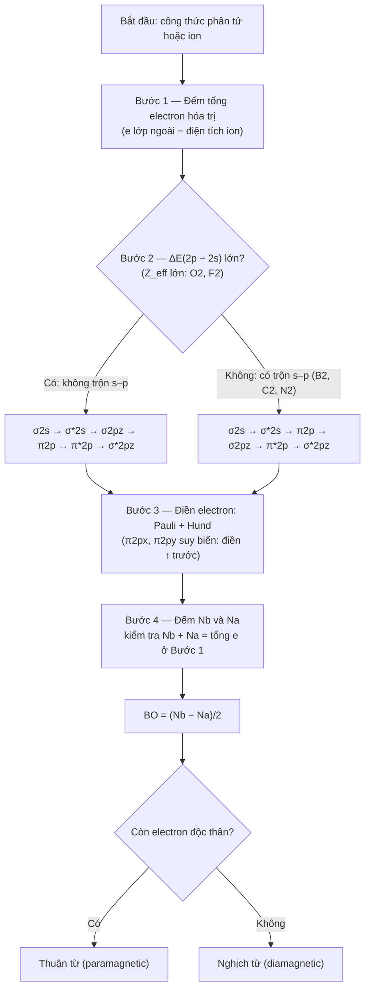

# Chương 4: Thuyết Orbital Phân tử (MO) & Phân tích Năng lượng LCAO

---

## 1. Tổng quan chương (Chapter Overview) {T-04.1}

### 1.1 Chương 4: Thuyết Orbital Phân tử (MO) & Phân tích Năng lượng LCAO {T-04.1.1}

Chương 3 cho thấy thuyết liên kết hóa trị (Valence Bond – VB) giải thích tốt liên kết định xứ hai tâm – hai electron nhưng bế tắc trước $O_2$ thuận từ, liên kết đa tâm trong $B_2H_6$ và quang phổ phức chất. Chương 4 chuyển sang quan điểm đa tâm: electron chuyển động trong trường thế chung của toàn bộ hạt nhân, mô tả bằng orbital phân tử (Molecular Orbital – MO) `[SRC: S-04.1]` `[ADDED: bridge from Ch03]`.

Chương gồm LCAO, ba điều kiện tổ hợp, phân loại MO, bậc liên kết – từ tính, giản đồ đồng hạch/dị hạch và $3c\text{–}2e$, nối Chương 3 với Chương 5–6 `[ADDED: scope summary]`.

### 1.2 Phạm vi, Kiến thức Tiên quyết & Thời lượng Học tập {T-04.1.2}

- **Kiến thức tiên quyết:**
  1. Cấu hình electron, Pauli, Hund, hình dạng AO $s, p$.
  2. Bậc liên kết, $E_{lk}$ tại `T-01.4.1`; MO mở rộng định nghĩa Lewis `[ADDED: cross-reference to Ch01]`.
  3. $SN = m + n$, lai hóa, liên kết $\sigma, \pi$ tại `T-02.4.2`, `T-03.4.2` `[ADDED: cross-reference to Ch02–03]`.
  4. Ba hạn chế VB tại `T-03.4.6`; độ âm điện $\chi$ `[ADDED: cross-reference to Ch03]`.
- **Thời lượng dự kiến:** ~**3 giờ 30 phút** (khoảng 2 giờ 50 phút cho ~4.200 từ lý thuyết – ví dụ tại Mục 1–6, tức ≈ 2,8 giờ; cộng 40 phút cho 10 bài tập ≈ 3 giờ 30 phút), theo `STUDY_TIME_RULE` `[ADDED: study time estimate]`.

---

## 2. Mục tiêu học tập (Learning Objectives) {T-04.2}

### 2.1 Chuẩn đầu ra Kiến thức, Kỹ năng, Vận dụng và Đánh giá mô hình (LO-1..LO-4) {T-04.2.1}

Sau chương này, sinh viên có thể `[ADDED: learning objectives]`:

- **`LO-1` (Kiến thức):** Phát biểu bản chất MO (hạt nhân đa tâm), LCAO, ba điều kiện tổ hợp, phân loại MO, công thức $BO$ và tiêu chí từ tính.
- **`LO-2` (Kỹ năng):** Lập giản đồ MO đồng hạch chu kỳ 2 với hai trật tự mức, điền electron theo Pauli–Hund, tính $BO$, dự đoán độ dài, năng lượng liên kết và từ tính.
- **`LO-3` (Vận dụng):** Giải thích $O_2$ thuận từ, bậc bán nguyên của dãy oxygen ($O_2^+, O_2^-$; $H_2^+$ là ví dụ minh họa cho bậc 0,5), khác biệt $N_2$/$O_2$ và cơ chế CO–hemoglobin qua HOMO–LUMO.
- **`LO-4` (Đánh giá mô hình):** So sánh MO với VB, nhận diện khi nào cần MO, giải thích $3c\text{–}2e$ trong $B_2H_6$ và nêu giới hạn mô hình.

---

## 3. Đặt vấn đề & Ý nghĩa thực tiễn (Introduction) {T-04.3}

### 3.1 Từ Giới hạn của Thuyết VB đến Thuyết Orbital Phân tử {T-04.3.1}

VB giả định electron liên kết định xứ và ghép đôi — đúng với phần lớn phân tử hữu cơ nhưng sai trước ba dữ kiện: $O_2$ lỏng thuận từ (công thức $:\ddot{O}=\ddot{O}:$ dự đoán nghịch từ), $B_2H_6$ chỉ có 12 electron hóa trị vẫn bền nhờ liên kết cầu, và VB không định lượng được mức năng lượng nên không giải thích quang phổ `[SRC: S-04.6]` `[ADDED: bridge from Ch03]`.

MO bỏ ràng buộc định xứ; phân bố electron trên MO quyết định độ bền và từ tính. MO bổ sung, không phủ định VB `[SRC: S-04.6]` `[ADDED: complementary model]` `[VERIFY: liquid O2 paramagnetism (V-04.01)]`.

---

## 4. Nội dung bài giảng chính (Main Content) {T-04.4}

### 4.1 Bản chất Thuyết MO & Phương pháp LCAO {T-04.4.1}

#### 4.1.1 Quan điểm hạt nhân đa tâm và khái niệm Orbital Phân tử {T-04.4.1.1}

> **Definition.** **Orbital phân tử (MO)** là hàm sóng mô tả trạng thái của một electron trong trường thế chung của toàn bộ hạt nhân; $|\Psi|^2$ là mật độ xác suất tìm thấy electron `[SRC: S-04.1]` `[ADDED: probability density interpretation]`.

MO trải trên hai hay nhiều hạt nhân — quan điểm đa tâm — nên mô tả tự nhiên electron phi định xứ, điều VB phải gán cho cấu trúc cộng hưởng `[SRC: S-04.1]` `[ADDED: comparison with VB]`.

#### 4.1.2 Tổ hợp tuyến tính AO: MO liên kết (Ψ) và MO phản liên kết (Ψ*) {T-04.4.1.2}

MO được tính gần đúng bằng tổ hợp tuyến tính các AO:

$$\Psi = c_A \varphi_A + c_B \varphi_B \quad \text{(liên kết)} \qquad \Psi^* = c_A \varphi_A - c_B \varphi_B \quad \text{(phản liên kết)}$$

với $\varphi_A, \varphi_B$ là hàm sóng AO; $c_A, c_B$ là hệ số tổ hợp (không thứ nguyên); dấu $*$ chỉ MO phản liên kết. Cộng cùng dấu tăng mật độ electron giữa hai hạt nhân (liên kết); trừ tạo mặt phẳng nút (phản liên kết) `[SRC: S-04.1]` `[ADDED: standard LCAO background]`.

#### 4.1.3 Điều kiện chuẩn hóa và ý nghĩa hệ số tổ hợp {T-04.4.1.3}

Bỏ qua xen phủ, điều kiện chuẩn hóa là:

$$c_A^2 + c_B^2 = 1$$

với $c_A^2, c_B^2$ là phần đóng góp của mỗi AO (không thứ nguyên); đồng hạch có $c_A = \pm c_B = 1/\sqrt{2}$, dị hạch có $c_A \neq c_B$ và AO năng lượng thấp đóng góp nhiều hơn `[ADDED: standard LCAO background]` `[VERIFY: normalization with overlap neglected (V-04.11)]`.

Năng lượng hai MO là:

$$E_{\pm} = \frac{\alpha \pm \beta}{1 \pm S}$$

trong đó $\alpha$ là tích phân Coulomb ($\alpha < 0$), $\beta$ là tích phân cộng hưởng ($\beta < 0$), $S$ là tích phân xen phủ ($|S| \le 1$; theo quy ước pha chọn $S > 0$ khi xen phủ hiệu quả); $\alpha, \beta$ có đơn vị năng lượng. Xét $E_{+} = (\alpha+\beta)/(1+S)$ với $\alpha, \beta < 0$: $E_{+}$ nằm dưới $\alpha$ (liên kết) khi $\beta < \alpha S$, tức $|\beta| > |\alpha|S$; khi tích phân cộng hưởng đủ lớn, $E_{+}$ là MO liên kết và $E_{-}$ là MO phản liên kết `[ADDED: standard LCAO background]` `[VERIFY: LCAO energy expression convention (V-04.11)]`.

### 4.2 Ba điều kiện tiên quyết để tổ hợp AO thành MO hiệu quả {T-04.4.2}

Ba điều kiện phải thỏa đồng thời `[SRC: S-04.2]`.

#### 4.2.1 Điều kiện năng lượng {T-04.4.2.1}

Hai AO phải có $\Delta E \le 10\text{–}14\text{ eV}$ — giá trị tham khảo, phụ thuộc mô hình. $\Delta E$ càng nhỏ, tương tác càng mạnh; quá lớn thì AO không trộn lẫn. Với cặp $2p$–$2s$, ngưỡng thường lấy $\le 12\text{ eV}$ `[SRC: S-04.2]` `[VERIFY: delta E threshold (V-04.04)]`.

#### 4.2.2 Điều kiện xen phủ {T-04.4.2.2}

Tích phân xen phủ:

$$S_{AB} = \int \varphi_A \varphi_B \, d\tau$$

với $d\tau$ là vi phân thể tích, tích phân trên toàn không gian; $S_{AB}$ không thứ nguyên, $|S_{AB}| \le 1$; theo quy ước pha chọn $S_{AB} > 0$ khi xen phủ hiệu quả và phải đáng kể. $S_{AB} = 0$ nghĩa là hai AO không tương tác `[SRC: S-04.2]` `[ADDED: overlap integral meaning]`.

#### 4.2.3 Điều kiện đối xứng và quy ước trục liên kết Oz {T-04.4.2.3}

Hai AO phải cùng đối xứng với trục liên kết $Oz$: $s$ tổ hợp với $s$ và $p_z$ tạo MO $\sigma$; $s$ với $p_x$ hoặc $p_y$ có $S = 0$ vì phần dương và âm triệt tiêu `[SRC: S-04.2]`.

### 4.3 Phân loại MO, Bậc liên kết & Từ tính {T-04.4.3}

#### 4.3.1 MO liên kết (σ, π), MO phản liên kết (σ*, π*) và MO không liên kết (n) {T-04.4.3.1}

MO liên kết thấp hơn AO, tăng mật độ electron liên nhân, làm bền; MO phản liên kết cao hơn, có mặt phẳng nút, làm mất bền; MO không liên kết $n$ giữ nguyên năng lượng (ví dụ $2p$ vuông góc trục trong HF) `[SRC: S-04.3]` `[ADDED: example for n]`.

**Bảng 4.1.** So sánh năm loại MO theo độ chiếm, đối xứng, năng lượng và tác dụng lên liên kết.

| Loại MO | Ký hiệu | Độ chiếm điển hình | Đối xứng / mặt phẳng nút | Năng lượng | Tác dụng |
|---|---|---|---|---|---|
| Liên kết sigma | $\sigma$ | 2 e | Đối xứng trục, 0 mặt phẳng nút chứa trục | Thấp hơn | Làm bền |
| Liên kết pi | $\pi$ | 2 e/MO (tối đa 4) | 1 mặt phẳng nút chứa trục | Thấp hơn, thường trên $\sigma$ | Làm bền, yếu hơn $\sigma$ |
| Phản liên kết sigma | $\sigma^*$ | 0–2 e | Mặt phẳng nút giữa hai hạt nhân | Cao hơn | Làm mất bền |
| Phản liên kết pi | $\pi^*$ | 0–4 e | 2 mặt phẳng nút | Cao hơn | Làm mất bền |
| Không liên kết | $n$ | 2 e (cặp tự do) | Không xen phủ | Giữ nguyên | Trung tính |

Bảng 4.1 cho thấy mức làm bền giảm $\sigma > \pi$, còn mức phá bền tăng theo chiều $\sigma^* > \pi^*$ ($\pi^*$ phá bền ít hơn $\sigma^*$) `[ADDED: summary table]`.

#### 4.3.2 Công thức bậc liên kết và bản chất bậc liên kết phân số {T-04.4.3.2}

$$BO = \frac{N_b - N_a}{2}$$

với $N_b, N_a$ là số electron trên MO liên kết và phản liên kết; $BO$ không thứ nguyên. $BO > 0$ có liên kết cộng hóa trị; $BO = 0$ không có liên kết cộng hóa trị bền — $He_2$ có $(\sigma_{1s})^2(\sigma^*_{1s})^2$, $BO = 0$, chỉ tồn tại như dimer van der Waals `[SRC: S-04.3]` `[ADDED: He2 van der Waals dimer]` `[VERIFY: He2 bond order statement (V-04.10)]`.

Trong dãy oxygen, $BO$ bán nguyên vì electron độc thân chỉ chiếm một trong hai MO $\pi^*$ suy biến, làm giảm nửa đơn vị bậc liên kết: $O_2^+$ 2,5; $O_2^-$ 1,5 (còn $O_2^{2-}$ có $BO = 1$, số nguyên). Riêng $H_2^+$ có $BO = 0,5$ do chỉ có một electron trên MO liên kết $\sigma_{1s}$ duy nhất (không suy biến) — bậc bán nguyên ở đây đến từ việc thiếu một electron để đủ cặp, không phải từ độ chiếm lẻ trên cặp suy biến `[SRC: S-04.3]` `[ADDED: fractional bond order]` `[VERIFY: BO values (V-04.02)]`.

#### 4.3.3 Thuận từ (Paramagnetic) và Nghịch từ (Diamagnetic) {T-04.4.3.3}

Thuận từ khi có ít nhất một electron độc thân; nghịch từ khi mọi electron ghép đôi `[SRC: S-04.3]`. Tiêu chí là số electron độc thân, không phải $BO$: $N_2$ và $CO$ có $BO = 3$ nhưng nghịch từ, $B_2$ có $BO = 1$ nhưng thuận từ. Bỏ cách nhớ "BO lẻ → thuận từ" `[VERIFY: mnemonic correction (V-04.12)]`.

### 4.4 Giản đồ năng lượng MO phân tử đồng hạch chu kỳ 2 (A₂) {T-04.4.4}

Đọc giản đồ từ dưới lên, điền electron theo Pauli và Hund; trật tự mức phụ thuộc mức trộn $2s$–$2p$ `[SRC: S-04.4]`.

#### 4.4.1 Trường hợp không có tương tác 2s–2p: trật tự chuẩn của O₂, F₂ {T-04.4.4.1}

O và F có $Z_{eff}$ lớn, $2s$ giữ chặt, $\Delta E(2p-2s)$ lớn nên không trộn:

$$\sigma_{2s} < \sigma^*_{2s} < \sigma_{2p_z} < (\pi_{2p_x} = \pi_{2p_y}) < (\pi^*_{2p_x} = \pi^*_{2p_y}) < \sigma^*_{2p_z}$$

với $\sigma_{2p_z}$ từ xen phủ trục $2p_z$; $\pi_{2p_x}, \pi_{2p_y}$ suy biến từ xen phủ bên $2p_x, 2p_y$ `[SRC: S-04.4]` `[VERIFY: MO ordering and s-p mixing (V-04.07)]`.

#### 4.4.2 Trường hợp có tương tác 2s–2p: nghịch đảo năng lượng ở B₂, C₂, N₂ {T-04.4.4.2}

Với B, C, N ($Z \le 7$), $\Delta E(2p-2s)$ nhỏ ($\le 12\text{ eV}$); hai MO $\sigma$ cùng đối xứng trộn cấu hình, đẩy $\sigma_{2p_z}$ lên trên $\pi_{2p}$:

$$\sigma_{2s} < \sigma^*_{2s} < (\pi_{2p_x} = \pi_{2p_y}) < \sigma_{2p_z} < (\pi^*_{2p_x} = \pi^*_{2p_y}) < \sigma^*_{2p_z}$$

Đây là trộn cấu hình, không phải "lực đẩy tĩnh điện" cổ điển `[SRC: S-04.4]` `[ADDED: configuration mixing]` `[VERIFY: MO ordering and s-p mixing (V-04.07)]`. $N_2$ có $BO = 3$ và $E_{lk} \approx 945\text{ kJ/mol}$ `[VERIFY: N2 bond energy (V-04.03)]`.

#### 4.4.3 Giải quyết nghịch lý O₂: cấu hình electron, 2 electron độc thân trên π*, tính thuận từ {T-04.4.4.3}

$O_2$ có 12 electron hóa trị:

$$(\sigma_{2s})^2(\sigma^*_{2s})^2(\sigma_{2p_z})^2(\pi_{2p_x})^2(\pi_{2p_y})^2(\pi^*_{2p_x})^1(\pi^*_{2p_y})^1$$

Hai electron cuối vào hai MO $\pi^*$ suy biến với spin song song theo Hund, nên $O_2$ có **2 electron độc thân**; $N_b = 8$, $N_a = 4$, $BO = 2$. $O_2$ thuận từ, đúng thực nghiệm, điều VB không giải thích được `[SRC: S-04.4]` `[ADDED: MO vs VB language]` `[VERIFY: O2 configuration and paramagnetism (V-04.01)]`.

#### 4.4.4 Bảng tổng hợp phân tử đồng hạch chu kỳ 2 (Bảng 4.2) {T-04.4.4.4}

**Bảng 4.2.** Cấu hình MO, bậc liên kết và từ tính của phân tử đồng hạch chu kỳ 2. Ký hiệu gộp $(\pi_{2p})^n$ chỉ tổng số electron trên cặp $\pi_{2p_x}, \pi_{2p_y}$ suy biến; cấu hình tách chi tiết ở Bảng 4.3 (họ oxygen) và Bài tập 7 (đủ năm phân tử $B_2, C_2, N_2, O_2, F_2$).

| Phân tử | Tổng e hóa trị | Cấu hình MO (lớp hóa trị) | $N_b$ | $N_a$ | $BO$ | Số e độc thân | Từ tính |
|---|---|---|---|---|---|---|---|
| $B_2$ | 6 | $(\sigma_{2s})^2(\sigma^*_{2s})^2(\pi_{2p})^2$ | 4 | 2 | 1 | 2 | Thuận từ |
| $C_2$ | 8 | $(\sigma_{2s})^2(\sigma^*_{2s})^2(\pi_{2p})^4$ | 6 | 2 | 2 | 0 | Nghịch từ |
| $N_2$ | 10 | $(\sigma_{2s})^2(\sigma^*_{2s})^2(\pi_{2p})^4(\sigma_{2p_z})^2$ | 8 | 2 | 3 | 0 | Nghịch từ |
| $O_2$ | 12 | $(\sigma_{2s})^2(\sigma^*_{2s})^2(\sigma_{2p_z})^2(\pi_{2p})^4(\pi^*_{2p})^2$ | 8 | 4 | 2 | 2 | Thuận từ |
| $F_2$ | 14 | $(\sigma_{2s})^2(\sigma^*_{2s})^2(\sigma_{2p_z})^2(\pi_{2p})^4(\pi^*_{2p})^4$ | 8 | 6 | 1 | 0 | Nghịch từ |

Bảng 4.2 cho thấy $BO$ tăng từ $B_2$ (1) đến $N_2$ (3) rồi giảm đến $F_2$ (1); chỉ $B_2$ và $O_2$ thuận từ `[ADDED: B2, C2, F2 standard configurations]` `[VERIFY: MO configurations and magnetism (V-04.07)]`.

### 4.5 Phân tử dị hạch, Orbital biên HOMO–LUMO & Carbon Monoxide {T-04.4.5}

#### 4.5.1 Nguyên tắc giản đồ MO dị hạch: AO lệch năng lượng và hệ số tổ hợp không bằng nhau {T-04.4.5.1}

Ở $AB$ dị hạch, hai AO lệch năng lượng nên $c_A \neq c_B$; MO liên kết mang đặc tính của AO thấp hơn (nguyên tử âm điện hơn) `[ADDED: heteronuclear MO principle]`.

> **Definition.** **HOMO** là orbital bị chiếm có năng lượng cao nhất; **LUMO** là orbital trống có năng lượng thấp nhất. Cặp HOMO–LUMO là **orbital biên**, quyết định khả năng cho – nhận electron `[ADDED: LUMO and frontier orbital]`.

#### 4.5.2 CO: HOMO tập trung trên C, LUMO là π*, cơ chế σ-donor và π-backbonding {T-04.4.5.2}

CO có 10 electron hóa trị, đồng electron với $N_2$: $(\sigma_{2s})^2(\sigma^*_{2s})^2(\pi_{2p})^4(\sigma_{2p_z})^2$, $BO = 3$, nghịch từ. Theo nhãn dị hạch dùng ở Hình 4.4, $\sigma_{2p_z} \equiv 5\sigma$ (HOMO) và $\sigma^*_{2p_z} \equiv 6\sigma^*$. Vì $\chi(O) > \chi(C)$, HOMO là orbital $\sigma$ tập trung trên C, LUMO là $\pi^*$ `[SRC: S-04.5]` `[VERIFY: CO MO diagram and HOMO localization (V-04.06)]`.

Cơ chế gồm **cho $\sigma$ ($\sigma$-donor)**: C cho cặp electron vào $d$ trống của $Fe^{2+}$; và **cho ngược $\pi$ ($\pi$-backbonding)**: kim loại chuyển mật độ electron vào $\pi^*$, làm bền M–C và yếu C–O `[SRC: S-04.5]` `[ADDED: orbital interaction]`.

#### 4.5.3 Hệ quả dược học: CO gắn mạnh hemoglobin, cản vận chuyển oxy {T-04.4.5.3}

CO gắn mạnh vào $Fe^{2+}$ của hemoglobin (Hb), cạnh tranh và làm giảm khả năng vận chuyển $O_2$. Liên kết CO–Hb bền gấp **200–250 lần** Hb–$O_2$, làm bất hoạt vận chuyển oxy và gây tử vong do ngạt mô nội bào `[SRC: S-04.5]` `[VERIFY: CO-Hb affinity 200–250 times (V-04.05)]`.

> **Important Note.** Chương chỉ giải thích cơ chế orbital theo nguồn; không trình bày liều, chỉ định, phác đồ hay dược động học `[ADDED: DOMAIN_RULES scope note]`.

### 4.6 Liên kết ba tâm – hai electron (3c–2e) trong Diborane (B₂H₆) {T-04.4.6}

$B_2H_6$ có 12 electron hóa trị: 4 liên kết B–H biên ($2c\text{–}2e$, 8 electron) và 2 cầu B–H–B ($3c\text{–}2e$, 4 electron) `[ADDED: standard MO treatment of 3c–2e bridge bond]` `[VERIFY: B2H6 electron count (V-04.09)]`.

Mỗi cầu do hai AO $sp^3$ của B và một AO $1s$ của H tổ hợp thành ba MO: liên kết, không liên kết và phản liên kết. Cặp electron duy nhất chiếm MO liên kết trải trên cả ba tâm, tạo liên kết B–H–B mà VB định xứ không mô tả được — lời giải cho `T-03.4.6` `[ADDED: standard MO treatment of 3c–2e bridge bond]` `[VERIFY: B2H6 3c-2e bonding (V-04.09)]`.

--- 

## 5. Ví dụ minh họa & Quy trình thực hành (Examples & Illustrations) {T-04.5}

Bốn ví dụ dưới đây chuyển quy tắc ở Mục 4 thành thao tác cụ thể; bước Solution luôn ghi $N_b$, $N_a$ và tổng electron hóa trị. `[ADDED: example set structure]`

### 5.1 Ví dụ 4.1: Bậc Liên kết của Họ loài Oxygen và Quy luật Thêm Electron Phản liên kết {T-04.5.1}

> **Example 4.1.** Tính bậc liên kết, số electron độc thân và từ tính cho dãy $O_2^{2-}$, $O_2^-$, $O_2$, $O_2^+$ và $H_2^+$. `[SRC: S-04.8]` `[SRC: S-04.3]`
>
> - **Given (Dữ kiện đã cho):** Bốn loài họ oxygen có 14, 13, 12, 11 electron hóa trị; $H_2^+$ có 1; cả dãy dùng trật tự không trộn $s$–$p$ (Mục 4.4.1). `[ADDED: given data restated from S-04.8 and S-04.3]`
> - **Find (Yêu cầu):** Xác định $N_b$, $N_a$, $BO$, số electron độc thân và từ tính của từng loài.
> - **Approach (Phương pháp giải):** Điền electron từ $\sigma_{2s}$ theo Pauli–Hund; các mức thấp đã đầy nên chỉ thêm hoặc bớt ở $\pi^*_{2p}$.
> - **Solution (Giải):**
>   1. $O_2^{2-}$ (14 e): $(\sigma_{2s})^2(\sigma^*_{2s})^2(\sigma_{2p_z})^2(\pi_{2p})^4(\pi^*_{2p})^4$ → $N_b=8$; $N_a=6$; $BO=1$; 0 electron độc thân → nghịch từ.
>   2. $O_2^-$ (13 e): $(\pi^*_{2p})^3$ → $N_b=8$; $N_a=5$; $BO=1,5$; 1 electron độc thân → thuận từ.
>   3. $O_2$ (12 e): $(\pi^*_{2p})^2$ → $N_b=8$; $N_a=4$; $BO=2$; 2 electron độc thân → thuận từ.
>   4. $O_2^+$ (11 e): $(\pi^*_{2p})^1$ → $N_b=8$; $N_a=3$; $BO=2,5$; 1 electron độc thân → thuận từ.
>   5. $H_2^+$ (1 e): $(\sigma_{1s})^1$ → $N_b=1$; $N_a=0$; $BO=0,5$; 1 electron độc thân → thuận từ. `[ADDED: step-by-step electron bookkeeping]`
> - **Check (Kiểm tra):** $N_b+N_a$ khớp tổng electron hóa trị ở cả năm loài ($14, 13, 12, 11, 1$); khi $BO$ giảm $2,5 \to 2 \to 1,5 \to 1$, độ dài liên kết tăng và năng lượng liên kết giảm (`T-01.4.1`).
> - **Interpretation (Nhận xét):** Thêm electron vào $\pi^*$ tăng $N_a$, giảm $BO$, yếu liên kết. Trong dãy oxygen, $BO$ bán nguyên do electron lẻ chỉ chiếm một trong hai orbital suy biến $\pi^*_{2p_x}$, $\pi^*_{2p_y}$ — trả lời carry-over (b) `T-03.4.6`; riêng $H_2^+$ ($BO=0,5$) có bậc bán nguyên do thiếu một electron để đủ cặp trên $\sigma_{1s}$ duy nhất. `[ADDED: explanation of fractional bond order]` `[VERIFY: fractional bond orders of the O2 series (V-04.02)]`

**Bảng 4.3.** Tổng hợp dãy loài oxygen: số electron hóa trị, cấu hình $\pi^*_{2p}$, $N_b$, $N_a$, $BO$ và từ tính. `[ADDED: Table 4.3]` `[VERIFY: bond order values of the O2 series (V-04.02)]`

| Loài | Tổng e hóa trị | Cấu hình $\pi^*_{2p}$ | $N_b$ | $N_a$ | $BO$ | Số e độc thân | Từ tính |
|---|---|---|---|---|---|---|---|
| $O_2^{2-}$ | 14 | $(\pi^*_{2p_x})^2(\pi^*_{2p_y})^2$ | 8 | 6 | 1 | 0 | Nghịch từ |
| $O_2^-$ | 13 | $(\pi^*_{2p_x})^2(\pi^*_{2p_y})^1$ | 8 | 5 | 1,5 | 1 | Thuận từ |
| $O_2$ | 12 | $(\pi^*_{2p_x})^1(\pi^*_{2p_y})^1$ | 8 | 4 | 2 | 2 | Thuận từ |
| $O_2^+$ | 11 | $(\pi^*_{2p_x})^1$ | 8 | 3 | 2,5 | 1 | Thuận từ |

Bảng 4.3 gom phép đếm.

### 5.2 Ví dụ 4.2: Giản đồ MO, Bậc liên kết và Từ tính của N₂ và O₂ {T-04.5.2}

> **Example 4.2.** Lập giản đồ MO cho $N_2$ và $O_2$, tính $BO$, xác định từ tính và so sánh độ bền liên kết. `[SRC: S-04.4]` `[SRC: S-04.7]`
>
> - **Given (Dữ kiện đã cho):** $N_2$ có 10 electron hóa trị, nhóm trộn $s$–$p$ ($Z\le 7$); $O_2$ có 12 electron, nhóm không trộn $s$–$p$; nguồn ghi $E_{lk}(N_2)\approx 945\ \text{kJ/mol}$. `[VERIFY: N2 bond energy (V-04.03)]` `[VERIFY: MO ordering and s–p mixing (V-04.07)]`
> - **Find (Yêu cầu):** Cấu hình MO, $N_b$, $N_a$, $BO$, số electron độc thân, từ tính.
> - **Approach (Phương pháp giải):** Chọn trật tự mức trước khi điền: $N_2$ theo $\sigma_{2s}<\sigma^*_{2s}<\pi_{2p}<\sigma_{2p_z}<\pi^*_{2p}<\sigma^*_{2p_z}$; $O_2$ theo $\sigma_{2s}<\sigma^*_{2s}<\sigma_{2p_z}<\pi_{2p}<\pi^*_{2p}<\sigma^*_{2p_z}$; dùng Hund cho $\pi_{2p}$ suy biến.
> - **Solution (Giải):**
>   1. $N_2$ (10 e): $(\sigma_{2s})^2(\sigma^*_{2s})^2(\pi_{2p})^4(\sigma_{2p_z})^2$ → $N_b=8$; $N_a=2$; $BO=3$; mọi electron ghép đôi → nghịch từ.
>   2. $O_2$ (12 e): $(\sigma_{2s})^2(\sigma^*_{2s})^2(\sigma_{2p_z})^2(\pi_{2p})^4(\pi^*_{2p})^2$ → $N_b=8$; $N_a=4$; $BO=2$; hai electron cuối điền $\pi^*_{2p_x}$, $\pi^*_{2p_y}$ song song → 2 electron độc thân → thuận từ.
>   3. So sánh: $N_2$ có $BO=3$ (một $\sigma$, hai $\pi$), $O_2$ có $BO=2$; theo `T-01.4.1`, $BO$ lớn ứng với liên kết ngắn, bền, phù hợp $E_{lk}(N_2)$ lớn và tính trơ của $N_2$. `[SRC: S-04.4]`
> - **Check (Kiểm tra):** $8+2=10$ và $8+4=12$ khớp tổng electron hóa trị. Kiểm tra chéo: $B_2$ (6 e): $BO=1$, 2 e độc thân, thuận từ; $C_2$ (8 e): $BO=2$, nghịch từ; $F_2$ (14 e): $N_b=8$, $N_a=6$, $BO=1$, nghịch từ. `[ADDED: cross-check with B2, C2, F2 standard configurations]` `[VERIFY: B2, C2, F2 configurations and magnetism (V-04.07)]`
> - **Interpretation (Nhận xét):** Từ tính chỉ phụ thuộc số electron độc thân: $N_2$ có $BO=3$ nhưng nghịch từ, nên "BO lẻ → thuận từ" là sai. Hai electron độc thân trên $\pi^*$ của $O_2$ là dữ kiện VB không giải thích được (`T-03.4.6`); MO giải thích bằng Hund — carry-over (a). `[VERIFY: O2 paramagnetism (V-04.01)]`

### 5.3 Ví dụ 4.3: CO – Phối tử σ-Donor/π-Acceptor và Độc tính Hemoglobin {T-04.5.3}

> **Example 4.3.** Phân tích giản đồ MO dị hạch của $CO$: xác định $BO$, từ tính, HOMO, LUMO và giải thích vì sao $CO$ gắn hemoglobin mạnh hơn $O_2$. `[SRC: S-04.5]`
>
> - **Given (Dữ kiện đã cho):** $CO$ có 10 electron hóa trị, đồng electron với $N_2$; $\chi(O)>\chi(C)$ nên AO của oxy thấp hơn. HOMO là $\sigma$ trên $C$; LUMO là $\pi^*$; nguồn ghi $CO$–$Hb$ bền gấp $200$–$250$ lần $Hb$–$O_2$. `[VERIFY: CO-Hb affinity 200–250x (V-04.05)]` `[VERIFY: CO MO diagram and HOMO on C (V-04.06)]`
> - **Find (Yêu cầu):** Cấu hình, $N_b$, $N_a$, $BO$, từ tính; vai trò $\sigma$-donor của HOMO và $\pi$-acceptor của LUMO.
> - **Approach (Phương pháp giải):** Áp dụng nguyên tắc dị hạch ở Mục 4.5 nhưng vẫn đếm electron và tính $BO$ như phân tử đồng hạch.
> - **Solution (Giải):**
>   1. $C$ góp 4, $O$ góp 6 → 10 electron hóa trị.
>   2. $(\sigma_{2s})^2(\sigma^*_{2s})^2(\pi_{2p})^4(\sigma_{2p_z})^2$ → $N_b=8$; $N_a=2$; $BO=3$; 0 electron độc thân → nghịch từ.
>   3. HOMO ($\sigma$ trên $C$) cho cặp electron vào orbital $d$ trống của $Fe^{2+}$ trong hemoglobin — $\sigma$-donor.
>   4. LUMO ($\pi^*$) nhận mật độ electron phản hồi từ $Fe^{2+}$ — $\pi$-backbonding; hai tương tác hiệp lực làm $CO$–$Fe$ rất bền. `[ADDED: heteronuclear HOMO–LUMO analysis]`
> - **Check (Kiểm tra):** $8+2=10$ khớp tổng; $BO=3$ trùng $N_2$ đúng dự đoán đồng electron. $BO=3$ (lẻ) nhưng $CO$ nghịch từ — phản chứng thứ hai cho "BO lẻ → thuận từ".
> - **Interpretation (Nhận xét):** $BO$ vẫn đếm được nhưng đối xứng orbital bị phá: HOMO lệch về $C$ nên $CO$ liên kết kim loại qua đầu $C$. Cặp HOMO–LUMO giải thích $\sigma$-donor, $\pi$-backbonding và việc $CO$ gắn mạnh vào hemoglobin, cạnh tranh với $O_2$, gây ngạt mô. `[VERIFY: CO-Hb affinity and clinical consequence (V-04.05)]`

### 5.4 Ví dụ 4.4: Đếm Electron và Mô hình Liên kết 3c–2e trong B₂H₆ {T-04.5.4}

> **Example 4.4.** Đếm tổng electron hóa trị của $B_2H_6$ và phân bố vào bốn liên kết $B$–$H$ biên ($2c$–$2e$) cùng hai cầu $B$–$H$–$B$ ($3c$–$2e$). `[ADDED: worked example on 3c–2e bonding]`
>
> - **Given (Dữ kiện đã cho):** $B_2H_6$ có 2 $B$ (nhóm 13, 3 electron hóa trị) và 6 $H$ (1 electron hóa trị); có hai cầu $B$–$H$–$B$; mô hình $2c$–$2e$ của VB thất bại (`T-03.4.6`). `[VERIFY: B2H6 electron count (V-04.09)]`
> - **Find (Yêu cầu):** Tổng electron hóa trị; cách chia cho khung biên và hai cầu; kiểm tra bảo toàn electron, bát tử.
> - **Approach (Phương pháp giải):** Đếm tổng, trừ electron bốn liên kết biên; phần còn lại chia hai cầu.
> - **Solution (Giải):**
>   1. Tổng electron hóa trị: $2\times 3+6\times 1=12$.
>   2. Bốn liên kết $B$–$H$ biên: $4\times 2=8$ electron.
>   3. Còn $12-8=4$ electron cho hai cầu, mỗi cầu 2 electron chia cho 3 tâm ($2B+1H$) → hai liên kết $3c$–$2e$.
>   4. Mỗi cầu: 2 AO $sp^3$ (mỗi $B$ một AO) + 1 AO $1s$ của $H$ cầu → 3 MO; 2 electron điền vào MO thấp nhất. `[ADDED: standard MO description of the bridge bond]`
> - **Check (Kiểm tra):** $12=8+4$. Mô hình $2c$–$2e$ cho 8 đoạn nối cần 16 electron, phân tử chỉ có 12 — đúng "thiếu electron"; với $3c$–$2e$, mỗi $B$ vẫn đủ 8 electron (4 từ liên kết biên, 4 từ cầu) mà không cần orbital $d$. `[ADDED: electron bookkeeping check]` `[VERIFY: octet counting in B2H6 (V-04.09)]`
> - **Interpretation (Nhận xét):** $BO=(N_b-N_a)/2$ định nghĩa cho cặp nguyên tử nên không áp dụng cho liên kết ba tâm; phải dùng MO đa tâm. Đây là câu trả lời carry-over (c) `T-03.4.6`: electron trải trên ba hạt nhân, không định xứ trên một cặp. `[ADDED: interpretation of multicenter bonding]`

### 5.5 Quy trình 4 Bước Lập Giản đồ MO & Sơ đồ Thuật toán (Mermaid) {T-04.5.5}

Quy trình dưới đây gom quy tắc Mục 4.2–4.4 thành bốn bước cho phân tử hai nguyên tử chu kỳ 2 và dị hạch: `[ADDED: 4-step algorithm synthesizing S-04.2–S-04.4]`

1. **Bước 1 — Đếm tổng electron hóa trị:** cộng electron lớp ngoài, trừ điện tích ion (thêm cho anion, bớt cho cation) — con số kiểm tra cuối cùng.
2. **Bước 2 — Chọn trật tự mức theo mức trộn $2s$–$2p$:** $\Delta E(2p-2s)$ lớn ($O_2$, $F_2$) thì $\sigma_{2p_z}$ dưới $\pi_{2p}$; $\Delta E$ nhỏ ($B_2$, $C_2$, $N_2$) thì ngược lại; dị hạch thêm cột AO lệch năng lượng, $c_A\neq c_B$.
3. **Bước 3 — Điền electron theo Pauli và Hund:** từ mức thấp lên, mỗi orbital tối đa 2 electron trái chiều; orbital suy biến ($\pi_{2p_x}$, $\pi_{2p_y}$) nhận một electron mỗi ô rồi mới ghép đôi.
4. **Bước 4 — Tính $BO$ và đọc từ tính:** đếm $N_b$, $N_a$, kiểm tra $N_b+N_a$ bằng tổng ở Bước 1, tính $BO$, đếm electron độc thân.

$$BO=\frac{N_b-N_a}{2}$$

trong đó $N_b$, $N_a$ là tổng electron trên MO liên kết và phản liên kết; $BO$ không có thứ nguyên. `[SRC: S-04.3]`

Thuật toán được mã hóa trong **Hình 4.1**:

**Hình 4.1.** Sơ đồ thuật toán 4 bước lập giản đồ MO. `[ADDED: Mermaid flowchart]` `[VERIFY: MO ordering and s–p mixing (V-04.07)]`

### 5.6 Minh họa Trực quan Giản đồ MO & Sơ đồ Xen phủ Orbital {T-04.5.6}

Năm hình dưới đây chỉ là khung giữ chỗ, **chưa được vẽ**; mỗi khung nêu nội dung, trục/nhãn và căn cứ. Hình 4.2–4.3 đối chiếu hai trật tự mức; 4.4 cho CO; 4.5 xen phủ; 4.6 cầu $3c$–$2e$. `[ADDED: figure placeholder specifications]`

**Hình 4.2.** Giản đồ MO của $O_2$ và $F_2$ (khung giữ chỗ). `[ADDED: Figure 4.2 caption]`

**Hình 4.3.** Giản đồ MO của $B_2$, $C_2$, $N_2$ (khung giữ chỗ). `[ADDED: Figure 4.3 caption]`

**Hình 4.4.** Giản đồ MO dị hạch của $CO$, HOMO trên $C$, LUMO $\pi^*$ (khung giữ chỗ). `[ADDED: Figure 4.4 caption]` `[VERIFY: CO MO diagram and HOMO on C (V-04.06)]`

**Hình 4.5.** Xen phủ orbital tạo MO liên kết và phản liên kết $\sigma$, $\pi$ (khung giữ chỗ). `[ADDED: Figure 4.5 caption]`

**Hình 4.6.** Hai cầu $B$–$H$–$B$ kiểu $3c$–$2e$ trong $B_2H_6$ (khung giữ chỗ). `[ADDED: Figure 4.6 caption]` `[VERIFY: B2H6 3c–2e bonding (V-04.09)]`

---

## 6. Tóm tắt chương (Chapter Summary) {T-04.6}

### 6.1 Tóm tắt Nội dung Trọng tâm & Quy tắc Ghi nhớ {T-04.6.1}

Các luận điểm chính của thuyết MO: `[SRC: S-04.6]` `[SRC: S-04.9]`

1. **Bản chất và LCAO:** electron thuộc toàn phân tử; $\Psi=c_A\varphi_A+c_B\varphi_B$ (liên kết) và $\Psi^*=c_A\varphi_A-c_B\varphi_B$ (phản liên kết), $c_A^2+c_B^2=1$; đồng hạch $c_A=c_B$, dị hạch $c_A\neq c_B$.
2. **Ba điều kiện tổ hợp:** năng lượng xấp xỉ, xen phủ $S_{AB}>0$ đáng kể, cùng đối xứng với trục $z$.
3. **Phân loại và bậc liên kết:** liên kết thấp hơn AO xuất phát, tăng mật độ electron giữa hai hạt nhân; phản liên kết cao hơn, có mặt phẳng nút; không liên kết giữ nguyên năng lượng. $BO$ lớn → liên kết ngắn, bền; $BO=0$ → không có liên kết cộng hóa trị bền ($He_2$); trong dãy oxygen, $BO$ bán nguyên do electron lẻ trên orbital $\pi^*$ suy biến (riêng $H_2^+$: thiếu một electron trên $\sigma_{1s}$).
4. **Từ tính:** chỉ căn cứ số electron độc thân; $N_2$ và $CO$ có $BO=3$ nhưng nghịch từ.
5. **Hai trật tự mức:** $O_2$, $F_2$ có $\sigma_{2p_z}$ dưới $\pi_{2p}$; $B_2$, $C_2$, $N_2$ ngược lại do trộn $s$–$p$.
6. **Dị hạch và orbital biên:** MO liên kết thiên về nguyên tử có AO thấp hơn; ở $CO$, HOMO là $\sigma$ trên $C$ ($\sigma$-donor), LUMO là $\pi^*$ ($\pi$-acceptor).
7. **Liên kết đa tâm:** $B_2H_6$ có 12 electron hóa trị = 4 liên kết $B$–$H$ biên ($2c$–$2e$) + 2 cầu ($3c$–$2e$), nơi VB định xứ bất lực.
8. **Liên hệ phổ:** vì định lượng được mức năng lượng MO, thuyết MO giải thích sự hấp thụ ánh sáng (UV–Vis) và màu sắc tốt hơn mô hình liên kết cục bộ `[SRC: S-04.6]` `[ADDED: UV–Vis/color gloss]`.

> **Quy tắc ghi nhớ (đã hiệu chỉnh):**
> - **Bậc liên kết:** $BO=\dfrac{N_b-N_a}{2}$; $BO$ lớn → liên kết ngắn và bền.
> - **Thứ tự điền:** $\sigma_s$, $\sigma_s^*$, rồi $\pi_p$ và $\sigma_p$ — $N_2$, $B_2$, $C_2$: $\pi_p$ dưới $\sigma_p$; $O_2$, $F_2$: $\sigma_p$ dưới $\pi_p$.
> - **Từ tính:** còn electron độc thân → thuận từ; toàn bộ ghép đôi → nghịch từ. Vế "BO lẻ → thuận từ" đã bỏ vì $N_2$, $CO$ có $BO=3$ nhưng nghịch từ. `[ADDED: corrected mnemonic]` `[VERIFY: mnemonic correction (V-04.12)]`

### 6.2 Bảng Tổng hợp Công thức, Quy tắc và Mối quan hệ Khái niệm {T-04.6.2}

**Bảng 4.4** gom công thức, hai trật tự mức, quy tắc từ tính, chuỗi Lewis → VSEPR → VB → MO: `[ADDED: summary concept table]`

**Bảng 4.4.** Tổng hợp công thức, quy tắc và mối quan hệ khái niệm của chương 4. `[ADDED: Table 4.4 title]`

| Hạng mục | Công thức / Quy tắc | Ý nghĩa và điều kiện áp dụng | Ví dụ trong chương |
|---|---|---|---|
| **Bậc liên kết theo MO** | $BO=\dfrac{N_b-N_a}{2}$ | $N_b$, $N_a$ đếm trên giản đồ; $BO>0$ mới có liên kết cộng hóa trị; $BO$ lớn → $r$ ngắn, $E_{lk}$ cao; $BO=0$ → không có liên kết cộng hóa trị bền | $N_2$: $3$; $O_2$: $2$; $O_2^+$: $2,5$; $H_2^+$: $0,5$ |
| **Ba điều kiện tổ hợp AO** | $\Delta E$ xấp xỉ; $S_{AB}>0$ đáng kể; cùng đối xứng với trục $z$ | Thiếu một điều kiện thì xen phủ hiệu dụng bằng 0, không tạo MO liên kết | $s$–$s$, $s$–$p_z$, $p_z$–$p_z$ → $\sigma$; $s$–$p_x$ → không liên kết |
| **Trật tự MO không trộn $s$–$p$** | $\sigma_{2s}<\sigma^*_{2s}<\sigma_{2p_z}<\pi_{2p}<\pi^*_{2p}<\sigma^*_{2p_z}$ | $\Delta E(2p-2s)$ lớn, $Z_{eff}$ lớn; áp dụng cho $O_2$, $F_2$ | $F_2$: $BO=1$, nghịch từ |
| **Trật tự MO có trộn $s$–$p$** | $\sigma_{2s}<\sigma^*_{2s}<\pi_{2p}<\sigma_{2p_z}<\pi^*_{2p}<\sigma^*_{2p_z}$ | $\Delta E(2p-2s)$ nhỏ, $Z\le 7$; $\sigma_{2p_z}$ bị đẩy lên trên $\pi_{2p}$ | $B_2$: $BO=1$, thuận từ; $C_2$: $BO=2$, nghịch từ |
| **Quy tắc từ tính** | Có $\ge 1$ electron độc thân → thuận từ; toàn bộ ghép đôi → nghịch từ | Chỉ đếm electron độc thân, không dựa vào $BO$ chẵn hay lẻ | $N_2$, $CO$: $BO=3$ nhưng nghịch từ; $O_2$, $B_2$: thuận từ |
| **Liên hệ Lewis → VSEPR → VB → MO** | Lewis: cặp electron định xứ; VSEPR: hình học từ $SN$; VB: xen phủ AO và lai hóa; MO: electron phi định xứ trên toàn phân tử | Bốn mô hình bổ sung nhau, không thay thế nhau; MO cần khi gặp từ tính bất thường, liên kết đa tâm hoặc cần orbital biên | $O_2$ (từ tính); $B_2H_6$ ($3c$–$2e$); $CO$ (HOMO–LUMO) |

---

## 7. Đánh giá & Bài tập tự lượng giá (Review & Assessment) {T-04.7}

[ADDED: assessment section frame] Bộ câu hỏi và bài tập dưới đây được thiết kế theo thang nhận thức từ Nhận biết, Thông hiểu đến Vận dụng, Phân tích và Đánh giá mô hình, bao phủ bốn chuẩn đầu ra `LO-1`–`LO-4` đã phát biểu tại `T-04.2.1`. Mỗi câu đều ghi rõ chuẩn đầu ra và cấp độ nhận thức; đáp án chi tiết nằm tại `T-04.7.4`. Sinh viên nên tự làm bài đầy đủ trước khi đọc đáp án chi tiết.

### 7.1 Câu hỏi Lý thuyết: Nhận biết & Thông hiểu (LO-1) {T-04.7.1}

[ADDED: knowledge and comprehension questions]

**Câu 1 (`LO-1` – Knowledge).** Phát biểu nào sau đây mô tả đúng nhất quan điểm hạt nhân đa tâm và phương pháp tổ hợp tuyến tính orbital nguyên tử (LCAO)?

- **A.** Electron vẫn thuộc riêng từng liên kết hai nguyên tử; MO chỉ là tên gọi khác của AO.
- **B.** Electron chuyển động trong trường thế chung của toàn bộ hạt nhân; hàm sóng MO được xấp xỉ bằng tổ hợp tuyến tính các AO, $\Psi = c_A\varphi_A + c_B\varphi_B$ (MO liên kết) và $\Psi^* = c_A\varphi_A - c_B\varphi_B$ (MO phản liên kết).
- **C.** Mỗi MO chỉ được tạo thành từ hai AO có năng lượng bằng nhau tuyệt đối và cùng thuộc một nguyên tử.
- **D.** Trong LCAO, electron luôn cư trú trên AO của nguyên tử có độ âm điện lớn hơn.

**Câu 2 (`LO-1` – Comprehension).** Ba điều kiện tiên quyết để các AO tổ hợp thành MO có hiệu quả là

- **A.** cùng năng lượng tuyệt đối, cùng kích thước hình học và cùng số electron.
- **B.** năng lượng xấp xỉ nhau; tích phân xen phủ $S_{AB} = \int \varphi_A\varphi_B\,d\tau > 0$ có giá trị đáng kể; cùng tính đối xứng đối với trục liên kết (quy ước $Oz$).
- **C.** năng lượng càng khác nhau càng tốt; $S_{AB} = 0$; khác tính đối xứng.
- **D.** chỉ cần khoảng cách giữa hai hạt nhân nhỏ hơn $100\text{ pm}$, không phụ thuộc năng lượng hay đối xứng.

**Câu 3 (`LO-1` – Comprehension).** Phát biểu nào sau đây đúng khi phân biệt MO liên kết, MO phản liên kết và MO không liên kết?

- **A.** MO liên kết có năng lượng cao hơn AO xuất phát và có mặt phẳng nút ở giữa hai hạt nhân.
- **B.** MO phản liên kết có năng lượng thấp hơn AO xuất phát và làm tăng mật độ electron ở vùng liên nhân.
- **C.** MO không liên kết ($n$) tham gia xen phủ mạnh nên năng lượng thay đổi đáng kể so với AO ban đầu.
- **D.** MO liên kết ($\sigma, \pi$) có năng lượng thấp hơn AO xuất phát và tăng mật độ electron ở vùng liên nhân; MO phản liên kết ($\sigma^*, \pi^*$) có năng lượng cao hơn và có mặt phẳng nút giữa hai hạt nhân; MO không liên kết ($n$) giữ nguyên năng lượng của AO ban đầu.

**Câu 4 (`LO-1` – Comprehension).** Viết công thức bậc liên kết theo thuyết MO và nêu ý nghĩa của $N_b$, $N_a$. Tiêu chí nào quyết định một phân tử là thuận từ hay nghịch từ? Một sinh viên phát biểu: “Hễ bậc liên kết là số lẻ thì phân tử thuận từ”. Hãy bác bỏ phát biểu này bằng hai phản ví dụ và giải thích ngắn. `[SRC: S-04.3, S-04.9]`

### 7.2 Bài tập Áp dụng: Giản đồ MO, Bậc liên kết & Từ tính (LO-2, LO-3) {T-04.7.2}

[ADDED: application exercises] Các bài tập dưới đây yêu cầu vận dụng quy trình 4 bước tại `T-04.5.5`; khi trình bày, cần ghi rõ trật tự mức năng lượng được chọn và lý do.

**Bài tập 5 (`LO-2` – Application).** Cho bốn tiểu phân thuộc họ oxygen: $O_2^+$, $O_2$, $O_2^-$ và $O_2^{2-}$. Với mỗi tiểu phân, hãy:

1. Đếm tổng số electron hóa trị.
2. Viết cấu hình electron trên giản đồ MO, dùng ký hiệu $\sigma_{2s}, \sigma^*_{2s}, \sigma_{2p_z}, \pi_{2p_x}, \pi_{2p_y}, \pi^*_{2p_x}, \pi^*_{2p_y}, \sigma^*_{2p_z}$ (không dùng ký hiệu gộp $\pi_{2p}$).
3. Xác định $N_b$, $N_a$, tính $BO$, số electron độc thân và kết luận về từ tính.
4. Sắp xếp chiều tăng độ dài liên kết và chiều giảm năng lượng liên kết.

**Bài tập 6 (`LO-2` – Application).** Lập giản đồ năng lượng MO cho $N_2$ (10 electron hóa trị) và $F_2$ (14 electron hóa trị). Với mỗi phân tử, hãy:

1. Chọn đúng trật tự mức năng lượng (có hoặc không có trộn $s$–$p$) và giải thích ngắn vì sao.
2. Điền electron theo quy tắc Hund, xác định $N_b$, $N_a$ và $BO$.
3. Xác định số electron độc thân và từ tính.
4. So sánh định tính độ dài và năng lượng liên kết giữa $N_2$ và $F_2$.

**Bài tập 7 (`LO-3` – Application).** Cho năm phân tử đồng hạch chu kỳ 2: $B_2$, $C_2$, $N_2$, $O_2$, $F_2$.

1. Viết cấu hình electron hóa trị trên giản đồ MO cho từng phân tử.
2. Lập bảng gồm: tổng electron hóa trị, $N_b$, $N_a$, $BO$, số electron độc thân và từ tính.
3. Giải thích vì sao $B_2$ và $O_2$ thuận từ, còn $C_2$, $N_2$, $F_2$ nghịch từ. Từ đó rút ra tiêu chí đúng để xét từ tính.

### 7.3 Câu hỏi Phân tích & Vận dụng Nâng cao trong Hóa Vô cơ Dược (LO-3, LO-4) {T-04.7.3}

[ADDED: analytical and advanced questions]

**Câu 8 (`LO-3`, `LO-4` – Analysis).** Thuyết VB mô tả $O_2$ bằng công thức Lewis $\text{:}\ddot{\text{O}}\text{=}\ddot{\text{O}}\text{:}$ với mọi electron đều ghép đôi, do đó dự đoán $O_2$ nghịch từ; thực nghiệm lại cho thấy $O_2$ lỏng bị hút vào từ trường. Hãy:

1. Chứng minh dự đoán của VB bằng cách đếm electron hóa trị và cấu hình electron của hai nguyên tử $O$.
2. Trình bày cách thuyết MO giải quyết nghịch lý: viết cấu hình MO của $O_2$, chỉ rõ vị trí hai electron cuối và giải thích vai trò của quy tắc Hund.
3. Từ trường hợp này, đánh giá giới hạn của mô hình VB định xứ so với mô hình MO. `[VERIFY: O2 MO configuration, two unpaired electrons and paramagnetism (V-04.01)]`

**Câu 9 (`LO-3` – Analysis).** Carbon monoxide ($CO$) là phân tử dị hạch, đồng electron với $N_2$ và có $BO = 3$.

1. Dựa trên giản đồ MO của $CO$, xác định HOMO và LUMO; giải thích vì sao HOMO có mật độ electron lớn hơn ở phía carbon.
2. Phân tích hai thành phần liên kết $CO$–$Fe^{2+}$ trong hemoglobin: cho $\sigma$ ($\sigma$-donor) từ HOMO của $CO$ vào orbital $d$ trống của $Fe^{2+}$ và cho ngược $\pi$ ($\pi$-backbonding) từ $Fe^{2+}$ vào LUMO $\pi^*$ của $CO$.
3. Giải thích vì sao tương tác này cạnh tranh với $O_2$ và làm giảm khả năng vận chuyển oxygen của hemoglobin. Chỉ dùng thông tin có trong nguồn; không bổ sung liều, chỉ định, dược động học hay tác dụng phụ. `[VERIFY: CO–hemoglobin affinity 200–250 times and MO mechanism (V-04.05, V-04.06)]`

**Câu 10 (`LO-4` – Advanced).** Diborane ($B_2H_6$) có 12 electron hóa trị nhưng không thể mô tả đầy đủ bằng mô hình hai tâm – hai electron ($2c\text{–}2e$).

1. Đếm số electron hóa trị của toàn phân tử từ cấu hình electron của $B$ và $H$.
2. Giả sử dùng mô hình $2c\text{–}2e$ cho cả bốn liên kết $\text{B–H}$ đầu mạch và hai cầu $\text{B–H–B}$; tính số electron tối thiểu cần có và so sánh với 12 electron thực tế.
3. Giải thích mô hình $3c\text{–}2e$: ba AO nào tổ hợp, tạo bao nhiêu MO, electron chiếm MO nào và vì sao liên kết được giải tỏa trên ba hạt nhân. `[VERIFY: B2H6 12 valence electrons and 3c–2e bridge bonding (V-04.09)]`

### 7.4 Đáp án & Hướng dẫn Giải Chi tiết (Answer Key) {T-04.7.4}

[ADDED: step-by-step answer key]

**Câu 1 — `LO-1` · Knowledge. Đáp án B.** Theo thuyết MO, phân tử là một tập hợp thống nhất gồm các hạt nhân và electron; electron chuyển động trong trường thế chung của toàn bộ hạt nhân trên các MO. LCAO xấp xỉ hàm sóng MO bằng tổ hợp tuyến tính các AO: $\Psi = c_A\varphi_A + c_B\varphi_B$ (liên kết) và $\Psi^* = c_A\varphi_A - c_B\varphi_B$ (phản liên kết). Phương án A sai vì mô tả electron định xứ theo kiểu VB; C sai vì hai AO có thể khác năng lượng (dị hạch) và khác nguyên tử; D sai vì hệ số tổ hợp không được quyết định đơn thuần bởi độ âm điện, mà bởi mức năng lượng và độ xen phủ.

**Câu 2 — `LO-1` · Comprehension. Đáp án B.** Ba điều kiện là: (i) năng lượng xấp xỉ, (ii) xen phủ đáng kể với $S_{AB} > 0$, (iii) cùng đối xứng đối với trục liên kết. Phương án A sai vì không đòi hỏi năng lượng tuyệt đối bằng nhau hay cùng kích thước; C đảo ngược các điều kiện; D bỏ qua năng lượng và đối xứng. Ví dụ, AO $s$ không tổ hợp với $p_x$ hoặc $p_y$ khi trục liên kết là $Oz$ vì tích phân xen phủ bằng 0 do phần dương và phần âm triệt tiêu. `[VERIFY: delta E threshold for AO combination (V-04.04)]`

**Câu 3 — `LO-1` · Comprehension. Đáp án D.** MO liên kết có năng lượng thấp hơn AO xuất phát, tăng mật độ electron ở vùng liên nhân và làm bền hệ. MO phản liên kết có năng lượng cao hơn, có mặt phẳng nút giữa hai hạt nhân và làm mất bền. MO không liên kết ($n$) không tham gia xen phủ nên giữ nguyên năng lượng AO ban đầu. A sai vì MO liên kết thấp hơn và không có mặt phẳng nút giữa hai hạt nhân; B sai vì MO phản liên kết cao hơn và làm giảm mật độ electron vùng liên nhân; C sai vì MO không liên kết không xen phủ mạnh.

**Câu 4 — `LO-1` · Comprehension.** Công thức: $BO = \dfrac{N_b - N_a}{2}$, với $N_b$ là tổng số electron trên các MO liên kết và $N_a$ là tổng số electron trên các MO phản liên kết. Tiêu chí từ tính là **số electron độc thân**: có ít nhất một electron độc thân → thuận từ; toàn bộ electron ghép đôi → nghịch từ. Phát biểu “BO lẻ → thuận từ” sai: $N_2$ có $BO = 3$ (lẻ) nhưng mọi electron ghép đôi nên nghịch từ; $CO$ cũng có $BO = 3$ và nghịch từ. Ngược lại, $O_2$ có $BO = 2$ (chẵn) nhưng có hai electron độc thân trên $\pi^*$ nên thuận từ. Vì vậy, độ chẵn lẻ của $BO$ không phải tiêu chí từ tính. `[VERIFY: mnemonic correction (V-04.12)]`

**Bài tập 5 — `LO-2` · Application.**

*Bước 1 — Đếm electron hóa trị.* Mỗi nguyên tử $O$ góp 6 electron hóa trị; tổng electron hóa trị của $O_2$ là $2 \times 6 = 12$. Các tiểu phân $O_2^+$, $O_2$, $O_2^-$, $O_2^{2-}$ lần lượt có 11, 12, 13 và 14 electron hóa trị.

*Bước 2 — Viết cấu hình MO.* Với $O_2$ và các tiểu phân của nó, trật tự mức không có trộn $s$–$p$ được dùng:

$$(\sigma_{2s})^2(\sigma^*_{2s})^2(\sigma_{2p_z})^2(\pi_{2p_x})^2(\pi_{2p_y})^2(\pi^*_{2p_x})^a(\pi^*_{2p_y})^b(\sigma^*_{2p_z})^c$$

- $O_2^+$ (11 e): $a=1$, $b=0$, $c=0$.
- $O_2$ (12 e): $a=1$, $b=1$, $c=0$.
- $O_2^-$ (13 e): $a=2$, $b=1$, $c=0$.
- $O_2^{2-}$ (14 e): $a=2$, $b=2$, $c=0$.

*Bước 3 — Bảng đối chiếu.*

**Bảng 4.5.** Đối chiếu số electron hóa trị, $N_b$, $N_a$, $BO$, số electron độc thân và từ tính của bốn loài họ oxygen.

| Tiểu phân | e hóa trị | $N_b$ | $N_a$ | $BO = (N_b-N_a)/2$ | e độc thân | Từ tính |
|---|---:|---:|---:|---:|---:|---|
| $O_2^+$ | 11 | 8 | 3 | $2,5$ | 1 | Thuận từ |
| $O_2$ | 12 | 8 | 4 | $2$ | 2 | Thuận từ |
| $O_2^-$ | 13 | 8 | 5 | $1,5$ | 1 | Thuận từ |
| $O_2^{2-}$ | 14 | 8 | 6 | $1$ | 0 | Nghịch từ |

*Bước 4 — Kiểm tra.* Tổng $N_b + N_a$ lần lượt bằng 11, 12, 13, 14, khớp số electron hóa trị. Khi thêm electron vào các MO phản liên kết $\pi^*$, $N_a$ tăng và $BO$ giảm.

*Kết luận.* Chiều tăng độ dài liên kết: $O_2^+ < O_2 < O_2^- < O_2^{2-}$. Chiều giảm năng lượng liên kết: $O_2^+ > O_2 > O_2^- > O_2^{2-}$. `[VERIFY: fractional bond orders of oxygen species (V-04.02)]`

**Bài tập 6 — `LO-2` · Application.**

*$N_2$ (10 e hóa trị).* Với $Z_{\text{eff}}$ nhỏ, $\Delta E(2p-2s)$ nhỏ nên có trộn $s$–$p$; trật tự mức là $\sigma_{2s} < \sigma^*_{2s} < \pi_{2p_x} = \pi_{2p_y} < \sigma_{2p_z} < \pi^*_{2p_x} = \pi^*_{2p_y} < \sigma^*_{2p_z}$. Cấu hình:

$$(\sigma_{2s})^2(\sigma^*_{2s})^2(\pi_{2p_x})^2(\pi_{2p_y})^2(\sigma_{2p_z})^2$$

$N_b = 2 + 4 + 2 = 8$; $N_a = 2$; $BO = (8-2)/2 = 3$. Mọi electron ghép đôi → $N_2$ nghịch từ.

*$F_2$ (14 e hóa trị).* Với $Z_{\text{eff}}$ lớn, $\Delta E(2p-2s)$ lớn nên không có trộn $s$–$p$; trật tự mức là $\sigma_{2s} < \sigma^*_{2s} < \sigma_{2p_z} < \pi_{2p_x} = \pi_{2p_y} < \pi^*_{2p_x} = \pi^*_{2p_y} < \sigma^*_{2p_z}$. Cấu hình:

$$(\sigma_{2s})^2(\sigma^*_{2s})^2(\sigma_{2p_z})^2(\pi_{2p_x})^2(\pi_{2p_y})^2(\pi^*_{2p_x})^2(\pi^*_{2p_y})^2$$

$N_b = 2 + 2 + 4 = 8$; $N_a = 2 + 4 = 6$; $BO = (8-6)/2 = 1$. Mọi electron ghép đôi → $F_2$ nghịch từ.

*So sánh.* $N_2$ có $BO = 3$ nên liên kết ngắn và bền hơn; $F_2$ có $BO = 1$ nên liên kết dài và yếu hơn. `[VERIFY: MO ordering and s–p mixing in N2 and F2 (V-04.07)]`

**Bài tập 7 — `LO-3` · Application.**

*Cấu hình electron hóa trị:*

- $B_2$ (6 e): $(\sigma_{2s})^2(\sigma^*_{2s})^2(\pi_{2p_x})^1(\pi_{2p_y})^1$.
- $C_2$ (8 e): $(\sigma_{2s})^2(\sigma^*_{2s})^2(\pi_{2p_x})^2(\pi_{2p_y})^2$.
- $N_2$ (10 e): $(\sigma_{2s})^2(\sigma^*_{2s})^2(\pi_{2p_x})^2(\pi_{2p_y})^2(\sigma_{2p_z})^2$.
- $O_2$ (12 e): $(\sigma_{2s})^2(\sigma^*_{2s})^2(\sigma_{2p_z})^2(\pi_{2p_x})^2(\pi_{2p_y})^2(\pi^*_{2p_x})^1(\pi^*_{2p_y})^1$.
- $F_2$ (14 e): $(\sigma_{2s})^2(\sigma^*_{2s})^2(\sigma_{2p_z})^2(\pi_{2p_x})^2(\pi_{2p_y})^2(\pi^*_{2p_x})^2(\pi^*_{2p_y})^2$.

**Bảng 4.6.** Tổng hợp cấu hình electron hóa trị, $N_b$, $N_a$, $BO$, số electron độc thân và từ tính của năm phân tử đồng hạch chu kỳ 2.

| Phân tử | e hóa trị | $N_b$ | $N_a$ | $BO$ | e độc thân | Từ tính |
|---|---:|---:|---:|---:|---:|---|
| $B_2$ | 6 | 4 | 2 | $1$ | 2 | Thuận từ |
| $C_2$ | 8 | 6 | 2 | $2$ | 0 | Nghịch từ |
| $N_2$ | 10 | 8 | 2 | $3$ | 0 | Nghịch từ |
| $O_2$ | 12 | 8 | 4 | $2$ | 2 | Thuận từ |
| $F_2$ | 14 | 8 | 6 | $1$ | 0 | Nghịch từ |

*Giải thích.* $B_2$ có hai electron cuối điền singly vào hai MO $\pi_{2p_x}$ và $\pi_{2p_y}$ suy biến theo quy tắc Hund, tạo hai electron độc thân → thuận từ. $O_2$ có hai electron cuối điền singly vào hai MO $\pi^*_{2p_x}$ và $\pi^*_{2p_y}$ suy biến → thuận từ. $C_2$, $N_2$, $F_2$ có các MO bị chiếm cao nhất đều chứa cặp electron ghép đôi → nghịch từ. Tiêu chí đúng là **số electron độc thân**, không phải độ chẵn lẻ của $BO$: $B_2$ có $BO = 1$ (lẻ) và thuận từ, $O_2$ có $BO = 2$ (chẵn) và thuận từ, trong khi $N_2$ có $BO = 3$ (lẻ) nhưng nghịch từ.

**Câu 8 — `LO-3`, `LO-4` · Analysis.**

1. *Dự đoán của VB.* Mỗi nguyên tử $O$ có cấu hình $2s^22p^4$, tức 6 electron hóa trị; $O_2$ có $2 \times 6 = 12$ electron hóa trị. Công thức Lewis $\text{:}\ddot{\text{O}}\text{=}\ddot{\text{O}}\text{:}$ dùng 2 cặp electron cho liên kết đôi và 4 cặp electron tự do, tổng cộng 6 cặp = 12 electron. Mọi electron đều ghép đôi ($\uparrow\downarrow$), nên VB dự đoán $O_2$ nghịch từ.
2. *Cách MO giải quyết.* Cấu hình MO của $O_2$ là $(\sigma_{2s})^2(\sigma^*_{2s})^2(\sigma_{2p_z})^2(\pi_{2p_x})^2(\pi_{2p_y})^2(\pi^*_{2p_x})^1(\pi^*_{2p_y})^1$. Hai electron cuối điền singly vào hai MO phản liên kết $\pi^*_{2p_x}$ và $\pi^*_{2p_y}$ suy biến, theo quy tắc Hund, với spin song song. $N_b = 8$, $N_a = 4$, $BO = 2$; phân tử có hai electron độc thân nên thuận từ. Như vậy MO vừa giữ được $BO = 2$ (phù hợp hóa trị hai) vừa giải thích đúng từ tính.
3. *Đánh giá giới hạn VB.* VB dùng mô hình $2c\text{–}2e$ định xứ, không mô tả được sự chiếm chỗ của electron trên các MO phản liên kết suy biến và tính phi định xứ của electron. MO mô tả electron trên toàn phân tử, nên giải thích được từ tính bất thường của $O_2$ và các hệ có electron độc thân. `[VERIFY: O2 paramagnetism (V-04.01)]`

**Câu 9 — `LO-3` · Analysis.**

1. *HOMO và LUMO của $CO$.* $CO$ có 10 electron hóa trị ($4$ từ $C$ và $6$ từ $O$), đồng electron với $N_2$, $BO = 3$. Vì $O$ có độ âm điện lớn hơn, các AO của $O$ nằm thấp hơn; MO liên kết thiên về $O$, còn MO phản liên kết và HOMO thiên về $C$. HOMO là MO $\sigma$ giàu đặc tính $C$ (cặp electron tự do hướng về phía carbon); LUMO là MO $\pi^*$.
2. *Hai thành phần liên kết.* Thành phần thứ nhất là cho $\sigma$: HOMO của $CO$ (trên $C$) cho cặp electron vào orbital $d$ trống của $Fe^{2+}$ trong hemoglobin. Thành phần thứ hai là cho ngược $\pi$: electron $d$ của $Fe^{2+}$ chuyển một phần mật độ vào LUMO $\pi^*$ của $CO$. Hai tương tác này hiệp lực: cho $\sigma$ làm tăng mật độ electron trên $Fe^{2+}$, còn cho ngược $\pi$ giải tỏa mật độ đó vào $CO$, đồng thời làm bền liên kết $Fe$–$C$.
3. *Cạnh tranh với $O_2$.* Liên kết $CO$–$Hb$ bền hơn nhiều so với $Hb$–$O_2$ (nguồn nêu “gấp 200–250 lần”), nên $CO$ gắn mạnh vào hemoglobin, cạnh tranh với $O_2$ và làm giảm khả năng vận chuyển oxygen của hemoglobin. Nội dung này chỉ giữ ở mức cơ chế orbital và thông tin có trong nguồn; không bổ sung liều, chỉ định, dược động học hay tác dụng phụ. `[VERIFY: CO–Hb affinity and d-orbital description (V-04.05, V-04.06)]`

**Câu 10 — `LO-4` · Advanced.**

1. *Đếm electron hóa trị.* $B$ có cấu hình $2s^22p^1$ nên góp 3 electron hóa trị; $H$ có $1s^1$ nên góp 1 electron. Tổng: $2 \times 3 + 6 \times 1 = 12$ electron hóa trị (6 cặp).
2. *Vì sao $2c\text{–}2e$ không đủ.* Bốn liên kết $\text{B–H}$ đầu mạch dùng $4 \times 2 = 8$ electron, còn 4 electron cho hai cầu $\text{B–H–B}$. Nếu mỗi cầu được mô tả bằng hai liên kết $2c\text{–}2e$ ($\text{B–H}$ và $\text{H–B}$), mỗi cầu cần 4 electron, hai cầu cần 8 electron; tổng cần $8 + 8 = 16$ electron, vượt 12 electron hiện có. Mô hình $3c\text{–}2e$ chỉ dùng đúng $8 + 4 = 12$ electron và không cần liên kết $\text{B–B}$; do đó đây là mô hình tối thiểu phù hợp với số electron hiện có. Vì vậy $B_2H_6$ là phân tử thiếu electron, không thể mô tả đủ bằng $2c\text{–}2e$.
3. *Mô hình $3c\text{–}2e$.* Mỗi cầu $\text{B–H–B}$ tổ hợp ba AO: hai AO lai hóa $sp^3$ của hai nguyên tử $B$ và AO $1s$ của $H$ cầu. Ba AO tạo ba MO: một MO liên kết (các thùy cùng pha), một MO không liên kết và một MO phản liên kết. Cặp electron duy nhất của cầu chiếm MO liên kết, được giải tỏa trên cả ba hạt nhân $\text{B–H–B}$. Hai cầu dùng 4 electron; cộng với 8 electron của bốn liên kết terminal được 12 electron. Mỗi cầu được xem là một liên kết $3c\text{–}2e$ (liên kết chuối), với bậc liên kết trung bình khoảng 0,5 cho mỗi tiếp xúc $\text{B–H}$. `[VERIFY: B2H6 3c–2e bonding (V-04.09)]`

## 8. Tài liệu tham khảo (References) {T-04.8}

### 8.1 Danh mục Tài liệu Tham khảo & Đọc thêm {T-04.8.1}

[ADDED: reference section structure] Nguồn `D-04` không có tài liệu tham khảo nào và `APPROVED_REFERENCE_LIST` là `none`. Theo R4, không tự điền tên sách, tác giả, năm, NXB, DOI hay số trang; ba thẻ dưới đây xác định loại tài liệu cần bổ sung.

1. **Giáo trình Hóa Vô cơ Dược (phần MO và LCAO):** `[VERIFY: reference needed for Inorganic Pharmaceutical Chemistry university textbook covering Molecular Orbital Theory and LCAO (V-04.08)]`.
2. **Giáo trình Hóa đại cương / vô cơ (giản đồ MO đồng hạch, trộn $s$–$p$, $BO$):** `[VERIFY: reference needed for general and inorganic chemistry textbook covering MO diagrams of second-period homonuclear diatomics, s–p mixing, and bond order (V-04.08)]`.
3. **Tài liệu Hóa phối trí / vô cơ sinh học ($CO$–hemoglobin, $3c\text{–}2e$):** `[VERIFY: reference needed for coordination chemistry / bioinorganic chemistry reference covering CO–hemoglobin binding and 3c–2e bonding in diborane (V-04.08)]`.

> **Ghi chú tuân thủ R4.** Ba mục trên là thẻ giữ chỗ, không phải trích dẫn đã xác minh; khi có danh mục chuẩn sẽ định dạng Vancouver.
