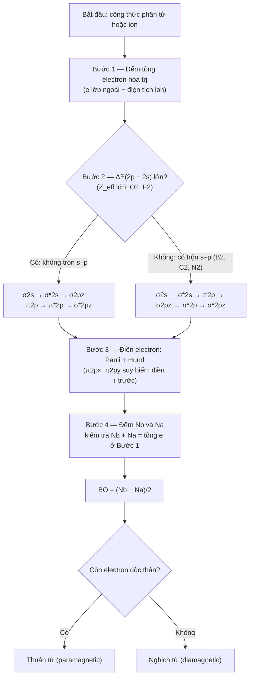

## 5. Ví dụ minh họa & Quy trình thực hành (Examples & Illustrations) {T-04.5}

Bốn ví dụ dưới đây chuyển quy tắc ở Mục 4 thành thao tác cụ thể; bước Solution luôn ghi $N_b$, $N_a$ và tổng electron hóa trị. `[ADDED: example set structure]`

### 5.1 Ví dụ 4.1: Bậc Liên kết của Họ loài Oxygen và Quy luật Thêm Electron Phản liên kết {T-04.5.1}

> **Example 4.1.** Tính bậc liên kết, số electron độc thân và từ tính cho dãy $O_2^{2-}$, $O_2^-$, $O_2$, $O_2^+$ và $H_2^+$. `[SRC: S-04.8]` `[SRC: S-04.3]`
>
> - **Given (Dữ kiện đã cho):** Bốn loài họ oxygen có 14, 13, 12, 11 electron hóa trị; $H_2^+$ có 1; cả dãy dùng trật tự không trộn $s$–$p$ (Mục 4.4.1). `[ADDED: given data restated from S-04.8 and S-04.3]`
> - **Find (Yêu cầu):** Xác định $N_b$, $N_a$, $BO$, số electron độc thân và từ tính của từng loài.
> - **Approach (Phương pháp giải):** Điền electron từ $\sigma_{2s}$ theo Pauli–Hund; các mức thấp đã đầy nên chỉ thêm hoặc bớt ở $\pi^*_{2p}$.
> - **Solution (Giải):**
>   1. $O_2^{2-}$ (14 e): $(\sigma_{2s})^2(\sigma^*_{2s})^2(\sigma_{2p_z})^2(\pi_{2p})^4(\pi^*_{2p})^4$ → $N_b=8$; $N_a=6$; $BO=1$; 0 electron độc thân → nghịch từ.
>   2. $O_2^-$ (13 e): $(\pi^*_{2p})^3$ → $N_b=8$; $N_a=5$; $BO=1,5$; 1 electron độc thân → thuận từ.
>   3. $O_2$ (12 e): $(\pi^*_{2p})^2$ → $N_b=8$; $N_a=4$; $BO=2$; 2 electron độc thân → thuận từ.
>   4. $O_2^+$ (11 e): $(\pi^*_{2p})^1$ → $N_b=8$; $N_a=3$; $BO=2,5$; 1 electron độc thân → thuận từ.
>   5. $H_2^+$ (1 e): $(\sigma_{1s})^1$ → $N_b=1$; $N_a=0$; $BO=0,5$; 1 electron độc thân → thuận từ. `[ADDED: step-by-step electron bookkeeping]`
> - **Check (Kiểm tra):** $N_b+N_a$ khớp tổng electron hóa trị ở cả năm loài ($14, 13, 12, 11, 1$); chiều $BO$ $2,5>2>1,5>1$ ứng với liên kết dài, yếu đi (`T-01.4.1`).
> - **Interpretation (Nhận xét):** Thêm electron vào $\pi^*$ tăng $N_a$, giảm $BO$, yếu liên kết. $BO$ bán nguyên do electron lẻ chỉ chiếm một trong hai orbital suy biến $\pi^*_{2p_x}$, $\pi^*_{2p_y}$ — trả lời carry-over (b) `T-03.4.6`. `[ADDED: explanation of fractional bond order]` `[VERIFY: fractional bond orders of the O2 series (V-04.02)]`

**Bảng 4.3.** Tổng hợp dãy loài oxygen: số electron hóa trị, cấu hình $\pi^*_{2p}$, $N_b$, $N_a$, $BO$ và từ tính. `[ADDED: Table 4.3]` `[VERIFY: bond order values of the O2 series (V-04.02)]`

| Loài | Tổng e hóa trị | Cấu hình $\pi^*_{2p}$ | $N_b$ | $N_a$ | $BO$ | Số e độc thân | Từ tính |
|---|---|---|---|---|---|---|---|
| $O_2^{2-}$ | 14 | $(\pi^*_{2p_x})^2(\pi^*_{2p_y})^2$ | 8 | 6 | 1 | 0 | Nghịch từ |
| $O_2^-$ | 13 | $(\pi^*_{2p_x})^2(\pi^*_{2p_y})^1$ | 8 | 5 | 1,5 | 1 | Thuận từ |
| $O_2$ | 12 | $(\pi^*_{2p_x})^1(\pi^*_{2p_y})^1$ | 8 | 4 | 2 | 2 | Thuận từ |
| $O_2^+$ | 11 | $(\pi^*_{2p_x})^1$ | 8 | 3 | 2,5 | 1 | Thuận từ |

Bảng 4.3 gom phép đếm.

### 5.2 Ví dụ 4.2: Giản đồ MO, Bậc liên kết và Từ tính của N₂ và O₂ {T-04.5.2}

> **Example 4.2.** Lập giản đồ MO cho $N_2$ và $O_2$, tính $BO$, xác định từ tính và so sánh độ bền liên kết. `[SRC: S-04.4]` `[SRC: S-04.7]`
>
> - **Given (Dữ kiện đã cho):** $N_2$ có 10 electron hóa trị, nhóm trộn $s$–$p$ ($Z\le 7$); $O_2$ có 12 electron, nhóm không trộn $s$–$p$; nguồn ghi $E_{lk}(N_2)\approx 945\ \text{kJ/mol}$. `[VERIFY: N2 bond energy (V-04.03)]` `[VERIFY: MO ordering and s–p mixing (V-04.07)]`
> - **Find (Yêu cầu):** Cấu hình MO, $N_b$, $N_a$, $BO$, số electron độc thân, từ tính.
> - **Approach (Phương pháp giải):** Chọn trật tự mức trước khi điền: $N_2$ theo $\sigma_{2s}<\sigma^*_{2s}<\pi_{2p}<\sigma_{2p_z}<\pi^*_{2p}<\sigma^*_{2p_z}$; $O_2$ theo $\sigma_{2s}<\sigma^*_{2s}<\sigma_{2p_z}<\pi_{2p}<\pi^*_{2p}<\sigma^*_{2p_z}$; dùng Hund cho $\pi_{2p}$ suy biến.
> - **Solution (Giải):**
>   1. $N_2$ (10 e): $(\sigma_{2s})^2(\sigma^*_{2s})^2(\pi_{2p})^4(\sigma_{2p_z})^2$ → $N_b=8$; $N_a=2$; $BO=3$; mọi electron ghép đôi → nghịch từ.
>   2. $O_2$ (12 e): $(\sigma_{2s})^2(\sigma^*_{2s})^2(\sigma_{2p_z})^2(\pi_{2p})^4(\pi^*_{2p})^2$ → $N_b=8$; $N_a=4$; $BO=2$; hai electron cuối điền $\pi^*_{2p_x}$, $\pi^*_{2p_y}$ song song → 2 electron độc thân → thuận từ.
>   3. So sánh: $N_2$ có $BO=3$ (một $\sigma$, hai $\pi$), $O_2$ có $BO=2$; theo `T-01.4.1`, $BO$ lớn ứng với liên kết ngắn, bền, phù hợp $E_{lk}(N_2)$ lớn và tính trơ của $N_2$. `[SRC: S-04.4]`
> - **Check (Kiểm tra):** $8+2=10$ và $8+4=12$ khớp tổng electron hóa trị. Kiểm tra chéo: $B_2$ (6 e): $BO=1$, 2 e độc thân, thuận từ; $C_2$ (8 e): $BO=2$, nghịch từ; $F_2$ (14 e): $N_b=8$, $N_a=6$, $BO=1$, nghịch từ. `[ADDED: cross-check with B2, C2, F2 standard configurations]` `[VERIFY: B2, C2, F2 configurations and magnetism (V-04.07)]`
> - **Interpretation (Nhận xét):** Từ tính chỉ phụ thuộc số electron độc thân: $N_2$ có $BO=3$ nhưng nghịch từ, nên "BO lẻ → thuận từ" là sai. Hai electron độc thân trên $\pi^*$ của $O_2$ là dữ kiện VB không giải thích được (`T-03.4.6`); MO giải thích bằng Hund — carry-over (a). `[VERIFY: O2 paramagnetism (V-04.01)]`

### 5.3 Ví dụ 4.3: CO – Phối tử σ-Donor/π-Acceptor và Độc tính Hemoglobin {T-04.5.3}

> **Example 4.3.** Phân tích giản đồ MO dị hạch của $CO$: xác định $BO$, từ tính, HOMO, LUMO và giải thích vì sao $CO$ gắn hemoglobin mạnh hơn $O_2$. `[SRC: S-04.5]`
>
> - **Given (Dữ kiện đã cho):** $CO$ có 10 electron hóa trị, đồng electron với $N_2$; $\chi(O)>\chi(C)$ nên AO của oxy thấp hơn. HOMO là $\sigma$ trên $C$; LUMO là $\pi^*$; nguồn ghi $CO$–$Hb$ bền gấp $200$–$250$ lần $Hb$–$O_2$. `[VERIFY: CO-Hb affinity 200–250x (V-04.05)]` `[VERIFY: CO MO diagram and HOMO on C (V-04.06)]`
> - **Find (Yêu cầu):** Cấu hình, $N_b$, $N_a$, $BO$, từ tính; vai trò $\sigma$-donor của HOMO và $\pi$-acceptor của LUMO.
> - **Approach (Phương pháp giải):** Áp dụng nguyên tắc dị hạch ở Mục 4.5 nhưng vẫn đếm electron và tính $BO$ như phân tử đồng hạch.
> - **Solution (Giải):**
>   1. $C$ góp 4, $O$ góp 6 → 10 electron hóa trị.
>   2. $(\sigma_{2s})^2(\sigma^*_{2s})^2(\pi_{2p})^4(\sigma_{2p_z})^2$ → $N_b=8$; $N_a=2$; $BO=3$; 0 electron độc thân → nghịch từ.
>   3. HOMO ($\sigma$ trên $C$) cho cặp electron vào orbital $d$ trống của $Fe^{2+}$ trong hemoglobin — $\sigma$-donor.
>   4. LUMO ($\pi^*$) nhận mật độ electron phản hồi từ $Fe^{2+}$ — $\pi$-backbonding; hai tương tác cộng hưởng làm $CO$–$Fe$ rất bền. `[ADDED: heteronuclear HOMO–LUMO analysis]`
> - **Check (Kiểm tra):** $8+2=10$ khớp tổng; $BO=3$ trùng $N_2$ đúng dự đoán đồng electron. $BO=3$ (lẻ) nhưng $CO$ nghịch từ — phản chứng thứ hai cho "BO lẻ → thuận từ".
> - **Interpretation (Nhận xét):** $BO$ vẫn đếm được nhưng đối xứng orbital bị phá: HOMO lệch về $C$ nên $CO$ liên kết kim loại qua đầu $C$. Cặp HOMO–LUMO giải thích $\sigma$-donor, $\pi$-backbonding và việc $CO$ chiếm chỗ $O_2$ trên hemoglobin, gây ngạt mô. `[VERIFY: CO-Hb affinity and clinical consequence (V-04.05)]`

### 5.4 Ví dụ 4.4: Đếm Electron và Mô hình Liên kết 3c–2e trong B₂H₆ {T-04.5.4}

> **Example 4.4.** Đếm tổng electron hóa trị của $B_2H_6$ và phân bố vào bốn liên kết $B$–$H$ biên ($2c$–$2e$) cùng hai cầu $B$–$H$–$B$ ($3c$–$2e$). `[ADDED: worked example on 3c–2e bonding]`
>
> - **Given (Dữ kiện đã cho):** $B_2H_6$ có 2 $B$ (nhóm 13, 3 electron hóa trị) và 6 $H$ (1 electron hóa trị); có hai cầu $B$–$H$–$B$; mô hình $2c$–$2e$ của VB thất bại (`T-03.4.6`). `[VERIFY: B2H6 electron count (V-04.09)]`
> - **Find (Yêu cầu):** Tổng electron hóa trị; cách chia cho khung biên và hai cầu; kiểm tra bảo toàn electron, bát tử.
> - **Approach (Phương pháp giải):** Đếm tổng, trừ electron bốn liên kết biên; phần còn lại chia hai cầu.
> - **Solution (Giải):**
>   1. Tổng electron hóa trị: $2\times 3+6\times 1=12$.
>   2. Bốn liên kết $B$–$H$ biên: $4\times 2=8$ electron.
>   3. Còn $12-8=4$ electron cho hai cầu, mỗi cầu 2 electron chia cho 3 tâm ($2B+1H$) → hai liên kết $3c$–$2e$.
>   4. Mỗi cầu: 2 AO $sp^3$ (mỗi $B$ một AO) + 1 AO $1s$ của $H$ cầu → 3 MO; 2 electron điền vào MO thấp nhất. `[ADDED: standard MO description of the bridge bond]`
> - **Check (Kiểm tra):** $12=8+4$. Mô hình $2c$–$2e$ cho 8 đoạn nối cần 16 electron, phân tử chỉ có 12 — đúng "thiếu electron"; với $3c$–$2e$, mỗi $B$ vẫn đủ 8 electron (4 từ liên kết biên, 4 từ cầu) mà không cần orbital $d$. `[ADDED: electron bookkeeping check]` `[VERIFY: octet counting in B2H6 (V-04.09)]`
> - **Interpretation (Nhận xét):** $BO=(N_b-N_a)/2$ định nghĩa cho cặp nguyên tử nên không áp dụng cho liên kết ba tâm; phải dùng MO đa tâm. Đây là câu trả lời carry-over (c) `T-03.4.6`: electron trải trên ba hạt nhân, không định xứ trên một cặp. `[ADDED: interpretation of multicenter bonding]`

### 5.5 Quy trình 4 Bước Lập Giản đồ MO & Sơ đồ Thuật toán (Mermaid) {T-04.5.5}

Quy trình dưới đây gom quy tắc Mục 4.2–4.4 thành bốn bước cho phân tử hai nguyên tử chu kỳ 2 và dị hạch: `[ADDED: 4-step algorithm synthesizing S-04.2–S-04.4]`

1. **Bước 1 — Đếm tổng electron hóa trị:** cộng electron lớp ngoài, trừ điện tích ion (thêm cho anion, bớt cho cation) — con số kiểm tra cuối cùng.
2. **Bước 2 — Chọn trật tự mức theo mức trộn $2s$–$2p$:** $\Delta E(2p-2s)$ lớn ($O_2$, $F_2$) thì $\sigma_{2p_z}$ dưới $\pi_{2p}$; $\Delta E$ nhỏ ($B_2$, $C_2$, $N_2$) thì ngược lại; dị hạch thêm cột AO lệch năng lượng, $c_A\neq c_B$.
3. **Bước 3 — Điền electron theo Pauli và Hund:** từ mức thấp lên, mỗi orbital tối đa 2 electron trái chiều; orbital suy biến ($\pi_{2p_x}$, $\pi_{2p_y}$) nhận một electron mỗi ô rồi mới ghép đôi.
4. **Bước 4 — Tính $BO$ và đọc từ tính:** đếm $N_b$, $N_a$, kiểm tra $N_b+N_a$ bằng tổng ở Bước 1, tính $BO$, đếm electron độc thân.

$$BO=\frac{N_b-N_a}{2}$$

trong đó $N_b$, $N_a$ là tổng electron trên MO liên kết và phản liên kết; $BO$ không có thứ nguyên. `[SRC: S-04.3]`

Thuật toán được mã hóa trong **Hình 4.1**:

**Hình 4.1.** Sơ đồ thuật toán 4 bước lập giản đồ MO. `[ADDED: Mermaid flowchart]` `[VERIFY: MO ordering and s–p mixing (V-04.07)]`

### 5.6 Minh họa Trực quan Giản đồ MO & Sơ đồ Xen phủ Orbital {T-04.5.6}

Năm hình dưới đây chỉ là khung giữ chỗ, **chưa được vẽ**; mỗi khung nêu nội dung, trục/nhãn và căn cứ. Hình 4.2–4.3 đối chiếu hai trật tự mức; 4.4 cho CO; 4.5 xen phủ; 4.6 cầu $3c$–$2e$. `[ADDED: figure placeholder specifications]`

[FIGURE 4.2 | MO energy diagram | giản đồ MO của $O_2$ và $F_2$ (không trộn $2s$–$2p$) | Trục tung là năng lượng $E$ tăng lên trên; hai cột AO $2s$, $2p$ hai bên và cột MO ở giữa; nhãn $\sigma_{2s}$, $\sigma^*_{2s}$, $\sigma_{2p_z}$, $\pi_{2p_x}=\pi_{2p_y}$, $\pi^*_{2p_x}=\pi^*_{2p_y}$, $\sigma^*_{2p_z}$; mũi tên spin $\uparrow\downarrow$; ghi 12 electron cho $O_2$, 14 electron cho $F_2$ | Đánh dấu $\sigma_{2p_z}$ nằm dưới $\pi_{2p}$; khoanh 2 electron độc thân trên $\pi^*$ của $O_2$ | basis: S-04.4]

**Hình 4.2.** Giản đồ MO của $O_2$ và $F_2$ (khung giữ chỗ). `[ADDED: Figure 4.2 caption]`

[FIGURE 4.3 | MO energy diagram | giản đồ MO của $B_2$, $C_2$, $N_2$ (có trộn $2s$–$2p$) | Cùng hệ trục như Hình 4.2; nhãn $\sigma_{2s}$, $\sigma^*_{2s}$, $\pi_{2p}$, $\sigma_{2p_z}$, $\pi^*_{2p}$, $\sigma^*_{2p_z}$; ghi 6, 8 và 10 electron hóa trị | Đánh dấu $\pi_{2p}$ nằm dưới $\sigma_{2p_z}$ do trộn $s$–$p$; khoanh 2 electron độc thân trên $\pi_{2p}$ của $B_2$ | basis: S-04.4]

**Hình 4.3.** Giản đồ MO của $B_2$, $C_2$, $N_2$ (khung giữ chỗ). `[ADDED: Figure 4.3 caption]`

[FIGURE 4.4 | heteronuclear MO diagram | giản đồ MO dị hạch của $CO$, HOMO trên $C$, LUMO $\pi^*$ | Hai cột AO không đối xứng: cột $O$ thấp hơn cột $C$; cột MO nghiêng về $O$ ở các mức liên kết; nhãn $5\sigma$ (HOMO), $\pi_{2p}$, $\pi^*$ (LUMO), $6\sigma^*$; ký hiệu $c_C\neq c_O$ | Tô đậm thùy HOMO hướng về $C$; mũi tên $\sigma$-donor từ $C$ sang $Fe^{2+}$ và $\pi$-backbonding từ $Fe^{2+}$ vào $\pi^*$ | basis: S-04.5]

**Hình 4.4.** Giản đồ MO dị hạch của $CO$, HOMO trên $C$, LUMO $\pi^*$ (khung giữ chỗ). `[ADDED: Figure 4.4 caption]` `[VERIFY: CO MO diagram and HOMO on C (V-04.06)]`

[FIGURE 4.5 | orbital overlap diagram | xen phủ tạo MO liên kết/phản liên kết $\sigma$, $\pi$ | Trục liên nhân $Oz$; dấu pha $(+)$, $(-)$ trên từng thùy AO; mặt phẳng nút vẽ nét đứt | Bốn ô đối chiếu: $s$–$s$ → $\sigma/\sigma^*$; $p_z$–$p_z$ → $\sigma/\sigma^*$; $p_x$–$p_x$ → $\pi/\pi^*$; ghi chú $S_{AB}>0$ khi xen phủ hiệu quả và $S_{AB}=0$ cho $s$–$p_x$ | basis: S-04.1, S-04.2]

**Hình 4.5.** Xen phủ orbital tạo MO liên kết và phản liên kết $\sigma$, $\pi$ (khung giữ chỗ). `[ADDED: Figure 4.5 caption]`

[FIGURE 4.6 | 3c–2e bonding diagram | hai cầu $B$–$H$–$B$ trong $B_2H_6$ | Nhãn ba tâm $B$–$H$–$B$ của mỗi cầu; hai AO lai hóa $sp^3$ (mỗi $B$ một AO) và một AO $1s$ của $H$ cầu; ký hiệu 2 electron mỗi cầu | Đánh dấu 4 liên kết $B$–$H$ biên ($2c$–$2e$) và 2 liên kết cầu ($3c$–$2e$); ghi tổng 12 electron hóa trị | basis: ADDED]

**Hình 4.6.** Hai cầu $B$–$H$–$B$ kiểu $3c$–$2e$ trong $B_2H_6$ (khung giữ chỗ). `[ADDED: Figure 4.6 caption]` `[VERIFY: B2H6 3c–2e bonding (V-04.09)]`

---

## 6. Tóm tắt chương (Chapter Summary) {T-04.6}

### 6.1 Tóm tắt Nội dung Trọng tâm & Quy tắc Ghi nhớ {T-04.6.1}

Các luận điểm chính của thuyết MO: `[SRC: S-04.6]` `[SRC: S-04.9]`

1. **Bản chất và LCAO:** electron thuộc toàn phân tử; $\Psi=c_A\phi_A+c_B\phi_B$ (liên kết) và $\Psi^*=c_A\phi_A-c_B\phi_B$ (phản liên kết), $c_A^2+c_B^2=1$; đồng hạch $c_A=c_B$, dị hạch $c_A\neq c_B$.
2. **Ba điều kiện tổ hợp:** năng lượng xấp xỉ, xen phủ $S_{AB}>0$ đáng kể, cùng đối xứng với trục $z$.
3. **Phân loại và bậc liên kết:** liên kết thấp hơn AO xuất phát, tăng mật độ electron giữa hai hạt nhân; phản liên kết cao hơn, có mặt phẳng nút; không liên kết giữ nguyên năng lượng. $BO$ lớn → liên kết ngắn, bền; $BO=0$ → không có liên kết cộng hóa trị bền ($He_2$); $BO$ bán nguyên do electron lẻ trên orbital suy biến.
4. **Từ tính:** chỉ căn cứ số electron độc thân; $N_2$ và $CO$ có $BO=3$ nhưng nghịch từ.
5. **Hai trật tự mức:** $O_2$, $F_2$ có $\sigma_{2p_z}$ dưới $\pi_{2p}$; $B_2$, $C_2$, $N_2$ ngược lại do trộn $s$–$p$.
6. **Dị hạch và orbital biên:** MO liên kết thiên về nguyên tử có AO thấp hơn; ở $CO$, HOMO là $\sigma$ trên $C$ ($\sigma$-donor), LUMO là $\pi^*$ ($\pi$-acceptor).
7. **Liên kết đa tâm:** $B_2H_6$ có 12 electron hóa trị = 4 liên kết $B$–$H$ biên ($2c$–$2e$) + 2 cầu ($3c$–$2e$), nơi VB định xứ bất lực.

> **Quy tắc ghi nhớ (đã hiệu chỉnh):**
> - **Bậc liên kết:** $BO=\dfrac{N_b-N_a}{2}$; $BO$ lớn → liên kết ngắn và bền.
> - **Thứ tự điền:** $\sigma_s$, $\sigma_s^*$, rồi $\pi_p$ và $\sigma_p$ — $N_2$, $B_2$, $C_2$: $\pi_p$ dưới $\sigma_p$; $O_2$, $F_2$: $\sigma_p$ dưới $\pi_p$.
> - **Từ tính:** còn electron độc thân → thuận từ; toàn bộ ghép đôi → nghịch từ. Vế "BO lẻ → thuận từ" đã bỏ vì $N_2$, $CO$ có $BO=3$ nhưng nghịch từ. `[ADDED: corrected mnemonic]` `[VERIFY: mnemonic correction (V-04.10)]`

### 6.2 Bảng Tổng hợp Công thức, Quy tắc và Mối quan hệ Khái niệm {T-04.6.2}

**Bảng 4.4** gom công thức, hai trật tự mức, quy tắc từ tính, chuỗi Lewis → VSEPR → VB → MO: `[ADDED: summary concept table]`

**Bảng 4.4.** Tổng hợp công thức, quy tắc và mối quan hệ khái niệm của chương 4. `[ADDED: Table 4.4 title]`

| Hạng mục | Công thức / Quy tắc | Ý nghĩa và điều kiện áp dụng | Ví dụ trong chương |
|---|---|---|---|
| **Bậc liên kết theo MO** | $BO=\dfrac{N_b-N_a}{2}$ | $N_b$, $N_a$ đếm trên giản đồ; $BO>0$ mới có liên kết cộng hóa trị; $BO$ lớn → $r$ ngắn, $E_{lk}$ cao; $BO=0$ → không có liên kết cộng hóa trị bền | $N_2$: $3$; $O_2$: $2$; $O_2^+$: $2,5$; $H_2^+$: $0,5$ |
| **Ba điều kiện tổ hợp AO** | $\Delta E$ xấp xỉ; $S_{AB}>0$ đáng kể; cùng đối xứng với trục $z$ | Thiếu một điều kiện thì xen phủ hiệu dụng bằng 0, không tạo MO liên kết | $s$–$s$, $s$–$p_z$, $p_z$–$p_z$ → $\sigma$; $s$–$p_x$ → không liên kết |
| **Trật tự MO không trộn $s$–$p$** | $\sigma_{2s}<\sigma^*_{2s}<\sigma_{2p_z}<\pi_{2p}<\pi^*_{2p}<\sigma^*_{2p_z}$ | $\Delta E(2p-2s)$ lớn, $Z_{eff}$ lớn; áp dụng cho $O_2$, $F_2$ | $F_2$: $BO=1$, nghịch từ |
| **Trật tự MO có trộn $s$–$p$** | $\sigma_{2s}<\sigma^*_{2s}<\pi_{2p}<\sigma_{2p_z}<\pi^*_{2p}<\sigma^*_{2p_z}$ | $\Delta E(2p-2s)$ nhỏ, $Z\le 7$; $\sigma_{2p_z}$ bị đẩy lên trên $\pi_{2p}$ | $B_2$: $BO=1$, thuận từ; $C_2$: $BO=2$, nghịch từ |
| **Quy tắc từ tính** | Có $\ge 1$ electron độc thân → thuận từ; toàn bộ ghép đôi → nghịch từ | Chỉ đếm electron độc thân, không dựa vào $BO$ chẵn hay lẻ | $N_2$, $CO$: $BO=3$ nhưng nghịch từ; $O_2$, $B_2$: thuận từ |
| **Liên hệ Lewis → VSEPR → VB → MO** | Lewis: cặp electron định xứ; VSEPR: hình học từ $SN$; VB: xen phủ AO và lai hóa; MO: electron phi định xứ trên toàn phân tử | Bốn mô hình bổ sung nhau, không thay thế nhau; MO cần khi gặp từ tính bất thường, liên kết đa tâm hoặc cần orbital biên | $O_2$ (từ tính); $B_2H_6$ ($3c$–$2e$); $CO$ (HOMO–LUMO) |

<!-- PART2-LIMITATIONS -->

### Chưa kiểm chứng / hạn chế (Phần 2)

- **Số liệu chưa có nguồn:** $BO$ của dãy oxygen và $H_2^+$, $E_{lk}(N_2)\approx 945\ \text{kJ/mol}$, độ bền $CO$–$Hb$ "gấp $200$–$250$ lần" và hậu quả ngạt mô lấy từ `D-04` không trích dẫn; đã gắn `[VERIFY]` (`V-04.01`–`V-04.05`).
- **Dữ liệu ngoài nguồn:** cấu hình, từ tính của $B_2$, $C_2$, $F_2$ và mô tả MO cầu, đếm bát tử $B_2H_6$ là kiến thức giáo trình chuẩn, đã gắn `[ADDED]` + `[VERIFY]`.
- **Giới hạn của $BO$:** công thức $BO=(N_b-N_a)/2$ không áp dụng cho liên kết ba tâm trong $B_2H_6$.
- **Hình vẽ:** Hình 4.2–4.6 chỉ là khung giữ chỗ, chưa sản xuất.
- **Mã thẻ:** `V-04.10` trong `ch04_audit.md` gán cho phát biểu $He_2$, không phải mẹo nhớ; QA cần đối chiếu lại.
- **Phạm vi:** phần này chỉ gồm T5–T6; Bảng 4.1, 4.2 và T7–T8 nằm ở phần khác.
