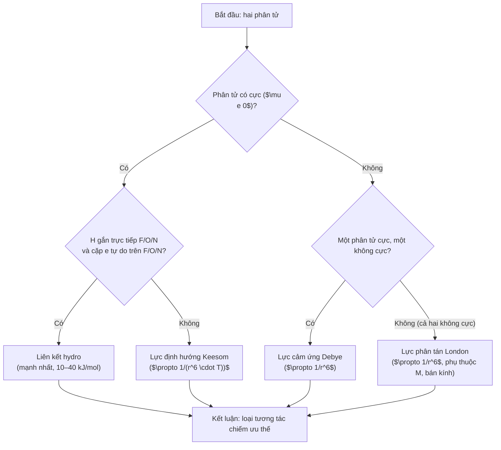

# Chương 5: Lực liên phân tử & Liên kết hydro

---

## 1. Tổng quan chương (Chapter Overview) {T-05.1}

### 1.1 Tên chương, giới thiệu khái quát & phạm vi nội dung {T-05.1.1}

Chương 1–3 đã trình bày liên kết cộng hóa trị định xứ (hai tâm – hai electron) và hình học phân tử qua VSEPR. Tuy nhiên, giữa các phân tử trung hòa điện vẫn tồn tại các lực hút yếu,rile qua khoảng cách, quyết định độ sôi, độ hòa tan và cách thuốc gắn với đích. Chương 5 chuyển sang **lực liên phân tử** (kể cả lực Van der Waals và liên kết hydro) — những tương tác yếu nhưng then chốt trong dược học vì chúng điều khiển việc thuốc tan trong nước, 침 thấm qua màng lipid và gắn chọn lọc với thụ thể `[SRC: S-05.1, S-05.2, S-05.3]` `[ADDED: bridge from Ch03–04]`.

Chương gồm ba thành phần Van der Waals (Keesom, Debye, London), bản chất & phân loại liên kết hydro, ứng dụng trong sinh học–dược học (DNA, protein, thuốc–thụ thể, quy tắc Lipinski), ví dụ tính toán (H2O vs H2S; acid salicylic vs para) và bộ bài tập tự lượng giá `[ADDED: scope summary]`.

Tên chương tạm thời: **"Lực liên phân tử & Liên kết hydro"** (chưa có tên chính thức trong file nguồn D-05, chỉ có tại `MANIFEST.md`) `[VERIFY: chapter title (V-05.01)]`.

### 1.2 Phạm vi, Kiến thức Tiên quyết & Thời lượng Học tập {T-05.1.2}

- **Kiến thức tiên quyết:**
  1. Liên kết cộng hóa trị định xứ, độ âm điện, cực tính liên kết tại `T-01.4.1` (Chương 1).
  2. Hình học phân tử VSEPR, số phối trí lập thể $SN = m + n$ tại `T-02.4.2`, `T-02.4.3` (Chương 2).
  3. Cực tính phân tử ($\mu \ne 0$) và cặp electron tự do (LP) của $H_2O$ ($AX_2E_2$, $104,5^\circ$), $NH_3$ ($AX_3E$, $107,3^\circ$) tại `T-02.4.6` (Chương 2) `[ADDED: cross-reference to Ch01–02]`.
- **Thời lượng dự kiến:** ~**2 giờ 30 phút** (khoảng 1 giờ 50 phút cho ~2.000 từ lý thuyết + ví dụ tại Mục 1–6, tương đương 2.000 / 1.500 ≈ 1,33 giờ; cộng 40 phút cho 10 bài tập ≈ 2 giờ 13 phút), theo `STUDY_TIME_RULE` `[ADDED: study time estimate]`.

---

## 2. Mục tiêu học tập (Learning Objectives) {T-05.2}

### 2.1 Chuẩn đầu ra Kiến thức, Kỹ năng, Vận dụng và Đánh giá mô hình (LO-1..LO-4) {T-05.2.1}

Sau chương này, sinh viên có thể `[ADDED: learning objectives]`:

- **`LO-1` (Kiến thức):** Phát biểu ba thành phần lực Van der Waals (Keesom, Debye, London), bản chất liên kết hydro ($X-H\cdots:Y$), phân loại liên kết hydro liên phân tử / nội phân tử.
- **`LO-2` (Kỹ năng):** Phân loại loại tương tác liên phân tử dựa trên cực tính, khối lượng, bán kính; giải thích vì sao $H_2O$ sôi cao hơn $H_2S$ mặc dù khối lượng nhỏ hơn.
- **`LO-3` (Vận dụng):** Vận dụng liên kết hydro để giải thích ổn định DNA (cặp base $A=T$ 2 liên kết H; $G\equiv C$ 3 liên kết H), cấu trúc protein (xoắn $\alpha$, phiến gấp $\beta$), tương tác thuốc–thụ thể và quy tắc Lipinski.
- **`LO-4` (Đánh giá mô hình):** So sánh liên kết hydro với liên kết cộng hóa trị (yếu hơn khoảng 10 lần), nhận diện khi nào liên kết hydro là yếu tố then chốt trong thiết kế thuốc và độ hòa tan `[ADDED: LO-4 definition]`.

---

## 3. Đặt vấn đề & Ý nghĩa thực tiễn (Introduction) {T-05.3}

### 3.1 Từ liên kết cộng hóa trị đến lực liên phân tử {T-05.3.1}

Liên kết cộng hóa trị giữ nguyên tử bên trong một phân tử; nhưng giữa các phân tử rời rạc vẫn tồn tại các lực hút yếu,rile qua khoảng cách, không đủ mạnh tạo liên kết cộng hóa trị nhưng đủ mạnh ảnh hưởng tính chất vật lý `[SRC: S-05.1]` `[ADDED: conceptual bridge]`.

Lực liên phân tử quyết định:
- **Độ sôi & độ tan:** $H_2O$ ($M=18$) sôi ở $+100^\circ\text{C}$ nhờ mạng lưới liên kết hydro, trong khi $H_2S$ ($M=34$, nặng hơn) chỉ sôi ở khoảng $-60^\circ\text{C}$ `[SRC: S-05.4]`.
- **Cấu trúc đại phân tử sinh học:** Liên kết hydro ổn định chuỗi xoắn kép DNA và cấu trúc protein `[SRC: S-05.2]`.
- **Thiết kế thuốc:** Mạng lưới liên kết hydro chính xác về khoảng cách và góc định hướng giúp thuốc gắn chọn lọc vào vị trí hoạt động của thụ thể `[SRC: S-05.2]`.

---

## 4. Nội dung bài giảng chính (Main Content) {T-05.4}

### 4.1 Lực tương tác Van der Waals {T-05.4.1}

Lực tương tác Van der Waals là lực tương tác hút tĩnh điện yếu giữa các phân tử trung hòa điện, giảm nhanh theo khoảng cách ($E \propto 1/r^6$), gồm 3 thành phần `[SRC: S-05.1]`.

#### 4.1.1 Lực định hướng (Keesom)

Tương tác giữa các phân tử có cực vĩnh viễn ($\mu \ne 0$), các đầu trái dấu hút nhau. Năng lượng phụ thuộc nghịch biến vào nhiệt độ tuyệt đối $T$:

$$E_{Keesom} \propto -\frac{\mu_1^2 \cdot \mu_2^2}{r^6 \cdot k \cdot T}$$

`$\mu_1, \mu_2$` là momento cực của hai phân tử; `$r$` là khoảng cách; `$k$` là hằng số; `$T$` là nhiệt độ tuyệt đối. Dấu âm biểu thị tương tác hút `[SRC: S-05.1]` `[ADDED: variable list]`.

Ví dụ: tương tác giữa các phân tử $HCl, SO_2, NH_3$ `[SRC: S-05.1]`.

#### 4.1.2 Lực cảm ứng (Debye)

Phân tử có cực vĩnh viễn gây biến dạng đám mây electron của phân tử không phân cực lân cận, tạo ra lưỡng cực cảm ứng. Năng lượng không phụ thuộc nhiệt độ:

$$E_{Debye} \propto -\frac{\mu^2 \cdot \alpha}{r^6}$$

`$\alpha$` là độ phân cực hóa của phân tử bị cảm ứng `[SRC: S-05.1]` `[ADDED: variable list]`.

#### 4.1.3 Lực phân tán (London) & quy luật nhiệt độ sôi

Xuất hiện do sự chuyển động bất đối xứng nhất thời của các electron tạo ra các **lưỡng cực tạm thời**, gây cảm ứng phân cực lên các phân tử kế cận `[SRC: S-05.1]`.

- Tồn tại ở **TẤT CẢ** các phân tử (kể cả khí hiếm $He, Ar$ và phân tử không cực $CH_4, O_2, I_2$) `[SRC: S-05.1]`.
- Độ lớn của lực London phụ thuộc thuận vào **khối lượng phân tử ($M$)** và **kích thước phân tử** (bán kính nguyên tử càng lớn $\rightarrow$ đám mây electron càng xốp $\rightarrow$ độ phân cực hóa $\alpha$ càng cao) `[SRC: S-05.1]`.
- **Quy luật nhiệt độ sôi:** Dãy halogen $F_2$ (khí) $< Cl_2$ (khí) $< Br_2$ (lỏng) $< I_2$ (rắn); dãy khí hvir $He < Ne < Ar < Kr < Xe$ `[SRC: S-05.1]`.
- Trong gây mê Dược khoa, thuốc mê hô hấp nhóm halogen (Halothane, Isoflurane, Sevoflurane) có lực phân tán London lớn giúp chúng dễ hóa lỏng và hòa tan vào lớp lipid màng nơron thần kinh `[SRC: S-05.1]` `[ADDED: clinical relevance]`.

#### 4.1.4 Ý nghĩa

Các lực Keesom, Debye và London ảnh hưởng độ sôi, độ hòa tan và phân bố phân tử giữa nước với pha lipid; điều này góp phần quyết định cách thuốc phân bố trong cơ thể `[SRC: S-05.1]` `[ADDED: pharmaceutical relevance]`.

### 4.2 Liên kết Hydro & Phân loại {T-05.4.2}

#### 4.2.1 Bản chất liên kết hydro

Là liên kết tĩnh điện đặc biệt kèm một phần cộng hóa trị hình thành giữa nguyên tử Hidro ($H$) liên kết với nguyên tử $X$ có độ âm điện lớn và bán kính nhỏ ($F, O, N$) với một nguyên tử $Y$ khác cũng có độ âm điện lớn và mang cặp electron tự do ($X-H\cdots:Y$) `[SRC: S-05.2]`.

Năng lượng liên kết: $10\text{–}40\text{ kJ/mol}$ (yếu hơn liên kết cộng hóa trị khoảng 10 lần nhưng mạnh hơn lực Van der Waals rất nhiều) `[SRC: S-05.2]` `[ADDED: quantitative comparison]`.

#### 4.2.2 Liên kết hydro liên phân tử

Tạo mạng lưới liên kết giữa các phân tử rời rạc $\rightarrow$ **làm tăng vọt nhiệt độ sôi, nhiệt độ nóng chảy và độ tan trong nước** `[SRC: S-05.2]`.

Nghịch lý nước ($H_2O$): $H_2O$ ($M=18$) sôi ở $+100^\circ\text{C}$ trong khi $H_2S$ ($M=34$) chỉ sôi ở $-60^\circ\text{C}$ do nước tạo mạng lưới liên kết hydro 3 chiều bền vững (mỗi phân tử $H_2O$ tạo được tối đa 4 liên kết hydro) `[SRC: S-05.2]` `[ADDED: numerical comparison]`.

#### 4.2.3 Liên kết hydro nội phân tử

Hình thành bên trong cùng một phân tử khi hai nhóm chức ở gần nhau trong không gian (ví dụ: $ortho$-nitrophenol, acid salicylic). Kiểu liên kết này "khóa" các nhóm phân cực lại, làm **giảm nhiệt độ sôi và giảm độ tan trong nước** so với đồng phân $para$ `[SRC: S-05.2]` `[ADDED: structural consequence]`.

### 4.3 Ứng dụng trong Dược học {T-05.4.3}

#### 4.3.1 Ổn định đại phân tử sinh cheveux

Liên kết hydro ổn định chuỗi xoắn kép DNA qua các cặp base bổ sung ($A=T$ bằng 2 liên kết H; $G\equiv C$ bằng 3 liên kết H); ổn định cấu trúc xoắn $\alpha$ và phiến gấp $\beta$ của protein enzym thụ thể `[SRC: S-05.2]` `[ADDED: structural detail]`.

#### 4.3.2 Tương tác Thuốc – Thụ thể (Drug – Receptor Binding)

Đa số các phân tử thuốc gắn kết vào vị trí hoạt động của thụ thể thông qua mạng lưới liên kết hydro chính xác về khoảng cách và góc định hướng `[SRC: S-05.2]` `[ADDED: mechanism]`.

#### 4.3.3 Quy tắc Lipinski (Rule of 5) trong Dược động học

Để một hoạt chất có khả năng hấp thu tốt qua đường uống: Số nhóm cho liên kết Hydro (OH, NH) $\le 5$ và số nhóm nhận liên kết Hydro (O, N) $\le 10$ `[SRC: S-05.2]` `[ADDED: clinical rule]`.

---

## 5. Ví dụ minh họa & Quy trình thực hành (Examples & Illustrations) {T-05.5}

### 5.1 Ví dụ 5.1: Vì sao $H_2O$ sôi cao hơn $H_2S$? {T-05.5.1}

> **Example 5.1.** So sánh nhiệt độ sôi của $H_2O$ và $H_2S$ và giải thích vai trò liên kết hydro. `[SRC: S-05.4]`
>
> - **Given (Dữ kiện đã cho):** $H_2O$: $M=18$, nhiệt độ sôi $100^\circ C$; mỗi phân tử có 2 H gắn với O và 2 cặp e tự do $\rightarrow$ tạo được tới **4 liên kết hydro**, hình thành mạng lưới ba chiều bền. $H_2S$: $M=34$ (nặng hơn) nhưng nhiệt độ sôi chỉ khoảng $-60^\circ C$; S có độ âm điện thấp hơn nhiều (2,58 so với 3,44) và bán kính lớn $\rightarrow$ liên kết S–H gần như không phân cực, không tạo liên kết hydro đủ mạnh `[SRC: S-05.4]`.
> - **Find (Yêu cầu):** Giải thích vì sao $H_2O$ sôi cao hơn $H_2S$ mặc dù khối lượng phân tử nhỏ hơn.
> - **Approach (Phương pháp giải):** So sánh khối lượng phân tử, độ âm điện, khả năng tạo liên kết hydro và số liên kết hydro mỗi phân tử.
> - **Solution (Giải):**
>   1. Khối lượng: $H_2O$ ($M=18$) nhẹ hơn $H_2S$ ($M=34$). Theo quy luật London, chất nặng hơn thường sôi cao hơn, nhưng thực tế ngược lại.
>   2. Độ âm điện: O (3,44) lớn hơn S (2,58) $\rightarrow$ liên kết O–H cực phân cực hơn liên kết S–H.
>   3. Liên kết hydro: O có 2 cặp electron tự do và 2 H gắn trực tiếp $\rightarrow$ mỗi phân tử $H_2O$ tạo được tới 4 liên kết hydro (2 làm nhóm cho, 2 làm nhóm nhận), hình thành mạng lưới 3 chiều. S không tạo liên kết hydro đủ mạnh.
>   4. Kết luận: Liên kết hydro, không phải khối lượng phân tử, là yếu tố then ch décident nhiệt độ sôi.
> - **Check (Kiểm tra):** $100^\circ\text{C} \gg -60^\circ\text{C}$ (chênh lệch $\approx 160^\circ\text{C}$), phù hợp với việc liên kết hydro mạnh hơn lực Van der Waals rất nhiều `[SRC: S-05.4]`.
> - **Interpretation (Nhận xét):** Khối lượng phân tử không quyết định một mình — **liên kết hydro mới là yếu tố then chốt** `[ADDED: conclusion]`.

### 5.2 Ví dụ 5.2: Liên kết hydro nội phân tử (acid salicylic & paracetamol) {T-05.5.2}

> **Example 5.2.** So sánh nhiệt độ nóng chảy và độ tan của acid salicylic (nội phân tử) vs đồng phân $para$ và paracetamol (liên phân tử). `[SRC: S-05.5]`
>
> - **Given (Dữ kiện đã cho):** Acid salicylic (acid 2-hydroxybenzoic): nhóm $-OH$ phenol ở vị trí $ortho$ tạo liên kết hydro **nội phân tử** với $C=O$ của nhóm carboxyl $\rightarrow$ phân tử "tự khóa" các nhóm phân cực, ít tương tác với nước hơn, nhiệt độ nóng chảy ($\approx 159^\circ C$) và độ tan thấp hơn đồng phân $para$ (acid 4-hydroxybenzoic, $t_{nc} \approx 215^\circ C$). Paracetamol ($HO-C_6H_4-NHCOCH_3$) lại tạo liên kết hydro **liên phân tử** giữa $-OH$ phenol và nhóm amide $\rightarrow$ mạng tinh thể bền, $t_{nc} \approx 170^\circ C$, tan ít trong nước lạnh nhưng tan tốt hơn khi đun nóng (dùng để kết tinh lại) `[SRC: S-05.5]`.
> - **Find (Yêu cầu):** Giải thích sự khác biệt nhiệt độ nóng chảy và độ tan giữa liên kết hydro nội phân tử và liên phân tử.
> - **Approach (Phương pháp giải):** So sánh cách liên kết hydro ảnh hưởng đến tương tác phân tử–phân tử và mạng tinh thể.
> - **Solution (Giải):**
>   1. Acid salicylic (nội phân tử): nhóm phân cực bị "khóa" bên trong phân tử $\rightarrow$ ít tương tác với nước $\rightarrow$ giảm độ tan; mạng tinh yếu hơn do nhóm phân cực không tham gia liên kết hydro giữa các phân tử $\rightarrow$ $t_{nc}$ thấp hơn ($\approx 159^\circ C$ vs $215^\circ C$ của para).
>   2. Paracetamol (liên phân tử): liên kết hydro giữa các phân tử tạo mạng tinh thể bền $\rightarrow$ $t_{nc} \approx 170^\circ C$, tan ít trong nước lạnh nhưng tan tốt hơn khi đun nóng.
> - **Check (Kiểm tra):** $159^\circ C < 170^\circ C < 215^\circ C$ (acid salicylic < paracetamol < acid para), khớp với ý liên kết hydro nội phân tử làm yếu mạng tinh thể hơn liên phân tử `[SRC: S-05.5]`.
> - **Interpretation (Nhận xét):** Liên kết hydro nội phân tử "khóa vòng" $\rightarrow$ giảm nhiệt độ sôi, giảm độ tan; liên kết hydro liên phân tử $\rightarrow$ tăng nhiệt độ sôi, tăng độ tan trong nước `[ADDED: mnemonic]`.

### 5.3 Sơ đồ thuật toán xác định tương tác liên phân tử (Mermaid) {T-05.5.3}

Quy trình dưới đây giúp xác định loại lực liên phân tử chiếm ưu thế cho một coppia phân tử `[ADDED: algorithm synthesizing S-05.1–S-05.2]`:

1. Kiểm tra cực tính phân tử ($\mu \ne 0$?).
2. Kiểm tra có H gắn trực tiếp với F/O/N và cặp electron tự do trên F/O/N? (liên kết hydro).
3. Kiểm tra khối lượng & bán kính (lực London).
4. Kết luận loại tương tác chiếm ưu thế.

**Hình 5.1.** Sơ đồ thuật toán xác định tương tác liên phân tử. `[ADDED: Mermaid flowchart]` `[VERIFY: interaction classification (V-05.02)]`.

### 5.4 Minh họa Trực quan (Placeholders) {T-05.5.4}

Các khung dưới đây chỉ là giữ chỗ, **chưa được vẽ** `[ADDED: figure placeholder specifications]`.

**Hình 5.1.** Ba thành phần lực Van der Waals (khung giữ chỗ). `[ADDED: Figure 5.1 caption]`

**Hình 5.2.** Mạng lưới liên kết hydro 3 chiều của nước (khung giữ chỗ). `[ADDED: Figure 5.2 caption]`

**Hình 5.3.** Liên kết hydro nội phân tử acid salicylic vs liên phân tử acid para (khung giữ chỗ). `[ADDED: Figure 5.3 caption]` `[VERIFY: molecular structure (V-05.03)]`.

---

## 6. Tóm tắt chương (Chapter Summary) {T-05.6}

### 6.1 Tóm tắt Nội dung Trọng tâm & Quy tắc Ghi nhớ {T-05.6.1}

Các luận điểm chính của chương 5 `[SRC: S-05.1, S-05.2, S-05.3, S-05.6]`:

1. **Lực Van der Waals:** Ba thành phần Keesom (phân tử cực, phụ thuộc $T$), Debye (phân tử cực + không cực, không phụ thuộc $T$), London (tất cả phân tử, phụ thuộc $M$ và kích thước). Tất cả giảm nhanh theo $1/r^6$ `[SRC: S-05.1]`.
2. **Liên kết hydro:** Liên kết tĩnh điện kèm một phần cộng hóa trị giữa $X-H\cdots:Y$ ($X, Y = F, O, N$), năng lượng $10\text{–}40\text{ kJ/mol}$ `[SRC: S-05.2]`.
3. **Liên phân tử vs nội phân tử:** Liên phân tử $\rightarrow$ tăng nhiệt độ sôi, tăng độ tan trong nước; nội phân tử $\rightarrow$ "khóa vòng", giảm nhiệt độ sôi, giảm độ tan `[SRC: S-05.2]` `[ADDED: comparative summary]`.
4. **Ứng dụng dược học:** Ổn định DNA ($A=T$ 2 liên kết H, $G\equiv C$ 3 liên kết H), cấu trúc protein, tương tác thuốc–thụ thể, quy tắc Lipinski (cho $\le 5$, nhận $\le 10$) `[SRC: S-05.2]` `[ADDED: pharmaceutical summary]`.
5. **Nghịch lý nước:** $H_2O$ ($M=18$) sôi cao hơn $H_2S$ ($M=34$) nhờ liên kết hydro `[SRC: S-05.4]` `[ADDED: key example]`.

> **Quy tắc ghi nhớ (mnemonic):**
> - **"F–O–N mới đủ mạnh":** liên kết hydro cần H gắn trực tiếp với F, O hoặc N và một cặp e tự do trên F/O/N `[SRC: S-05.6]`.
> - **Liên phân tử $\rightarrow$ $\uparrow$ nhiệt độ sôi, $\uparrow$ độ tan trong nước; Nội phân tử $\rightarrow$ "khóa vòng", $\downarrow$ nhiệt độ sôi, $\downarrow$ độ tan** `[ADDED: corrected mnemonic]`.
> - **Mẹo:** liên kết hydro nội phân tử chỉ có khi tạo được vòng 5–6 cạnh (như $ortho$-nitrophenol, acid salicylic) `[SRC: S-05.6]`.

### 6.2 Bảng Tổng hợp Công thức & Quy tắc {T-05.6.2}

**Bảng 5.1.** Tổng hợp ba thành phần lực Van der Waals. `[ADDED: Table 5.1]`

| Thành phần | Điều kiện xảy ra | Phụ thuộc nhiệt độ | Công thức (tỷ lệ) | Ví dụ |
|---|---|---|---|---|
| Keesom | Cả hai phân tử cực ($\mu \ne 0$) | Nghịch biến với $T$ | $E \propto -\frac{\mu_1^2 \mu_2^2}{r^6 k T}$ | $HCl, SO_2, NH_3$ |
| Debye | Một cực, một không cực | Không phụ thuộc $T$ | $E \propto -\frac{\mu^2 \alpha}{r^6}$ | Phân tử cực + phân tử không cực |
| London | Tất cả phân tử | Không phụ thuộc $T$ | $E \propto -\frac{1}{r^6}$ | $He, Ar, CH_4, O_2, I_2$ |

**Bảng 5.2.** So sánh liên kết hydro liên phân tử và nội phân tử. `[ADDED: Table 5.2]`

| Tiêu chí | Liên kết hydro liên phân tử | Liên kết hydro nội phân tử |
|---|---|---|
| Vị trí hình thành | Giữa các phân tử rời rạc | Bên trong cùng một phân tử |
| Ảnh hưởng nhiệt độ sôi | Tăng vọt | Giảm |
| Ảnh hưởng độ tan trong nước | Tăng | Giảm |
| Ví dụ | Paracetamol (mạng tinh thể bền) | Acid salicylic ("khóa vòng") |

**Bảng 5.3.** Quy tắc Lipinski (Rule of 5) cho hấp thu qua đường uống. `[ADDED: Table 5.3]`

| Nhóm | Giới hạn | Ý nghĩa |
|---|---|---|
| Nhóm cho liên kết Hydro (OH, NH) | $\le 5$ | Khả năng hấp thu tốt qua đường uống |
| Nhóm nhận liên kết Hydro (O, N) | $\le 10$ | Khả năng hấp thu tốt qua đường uống |

---

## 7. Đánh giá & Bài tập tự lượng giá (Review & Assessment) {T-05.7}

[ADDED: assessment section frame] Bộ câu hỏi và bài tập dưới đây được thiết kế theo thang nhận thức từ Nhận biết, Thông hiểu đến Vận dụng, Phân tích và Đánh giá mô hình, bao phủ bốn chuẩn đầu ra `LO-1`–`LO-4` đã phát biểu tại `T-05.2.1`. Mỗi câu đều ghi rõ chuẩn đầu ra và cấp độ nhận thức; đáp án chi tiết nằm tại `T-05.7.4`. Sinh viên nên tự làm bài đầy đủ trước khi đọc đáp án chi tiết.

### 7.1 Câu hỏi Lý thuyết: Nhận biết & Thông hiểu (LO-1) {T-05.7.1}

[ADDED: knowledge and comprehension questions]

**Câu 1 (`LO-1` – Knowledge).** Ba thành phần lực tương tác Van der Waals là gì?

- **A.** Liên kết ion, liên kết cộng hóa trị, liên kết hydro.
- **B.** Lực định hướng (Keesom), lực cảm ứng (Debye), lực phân tán (London).
- **C.** Liên kết hydro liên phân tử, liên kết hydro nội phân tử, liên kết confuse.
- **D.** Lực kéo đỡ, lực đẩy tĩnh điện, lực xen_core.

**Câu 2 (`LO-1` – Comprehension).** Phát biểu nào đúng về lực phân tán London?

- **A.** Chỉ xảy ra ở phân tử cực.
- **B.** Tồn tại ở tất cả các phân tử, kể cả khí hvir và phân tử không cực.
- **C.** Năng lượng phụ thuộc mạnh vào nhiệt độ.
- **D.** Chỉ xảy ra khi có H gắn với F/O/N.

**Câu 3 (`LO-1` – Comprehension).** Liên kết hydro cần đáp ứng điều kiện nào?

- **A.** H gắn với bất kỳ nguyên tử nào và có cặp electron tự do.
- **B.** H gắn trực tiếp với F, O hoặc N, và có một cặp electron tự do trên F/O/N của phân tử khác.
- **C.** Chỉ cần phân tử có cực tính.
- **D.** Chỉ cần khối lượng phân tử lớn.

**Câu 4 (`LO-1` – Comprehension).** Năng lượng liên kết hydro khoảng bao nhiêu so với liên kết cộng hóa trị?

- **A.** Bằng nhau.
- **B.** Yếu hơn khoảng 10 lần.
- **C.** Mạnh hơn 10 lần.
- **D.** Không có liên hệ.

### 7.2 Bài tập Áp dụng: Tính toán & Phân loại (LO-2, LO-3) {T-05.7.2}

[ADDED: application exercises]

**Bài tập 5 (`LO-2` – Application).** Cho bốn phối tử sau: $CH_4$, $HCl$, $H_2O$, $NH_3$. Với mỗi phối tử, hãy:
1. Xác định phân tử có cực tính ($\mu \ne 0$) hay không.
2. Phân loại loại lực Van der Waals chiếm ưu thế (Keesom / Debye / London).
3. Giải thích ngắn lý do.

**Bài tập 6 (`LO-2` – Application).** So sánh nhiệt độ sôi của $F_2$, $Cl_2$, $Br_2$, $I_2$ và giải thích theo quy luật nhiệt độ sôi của lực London.

**Bài tập 7 (`LO-3` – Application).** Cho acid salicylic (nội phân tử) và acid 4-hydroxybenzoic (liên phân tử). Hãy:
1. Nêu loại liên kết hydro hình thành trong mỗi chất.
2. Giải thích vì sao acid salicylic có nhiệt độ nóng chảy thấp hơn ($\approx 159^\circ C$ vs $\approx 215^\circ C$).
3. Dự đoán chất nào tan ít trong nước lạnh hơn và tại sao.

### 7.3 Câu hỏi Phân tích & Vận dụng Nâng cao (LO-3, LO-4) {T-05.7.3}

[ADDED: analytical and advanced questions]

**Câu 8 (`LO-3`, `LO-4` – Analysis).** Thuyết VB mô tả liên kết O–H trong nước bằng liên kết cộng hóa trị định xứ, nhưng thực nghiệm cho thấy nước tạo mạng lưới liên kết hydro 3 chiều và sôi cao hơn dự đoán từ khối lượng. Hãy:
1. Trình bày cách liên kết hydro hình thành giữa hai phân tử $H_2O$.
2. Giải thích vì sao mỗi phân tử $H_2O$ tạo được tới 4 liên kết hydro.
3. Đánh giá vai trò liên kết hydro so với liên kết cộng hóa trị O–H trong ổn định cấu trúc nước lỏng `[VERIFY: hydrogen bonding in water (V-05.04)]`.

**Câu 9 (`LO-3` – Analysis).** Paracetamol ($HO-C_6H_4-NHCOCH_3$) tạo liên kết hydro liên phân tử giữa $-OH$ phenol và nhóm amide $\rightarrow$ mạng tinh thể bền, $t_{nc} \approx 170^\circ C$, tan ít trong nước lạnh nhưng tan tốt hơn khi đun nóng. Hãy:
1. Giải thích cơ chế liên kết hydro liên phân tử trong paracetamol.
2. Liên hệ kết tinh lại (tan tốt hơn khi đun nóng) với mạng lưới liên kết hydro `[SRC: S-05.5]`.

**Câu 10 (`LO-4` – Advanced).** Quy tắc Lipinski khuyên số nhóm cho liên kết hydro (OH, NH) $\le 5$ và số nhóm nhận (O, N) $\le 10$ cho hoạt chất hấp thu tốt qua đường uống. Hãy phân tích tại sao giới hạn này liên quan đến liên kết hydro và môi trường nước, và nêu một rủi ro nếu vượt quá giới hạn `[SRC: S-05.2]` `[ADDED: critical thinking]`.

---

## 7.4 Đáp án & Hướng dẫn Giải Chi tiết (Answer Key) {T-05.7.4}

[ADDED: step-by-step answer key]

**Câu 1 — `LO-1` · Knowledge. Đáp án B.** Ba thành phần lực Van der Waals là lực định hướng (Keesom), lực cảm ứng (Debye), lực phân tán (London). Phương án A là các loại liên kết, không phải lực liên phân tử; C và D không phải phân loại chuẩn của Van der Waals.

**Câu 2 — `LO-1` · Comprehension. Đáp án B.** Lực phân tán London tồn tại ở tất cả các phân tử (kể cả khí hvir $He, Ar$ và phân tử không cực $CH_4, O_2, I_2$) do lưỡng cực tạm thời. Phương án A sai (chỉ phân tử cực), C sai (London không phụ thuộc nhiệt độ mạnh), D sai (điều kiện đó là liên kết hydro).

**Câu 3 — `LO-1` · Comprehension. Đáp án B.** Liên kết hydro cần H gắn trực tiếp với F, O hoặc N (do độ âm điện lớn, bán kính nhỏ) và một cặp electron tự do trên F/O/N của phân tử khác. Phương án A sai (không phải bất kỳ nguyên tử nào), C và D thiếu điều kiện cắt giữa H và cặp e tự do.

**Câu 4 — `LO-1` · Comprehension. Đáp án B.** Năng lượng liên kết hydro $10\text{–}40\text{ kJ/mol}$, yếu hơn liên kết cộng hóa trị khoảng 10 lần nhưng mạnh hơn lực Van der Waals `[SRC: S-05.2]`.

**Bài tập 5 — `LO-2` · Application.**
- $CH_4$: không cực (xứng thương kỳ), lực London chiếm ưu thế.
- $HCl$: cực ($\mu \ne 0$), lực Keesom chiếm ưu thế (khi paired với phân tử cực khác).
- $H_2O$: cực, có liên kết hydro (mạnh nhất).
- $NH_3$: cực, có liên kết hydro.

**Bài tập 6 — `LO-2` · Application.**
- Nhiệt độ sôi tăng theo dãy $F_2 < Cl_2 < Br_2 < I_2$.
- Lý do: khối lượng phân tử và kích thước tăng $\rightarrow$ đám mây electron xốp hơn $\rightarrow$ độ phân cực hóa $\alpha$ cao hơn $\rightarrow$ lực London mạnh hơn `[SRC: S-05.1]`.

**Bài tập 7 — `LO-3` · Application.**
1. Acid salicylic: liên kết hydro **nội phân tử** (groupe $-OH$ phenol ở $ortho$ với $C=O$ carboxyl). Acid 4-hydroxybenzoic: liên kết hydro **liên phân tử**.
2. Acid salicylic "tự khóa" nhóm phân cực $\rightarrow$ ít tương tác giữa các phân tử $\rightarrow$ mạng tinh yếu hơn $\rightarrow$ $t_{nc}$ thấp hơn ($\approx 159^\circ C$ vs $\approx 215^\circ C$).
3. Acid salicylic tan ít trong nước lạnh hơn (nhóm phân cực bị khóa, ít tương tác với nước).

**Câu 8 — `LO-3`, `LO-4` · Analysis.**
1. Liên kết hydro giữa hai phân tử $H_2O$: H của một phân tử (gắn với O, độ âm điện cao) hút cặp electron tự do của O của phân tử khác ($O-H\cdots:O$).
2. Mỗi phân tử $H_2O$ có 2 H (làm nhóm cho) và 2 cặp e tự do trên O (làm nhóm nhận) $\rightarrow$ tối đa 4 liên kết hydro.
3. Liên kết hydro ($10\text{–}40\text{ kJ/mol}$) yếu hơn liên kết cộng hóa trị O–H (khoảng 10 lần), nhưng sức nhiều (4 liên kết mỗi phân tử) tạo mạng lưới 3 chiều bền vững, quyết định nhiệt độ sôi cao của nước `[VERIFY: hydrogen bonding in water (V-05.04)]`.

**Câu 9 — `LO-3` · Analysis.**
1. Nhóm $-OH$ phenol của một phân tử paracetamol hút nhóm amide ($C=O$) của phân tử lân cận $\rightarrow$ liên kết hydro liên phân tử.
2. Mạng lưới liên kết hydro giữa các phân tử tạo mạng tinh thể bền $\rightarrow$ $t_{nc} \approx 170^\circ C$. Khi đun nóng, năng lượng nhiệt phá vỡ liên kết hydro $\rightarrow$ tan tốt hơn; khi nguội, liên kết hydro hình thành lại $\rightarrow$ kết tinh lại `[SRC: S-05.5]`.

**Câu 10 — `LO-4` · Advanced.**
- Liên kết hydro xảy ra trong môi trường nước (hоз tách trường, phân bố thuốc). Giới hạn Lipinski (cho $\le 5$, nhận $\le 10$) đảm bảo hoạt chất không tạo quá nhiều liên kết hydro với nước $\rightarrow$ vẫn thấm qua màng lipid.
- Rủi ro nếu vượt quá: quá nhiều nhóm cực $\rightarrow$ độ tan trong nước cao nhưng khả năng thấm qua màng lipid kém $\rightarrow$ hấp thu qua đường uống giảm `[ADDED: critical thinking]`.

---

## 8. Tài liệu tham khảo (References) {T-05.8}

### 8.1 Danh mục Tài liệu Tham khảo & Đọc thêm {T-05.8.1}

[ADDED: reference section structure] Nguồn `D-05` không có tài liệu tham khảo nào và `APPROVED_REFERENCE_LIST` là `none`. Theo R4, không tự điền tên sách, tác giả, năm, NXB, DOI hay số trang; ba thẻ dưới đây xác định loại tài liệu cần bổ sung.

1. **Giáo trình Hóa Vô cơ Dược (phần lực liên phân tử & liên kết hydro):** `[VERIFY: reference needed for Inorganic Pharmaceutical Chemistry textbook covering intermolecular forces and hydrogen bonding (V-05.05)]`.
2. **Giáo trình Hóa đại cương / vô cơ (lực Van der Waals, quy luật nhiệt độ sôi):** `[VERIFY: reference needed for general/inorganic chemistry textbook covering Van der Waals forces, Keesom, Debye, London, boiling point trends (V-05.05)]`.
3. **Tài liệu Dược động học / thiết kế thuốc (quy tắc Lipinski, tương tác thuốc–thụ thể):** `[VERIFY: reference needed for pharmacokinetics / drug design textbook covering Lipinski Rule of 5 and hydrogen bonding in drug-receptor binding (V-05.05)]`.

> **Ghi chú tuân thủ R4.** Ba mục trên là thẻ giữ chỗ, không phải trích dẫn đã xác minh; khi có danh mục chuẩn sẽ định dạng Vancouver.
