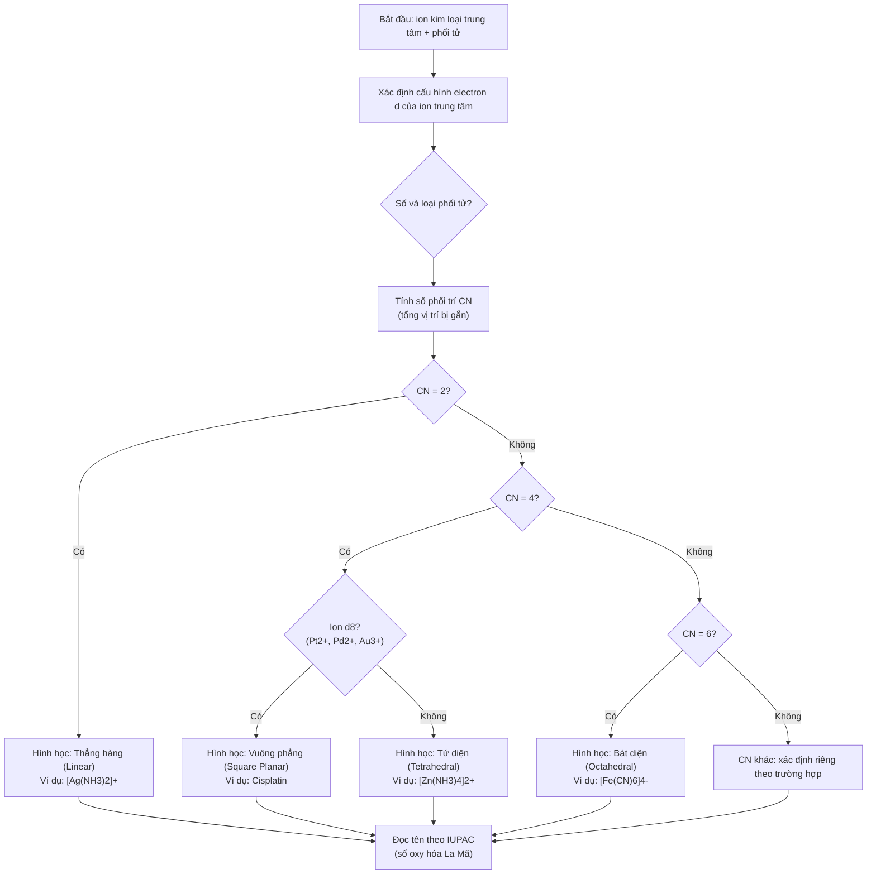

# Chương 6: Hóa học phối trí & Ứng dụng dược (tên tạm)

---

## 1. Tổng quan chương (Chapter Overview) {T-06.1}

### 1.1 Tên chương, giới thiệu khái quát & phạm vi nội dung {T-06.1.1}

Chương 1–4 đã trình bày liên kết cộng hóa trị định xứ, hình học phân tử VSEPR, thuyết liên kết hóa trị VB và thuyết orbital phân tử MO. Chương 6 chuyển sang **hoá học phối trí** — khía cạnh của hóa liễu mà ion kim loại trung tâm gắn trực tiếp với các phối tử (ligand) tạo thành ion phức hoặc phân tử phức. Phức chất hiện diện khắp nơi trong dược lý: cisplatin chống ung thư, hemoglobin vận chuyển oxy, chất cản quang MRI, thuốc giải độc kim loại nặng `[SRC: S-06.1, S-06.9]` `[ADDED: bridge from Ch03–05]`.

Chương trình bày thuyết phối trí Alfred Werner (cầu nội/cầu ngoại), nguyên tử trung tâm & số phối trí, phân loại phối tử, hiệu ứng chelat, danh pháp IUPAC, đồng phân, thuyết trường tinh thể (CFT), hằng số bền & HSAB, và bảng tổng hợp 10 ứng dụng y dược `[ADDED: scope summary]`.

Tên chương tạm thời: **"Hóa học phối trí & Ứng dụng dược"** (chưa có tên chính thức trong file nguồn D-06, chỉ có tại `MANIFEST.md`) `[VERIFY: chapter title (V-06.01)]`.

### 1.2 Phạm vi, Kiến thức Tiên quyết & Thời lượng Học tập {T-06.1.2}

- **Kiến thức tiên quyết:**
  1. Liên kết cộng hóa trị định xứ, độ âm điện, cực tính liên kết tại `T-01.4.1` (Chương 1).
  2. Hình học phân tử VSEPR, số phối trí lập thể $SN = m + n$ tại `T-02.4.2`, `T-02.4.3` (Chương 2) — phân biệt với số phối trí CN của phức chất.
  3. Thuyết orbital phân tử MO, bậc liên kết, thuận từ/nghịch từ tại Chương 4 (cơ sở cho CFT và màu sắc phức chất) `[ADDED: cross-reference to Ch01–04]`.
- **Thời lượng dự kiến:** ~**3 giờ 30 phút** (khoảng 2 giờ 50 phút cho ~4.000 từ lý thuyết + ví dụ/tính toán tại Mục 1–6, tương đương 4.000 / 1.500 ≈ 2,67 giờ; cộng 40 phút cho 10 bài tập ≈ 3 giờ 30 phút), theo `STUDY_TIME_RULE` `[ADDED: study time estimate]`.

---

## 2. Mục tiêu học tập (Learning Objectives) {T-06.2}

### 2.1 Chuẩn đầu ra Kiến thức, Kỹ năng, Vận dụng và Đánh giá mô hình (LO-1..LO-4) {T-06.2.1}

Sau chương này, sinh viên có thể `[ADDED: learning objectives]`:

- **`LO-1` (Kiến thức):** Phát biểu thuyết phối trí Werner, cầu nội/cầu ngoại, số phối trí CN, phân loại phối tử theo số càng, danh pháp IUPAC, đồng phân cấu trúc & lập thể.
- **`LO-2` (Kỹ năng):** Xác định CN, hình học, số oxy hóa, điện tích phức; đọc tên phức theo IUPAC; tính hằng số bền $\beta_n$, CFSE; phân loại spin cao/thấp.
- **`LO-3` (Vận dụng):** Vận dụng hiệu ứng chelat, CFT (tách mức $d$, spin, màu sắc), HSAB để giải thích độ bền phức, tương tác thuốc–kim loại và nguyên lý giải độc kim loại nặng.
- **`LO-4` (Đánh giá mô hình):** Đánh giá ứng dụng y dược (cisplatin, EDTA,MRI, SPECT, hemoglobin, B12), so sánh đồng phân, chọn chất tạo phức giải독 phù hợp `[ADDED: LO-4 definition]`.

---

## 3. Đặt vấn đề & Ý nghĩa thực tiễn (Introduction) {T-06.3}

### 3.1 Từ liên kết cộng hóa trị đến liên kết phối chí {T-06.3.1}

Liên kết cộng hóa trị (Chương 1) gắn hai nguyên tử trong cùng một phân tử; liên kết phối chí (hoá học phối trí) là liên kết cho–nhận giữa ion kim loại trung tâm (nhận cặp electron, Acid Lewis) và phối tử (cho cặp electron, Base Lewis) `[SRC: S-06.1, S-06.2]` `[ADDED: conceptual bridge]`.

Ph복 chất quyết định:
- **Cấu hình & hình học:** Số phối trí CN quyết định hình học không gian (tứ diện, vuông phẳng, bát diện) `[SRC: S-06.2]`.
- **Độ bền & độ chọn lọc:** Hiệu ứng chelat và hằng số bền quyết định phavourite ion kim loại nào `[SRC: S-06.4, S-06.8]`.
- **Màu sắc & tính chất quang:** CFT giải thích bước nhảy $d-d$ tạo màu sắc phức chất, nền tảng chất cản quang MRI `[SRC: S-06.7, S-06.9]`.
- **Ứng dụng dược lý:** Thuốc chống ung thư (cisplatin), giải độc (EDTA, Deferoxamine), chẩn đoán ($^{99m}Tc$-Sestamibi) `[SRC: S-06.9]`.

---

## 4. Nội dung bài giảng chính (Main Content) {T-06.4}

### 4.1 Thuyết phối trí Alfred Werner & Cầu nội/Cầu ngoại {T-06.4.1}

Năm 1893, Alfred Werner (giải Nobel Hóa học 1913) đưa ra thuyết phối cách mạng, giải thích cấu trúc không gian và bản chất liên kết của hợp chất phức vô cơ qua khái niệm **cầu nội** và **cầu ngoại** `[SRC: S-06.1]`.

> **Định nghĩa trọng tâm:**
> - **Cầu nội phối trí (Inner Coordination Sphere):** Viết **bên trong dấu ngoặc vuông `[...]`**, gồm ion kim loại trung tâm liên kết trực tiếp với các phối tử xung quanh bằng **liên kết phối chí (cho–nhận)** rất bền, có tính định hướng không gian xác định. Trong dung dịch nước **KHÔNG phân ly** thành ion kim loại tự do hoặc phối tử tự do. Điện tích cầu nội = tổng đại số điện tích của kim loại trung tâm và các phối tử:
> $$q_{cầu\ nội} = q_{kim\ loại} + \sum q_{phối\ tử}$$
> Cầu nội có thể là cation phức ($[Co(NH_3)_6]^{3+}$), anion phức ($[Fe(CN)_6]^{4-}$) hoặc phức trung hòa ($[Pt(NH_3)_2Cl_2]$) `[SRC: S-06.1]` `[ADDED: definition box]`.
> - **Cầu ngoại (Outer Sphere):** Nằm **bên ngoài dấu ngoặc vuông `[...]`**, gồm các ion đơn mang điện tích trái dấu ($Cl^-, NO_3^-, SO_4^{2-}, K^+, Na^+$) hoặc nước kết tinh. Liên kết là **liên kết ion tĩnh điện không định hướng**, kém bền hơn nhiều. Trong dung dịch nước **phân ly hoàn toàn thành ion tự do** `[SRC: S-06.1]` `[ADDED: definition box]`.

**Bảng 6.1.** So sánh cầu nội và cầu ngoại (6 tiêu chí). `[SRC: S-06.1]`

| Tiêu chí | Cầu nội phối trí | Cầu ngoại |
|---|---|---|
| Vị trí công thức | Bên trong `[...]` | Bên ngoài `[...]` |
| Thành cấu tạo | Kim loại trung tâm + phối tử | Ion đối đơn giản hoặc nước kết tinh |
| Bản chất liên kết | Liên kết phối chí (cho–nhận), định hướng | Liên kết ion tĩnh điện, không định hướng |
| Độ bền | Rất bền, khó phá vỡ | Kém bền, dễ solvat hóa phân ly |
| Điện ly trong nước | Không phân ly thành tiểu phân | Phân ly hoàn toàn $100\%$ thành ion tự do |
| Phản ứng với thuốc thử | Không phản ứng với thuốc thử nhận biết ion | Phản ứng tức thì tạo tủa ion đặc trưng |
| Ý nghĩa lập thể | Quyết định hình học không gian phân tử | Chỉ bù trừ điện tích |

**Thí nghiệm kinh điển của Alfred Werner với chuỗi phức Cobalt(III):** Werner thêm dung dịch bạc nitrat ($AgNO_3$) dư vào 4 hợp chất ammine của $CoCl_3$ và đo độ dẫn điện đương kỳ. Kết quả chứng minh ion cầu ngoại phân ly tự do, trong khi phối tử cầu nội gắn với kim loại `[SRC: S-06.1]` `[ADDED: historical experiment]`.

| Công thức thực nghiệm | Công thức phối trí | Cầu nội & cầu ngoại | $AgCl\downarrow$/1 mol | Tổng ion | Độ dẫn điện |
|---|---|---|---|---|---|
| $CoCl_3\!\cdot\!6NH_3$ (Vàng) | $[Co(NH_3)_6]Cl_3$ | Nội: $[Co(NH_3)_6]^{3+}$; Ngoại: $3Cl^-$ | 3 mol | 4 ion | Rất cao (1:3) |
| $CoCl_3\!\cdot\!5NH_3$ (Tím) | $[Co(NH_3)_5Cl]Cl_2$ | Nội: $[Co(NH_3)_5Cl]^{2+}$; Ngoại: $2Cl^-$ | 2 mol | 3 ion | Trung bình cao (1:2) |
| $CoCl_3\!\cdot\!4NH_3$ (Xanh lục) | $[Co(NH_3)_4Cl_2]Cl$ | Nội: $[Co(NH_3)_4Cl_2]^+$; Ngoại: $1Cl^-$ | 1 mol | 2 ion | Trung bình (1:1) |
| $CoCl_3\!\cdot\!3NH_3$ (Lục nhạt) | $[Co(NH_3)_3Cl_3]$ | Nội: $[Co(NH_3)_3Cl_3]$; Ngoại: Không có | 0 mol | 0 ion | Không dẫn điện |

**Ý nghĩa:** Cầu nội quyết định phối tử gắn trực tiếp và hình học quanh kim loại; cầu ngoại quyết định ion tự do khi hòa tan. Phân biệt giúp lập công thức và dự đoán phản ứng định tính `[SRC: S-06.1]` `[ADDED: interpretation]`.

### 4.2 Nguyên tử Trung tâm, Hóa trị & Số Phối trí {T-06.4.2}

- **Nguyên tử/ion trung tâm:** Thường là cation kim loại chuyển tiếp ($Fe^{2+}, Fe^{3+}, Cu^{2+}, Co^{3+}, Pt^{2+}, Zn^{2+}$) có orbital $d$ trống chưa lấp đầy, đóng vai trò **Acid Lewis** nhận cặp electron `[SRC: S-06.2]`.
- **Hóa trị chính (Primary valence):** Chính là **số oxy hóa** của kim loại trung tâm, được bão hòa bởi anion ở cầu ngoại hoặc cầu nội, không có tính định hướng không gian `[SRC: S-06.2]`.
- **Hóa trị phụ (Secondary valence):** Chính là **số phối trí (Coordination Number – CN)**, được bão hòa bởi phối tử ở cầu nội, có tính **định hướng không gian xác định**, quyết định cấu hình hình học phức chất `[SRC: S-06.2]`.
- **Số phối trí phổ biến & hình học:**
  - $CN = 2$: Thẳng hàng (Linear) — $[Ag(NH_3)_2]^+$, $[Au(CN)_2]^-$ `[SRC: S-06.2]`.
  - $CN = 4$: Tứ diện (Tetrahedral) — $[Zn(NH_3)_4]^{2+}, [NiCl_4]^{2-}$; hoặc Vuông phẳng (Square Planar) — $d^8$ ($Pt^{2+}, Pd^{2+}, Au^{3+}$ như $[PtCl_4]^{2-}, cis\text{-}[Pt(NH_3)_2Cl_2]$ – Cisplatin) `[SRC: S-06.2]`.
  - $CN = 6$: Bát diện (Octahedral) — phổ biến nhất ($[Fe(CN)_6]^{4-}, [Co(NH_3)_6]^{3+}, [Cr(H_2O)_6]^{3+}$) `[SRC: S-06.2]`.
- **Ý nghĩa:** Số oxy hóa và số phối trí giúp xác định điện tích phức, số vị trí phối tử và hình học dự kiến; cần thiết để lập công thức và gọi tên chính xác `[SRC: S-06.2]` `[ADDED: interpretation]`.

> **Phân biệt:** Số phối trí $CN$ của phức chất ≠ số phối trí lập thể $SN$ của VSEPR (Chương 2). $CN$ chỉ tính các vị trí bị phối tử gắn trực tiếp ở cầu nội `[ADDED: cross-reference note]`.

### 4.3 Phân loại Phối tử & Dung lượng Phối trí {T-06.4.3}

Phối tử được phân loại theo **dung lượng phối trí (denticity)** — số nguyên tử cho cặp electron trên mỗi phân tử phối tử `[SRC: S-06.3]` `[ADDED: definition]`.

**Bảng 6.2.** Phân loại phối tử chi tiết. `[SRC: S-06.3]`

| Loại phối tử | Dung lượng phối trí | Ví dụ tiêu biểu & Ký hiệu | Nguyên tử cho electron | Đặc điểm & ứng dụng dược |
|---|---|---|---|---|
| 1 càng (Monodentate) | 1 nguyên tử trên mỗi phân tử | Trung hòa: $H_2O, NH_3, CO, NO, py$; Anion: $F^-, Cl^-, Br^-, I^-, OH^-, CN^-$ | $O, N, C, F, Cl, Br, I$ | Chiếm 1 vị trí phối trí; $NH_3, Cl^-$ trong Cisplatin $[Pt(NH_3)_2Cl_2]$ |
| 2 càng (Bidentate) | 2 nguyên tử, tạo vòng 5–6 cạnh | Ethylenediamine ($en$), Oxalate ($ox^{2-}$), Glycinate ($gly^-$), $bipy$, $phen$ | $2N$, hoặc $2O$, hoặc $1N+1O$ | Tạo phức chelat bền; Oxaliplatin dùng oxalate 2 càng giảm độc thận |
| Đa càng (Polydentate/Chelate) | $\ge 3$ nguyên tử, ôm trọn kim loại | 3 càng ($dien$); 4 càng ($trien$, Vòng Porphyrin); 6 càng ($EDTA^{4-}$, Deferoxamine) | $O, N$ | Thuốc giải độc kim loại nặng ($EDTA$ thải chì, Deferoxamine thải sắt) |
| Lưỡng nha (Ambidentate) | $\ge 2$ nguyên tử khác nhau, nhưng chỉ liên kết qua 1 tại một thời điểm | $NO_2^-$ (Nitro $M-NO_2$ / Nitrito $M-ONO$); $SCN^-$ (Thiocyanato $M-SCN$ / Isothiocyanato $M-NCS$) | $N$ hoặc $O$; $S$ hoặc $N$ | Nguồn đồng phân liên kết (linkage isomerism) |
| Cầu nối (Bridging) | Liên kết đồng thời với ≥2 ion kim loại | $OH^-$ ($\mu$-hydroxo), $O^{2-}$ ($\mu$-oxo), $Cl^-$ ($\mu$-chloro), $NH_2^-$ ($\mu$-amido) | Cặp e tự do thứ hai chia sẻ | Tạo phức đa nhân; enzym kim loại (Hemerythrin có cầu $\mu$-oxo giữa 2 Fe) |

**Ý nghĩa:** Phân loại phối tử theo số càng và nguyên tử cho giúp dự đoán cấu trúc, độ bền, khả năng tạo chelat và tính chọn lọc với ion kim loại `[SRC: S-06.3]` `[ADDED: interpretation]`.

### 4.4 Hiệu ứng Chelat & Nhiệt động học {T-06.4.4}

> **Định nghĩa:** Phức chất vòng càng (chelat) từ phối tử đa càng luôn có độ bền nhiệt động học và hằng số bền ($\beta$) cao hơn hàng nghìn đến hàng triệu lần so với phức chất từ phối tử 1 càng tương đương `[SRC: S-06.4]` `[ADDED: definition box]`.

**Giải thích theo nhiệt động học** ($\Delta G^\circ = \Delta H^\circ - T\Delta S^\circ$) `[SRC: S-06.4]`:
- Phản ứng 1 ($6NH_3$ 1 càng): $[Ni(H_2O)_6]^{2+} + 6NH_3 \rightleftharpoons [Ni(NH_3)_6]^{2+} + 6H_2O$ ($\log\beta \approx 8,6$): $1$ ion phức $+ 6$ phân tử ($7$ tiểu phân) sinh ra $1$ phức $+ 6$ nước ($7$ tiểu phân) $\implies \Delta S^\circ \approx 0$.
- Phản ứng 2 ($3en$ 2 càng): $[Ni(H_2O)_6]^{2+} + 3en \rightleftharpoons [Ni(en)_3]^{2+} + 6H_2O$ ($\log\beta \approx 18,3$): $1$ ion phức $+ 3$ phân tử ($4$ tiểu phân) sinh ra $1$ phức $+ 6$ phân tử nước tự do ($7$ tiểu phân) $\implies$ **số lượng phân tử tự do tăng vọt**, $\Delta S^\circ \gg 0$.
- Vì $\Delta S^\circ > 0$ rất lớn $\implies \Delta G^\circ \ll 0 \implies$ tạo phức chelat diễn ra mãnh liệt và cực kỳ bền vững `[SRC: S-06.4]` `[ADDED: step-by-step thermodynamic explanation]`.

**Ý nghĩa:** Hiệu ứng chelat giải thích độ bền tương đối của phức đa càng; ứng dụng giải độc kim loại phải dựa trên chỉ định vì chất tạo phức cũng có thể gắn ion thiết yếu `[SRC: S-06.4]` `[ADDED: DOMAIN_RULES scope note]`.

### 4.5 Danh pháp Phức chất Quốc tế (IUPAC) {T-06.4.5}

**Trật tự gọi tên** `[SRC: S-06.5]`:
1. Gọi tên phối tử trước, tên kim loại trung tâm sau.
2. Nhiều loại phối tử: xếp theo bảng chữ cái Latin (không tính tiếp đầu ngữ số lượng).
3. Tiếp đầu ngữ số lượng đơn giản: di, tri, tetra, penta, hexa. Tên phức tạp hoặc đã có tiếp đầu ngữ số: bis, tris, tetrakis, pentakis, đặt tên trong dấu ngoặc đơn.
4. Kim loại trung tâm kèm số oxy hóa bằng chữ số La Mã trong ngoặc đơn (sát tên, không dấu cách).

**Tên kim loại trung tâm** `[SRC: S-06.5]`:
- Cation hoặc trung hòa: giữ tên thông thường (Cobalt, Chromium, Platinum, Iron/Sắt, Copper/Đồng).
- Anion: đổi đuôi thành **-ate** (tên Latin: Iron → Ferrate, Copper → Cuprate, Lead → Plumbate, Silver → Argentate, Gold → Aurate, Tin → Stannate).

**Bảng 6.3.** Ví dụ đọc tên phức chất chuẩn mực. `[SRC: S-06.5]`

| Công thức phức chất | Phân loại điện tích | Tên IUPAC quốc tế |
|---|---|---|
| $[Co(NH_3)_6]Cl_3$ | Cation phức | Hexaamminecobalt(III) chloride |
| $[Pt(NH_3)_2Cl_2]$ | Phức trung hòa điện | Diamminedichloridoplatinum(II) |
| $K_4[Fe(CN)_6]$ | Anion phức | Potassium hexacyanoferrate(II) |
| $K_3[Fe(CN)_6]$ | Anion phức | Potassium hexacyanoferrate(III) |
| $[Co(en)_3]Cl_3$ | Cation phức (đa càng) | Tris(ethylenediamine)cobalt(III) chloride |
| $Na[Al(OH)_4]$ | Anion phức | Sodium tetrahydroxidoaluminate(III) |
| $[Ag(NH_3)_2]NO_3$ | Cation phức | Diamminesilver(I) nitrate |

**Ý nghĩa:** Danh pháp IUPAC giúp suy ngược thành phần, phối tử, điện tích và số oxy hóa từ tên; giảm nhầm lẫn khi đọc tài liệu hóa dược `[SRC: S-06.5]` `[ADDED: interpretation]`.

### 4.6 Các dạng Đồng phân trong Phức chất {T-06.4.6}

**I. Đồng phân cấu trúc (Structural Isomerism)** `[SRC: S-06.6]`:
1. **Đồng phân ion hóa:** Phối tử ở cầu nội và anion ở cầu ngoại đổi chỗ.
   - $[Co(NH_3)_5Br]SO_4$ (Đỏ tím, tủa $BaSO_4$ với $BaCl_2$, không tủa với $AgNO_3$).
   - $[Co(NH_3)_5(SO_4)]Br$ (Đỏ hồng, tủa $AgBr$ với $AgNO_3$, không tủa với $BaCl_2$).
2. **Đồng phân solvat/hydrat hóa:** Nước dung môi là phối tử ở cầu nội hay nước kết tinh ở cầu ngoại.
   - $[Cr(H_2O)_6]Cl_3$ (màu tím hoa cà, 3 ion $Cl^-$ tủa với $Ag^+$).
   - $[Cr(H_2O)_5Cl]Cl_2\!\cdot\!H_2O$ (màu xanh lục nhạt, 2 ion $Cl^-$ tủa).
   - $[Cr(H_2O)_4Cl_2]Cl\!\cdot\!2H_2O$ (màu xanh lục đậm, 1 ion $Cl^-$ tủa).
3. **Đồng phân liên kết:** Phối tử lưỡng nha ($NO_2^-, SCN^-$).
   - $[Co(NH_3)_5(NO_2)]Cl_2$: Nitro gắn qua N ($Co-NO_2$), màu vàng.
   - $[Co(NH_3)_5(ONO)]Cl_2$: Nitrito gắn qua O ($Co-ONO$), màu đỏ.
4. **Đồng phân phối trí:** Cả cation và anion là ion phức, hoán đổi phối tử giữa hai tâm.
   - $[Co(NH_3)_6][Cr(CN)_6]$ và $[Cr(NH_3)_6][Co(CN)_6]$.

**II. Đồng phân lập thể (Stereoisomerism)** `[SRC: S-06.6]`:
1. **Đồng phân hình học (Geometric):**
   - Hệ vuông phẳng $MA_2B_2$: *cis* (2 phối tử giống nhau góc $90^\circ$) và *trans* (góc $180^\circ$). **Cisplatin** ($cis\text{-}[Pt(NH_3)_2Cl_2]$) là thuốc chống ung thư cực mạnh; **Transplatin** hoàn toàn không tác dụng trị ung thư vì không tạo liên kết uốn gập DNA kép `[SRC: S-06.6]` `[ADDED: pharmaceutical significance]`.
   - Hệ bát diện $MA_4B_2$: *cis* (góc $90^\circ$) và *trans* (góc $180^\circ$).
   - Hệ bát diện $MA_3B_3$: *fac* (Facial, 3 đỉnh của một mặt tam giác) và *mer* (Meridional, trên mặt phẳng xích đạo).
2. **Đồng phân quang học (Optical/Chiral):** Phân tử không có tâm/mặt đối xứng, hai dạng đối quang ($\Delta$ quay phải, $\Lambda$ quay trái) không chồng khít. Ví dụ $[Co(en)_3]^{3+}, [Fe(ox)_3]^{3-}$. Trong dược lý, tính bất đối xứng lập thể quyết định khả năng gắn khớp vào ổ thụ thể protein `[SRC: S-06.6]` `[ADDED: pharmaceutical relevance]`.

**Ý nghĩa:** Cùng công thức tổng có thể cho ion hóa, hình học, màu sắc hoặc hoạt tính khác nhau; cisplatin/transplatin minh họa rõ ý nghĩa dược lý `[SRC: S-06.6]` `[ADDED: interpretation]`.

### 4.7 Thuyết Trường Tinh thể (CFT) & Bản chất Liên kết Phối trí {T-06.4.7}

**Gia định của CFT:** Tương tác ion kim loại trung tâm và phối tử là tương tác **tĩnh điện thuần túy** giữa điện tích điểm (phối tử anion) hoặc ion với đầu lưỡng cực âm (phối tử trung hòa như $H_2O, NH_3$) `[SRC: S-06.7]` `[ADDED: definition]`.

**Tách mức năng lượng orbital $d$ trong trường bát diện ($O_h$)** `[SRC: S-06.7]`:
- 5 orbital $d$ ($d_{xy}, d_{yz}, d_{xz}, d_{x^2-y^2}, d_{z^2}$) bằng nhau (suy biến bậc 5) khi cô lập.
- 6 phối tử tiến lại dọc theo 3 trục ($x,y,z$):
  - Hai orbital $e_g$ ($d_{x^2-y^2}, d_{z^2}$) thùy hướng thẳng vào phối tử $\rightarrow$ chịu đẩy lớn nhất $\rightarrow$ **nâng cao năng lượng $+0,6\Delta_o$** ($+6Dq$).
  - Ba orbital $t_{2g}$ ($d_{xy}, d_{yz}, d_{xz}$) thùy xen kẽ giữa các trục $\rightarrow$ chịu đẩy nhỏ hơn $\rightarrow$ **hạ thấp năng lượng $-0,4\Delta_o$** ($-4Dq$).
  - Khoảng cách giữa 2 mức = **năng lượng tách trường tinh thể ($\Delta_o$ hay $10Dq$)**.

**Dãy phổ hóa học của phối tử** (thứ tự tăng dần khả năng tách trường $\Delta_o$) `[SRC: S-06.7]`:
$$I^- < Br^- < S^{2-} < SCN^- < Cl^- < F^- < OH^- < ox^{2-} < H_2O < NCS^- < py \approx NH_3 < en < bipy < phen < NO_2^- < CN^- \approx CO$$
- Phối tử trường yếu (bên trái $H_2O$): $\Delta_o$ nhỏ.
- Phối tử trường mạnh (bên phải $NH_3$): $\Delta_o$ rất lớn ($CN^-, CO$).

**Spin cao vs Spin thấp:** Sắp xếp electron $d$ phụ thuộc $\Delta_o$ vs năng lượng ghép đôi $P$ `[SRC: S-06.7]`:
- $\Delta_o < P$ (trường yếu): Electron điền độc thân theo Hund → **spin cao** (nhiều electron độc thân → thuận từ mạnh). Ví dụ $[FeF_6]^{3-}$ ($Fe^{3+}: d^5$): $(t_{2g})^3(e_g)^2$, 5 electron độc thân.
- $\Delta_o > P$ (trường mạnh): Electron bị ép ghép đôi tại $t_{2g}$ → **spin thấp** (ít/không electron độc thân). Ví dụ $[Fe(CN)_6]^{3-}$ ($d^5$): $(t_{2g})^5(e_g)^0$, 1 electron độc thân; $[Fe(CN)_6]^{4-}$ ($d^6$): $(t_{2g})^6(e_g)^0$, 0 electron độc thành → **nghịch từ hoàn toàn**.

**Năng lượng làm bền trường tinh thể (CFSE)** `[SRC: S-06.7]`:
$$CFSE = (-0,4 \cdot n_{t_{2g}} + 0,6 \cdot n_{e_g})\Delta_o + m \cdot P$$
($n_{t_{2g}}, n_{e_g}$: số electron ở từng mức; $m$: số cặp electron ghép đôi mới phát sinh do phối tử).

**Nguồn gốc màu sắc:** Phức chất hấp thụ photon có năng lượng bằng $\Delta_o$:
$$\Delta_o = h\nu = \frac{h \cdot c}{\lambda}$$
Electron nhảy $t_{2g} \to e_g$ (bước nhảy $d-d$); mắt người quan sát thấy màu bổ sung. Ion $d^0$ ($Sc^{3+}, Ti^{4+}$) hoặc $d^{10}$ ($Zn^{2+}, Cu^+$) không thể bước nhảy $d-d$ → dung dịch **không có màu** `[SRC: S-06.7]` `[ADDED: explanation]`.

**Hiệu ứng Jahn–Teller:** Hệ thống phân tử phi tuyến có trạng thái suy biến điện tử tự biến dạng cấu trúc để giảm năng lượng. Ví dụ $Cu^{2+}$ ($d^9$, $(t_{2g})^6(e_g)^3$ suy biến ở $e_g$): trong $[Cu(H_2O)_6]^{2+}$, 2 liên kết nước dọc theo trục $z$ bị kéo dài (bát diện bị kéo dài theo $z$) `[SRC: S-06.7]` `[ADDED: explanation]`.

**Ý nghĩa:** CFT liên hệ trường phối tử với phân bố electron $d$, spin, từ tính và màu sắc; hỗ trợ nhận diện phức và giải thích ảnh hưởng của phối tử lên kim loại trung tâm `[SRC: S-06.7]` `[ADDED: interpretation]`.

### 4.8 Cân bằng Phức chất, Hằng số Bền & HSAB {T-06.4.8}

**Hằng số bền từng nấc và tổng cộng** `[SRC: S-06.8]`:
$$M + L \rightleftharpoons ML\ (k_1); \quad ML + L \rightleftharpoons ML_2\ (k_2); \ \dots \ ; ML_{n-1} + L \rightleftharpoons ML_n\ (k_n)$$
$$Hằng số bền tổng cộng:\quad \beta_n = k_1 \cdot k_2 \cdots k_n = \frac{[ML_n]}{[M][L]^n}$$
$\beta_n$ càng lớn thì phức chất càng bền vững. Đại lượng nghịch đảo = hằng số không bền: $K_{kb} = 1/\beta_n$.

**Hằng số bền điều kiện ($\beta'$)** `[SRC: S-06.8]`:
$$\beta' = \frac{\beta_{ML}}{\alpha_M \cdot \alpha_L}$$
($\alpha_M, \alpha_L$: hệ số phản ứng phụ). Nguyên lý cốt lõi để chuẩn độ complexon chọn lọc ion $Ca^{2+}, Mg^{2+}, Bi^{3+}, Zn^{2+}$ trong Dược điển.

**Thuyết Acid–Base Cứng và Mềm của Pearson (HSAB)** `[SRC: S-06.8]`:
- **Acid Lewis cứng:** Bán kính nhỏ, điện tích dương cao, khó cực hóa ($H^+, Li^+, Mg^{2+}, Ca^{2+}, Al^{3+}, Fe^{3+}, Cr^{3+}, Ti^{4+}$).
- **Acid Lewis mềm:** Bán kính lớn, điện tích thấp ($\le+2$), nhiều electron $d$, dễ cực hóa ($Ag^+, Cu^+, Au^+, Pt^{2+}, Hg^{2+}, Cd^{2+}$).
- **Base Lewis cứng:** Nguyên tử phối tử độ âm điện lớn, bán kính nhỏ ($F^-, OH^-, H_2O, NH_3, SO_4^{2-}$).
- **Base Lewis mềm:** Độ âm điện thấp, bán kính lớn, đám mây electron xốp ($I^-, S^{2-}, SCN^-, CN^-, CO, R\text{-}SH$).
- **Quy tắc phối trí Pearson:** "Acid cứng ưu tiên phối trí với Base cứng; Acid mềm ưu tiên phối trí với Base mềm" (Cứng–Cứng: tính chất tĩnh điện ion; Mềm–Mềm: tính chất cộng hóa trị) `[SRC: S-06.8]` `[ADDED: tabular summary]`.

**Ý nghĩa Dộc chất học & Giải độc Dược:** Ion kim loại nặng cực độc ($Hg^{2+}, Cd^{2+}, Pb^{2+}, As^{3+}$) là acid mềm hoặc trung gian; có ái lực với nhóm sulfhydryl ($-SH$, base mềm) trên enzym → biến tính, ức chế chức năng sống. Thuốc giải độc đặc hiệu phải là phối tử chứa lưu huỳnh (base mềm) như D-Penicillamine, Dimercaprol (BAL), DMPS để cạnh tranh lôi kéo ion kim loại nặng ra khỏi tế bào `[SRC: S-06.8]` `[ADDED: clinical mechanism]` `[DOMAIN_RULES: chỉ giải thích cơ chế, không liều/chỉ định]`.

**Ý nghĩa:** Hằng số bền và HSAB giúp dự đoán cạnh tranh tạo phức trong dung dịch sinh lý, tương tác thuốc–kim loại và nguyên lý chọn chất tạo phức giải độc `[SRC: S-06.8]` `[ADDED: interpretation]`.

### 4.9 Ứng dụng Hóa Phối Trí trong Y Dược {T-06.4.9}

**Bảng 6.4.** Bảng tổng hợp ứng dụng hóa phối trí trong y dược. `[SRC: S-06.9]`

| Lĩnh vực / Tên thuốc | Công thức & Cấu trúc phối trí | Cơ chế phối trí & Ứng dụng điều trị |
|---|---|---|
| Cisplatin (chống ung thư) | $cis\text{-}[Pt(NH_3)_2Cl_2]$, vuông phẳng ($dsp^2$), 2 ammine + 2 chloro ở vị trí cis | 2 chloro rời đi trong nội bào (nồng độ $Cl^-$ thấp); $Pt^{2+}$ liên kết với $N_7$ của Guanine trên DNA, uốn cong DNA kép, ngăn sao chép, kích hoạt tự hủy tế bào ác tính |
| Carboplatin & Oxaliplatin (thế hệ 2 & 3) | $Pt^{2+}$ với phối tử chelat dicarboxylate + diamine | Tăng độ bền liên kết phối tử, giảm tốc độ thủy phân → giảm độc thận và thần kinh thính giác so với cisplatin |
| $CaNa_2$-EDTA (giải độc chì) | Phối tử chelat EDTA 6 càng ($2N+4O$) | $Pb^{2+}$ có $\log\beta$ với EDTA ($\approx18$) cao hơn $Ca^{2+}$ ($\approx10,7$); tiêm $\rightarrow$ $Pb^{2+}$ đẩy $Ca^{2+}$ ra ngoài, tạo $[Pb(EDTA)]^{2-}$ đào thải qua thận, không hạ canxi máu |
| D-Penicillamine (giải độc đồng) | Phối tử aminothiol chelat qua $-SH$ và $-NH_2$ | Đ특 trị bệnh Wilson ($Cu^{2+}$ ứ đọng); tạo phức chelat tan đào thải đồng qua niệu; giải độc thủy ngân, chì |
| Deferoxamine (Desferal) (giải độc sắt) | Phối tử trihydroxamate tự nhiên, bát diện 6 càng với $Fe^{3+}$ | $\log\beta$ với $Fe^{3+}$ siêu cao ($\approx31$); đặc trị quá tải sắt do truyền máu kéo dài (Thalassemia) |
| Dimercaprol (BAL) (British Anti-Lewisite) | $CH_2(SH)\text{-}CH(SH)\text{-}CH_2OH$, dithiol 2 càng qua 2 $-SH$ | Đặc trị ngộ độc kim loại mềm: Asen ($As^{3+}$), Thủy ngân ($Hg^{2+}$), Vàng ($Au$), Antimon ($Sb$); cạnh tranh kéo kim loại ra khỏi enzym pyruvate dehydrogenase |
| $Gd\text{-DTPA}$ & $Gd\text{-DOTA}$ (chất cản quang MRI) | $Gd^{3+}$ ($4f^7$, 7 electron độc thân) với DTPA/DOTA | $\log\beta > 22$, phức đào thải nguyên vẹn qua thận; 7 electron độc thân tạo momen từ lớn, rút ngắn thời gian hồi phục $T_1$ của proton nước, giúp hình ảnh MRI rõ ràng |
| $^{99m}Tc\text{-Sestamibi}$ (Cardiolite) (chẩn đoán hạt nhân) | $^{99m}Tc$ với 6 phối tử isonitrile | Phức cation thân dầu, tích điện dương, tập trung vào màng ty thể tế bào cơ tim còn sống; phát tia gamma $140\text{ keV}$, máy SPECT chụp hình vùng cơ tim thiếu máu |
| Hemoglobin & Myoglobin (hệ phức sinh học) | $Fe^{2+}$ với vòng Porphyrin (Heme) và Histidine | Vị trí phối trí thứ 6 liên kết thuận nghịch với $O_2$ để vận chuyển khí nuôi mô; bị ức chế bất thuận nghịch bởi $CO$ và $CN^-$ (trường mạnh) |
| Vitamin B12 (Cobalamin) | $Co^{3+}$ với vòng Corrin (4N), dimethylbenzimidazole (1N) và $-CN$ hoặc $-CH_3$ | Coenzym sống còn tham gia tổng hợp methionine, tạo hồng cầu và phát triển hệ thần kinh |

**Ý nghĩa:** Cùng nguyên lý phối trí được dùng trong điều trị, chẩn đoán và giải độc; mỗi ứng dụng cần cân nhắc độ bền phức, phân bố, thải trừ và độc tính `[SRC: S-06.9]` `[ADDED: summary table]`.

---

## 5. Ví dụ minh họa & Quy trình thực hành (Examples & Illustrations) {T-06.5}

### 5.1 Ví dụ 6.1: Đọc ba phức chất thường gặp {T-06.5.1}

> **Example 6.1.** Phân tích ba phức chất: $[Cu(NH_3)_4]^{2+}$, $[Fe(CN)_6]^{3-}$, $[Ag(NH_3)_2]^+$. `[SRC: S-06.9]` `[SRC: S-06.7]`
>
> - **Given (Dữ kiện đã cho):** $[Cu(NH_3)_4]^{2+}$: $Cu^{2+}$ ($3d^9$) + 4 $NH_3$ đơn càng $\rightarrow$ số phối trí 4, dạng vuông phẳng, dung dịch xanh lam đậm, còn 1 electron độc thân → thuận từ. $[Fe(CN)_6]^{3-}$: $Fe^{3+}$ ($3d^5$) + 6 $CN^-$ (trường mạnh) $\rightarrow$ bát diện, cấu hình $t_{2g}^5$ (low-spin), 1 electron độc thân, $\mu \approx 1,73$ BM (spin-only), $\log\beta \approx 44$. $[Ag(NH_3)_2]^+$: $Ag^+$ ($4d^{10}$) + 2 phối tử $\rightarrow$ số phối trí 2, dạng thẳng; cơ sở phản ứng hòa tan $AgCl$ trong dung dịch $NH_3$ đặc `[SRC: S-06.9]`.
> - **Find (Yêu cầu):** Xác định số phối trí, hình học, cấu hình electron, số electron độc thân, tính chất từ tính và ý nghĩa ứng dụng cho mỗi phức.
> - **Approach (Phương pháp giải):** Xác định ion trung tâm và số electron $d$, số phối tử và kiểu lai hóa/hình học, điền electron theo CFT, tính $\mu$ spin-only nếu cần.
> - **Solution (Giải):**
>   1. $[Cu(NH_3)_4]^{2+}$: $Cu^{2+}$ ($3d^9$), $CN=4$, vuông phẳng ($dsp^2$), cấu hình $(t_{2g})^6(e_g)^3$ suy biến ở $e_g$ → Jahn-Teller, 1 electron độc thân → thuận từ.
>   2. $[Fe(CN)_6]^{3-}$: $Fe^{3+}$ ($3d^5$), $CN=6$, bát diện, trường mạnh $CN^-$ $\rightarrow$ low-spin $(t_{2g})^5(e_g)^0$, 1 electron độc thân → thuận từ yếu, $\log\beta \approx 44$ (rất bền).
>   3. $[Ag(NH_3)_2]^+$: $Ag^+$ ($4d^{10}$), $CN=2$, thẳng hàng ($sp$), tất cả orbital $d$ đầy → 0 electron độc thân → nghịch từ; أساس hòa tan $AgCl$ trong $NH_3$ đặc.
> - **Check (Kiểm tra):** Tổng số electron và điện tích khớp với công thức; $[Fe(CN)_6]^{3-}$ có điện tích $3+ + 6(-1) = -3$ ✓.
> - **Interpretation (Nhận xét):** Số đồng vị $d$ và loại phối tử quyết định spin và màu sắc; các phức này minh họa sự đa dạng của hóa học phối trí `[ADDED: conclusion]`.

### 5.2 Ví dụ 6.2: EDTA & giải độc {T-06.5.2}

> **Example 6.2.** Phân tích EDTA như phối tử 6 càng và ứng dụng giải độc. `[SRC: S-06.9]` `[SRC: S-06.4]`
>
> - **Given (Dữ kiện đã cho):** $EDTA^{4-}$ có 4 nhóm carboxylate (4 nguyên tử O) + 2 nguyên tử N, mỗi vị trí cho 1 cặp electron $\rightarrow$ **6 càng**, "ôm" ion kim loại tạo nhiều vòng 5 cạnh (chelat). Hiệu ứng chelat: giải phóng nhiều phân tử nước khi tạo phức làm tăng entropy → phức bền hơn hẳn phức của phối tử đơn càng ($\log\beta$ với $Fe^{3+}$ khoảng 25). Ứng dụng: $CaNa_2EDTA$ dùng giải độc chì ($Pb^{2+}$); trong bào chế, EDTA liều thấp thêm vào thuốc để "khóa" vết $Fe^{3+}/Cu^{2+}$ xúc tác phản ứng oxy hóa, giúp chế phẩm ổn định hơn `[SRC: S-06.9]`.
> - **Find (Yêu cầu):** Giải thích cấu trúc chelat của EDTA, lý do độ bền cao và ứng dụng giải độc chì.
> - **Approach (Phương pháp giải):** Xác định số nguyên tử cho electron của EDTA, số vòng chelat, hiệu ứng entropy, so sánh $\log\beta$ của $Pb^{2+}$ và $Ca^{2+}$ với EDTA.
> - **Solution (Giải):**
>   1. $EDTA^{4-}$: 4 O + 2 N = 6 nguyên tử cho electron → 6 càng, tạo nhiều vòng chelat 5 cạnh.
>   2. Tạo phức chelat giải phóng nhiều phân tử nước tự do → $\Delta S^\circ \gg 0$ → $\Delta G^\circ \ll 0$ → ph cực bền.
>   3. $\log\beta(Pb\text{-}EDTA) \approx 18 > \log\beta(Ca\text{-}EDTA) \approx 10,7$ → $Pb^{2+}$ đẩy $Ca^{2+}$ ra ngoài, tạo $[Pb(EDTA)]^{2-}$ tan đào thải qua thận.
>   4. Không gây hạ canxi máu vì $Ca^{2+}$ được giải phóng dưới dạng ion tự do (không kẹt trong phức ổn định quá mức).
> - **Check (Kiểm tra):** 6 càng của EDTA khớp với "4 O + 2 N = 6" (mẹo nhớ); $\log\beta$ values phù hợp với dữ liệu nguồn `[SRC: S-06.4, S-06.9]`.
> - **Interpretation (Nhận xét):** EDTA là chất tạo phức giải độc hiệu quả nhờ hiệu ứng chelat và độ chọn lọc cao với ion kim loại nặng `[ADDED: conclusion]`.

### 5.3 Sơ đồ thuật toán xác định số phối trí & hình học (Mermaid) {T-06.5.3}

Quy trình xác định số phối trí CN và hình học phức chất dựa trên ion trung tâm và loại phối tử `[ADDED: algorithm synthesizing S-06.2, S-06.4.2]`:

1. Xác định ion kim loại trung tâm và cấu hình electron $d$.
2. Xác định số và loại phối tử (dung lượng, điện tích).
3. Tính số phối trí CN = tổng vị trí bị gắn.
4. Chọn hình học: $CN=2$ (thẳng), $CN=4$ (tứ diện nếu $d^{10}$/trường yếu, vuông phẳng nếu $d^8$), $CN=6$ (bát diện).
5. Đọc tên theo IUPAC.

**Hình 6.1.** Sơ đồ thuật toán xác định số phối trí và hình học phức chất. `[ADDED: Mermaid flowchart]` `[VERIFY: CN determination algorithm (V-06.02)]`.

### 5.4 Minh họa Trực quan (Placeholders) {T-06.5.4}

Các khung dưới đây chỉ là giữ chỗ, **chưa được vẽ** `[ADDED: figure placeholder specifications]`.

**Hình 6.1.** Cấu trúc cầu nội & cầu ngoại (khung giữ chỗ). `[ADDED: Figure 6.1 caption]`

**Hình 6.2.** Tách mức orbital $d$ trường bát diện (khung giữ chỗ). `[ADDED: Figure 6.2 caption]` `[VERIFY: d-orbital splitting (V-06.02)]`

**Hình 6.3.** Dãy phổ hóa học của phối tử (khung giữ chỗ). `[ADDED: Figure 6.3 caption]`

---

## 6. Tóm tắt chương (Chapter Summary) {T-06.6}

### 6.1 Tóm tắt Nội dung Trọng tâm & Quy tắc Ghi nhớ {T-06.6.1}

Các luận điểm chính của chương 6 `[SRC: S-06.1–S-06.9]`:

1. **Thuyết phối trí Werner:** Ion kim loại trung tâm gắn trực tiếp với các phối tử ở **cầu nội** (`[...]`), liên kết phối chí (cho–nhận), bền, định hướng; **cầu ngoại** là ion đối, liên kết ion tĩnh điện, phân ly hoàn toàn trong nước `[SRC: S-06.1]`.
2. **Số phối trí CN:** $CN=2$ (thẳng), $CN=4$ (tứ diện/vuông phẳng), $CN=6$ (bát diện); phân biệt với số phối trí lập thể $SN$ (VSEPR) `[SRC: S-06.2]` `[ADDED: cross-reference note]`.
3. **Phân loại phối tử:** 1 càng, 2 càng, đa càng, lưỡng nha, cầu nối; EDTA là 6 càng (4 O + 2 N) `[SRC: S-06.3]` `[ADDED: mnemonic "4 O + 2 N = 6"]`.
4. **Hiệu ứng chelat:** Phức đa càng bền hơn hẳn phức đơn cùng do entropy tăng ($\Delta S^\circ \gg 0 \implies \Delta G^\circ \ll 0$) `[SRC: S-06.4]` `[ADDED: thermodynamic summary]`.
5. **Danh pháp IUPAC:** Phối tử trước, kim loại sau; số oxy hóa chữ La Mã; kim loại anion đổi đuôi -ate `[SRC: S-06.5]`.
6. **Đồng phân:** Cấu trúc (ion hóa, solvat, liên kết, phối trí) & lập thể (hình học cis/trans fac/mer, quark học $\Delta/\Lambda$); cisplatin vs transplatin `[SRC: S-06.6]` `[ADDED: pharmaceutical summary]`.
7. **CFT:** Tách mức $d$ bát diện ($t_{2g}$ thấp, $e_g$ cao, $\Delta_o=10Dq$); dãy phổ; spin cao ($\Delta_o<P$) vs spin thấp ($\Delta_o>P$); CFSE; màu sắc từ bước nhảy $d-d$; Jahn-Teller `[SRC: S-06.7]` `[ADDED: theoretical summary]`.
8. **Hằng số bền & HSAB:** $\beta_n$ càng lớn → bền hơn; $\beta' = \beta_{ML}/(\alpha_M\alpha_L)$; acid cứng-base cứng, acid mềm-base mềm; giải độc kim loại nặng bằng phối tử chứa lưu huỳnh `[SRC: S-06.8]` `[ADDED: clinical summary]`.
9. **Ứng dụng y dược:** Cisplatin, EDTA, Deferoxamine, MRI ($Gd$-DTPA), SPECT ($^{99m}Tc$), hemoglobin, Vitamin B12 `[SRC: S-06.9]` `[ADDED: application summary]`.

> **Quy tắc ghi nhớ (mnemonic):**
> - **"4 O + 2 N = 6":** EDTA là phối tử 6 càng (4 nguyên tử O từ carboxyl + 2 nguyên tử N) `[ADDED: mnemonic]`.
> - **Cisplatin (cis) chữa ung thư; Transplatin (trans) không:** Hình học lập thể quyết định khả năng gắn DNA `[ADDED: mnemonic]`.
> - **Acid cứng–Base cứng; Acid mềm–Base mềm:** Quy tắc phối trí Pearson trong HSAB `[ADDED: mnemonic]`.

### 6.2 Bảng Tổng hợp Công thức & Quy tắc {T-06.6.2}

**Bảng 6.5.** Tổng hợp công thức, số phối trí, hình học và màu sắc của chương 6. `[ADDED: Table 6.5]`

| Hạng mục | Công thức / Quy tắc | Ý nghĩa & điều kiện | Ví dụ trong chương |
|---|---|---|---|
| Điện tích cầu nội | $q_{cầu\ nội} = q_{kim\ loại} + \sum q_{phối\ tử}$ | Tổng đại số điện tích; quyết định cation/anion/trung hòa | $[Co(NH_3)_6]^{3+}$ (cation), $[Fe(CN)_6]^{4-}$ (anion) |
| Số phối trí CN | $CN = 2, 4, 6$ | $CN=2$ thẳng; $CN=4$ tứ diện/vuông phẳng; $CN=6$ bát diện | $[Ag(NH_3)_2]^+$ ($CN=2$); $[PtCl_4]^{2-}$ ($CN=4$); $[Fe(CN)_6]^{4-}$ ($CN=6$) |
| Tách mức $d$ bát diện | $t_{2g}$ (thấp, $-0,4\Delta_o$); $e_g$ (cao, $+0,6\Delta_o$) | $\Delta_o = 10Dq$; 6 phối tử dọc theo 3 trục | $[Fe(CN)_6]^{4-}$ (low-spin, $t_{2g}^6$) |
| Bước nhảy $d-d$ | $\Delta_o = h\nu = hc/\lambda$ | Hấp thụ photon $\rightarrow$ màu sắc bổ sung | Ion $d^0, d^{10}$ không màu |
| CFSE | $CFSE = (-0,4 n_{t_{2g}} + 0,6 n_{e_g})\Delta_o + m\cdot P$ | Năng lượng làm bền trường tinh thể | Tính toán độ bền tương đối |
| Hằng số bền | $\beta_n = k_1\cdots k_n = [ML_n]/([M][L]^n)$ | $\beta_n$ lớn → phức bền | $\log\beta(Fe^{3+}\text{-}EDTA) \approx 25$ |
| Hằng số bền điều kiện | $\beta' = \beta_{ML}/(\alpha_M\cdot\alpha_L)$ | Định lượng độ bền thực tế ở pH xác định | Chuẩn độ complexon $Ca^{2+}, Mg^{2+}$ |
| Quy tắc Pearson (HSAB) | Acid cứng–Base cứng; Acid mềm–Base mềm | Cứng–Cứng: tính chất ion; Mềm–Mềm: tính chất cộng hóa trị | Giải độc bằng D-Penicillamine, Dimercaprol |

---

## 7. Đánh giá & Bài tập tự lượng giá (Review & Assessment) {T-06.7}

[ADDED: assessment section frame] Bộ câu hỏi và bài tập dưới đây được thiết kế theo thang nhận thức từ Nhận biết, Thông hiểu đến Vận dụng, Phân tích và Đánh giá mô hình, bao phủ bốn chuẩn đầu ra `LO-1`–`LO-4` đã phát biểu tại `T-06.2.1`. Mỗi câu đều ghi rõ chuẩn đầu ra và cấp độ nhận thức; đáp án chi tiết nằm tại `T-06.7.4`. Sinh viên nên tự làm bài đầy đủ trước khi đọc đáp án chi tiết.

### 7.1 Câu hỏi Lý thuyết: Nhận biết & Thông hiểu (LO-1) {T-06.7.1}

[ADDED: knowledge and comprehension questions]

**Câu 1 (`LO-1` – Knowledge).** Phân biệt chính xác giữa cầu nội và cầu ngoại của một phức chất là gì?

- **A.** Cầu nội nằm bên ngoài dấu ngoặc vuông, cầu ngoại nằm bên trong.
- **B.** Cầu nội chứa ion kim loại và phối tử liên kết trực tiếp (bên trong `[...]`), cầu ngoại chứa ion đối hoặc nước kết tinh (bên ngoài `[...]`).
- **C.** Cầu nội và cầu ngoại đều có liên kết ion tĩnh điện.
- **D.** Cầu ngoại quyết định hình học không gian của phức chất.

**Câu 2 (`LO-1` – Comprehension).** Số phối trí $CN = 4$ của một ion kim loại có cấu hình $d^8$ (ví dụ $Pt^{2+}$) thường dẫn đến hình học nào?

- **A.** Thẳng hàng.
- **B.** Tứ diện.
- **C.** Vuông phẳng.
- **D.** Bát diện.

**Câu 3 (`LO-1` – Comprehension).** Phối tử EDTA là loại phối tử nào theo dung lượng phối trí?

- **A.** 1 càng.
- **B.** 2 càng.
- **C.** 4 càng.
- **D.** 6 càng.

**Câu 4 (`LO-1` – Comprehension).** Trong dãy phổ hóa học của phối tử, phối tử nào có khả năng tách trường $\Delta_o$ lớn nhất?

- **A.** $I^-$
- **B.** $H_2O$
- **C.** $NH_3$
- **D.** $CO$ (hoặc $CN^-$)

### 7.2 Bài tập Áp dụng: Tính toán & Phân loại (LO-2, LO-3) {T-06.7.2}

[ADDED: application exercises]

**Bài tập 5 (`LO-2` – Application).** Cho phức chất $[Co(NH_3)_6]Cl_3$. Hãy:
1. Xác định số oxy hóa của Co, điện tích của ion phức $[Co(NH_3)_6]$.
2. Gọi tên theo danh pháp IUPAC.
3. Xác định số phối trí CN và hình học dự kiến.
4. Dự đoán tính chất dẫn điện của dung dịch (phân ly hay không, số ion).

**Bài tập 6 (`LO-2` – Application).** Tính CFSE của ion $[Fe(CN)_6]^{4-}$ ($Fe^{2+}: d^6$, low-spin, trường mạnh $CN^-$), biết $\Delta_o$ là đơn vị năng lượng. Hãy:
1. Xác định cấu hình electron $(t_{2g})^n(e_g)^m$.
2. Tính $CFSE = (-0,4 \cdot n_{t_{2g}} + 0,6 \cdot n_{e_g})\Delta_o$ (bỏ qua năng lượng ghép đôi $m\cdot P$ để đơn giản hóa).
3. Dự đoán tính chất từ tính (số electron độc thân).

**Bài tập 7 (`LO-3` – Application).** Cho hai phức chất $[FeF_6]^{3-}$ (trường yếu) và $[Fe(CN)_6]^{3-}$ (trường mạnh), cả hai có $Fe^{3+}: d^5$. Hãy:
1. Vẽ cấu hình electron $(t_{2g})^n(e_g)^m$ cho mỗi phức (spin cao vs spin thấp).
2. Xác định số electron độc thân và tính chất từ tính của mỗi phức.
3. Giải thích vì sao $[Fe(CN)_6]^{3-}$ có màu sắc khác $[FeF_6]^{3-}$ (dựa trên $\Delta_o$ khác nhau).

### 7.3 Câu hỏi Phân tích & Vận dụng Nâng cao (LO-3, LO-4) {T-06.7.3}

[ADDED: analytical and advanced questions]

**Câu 8 (`LO-3`, `LO-4` – Analysis).** Giải thích hiệu ứng chelat tại sao phức của EDTA với ion kim loại nặng bền hơn hẳn phức của phối tử đơn càng (như $Cl^-$或 $NH_3$) có bản chất liên kết tương đương. Sử dụng khái niệm entropy và công thức $\Delta G^\circ = \Delta H^\circ - T\Delta S^\circ$ trong giải thích `[SRC: S-06.4]`.

**Câu 9 (`LO-3` – Analysis).** Cisplatin ($cis\text{-}[Pt(NH_3)_2Cl_2]$) là thuốc chống ung thư mạnh, trong khi đồng phân transplatin hoàn toàn không có tác dụng trị ung thư. Hãy:
1. Vẽ mô tả cấu trúc hai dạng *cis* và *trans* (vuông phẳng, góc liên kết).
2. Giải thích tại sao chỉ dạng *cis* có thể tạo liên kết uốn gập DNA kép (liên kết với 2 nguyên tử Guanine liền nhau trên cùng một mắt xích DNA).
3. Đánh giá ý nghĩa của đồng phân lập thể trong thiết kế thuốc chống ung thư `[SRC: S-06.6]` `[ADDED: critical thinking]`.

**Câu 10 (`LO-4` – Advanced).** Thuyết HSAB khuyên "acid cứng phối trí với base cứng; acid mềm phối trí với base mềm". Áp dụng quy tắc này để giải thích tại sao thuốc giải độc kim loại nặng (D-Penicillamine, Dimercaprol) chứa nhóm $-SH$ (base mềm) có hiệu quả với ion kim loại nặng ($Hg^{2+}, Pb^{2+}, Cd^{2+}$ — acid mềm). Nêu một rủi ro nếu dùng chất tạo phức không phù hợp với loại acid của ion kim loại độc `[SRC: S-06.8]` `[ADDED: critical thinking]` `[DOMAIN_RULES: chỉ giải thích cơ chế, không liều/chỉ định]`.

---

## 7.4 Đáp án & Hướng dẫn Giải Chi tiết (Answer Key) {T-06.7.4}

[ADDED: step-by-step answer key]

**Câu 1 — `LO-1` · Knowledge. Đáp án B.** Cầu nội chứa ion kim loại và các phối tử liên kết trực tiếp, viết bên trong dấu ngoặc vuông `[...]`, liên kết phối chí bền, định hướng, không phân ly trong nước. Cầu ngoại chứa ion đối hoặc nước kết tinh, viết bên ngoài `[...]`, liên kết ion tĩnh điện, phân ly hoàn toàn. Phương án A đảo ngược vị trí; C sai vì chỉ cầu nội liên kết phối chí; D sai vì hình học được quyết định bởi cầu nội (số phối trí).

**Câu 2 — `LO-1` · Comprehension. Đáp án C.** Ion $d^8$ ($Pt^{2+}, Pd^{2+}, Au^{3+}$) với số phối trí 4 thường tạo hình học vuông phẳng (ví dụ cisplatin $[Pt(NH_3)_2Cl_2]$). Phương án A là $CN=2$; B là $CN=4$ nhưng ion không phải $d^8$ (ví dụ $d^{10}$); D là $CN=6$.

**Câu 3 — `LO-1` · Comprehension. Đáp án D.** EDTA có 4 nguyên tử O (từ 4 nhóm carboxylate) + 2 nguyên tử N = 6 nguyên tử cho electron $\rightarrow$ 6 càng, tạo nhiều vòng chelat 5 cạnh `[SRC: S-06.9]` `[ADDED: mnemonic "4 O + 2 N = 6"]`.

**Câu 4 — `LO-1` · Comprehension. Đáp án D.** Theo dãy phổ hóa học, khả năng tách trường $\Delta_o$ tăng dần từ trái sang phải; $CO$ và $CN^-$ nằm ở bên phải (trường mạnh, $\Delta_o$ rất lớn). Phương án A–C nằm bên trái hoặc giữa (trường yếu/trung bình).

**Bài tập 5 — `LO-2` · Application.**
1. $NH_3$ là phối tử trung hòa (điện tích 0), 3 ion $Cl^-$ ở cầu ngoài mỗi ion $-1$. Tổng điện tích của ion phức $[Co(NH_3)_6]^{3+}$: $x + 6(0) = +3 \implies x = +3$. Số oxy hóa Co = $+3$. Điện tích ion phức = $+3$.
2. Tên IUPAC: Hexaamminecobalt(III) chloride.
3. Số phối trí $CN = 6$ (6 phân tử $NH_3$ gắn trực tiếp). Hình học: Bát diện (Octahedral).
4. Dung dịch phân ly hoàn toàn thành 1 cation phức $[Co(NH_3)_6]^{3+}$ và 3 anion $Cl^-$ $\rightarrow$ tổng 4 ion mỗi mol phức, chất điện ly loại 1:3, độ dẫn điện rất cao `[SRC: S-06.1]`.

**Bài tập 6 — `LO-2` · Application.**
1. $[Fe(CN)_6]^{4-}$: $Fe^{2+}$ là $d^6$, trường mạnh $CN^-$ $\rightarrow$ low-spin, cấu hình $(t_{2g})^6(e_g)^0$. Vậy $n_{t_{2g}}=6, n_{e_g}=0$.
2. $CFSE = (-0,4 \cdot 6 + 0,6 \cdot 0)\Delta_o = -2,4\Delta_o$ (bỏ qua $m\cdot P$).
3. Tất cả 6 electron đều ghép đôi ở mức $t_{2g}$ $\rightarrow$ 0 electron độc thân $\rightarrow$ **nghịch từ hoàn toàn** `[SRC: S-06.7]`.

**Bài tập 7 — `LO-3` · Application.**
1. $[FeF_6]^{3-}$ ($Fe^{3+}: d^5$, trường yếu $F^-$): spin cao, $(t_{2g})^3(e_g)^2$, 5 electron độc thân → thuận từ mạnh. $[Fe(CN)_6]^{3-}$ ($d^5$, trường mạnh $CN^-$): spin thấp, $(t_{2g})^5(e_g)^0$, 1 electron độc thân → thuận từ yếu.
2. $[Fe(CN)_6]^{3-}$ có $\Delta_o$ rất lớn ($CN^-$ là phối tử trường mạnh) $\rightarrow$ bước nhảy $d-d$ hấp thụ ánh sáng bước sóng khác so với $[FeF_6]^{3-}$ ($\Delta_o$ nhỏ) $\rightarrow$ màu sắc khác nhau `[SRC: S-06.7]`.

**Câu 8 — `LO-3`, `LO-4` · Analysis.**
- Phối tử đơn càng (ví dụ 6 phân tử $NH_3$) tạo phức: $1$ ion phức $+ 6$ phân tử ($7$ tiểu phân) $\rightarrow$ $1$ phức $+ 6$ phân tử ($7$ tiểu phân), số lượng phân tử tự do không đổi $\implies \Delta S^\circ \approx 0$.
- Phối tử đa càng EDTA (3 phân tử $en$ tương đương): $1$ ion phức $+ 3$ phân tử ($4$ tiểu phân) $\rightarrow$ $1$ phức $+ 6$ phân tử nước tự do ($7$ tiểu phân), số lượng phân tử tự do tăng từ 4 lên 7 $\implies \Delta S^\circ \gg 0$.
- Vì $\Delta S^\circ > 0$ lớn $\implies -T\Delta S^\circ$ là số âm lớn $\implies \Delta G^\circ = \Delta H^\circ - T\Delta S^\circ \ll 0 \implies$ phản ứng tạo phức chelat diễn ra mãnh liệt, hằng số bền $\beta$ cao hơn hàng nghìn đến hàng triệu lần `[SRC: S-06.4]`.

**Câu 9 — `LO-3`, `LO-4` · Analysis.**
1. Dạng *cis*: 2 phân tử $Cl^-$ và 2 phân tử $NH_3$ liền kề nhau (góc $90^\circ$) trên mặt phẳng vuông phẳng quanh $Pt^{2+}$. Dạng *trans*: 2 $Cl^-$ và 2 $NH_3$ nằm đối diện (góc $180^\circ$).
2. Chỉ dạng *cis* có 2 vị trí liên kết liền kề trên cùng một mắt xích DNA, cho phép $Pt^{2+}$ tạo liên kết cộng hóa trị với 2 nguyên tử Guanine liền nhau $\rightarrow$ uốn gập DNA kép $\rightarrow$ ngăn sao chép DNA. Dạng *trans* có 2 vị trí liên kết đối diện, không thể chạm 2 Guanine trên cùng một mắt xích $\rightarrow$ không uốn gập DNA → không trị được ung thư `[SRC: S-06.6]` `[ADDED: structural explanation]`.
3. Đồng phân lập thể có cùng công thức tổng nhưng hoạt tính dược lý khác nhau cực đoan → phân loại đồng phân là bước then chốt trong thiết kế và kiểm soát chất lượng thuốc chống ung thư `[ADDED: conclusion]`.

**Câu 10 — `LO-4` · Analysis.**
- Ion kim loại nặng ($Hg^{2+}, Pb^{2+}, Cd^{2+}$) là **acid Lewis mềm** (bán kính lớn, nhiều electron $d$, dễ cực hóa). Nhóm $-SH$ (thiol) là **base Lewis mềm** (độ âm điện thấp, đám mây electron xốp). Theo quy tắc Pearson, acid mềm ưu tiên phối trí với base mềm $\rightarrow$ liên kết $M\text{-}S$ rất bền, thuốc giải độc (D-Penicillamine, Dimercaprol) có ái lực cao với ion kim loại nặng, kéo chúng ra khỏi liên kết với enzym protein `[SRC: S-06.8]` `[ADDED: HSAB application]`.
- Rủi ro nếu dùng chất tạo phức không phù hợp (ví dụ base cứng với acid mềm): liên kết kém bền, không thể cạnh tranh với liên kết ion kim loại–enzym trong cơ thể $\rightarrow$ hiệu quả giải độc thấp, đồng thời chất tạo phức riêng có thể gây độc tính phụ hoặc phân bố không mong muốn `[ADDED: critical thinking]` `[DOMAIN_RULES: chỉ giải thích cơ chế, không liều/chỉ định]`.

---

## 8. Tài liệu tham khảo (References) {T-06.8}

### 8.1 Danh mục Tài liệu Tham khảo & Đọc thêm {T-06.8.1}

[ADDED: reference section structure] Nguồn `D-06` không có tài liệu tham khảo nào và `APPROVED_REFERENCE_LIST` là `none`. Theo R4, không tự điền tên sách, tác giả, năm, NXB, DOI hay số trang; ba thẻ dưới đây xác định loại tài liệu cần bổ sung.

1. **Giáo trình Hóa Vô cơ Dược (phần hóa học phối trí, phức chất):** `[VERIFY: reference needed for Inorganic Pharmaceutical Chemistry textbook covering coordination chemistry and complex compounds (V-06.04)]`.
2. **Giáo trình Hóa đại cương / vô cơ (CFT, hằng số bền, HSAB):** `[VERIFY: reference needed for general/inorganic chemistry textbook covering crystal field theory, stability constants, and HSAB theory (V-06.04)]`.
3. **Tài liệu Dược lý / Hóa dược (ứng dụng phức chất trong thuốc, MRI, giải độc):** `[VERIFY: reference needed for pharmacology / pharmaceutical chemistry textbook covering medical applications of coordination compounds (V-06.04)]`.

> **Ghi chú tuân thủ R4.** Ba mục trên là thẻ giữ chỗ, không phải trích dẫn đã xác minh; khi có danh mục chuẩn sẽ định dạng Vancouver.
