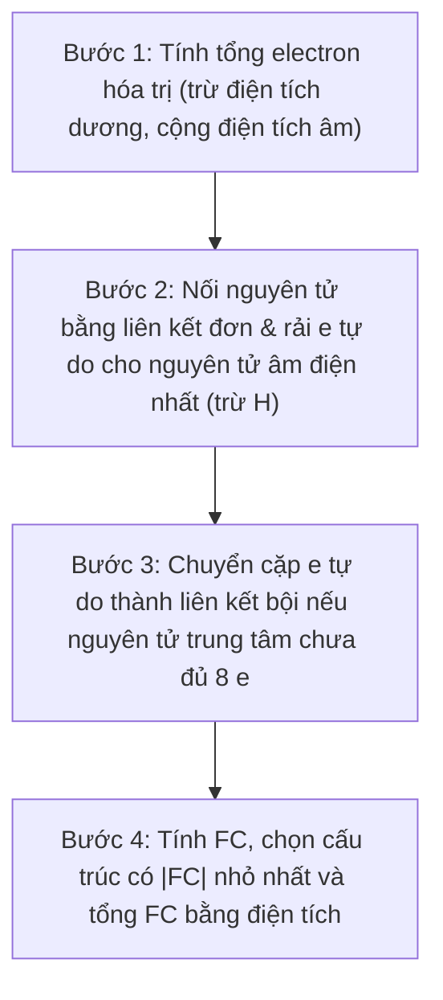
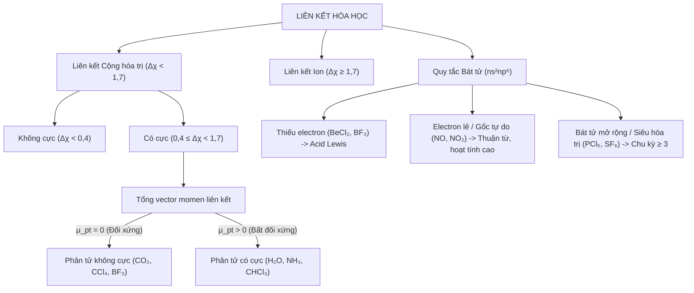

> **Mode A — Per-chapter standardization (REVIEW DRAFT)**

# Chương 1: Đại cương Liên kết Hóa học, Thuyết Lewis & Quy tắc Bát tử

---

## 1.1 Tổng quan chương (Chapter Overview)

### 1.1.1 Tên chương, giới thiệu & phạm vi kiến thức
[ADDED: structural frame]
Chương 1 mở đầu cho toàn bộ học trình Hóa vô cơ Dược bằng việc hệ thống hóa bản chất của liên kết hóa học – lực tương tác cơ bản gắn kết các nguyên tử tạo nên phân tử và tinh thể hợp chất thuốc. Nội dung chương tập trung vào hai trụ cột chính: (1) Các đại lượng vật lý đặc trưng cho liên kết (năng lượng liên kết, độ dài liên kết, góc liên kết và momen lưỡng cực); và (2) Thuyết biểu diễn liên kết kinh điển của Gilbert N. Lewis, công thức tính điện tích hình thức (Formal Charge), hiện tượng giải tỏa electron qua các cấu trúc cộng hưởng, cùng ba nhóm ngoại lệ quan trọng của quy tắc bát tử.

Phạm vi kiến thức giới hạn trong khuôn khổ hóa học cấu tạo đại cương ứng dụng cho sinh viên Dược năm 1–2, làm cơ sở giải thích độ bền hóa học, độ phân cực, tính tan trong nước/lipid và khả năng tương tác bước đầu của các phân tử vô cơ cũng như dược chất tại các thụ thể sinh học.

### 1.1.2 Kiến thức tiên quyết & Thời lượng học tập dự kiến
[ADDED: study rule estimate]
- **Kiến thức tiên quyết:** Sinh viên cần nắm vững cấu hình electron nguyên tử, quy tắc Hund, nguyên lý Pauli, vị trí các nguyên tố nhóm A trong bảng hệ thống tuần hoàn và khái niệm cơ bản về độ âm điện.
- **Thời lượng học tập dự kiến:** 1,5 giờ học tập cá nhân (bao gồm 60 phút nghiên cứu lý thuyết nền tảng và 30 phút tự lượng giá, giải quyết bài tập định lượng tại Mục 1.7).

---

## 1.2 Mục tiêu học tập (Learning Objectives)

### 1.2.1 Chuẩn đầu ra về Kiến thức, Kỹ năng và Năng lực vận dụng
[ADDED: learning objectives]
Sau khi hoàn thành chương này, sinh viên có khả năng:
1. **LO-1 (Kiến thức):** Định nghĩa chính xác và phân tích mối liên hệ tương quan giữa năng lượng liên kết ($E_{lk}$), độ dài liên kết ($r$), góc liên kết ($\theta$) và bậc liên kết; phát biểu nội dung quy tắc bát tử ($ns^2np^6$) và đặc điểm của 3 nhóm ngoại lệ bát tử.
2. **LO-2 (Thông hiểu):** Vận dụng hiệu độ âm điện theo thang Pauling ($\Delta\chi$) và tổng vector momen lưỡng cực ($\vec{\mu}_{pt}$) để phân biệt bản chất liên kết (cộng hóa trị không cực, có cực, ion) và dự đoán tính phân cực của phân tử.
3. **LO-3 (Kỹ năng):** Áp dụng thành thạo quy trình 4 bước thiết lập công thức Lewis; tính toán chính xác điện tích hình thức ($FC$) cho từng nguyên tử và lựa chọn cấu trúc cộng hưởng ưu thế nhất.
4. **LO-4 (Vận dụng & Phân tích):** Phân tích được nguyên nhân tồn tại của các hợp chất thiếu electron, gốc tự do và hợp chất siêu hóa trị (bát tử mở rộng); liên hệ được tính phân cực và cấu tạo phân tử nitric oxide ($NO$) với vai trò sinh học trong Dược học.

---

## 1.3 Đặt vấn đề & Ý nghĩa thực tiễn (Introduction)

### 1.3.1 Vai trò của liên kết hóa học trong thiết kế và tác dụng của dược chất
[ADDED: pedagogical context]
Mỗi phân tử dược chất vô cơ hay hữu cơ khi đưa vào cơ thể đều hoạt động trong môi trường dịch thể phân cực (dung dịch nước) và tiếp xúc với các đại phân tử sinh học phức tạp (protein, enzyme, receptor, acid nucleic). Hiệu quả điều trị, độ bền phân tử, tốc độ chuyển hóa và độc tính của thuốc đều bắt nguồn từ cấu trúc liên kết nội phân tử.

Hiểu rõ liên kết hóa học cho phép dược sĩ giải thích tại sao một hoạt chất có độ bền nhiệt cao hay thấp (thông qua năng lượng liên kết), tại sao một phân tử thuốc có thể dễ dàng đi qua màng tế bào phospholipid hay chỉ phân bố ở dịch ngoại bào (thông qua momen lưỡng cực và độ phân cực), và làm thế nào các chất có phân bố điện tích đặc thù hoặc có cấu trúc gốc tự do (như $NO$) có thể tham gia vào các quá trình truyền tin sinh hóa phức tạp. Thuyết Lewis và quy tắc bát tử chính là ngôn ngữ mô tả cấu trúc phân tử căn bản nhất giúp kết nối bản chất hóa học với tác động sinh học.

---

## 1.4 Nội dung bài giảng chính (Main Content)

### 1.4.1 Các đại lượng đặc trưng của liên kết hóa học

Năng lượng liên kết, độ dài liên kết và bậc liên kết là bộ ba thông số nhiệt động - hình học phản ánh trực tiếp độ bền và bản chất của liên kết giữa hai nguyên tử.

#### 1.4.1.1 Năng lượng liên kết ($E_{lk}$) và độ bền phân tử
Năng lượng liên kết ($E_{lk}$) được định nghĩa là năng lượng cần cung cấp để bẻ gãy 1 mol liên kết xác định ở trạng thái khí thành các nguyên tử cô lập ở trạng thái cơ bản, đơn vị đo tiêu chuẩn là $\text{kJ/mol}$. 

[ADDED: thermodynamics definition] 
Năng lượng liên kết luôn mang giá trị dương ($E_{lk} > 0$), và giá trị $E_{lk}$ càng lớn chứng tỏ liên kết càng bền vững, phân tử càng có độ ổn định nhiệt động học cao.

#### 1.4.1.2 Độ dài liên kết ($r$) và mối quan hệ với bậc liên kết
Độ dài liên kết ($r$ hoặc $r_{lk}$) là khoảng cách cân bằng giữa hai tâm hạt nhân của hai nguyên tử tham gia liên kết trực tiếp ($\text{pm}$ hoặc $\text{Å}$). [ADDED: electrostatic potential & SI conversion] Tại khoảng cách cân bằng này, thế năng tương tác tĩnh điện của hệ đạt giá trị cực tiểu; đơn vị đo hệ SI chuẩn là picomet ($\text{pm}$) với hệ số chuyển đổi $1\text{ Å} = 100\text{ pm} = 10^{-10}\text{ m}$.

[ADDED: bond order concept]
Bậc liên kết biểu thị số lượng cặp electron liên kết được chia sẻ giữa hai nguyên tử (liên kết đơn có bậc 1, liên kết đôi có bậc 2, liên kết ba có bậc 3). Bậc liên kết càng lớn thì lực hút tĩnh điện giữa các hạt nhân với vùng mật độ electron chung càng mạnh, kéo hai hạt nhân lại gần nhau hơn, làm độ dài liên kết co ngắn lại và năng lượng liên kết tăng lên rõ rệt.

#### 1.4.1.3 Mối quan hệ thực nghiệm giữa bậc liên kết, độ dài và năng lượng
Khảo sát thực nghiệm trên chuỗi liên kết giữa hai nguyên tử Carbon minh họa rõ ràng quy luật tỷ lệ nghịch giữa độ dài và độ bền:
- Về năng lượng liên kết:
  $$E_{lk}(C \equiv C) > E_{lk}(C = C) > E_{lk}(C - C) \quad (839 > 614 > 348 \text{ kJ/mol}) \qquad (1.1)$$
  Trong đó:
  - $E_{lk}(C \equiv C), E_{lk}(C = C), E_{lk}(C - C)$: Năng lượng liên kết của liên kết ba, liên kết đôi và liên kết đơn giữa hai nguyên tử Carbon ($\text{kJ/mol}$).
- Về độ dài liên kết:
  $$r(C - C) \approx 154\text{ pm } (1,54\text{ Å}) > r(C = C) \approx 134\text{ pm } (1,34\text{ Å}) > r(C \equiv C) \approx 120\text{ pm } (1,20\text{ Å}) \qquad (1.2)$$
  Trong đó:
  - $r(C - C), r(C = C), r(C \equiv C)$: Độ dài liên kết cân bằng của liên kết đơn, liên kết đôi và liên kết ba giữa hai nguyên tử Carbon ($\text{pm}$ hoặc $\text{Å}$).

Quy luật tổng quát: **Bậc liên kết tăng $\rightarrow$ Độ dài liên kết giảm $\rightarrow$ Năng lượng liên kết tăng $\rightarrow$ Độ bền phân tử tăng.**

---

### 1.4.2 Góc liên kết, Momen lưỡng cực & Độ phân cực phân tử

#### 1.4.2.1 Góc liên kết ($\theta$)
Góc liên kết ($\theta$) là góc tạo bởi hai trục liên kết hóa học xuất phát từ cùng một nguyên tử trung tâm, quyết định hình học không gian phân tử. [ADDED: pharmacology context] Đơn vị đo góc liên kết thường dùng là độ ($^\circ$); góc liên kết cùng với độ dài liên kết quy định cấu trúc hình học không gian 3 chiều của phân tử, chi phối khả năng khớp nối không gian (steric fit) giữa dược chất và thụ thể sinh học.

#### 1.4.2.2 Momen lưỡng cực liên kết và quy tắc cộng vector
Momen lưỡng cực liên kết ($\vec{\mu}_{lk}$) đặc trưng cho độ phân cực của liên kết, được xác định bởi biểu thức:
$$\vec{\mu}_{lk} = q \cdot \vec{d} \qquad (1.3)$$
[ADDED: formula definition]
Trong đó:
- $\vec{\mu}_{lk}$: Vector momen lưỡng cực liên kết ($\text{C}\cdot\text{m}$ hoặc $\text{D}$).
- $q$: Độ lớn điện tích hữu hiệu phân tách tại các cực ($\text{C}$, Coulomb).
- $\vec{d}$: Vector khoảng cách giữa hai trọng tâm điện tích âm và dương ($\text{m}$, mét), chiều quy ước hướng từ cực dương sang cực âm (hoặc ngược lại tùy quy ước lý thuyết).
- Đơn vị đo: Hệ SI là $\text{C}\cdot\text{m}$. Trong thực hành hóa học, đơn vị truyền thống thường dùng là Debye ($\text{D}$), với $1\text{ D} = 3,336 \times 10^{-30}\text{ C}\cdot\text{m}$.

#### 1.4.2.3 Momen lưỡng cực toàn phân tử ($\vec{\mu}_{pt}$) và tiêu chuẩn phân cực
Momen lưỡng cực toàn phân tử ($\vec{\mu}_{pt}$) là tổng vector của các momen liên kết thành phần trong phân tử:
$$\vec{\mu}_{pt} = \sum \vec{\mu}_i \qquad (1.4)$$
Trong đó:
- $\vec{\mu}_{pt}$: Vector momen lưỡng cực toàn phân tử ($\text{C}\cdot\text{m}$ hoặc $\text{D}$).
- $\vec{\mu}_i$: Vector momen lưỡng cực của liên kết thành phần thứ $i$ trong phân tử ($\text{C}\cdot\text{m}$ hoặc $\text{D}$).

Dựa vào giá trị $\vec{\mu}_{pt}$, phân tử được phân thành hai nhóm:
1. **Phân tử không cực ($\mu_{pt} = 0$):** Một phân tử chứa liên kết phân cực mạnh nhưng có cấu trúc đối xứng hoàn hảo thì các vector momen liên kết triệt tiêu nhau hoàn toàn ($\mu_{pt} = 0$).
   - *Ví dụ:* $CO_2$, $CCl_4$, $BF_3$, $SF_6$ [ADDED: geometric shapes] (tương ứng cấu trúc đường thẳng, tứ diện đều, tam giác phẳng và bát diện đều).
2. **Phân tử có cực ($\mu_{pt} > 0$):** Phân tử bất đối xứng có tổng vector momen lưỡng cực khác không ($\mu_{pt} > 0$).
   - *Ví dụ:* $H_2O$, $NH_3$, $CHCl_3$ [ADDED: geometric shapes] (tương ứng cấu trúc góc gấp khúc, chóp tam giác và tứ diện bất đối xứng).

---

### 1.4.3 Bản chất liên kết & Hiệu độ âm điện Pauling

[ADDED: definition] Độ âm điện ($\chi$) là đại lượng đặc trưng cho khả năng hút electron liên kết về phía nguyên tử khi hình thành phân tử. Dựa trên thang độ âm điện Pauling, hiệu độ âm điện giữa hai nguyên tử ($\Delta\chi$) cung cấp tiêu chí phân định bản chất liên kết như trình bày trong **Bảng 1.1**:

**Bảng 1.1.** Phân loại bản chất liên kết hóa học dựa theo hiệu độ âm điện Pauling ($\Delta\chi$).

| Khoảng $\Delta\chi$ | Phân loại liên kết | Bản chất tương tác | Ví dụ điển hình |
|---|---|---|---|
| $\Delta\chi < 0,4$ | Cộng hóa trị không cực | [ADDED: explanation] Cặp electron dùng chung phân bố gần như đồng đều giữa 2 nguyên tử | $H_2$, $Cl_2$, liên kết $C-H$ |
| $0,4 \le \Delta\chi < 1,7$ | Cộng hóa trị có cực | [ADDED: explanation] Cặp electron dùng chung lệch về phía nguyên tử có độ âm điện lớn hơn | $H-Cl$, liên kết $C-O$ |
| $\Delta\chi \ge 1,7$ | Liên kết ion | Bản chất hút tĩnh điện đa hướng không bão hòa | $NaCl$, $KBr$ |

> **Important Note.** [ADDED: pedagogical note] Ranh giới $\Delta\chi = 0,4$ và $1,7$ là quy ước thực nghiệm tương đối. Nhiều liên kết có tính chất trung gian (tính cộng hóa trị có một phần đặc tính ion và ngược lại).

---

### 1.4.4 Thuyết Lewis & Điện tích hình thức (Formal Charge)

#### 1.4.4.1 Quy tắc Bát tử (Octet Rule)
[ADDED: historical context] Theo mô hình liên kết cộng hóa trị của Gilbert N. Lewis: Khi hình thành liên kết, các nguyên tử có xu hướng góp chung, nhường hoặc nhận electron để đạt được cấu hình electron bền vững $ns^2np^6$ (8 electron lớp ngoài cùng) giống khí hiếm (hoặc 2 electron $1s^2$ như $He$).

#### 1.4.4.2 Định nghĩa và công thức tính Điện tích hình thức ($FC$)
[ADDED: definition] Điện tích hình thức ($FC$ - Formal Charge) là điện tích giả định gán cho một nguyên tử trong công thức Lewis khi coi các electron liên kết được chia đều cho hai nguyên tử tham gia liên kết (bỏ qua sự chênh lệch độ âm điện).

Công thức tính Điện tích hình thức ($FC$):
$$FC = V - N - \frac{B}{2} \qquad (1.5)$$
Trong đó:
- $FC$: Điện tích hình thức của nguyên tử trong cấu trúc Lewis.
- $V$: Số electron hóa trị của nguyên tử tự do (theo nhóm trong bảng tuần hoàn).
- $N$: Số electron tự do không liên kết (Lone pairs: $N = 2 \times \text{số cặp e lẻ}$).
- $B$: Số electron tham gia liên kết ($B = 2 \times \text{số liên kết xung quanh}$).

#### 1.4.4.3 Tiêu chuẩn cấu trúc Lewis bền vững tối ưu
Khi xét các công thức Lewis khả dĩ cho một phân tử hoặc ion, cấu trúc bền vững được xác định theo 3 tiêu chuẩn:
1. **Tuân thủ bát tử:** Các nguyên tử tuân theo quy tắc bát tử (nếu có thể).
2. **Bảo toàn điện tích:** Tổng đại số điện tích hình thức $FC$ của các nguyên tử bằng đúng điện tích của phân tử/ion:
   $$\sum FC = q_{phân\ tử} \qquad (1.6)$$
   Trong đó:
   - $\sum FC$: Tổng đại số điện tích hình thức của tất cả các nguyên tử trong phân tử hoặc ion.
   - $q_{phân\ tử}$: Điện tích thực tế của toàn phân tử ($q_{phân\ tử} = 0$ đối với phân tử trung hòa) hoặc ion.
3. **Cực tiểu hóa điện tích hình thức:** Điện tích hình thức càng gần 0 càng tốt [ADDED: operational rule] (tổng $\sum |FC|$ nhỏ nhất). Nếu có điện tích âm, điện tích âm phải ưu tiên nằm trên nguyên tử có độ âm điện lớn hơn.

---

### 1.4.5 Cấu trúc cộng hưởng (Resonance Structures)

Khi một phân tử không thể mô tả chính xác chỉ bằng một công thức Lewis duy nhất, cấu trúc thực là tổ hợp cộng hưởng (hybrid resonance) của nhiều công thức tương đương.

#### 1.4.5.1 Bản chất của hiện tượng cộng hưởng
Sự giải tỏa electron (delocalization) làm hạ thấp năng lượng hệ và tăng độ bền phân tử (Năng lượng cộng hưởng). [ADDED: theory clarification] Cộng hưởng không phải là sự chuyển đổi qua lại giữa các đồng phân khác nhau, mà các công thức cộng hưởng chỉ là cách biểu diễn giới hạn của cùng một phân tử thực tế có đám mây electron $\pi$ phân bố đều trên khung nguyên tử.

#### 1.4.5.2 Phân tích các trường hợp kinh điển
- **Ion Carbonate ($CO_3^{2-}$):** Trong $CO_3^{2-}$, cả 3 liên kết $C-O$ đều có độ dài bằng nhau:
  - Độ dài liên kết thực nghiệm: $r(C-O) = 128\text{ pm } (1,28\text{ Å})$.
  - Bậc liên kết thực nghiệm là $1\frac{1}{3} \approx 1,33$.
  - [ADDED: charge delocalization] Điện tích âm $-2$ được giải tỏa đều trên cả 3 nguyên tử Oxy (mỗi Oxy mang điện tích trung bình $-2/3$).
- **Ion Nitrate ($NO_3^-$):** Tương tự, $NO_3^-$ là tổ hợp cộng hưởng của 3 công thức Lewis tương đương [ADDED: bond order explanation] với 3 liên kết $N-O$ hoàn toàn đồng nhất (bậc liên kết $1\frac{1}{3}$).
- **Ion Sulfate ($SO_4^{2-}$) và phân tử Benzen ($C_6H_6$):** Đều là các hệ cộng hưởng điển hình có độ bền cao nhờ sự giải tỏa electron [ADDED: benzene & sulfate explanation] (trong $C_6H_6$, 6 liên kết $C-C$ hoàn toàn tương đương với bậc liên kết $1,5$).

---

### 1.4.6 Các ngoại lệ của Quy tắc Bát tử

Có ba trường hợp ngoại lệ kinh điển của quy tắc bát tử cần phân biệt rõ:

#### 1.4.6.1 Phân tử thiếu electron (Incomplete Octet)
Nguyên tử trung tâm có ít hơn 8 electron hóa trị sau liên kết. Điển hình là Beri ($Be$, 4 electron) và Bo, Nhôm ($B, Al$, 6 electron).
- *Ví dụ:* $BeCl_2$ ($Cl-Be-Cl$), $BF_3$, $AlCl_3$.
- *Đặc tính hóa học:* [VERIFY: Lewis acidity comparison] Do thiếu electron, các chất này đóng vai trò là những **Acid Lewis rất mạnh** [ADDED: Lewis acid definition] (chất có orbital trống nhận cặp electron), dễ dàng nhận thêm cặp electron tự do từ Base Lewis để đạt bát tử (ví dụ tạo phức $F_3B-NH_3$).

#### 1.4.6.2 Phân tử có số electron lẻ (Odd-Electron Molecules / Gốc tự do)
Tổng số electron hóa trị là số lẻ nên không thể ghép đôi hoàn toàn [ADDED: free radical concept], dẫn đến sự tồn tại của electron độc thân (gốc tự do).
- *Ví dụ:* $NO$ (11 electron), $NO_2$ (17 electron), $ClO_2$ (19 electron).
- *Đặc tính hóa lý:* Các phân tử này có **tính thuận từ** [ADDED: paramagnetism definition] (bị hút vào từ trường ngoài do có electron độc thân) và hoạt tính hóa học cực cao.

#### 1.4.6.3 Bát tử mở rộng (Expanded Octet / Hợp chất Siêu hóa trị - Hypervalent)
Các nguyên tố từ chu kỳ 3 trở đi ($P, S, Cl, Br, I, Xe$) do có bán kính nguyên tử đủ lớn và [VERIFY: modern bonding models] có **phân lớp $d$ trống** ($3d, 4d$) có mức năng lượng gần kề tham gia liên kết, nên có thể chứa 10, 12 hoặc 14 electron lớp ngoài cùng. [ADDED: period 2 vs period 3 comparison] Ngược lại, các nguyên tố chu kỳ 2 ($C, N, O, F$) không có phân lớp $2d$ nên không bao giờ mở rộng bát tử quá 8 electron.
- *Ví dụ điển hình:*
  - $PCl_5$ (10 electron quanh P).
  - $SF_6$ (12 electron quanh S).
  - $H_2SO_4$ ([VERIFY: formalism] 12 electron quanh S khi viết 2 liên kết đôi $S=O$ để triệt tiêu điện tích hình thức).
  - $XeF_4$, $IF_7$.

---

### 1.4.7 Ý nghĩa và ứng dụng trong Dược học

Năng lượng, độ dài và độ phân cực liên kết giúp so sánh độ bền, hình học và tương tác của phân tử; các đặc điểm này ảnh hưởng đến độ tan, độ ổn định và khả năng thuốc tương tác với môi trường sinh học. Cấu trúc Lewis, điện tích hình thức và cộng hưởng giúp kiểm tra phân bố electron, điện tích, dự đoán độ bền tương đối và vị trí có thể tham gia phản ứng, hỗ trợ suy luận tính acid–base và khả năng tạo liên kết.

#### 1.4.7.1 Độ phân cực, tính tan và phân bố sinh học của dược chất
Độ phân cực ảnh hưởng trực tiếp đến tương tác của phân tử với nước, màng sinh học và đích tác dụng của thuốc. [ADDED: pharmacokinetic concept] Cụ thể, momen lưỡng cực toàn phân tử ($\vec{\mu}_{pt}$) quy định tính ưa nước (hydrophilic) hay ưa lipid (lipophilic): các phân tử không cực ($\mu_{pt} = 0$) thường dễ thấm qua lớp kép phospholipid của màng tế bào, trong khi các phân tử phân cực mạnh ($\mu_{pt} > 0$) dễ hòa tan trong môi trường dịch thể ngoại bào và huyết tương.

#### 1.4.7.2 Phân tử Nitric Oxide ($NO$) trong truyền tín hiệu sinh học
Nhận biết ngoại lệ bát tử giúp tránh áp đặt cứng nhắc quy tắc 8 electron lên các gốc tự do, acid Lewis thiếu electron hoặc hợp chất siêu hóa trị; ngoại lệ bát tử cùng phân tử $NO$ minh họa vì sao cấu tạo electron liên quan trực tiếp tới tính phản ứng và tác dụng sinh học.

[VERIFY: pharmacology reference needed] Trong Dược học, **Nitric oxide ($NO$)** là chất truyền tin tế bào tối quan trọng: trong cơ thể, $NO$ khuếch tán vào cơ trơn mạch máu, hoạt hóa enzym **Guanylyl Cyclase** làm giãn cơ trơn mạch máu (gây hạ huyết áp).

---

## 1.5 Ví dụ minh họa & Quy trình thực hành (Examples & Illustrations)

### 1.5.1 Ví dụ tính toán chi tiết: Xác định điện tích hình thức của $CO_2$ và $NO_3^-$

[ADDED: worked example structure]
Cách vận dụng Công thức $(1.5)$ và $(1.6)$ để tính điện tích hình thức ($FC$) và đánh giá độ bền cấu trúc Lewis được minh họa chi tiết trong **Example 1.1** và **Example 1.2**:

> **Example 1.1.** **Tính điện tích hình thức cho phân tử Carbon dioxide ($CO_2$)**
> - **Given (Cho biết):** Phân tử $CO_2$ có cấu trúc $O=C=O$. C có $V=4$, O có $V=6$.
> - **Find (Yêu cầu):** Tính điện tích hình thức ($FC$) của nguyên tử C và các nguyên tử O; kiểm tra tổng $FC$.
> - **Approach (Phương pháp):** Áp dụng công thức $FC = V - N - \frac{B}{2}$ và kiểm tra $\sum FC = q_{phân\ tử}$.
> - **Solution (Các bước giải):**
>   1. *Nguyên tử C trung tâm:* $V = 4, N = 0, B = 8 \Rightarrow FC(C) = 4 - 0 - 4 = 0$.
>   2. *Mỗi nguyên tử O:* $V = 6, N = 4, B = 4 \Rightarrow FC(O) = 6 - 4 - 2 = 0$.
> - **Check (Kiểm tra):** Tổng $\sum FC = 0 + 2(0) = 0$ $\rightarrow$ đúng bằng điện tích phân tử trung hòa.
> - **Interpretation (Nhận định):** Mọi nguyên tử đều đạt bát tử và có $FC = 0$, cấu trúc $O=C=O$ bền vững tối ưu.

> **Example 1.2.** **Tính điện tích hình thức cho ion Nitrate ($NO_3^-$)**
> - **Given (Cho biết):** Ion $NO_3^-$ có cấu trúc gồm 1 liên kết đôi $N=O$ và 2 liên kết đơn $N-O$. N có $V=5$, O có $V=6$.
> - **Find (Yêu cầu):** Tính $FC$ cho nguyên tử N, nguyên tử O(đôi) và hai nguyên tử O(đơn); kiểm tra tổng $FC$.
> - **Approach (Phương pháp):** Áp dụng công thức $FC = V - N - \frac{B}{2}$ và tiêu chuẩn độ âm điện.
> - **Solution (Các bước giải):**
>   1. *Nguyên tử N:* $V = 5, N = 0, B = 8 \Rightarrow FC(N) = 5 - 0 - 4 = +1$.
>   2. *Nguyên tử O(đôi):* $V = 6, N = 4, B = 4 \Rightarrow FC(O_{đôi}) = 6 - 4 - 2 = 0$.
>   3. *Mỗi nguyên tử O(đơn):* $V = 6, N = 6, B = 2 \Rightarrow FC(O_{đơn}) = 6 - 6 - 1 = -1$.
> - **Check (Kiểm tra):** Tổng $\sum FC = (+1) + 0 + (-1) + (-1) = -1$ $\rightarrow$ khớp điện tích ion $NO_3^-$.
> - **Interpretation (Nhận định):** Điện tích âm nằm trên O (nguyên tử có độ âm điện lớn hơn N) nên cấu trúc bền vững.

---

### 1.5.2 Các ví dụ minh họa ngoại lệ bát tử trong thực tế
1. **Thiếu electron:** $BF_3$ chỉ có 6 electron quanh B $\rightarrow$ đóng vai trò acid Lewis mạnh, dễ nhận cặp electron tự do của $NH_3$ tạo thành $F_3B-NH_3$.
2. **Bát tử mở rộng:** $PCl_5$ (10 electron quanh P), $SF_6$ (12 electron quanh S) nhờ sự tham gia của orbital $d$ trống của nguyên tố chu kỳ 3.
3. **Số electron lẻ:** $NO$ có 11 electron hóa trị $\rightarrow$ là gốc tự do, có tính thuận từ và hoạt tính cao. Trong cơ thể, $NO$ khuếch tán vào cơ trơn mạch máu, hoạt hóa guanylyl cyclase $\rightarrow$ giãn mạch, hạ huyết áp.

---

### 1.5.3 Quy trình chuẩn 4 bước thiết lập công thức Lewis tối ưu

Quy trình 4 bước viết công thức Lewis và chọn cấu trúc bền được khái quát qua sơ đồ tại **Hình 1.1** và diễn giải chi tiết dưới đây:

[ADDED: Mermaid flowchart for 4-step procedure]

**Hình 1.1.** Lưu đồ quy trình 4 bước thiết lập công thức Lewis tối ưu.

1. **Bước 1:** Tính tổng electron hóa trị của toàn phân tử hoặc ion (trừ đi điện tích dương đối với cation, cộng vào điện tích âm đối với anion).
2. **Bước 2:** Nối các nguyên tử bằng liên kết đơn rồi rải electron tự do cho nguyên tử có độ âm điện lớn nhất trước (trừ nguyên tử H chỉ tối đa 2 electron).
3. **Bước 3:** Nếu nguyên tử trung tâm chưa đủ 8 electron thì chuyển cặp electron tự do từ nguyên tử biên thành liên kết bội (đôi hoặc ba).
4. **Bước 4:** Tính điện tích hình thức $FC$ và chọn cấu trúc có $|FC|$ nhỏ nhất, tổng $\sum FC$ đúng bằng điện tích của phân tử/ion.

---

### 1.5.4 Sơ đồ hệ thống hóa các dạng liên kết hóa học
[ADDED: diagram]
Sơ đồ quan hệ phân loại bản chất liên kết và các nhóm ngoại lệ bát tử được hệ thống hóa tại **Hình 1.2**:

**Hình 1.2.** Sơ đồ hệ thống hóa các dạng liên kết hóa học, tính phân cực phân tử và ba nhóm ngoại lệ của quy tắc bát tử.

---

## 1.6 Tóm tắt chương (Chapter Summary)

### 1.6.1 Bảng đối chiếu các đại lượng đặc trưng và 3 nhóm ngoại lệ
[ADDED: summary]
Toàn bộ các đại lượng đặc trưng của liên kết hóa học, nguyên lý điện tích hình thức, cộng hưởng và ba nhóm ngoại lệ của quy tắc bát tử cùng ý nghĩa trong Dược học được tổng hợp đối chiếu trong **Bảng 1.2**:

**Bảng 1.2.** Bảng tổng hợp đối chiếu các đại lượng đặc trưng của liên kết hóa học, thuyết Lewis và 3 nhóm ngoại lệ bát tử.

| Nội dung trọng tâm | Bản chất khoa học | Điểm cần ghi nhớ | Ý nghĩa Dược học |
|---|---|---|---|
| **Năng lượng liên kết ($E_{lk}$)** | Năng lượng bẻ gãy 1 mol liên kết ($\text{kJ/mol}$) | Bậc liên kết tăng $\rightarrow E_{lk}$ tăng | Độ bền nhiệt và độ ổn định của phân tử thuốc |
| **Độ dài liên kết ($r$)** | Khoảng cách cân bằng giữa 2 hạt nhân ($\text{pm, Å}$) | Bậc liên kết tăng $\rightarrow r$ giảm | Hình học phân tử và khả năng tương tác đích |
| **Momen lưỡng cực ($\vec{\mu}_{pt}$)** | Tổng vector momen lưỡng cực các liên kết | Phụ thuộc độ âm điện và hình học đối xứng | Ảnh hưởng độ tan và tương tác màng sinh học |
| **Điện tích hình thức ($FC$)** | Điện tích giả định chia đều electron ($FC = V - N - B/2$) | Cấu trúc bền có $\|FC\|$ nhỏ nhất | Kiểm tra phân bố điện tích và vị trí phản ứng |
| **Cấu trúc cộng hưởng** | Sự giải tỏa electron trên nhiều công thức tương đương | Hạ thấp năng lượng hệ, tăng độ bền phân tử | Giải thích độ bền của $CO_3^{2-}, NO_3^-, SO_4^{2-}, C_6H_6$ |
| **Ngoại lệ: Thiếu electron** | Nguyên tử trung tâm có $<8$ electron ($Be, B, Al$) | Đóng vai trò là Acid Lewis mạnh | Nhận cặp electron tự do tạo liên kết phối trí |
| **Ngoại lệ: Electron lẻ** | Chứa electron độc thân ($NO, NO_2, ClO_2$) | Thuận từ, hoạt tính gốc tự do rất mạnh | $NO$ hoạt hóa guanylyl cyclase gây giãn mạch |
| **Ngoại lệ: Mở rộng bát tử** | Có 10, 12, 14 electron hóa trị (nguyên tố chu kỳ $\ge 3$) | Nhờ bán kính lớn và phân lớp $d$ trống | Giải thích cấu tạo $PCl_5, SF_6, H_2SO_4$ |

### 1.6.2 Hệ thống công thức, đơn vị và quy tắc then chốt
[ADDED: formula sheet]
1. **Công thức momen lưỡng cực liên kết (Công thức 1.3):**
   $$\vec{\mu}_{lk} = q \cdot \vec{d} \quad (1\text{ D} = 3,336 \times 10^{-30}\text{ C}\cdot\text{m}) \qquad (1.3)$$
   Trong đó: $\vec{\mu}_{lk}$ là vector momen lưỡng cực liên kết ($\text{C}\cdot\text{m}$ hoặc $\text{D}$); $q$ là độ lớn điện tích phân tách ($\text{C}$); $\vec{d}$ là vector khoảng cách giữa hai tâm điện tích ($\text{m}$).
2. **Tổng vector momen lưỡng cực phân tử (Công thức 1.4):**
   $$\vec{\mu}_{pt} = \sum \vec{\mu}_i \qquad (1.4)$$
   Trong đó: $\vec{\mu}_{pt}$ là vector momen lưỡng cực toàn phân tử; $\vec{\mu}_i$ là vector momen lưỡng cực của liên kết thành phần thứ $i$.
3. **Công thức tính điện tích hình thức (Công thức 1.5):**
   $$FC = V - N - \frac{B}{2} \qquad (1.5)$$
   Trong đó: $FC$ là điện tích hình thức; $V$ là số electron hóa trị của nguyên tử tự do; $N$ là số electron tự do không liên kết; $B$ là số electron tham gia liên kết.
4. **Quy tắc bảo toàn điện tích hình thức (Công thức 1.6):**
   $$\sum FC = q_{phân\ tử} \qquad (1.6)$$
   Trong đó: $\sum FC$ là tổng đại số điện tích hình thức của các nguyên tử; $q_{phân\ tử}$ là điện tích thực tế của phân tử hoặc ion.

---

## 1.7 Đánh giá & Bài tập tự lượng giá (Review & Assessment)

[ADDED: assessment questions]

### 1.7.1 Câu hỏi nhận biết và thông hiểu (LO-1, LO-2)
[ADDED: knowledge and comprehension questions]

**Câu 1 (Nhận biết - LO-1):** Khi so sánh các liên kết giữa hai nguyên tử Carbon ($C-C$, $C=C$, $C \equiv C$), nhận định nào sau đây là **đúng**?
A. Liên kết $C \equiv C$ có độ dài lớn nhất và năng lượng liên kết nhỏ nhất.  
B. Liên kết $C - C$ có độ dài ngắn nhất và năng lượng liên kết lớn nhất.  
C. Liên kết $C \equiv C$ có độ dài ngắn nhất ($120\text{ pm}$) và năng lượng liên kết lớn nhất ($839\text{ kJ/mol}$).  
D. Cả ba liên kết có độ dài và năng lượng tương đương nhau.

**Câu 2 (Nhận biết - LO-1):** Cặp phân tử nào sau đây đều thuộc nhóm ngoại lệ quy tắc bát tử do **thiếu electron** ở nguyên tử trung tâm?
A. $PCl_5$ và $SF_6$  
B. $BeCl_2$ và $BF_3$  
C. $NO$ và $NO_2$  
D. $CO_2$ và $CCl_4$

**Câu 3 (Thông hiểu - LO-2):** Phân tử Carbon tetrachloride ($CCl_4$) chứa các liên kết $C-Cl$ phân cực. Tuy nhiên, toàn phân tử $CCl_4$ lại là một phân tử không cực ($\mu_{pt} = 0$). Nguyên nhân là do:
A. Độ dài các liên kết $C-Cl$ quá ngắn khiến điện tích không phân tách được.  
B. Các liên kết $C-Cl$ bị ion hóa hoàn toàn.  
C. Phân tử có cấu trúc đối xứng hoàn hảo nên các vector momen liên kết triệt tiêu nhau hoàn toàn.  
D. Nguyên tử Carbon trung tâm có 2 cặp electron tự do.

**Câu 4 (Thông hiểu - LO-2):** Dựa vào quy ước hiệu độ âm điện Pauling ($\Delta\chi$), hãy xếp các liên kết $C-H$ ($\Delta\chi < 0,4$), $H-Cl$ ($0,4 \le \Delta\chi < 1,7$) và $Na-Cl$ ($\Delta\chi \ge 1,7$) theo thứ tự **tăng dần độ phân cực**:
A. $Na-Cl < H-Cl < C-H$  
B. $C-H < H-Cl < Na-Cl$  
C. $H-Cl < C-H < Na-Cl$  
D. $C-H < Na-Cl < H-Cl$

---

### 1.7.2 Bài tập áp dụng tính toán điện tích hình thức & độ phân cực (LO-3)
[ADDED: application exercises]

**Bài tập 5 (Áp dụng - LO-3):** 
Xác định điện tích hình thức ($FC$) của từng nguyên tử trong phân tử Ozone ($O_3$) với cấu trúc Lewis: $O_{(1)} = O_{(2)} - O_{(3)}$ (trong đó $O_{(2)}$ là nguyên tử trung tâm liên kết đôi với $O_{(1)}$ và liên kết đơn với $O_{(3)}$). Kiểm tra tổng đại số điện tích hình thức.

**Bài tập 6 (Áp dụng - LO-3):** 
Đối với anion Tetrafluoroborate ($BF_4^-$), hãy:
a) Viết cấu trúc Lewis của ion theo quy trình 4 bước.  
b) Tính điện tích hình thức của nguyên tử Bo và các nguyên tử Fluorine.  
c) Nhận xét về việc tuân thủ quy tắc bát tử xung quanh nguyên tử Bo trong ion này so với phân tử $BF_3$ tự do.

---

### 1.7.3 Câu hỏi phân tích, ngoại lệ và liên hệ dược lý học (LO-4)
[ADDED: analytical questions]

**Câu 7 (Phân tích - LO-4):** 
Phosphor (chu kỳ 3) và Nitơ (chu kỳ 2) cùng thuộc nhóm VA trong bảng tuần hoàn. Tại sao phân tử $PCl_5$ (10 electron quanh P) tồn tại bền vững, trong khi phân tử $NCl_5$ không thể hình thành? Giải thích dựa trên đặc điểm phân lớp orbital nguyên tử.

**Câu 8 (Vận dụng nâng cao - LO-4):** 
Nitric oxide ($NO$) là một chất truyền tin tế bào quan trọng trong Dược học.
a) Dựa trên tổng số electron hóa trị, hãy giải thích tại sao phân tử $NO$ là một gốc tự do có tính thuận từ và hoạt tính hóa học cực cao.  
b) Nêu vai trò truyền tin sinh học của $NO$ đối với enzyme Guanylyl Cyclase và cơ trơn mạch máu.

---

### 1.7.4 Hướng dẫn giải chi tiết và biểu điểm đánh giá
[ADDED: answer key]

#### 1.7.4.1 Đáp án phần trắc nghiệm
- **Câu 1: C.** (Bậc liên kết càng lớn thì độ dài càng ngắn: $120\text{ pm} < 134\text{ pm} < 154\text{ pm}$, và năng lượng liên kết càng cao: $839 > 614 > 348\text{ kJ/mol}$).
- **Câu 2: B.** ($BeCl_2$ chỉ có 4 electron quanh Be, $BF_3$ chỉ có 6 electron quanh B; nhóm A là mở rộng bát tử; nhóm C là electron lẻ).
- **Câu 3: C.** (Cấu trúc đối xứng hoàn hảo khiến tổng vector $\vec{\mu}_{pt} = \sum \vec{\mu}_i = \vec{0}$).
- **Câu 4: B.** (Liên kết cộng hóa trị không cực $C-H$ ($\Delta\chi < 0,4$) < cộng hóa trị có cực $H-Cl$ ($0,4 \le \Delta\chi < 1,7$) < liên kết ion $Na-Cl$ ($\Delta\chi \ge 1,7$)).

#### 1.7.4.2 Lời giải chi tiết phần bài tập
- **Bài tập 5 ($O_3$):**
  - Nguyên tử Oxy nhóm VIA có $V = 6$.
  - Nguyên tử $O_{(1)}$ (liên kết đôi): có 2 cặp e tự do ($N = 4$), tham gia 1 liên kết đôi ($B = 4$):
    $$FC(O_{(1)}) = 6 - 4 - \frac{4}{2} = 0$$
  - Nguyên tử $O_{(2)}$ (trung tâm): có 1 cặp e tự do ($N = 2$), tham gia 1 liên kết đôi và 1 liên kết đơn ($B = 6$):
    $$FC(O_{(2)}) = 6 - 2 - \frac{6}{2} = +1$$
  - Nguyên tử $O_{(3)}$ (liên kết đơn): có 3 cặp e tự do ($N = 6$), tham gia 1 liên kết đơn ($B = 2$):
    $$FC(O_{(3)}) = 6 - 6 - \frac{2}{2} = -1$$
  - Tổng điện tích: $\sum FC = 0 + (+1) + (-1) = 0$, khớp với phân tử $O_3$ trung hòa.

- **Bài tập 6 ($BF_4^-$):**
  - a) Tổng e hóa trị: $B(3) + 4 \times F(7) + 1 (e\text{ âm}) = 3 + 28 + 1 = 32$ electron. Khung gồm B ở tâm nối với 4 nguyên tử F bằng 4 liên kết đơn, mỗi F mang 3 cặp electron tự do.
  - b) Tính $FC$:
    - Nguyên tử Bo: $V = 3, N = 0, B = 8 \Rightarrow FC(B) = 3 - 0 - \frac{8}{2} = -1$.
    - Mỗi nguyên tử Fluorine: $V = 7, N = 6, B = 2 \Rightarrow FC(F) = 7 - 6 - \frac{2}{2} = 0$.
    - Tổng: $\sum FC = (-1) + 4(0) = -1$, đúng điện tích anion.
  - c) Nhận xét: Trong $BF_3$, Bo chỉ có 6 electron (thiếu bát tử, đóng vai trò Acid Lewis). Khi nhận thêm cặp electron tự do để tạo $BF_4^-$, lớp vỏ ngoài của Bo đã đạt đủ 8 electron theo quy tắc bát tử.

- **Câu 7 (Phân tích $PCl_5$ vs $NCl_5$):**
  - Nitơ thuộc chu kỳ 2, lớp vỏ hóa trị chỉ có phân lớp $2s$ và $2p$ (không có phân lớp $2d$), do đó tối đa chỉ chứa được 8 electron và không thể mở rộng bát tử để tạo $NCl_5$.
  - Phosphor thuộc chu kỳ 3, ngoài phân lớp $3s$ và $3p$ còn có bán kính nguyên tử đủ lớn và phân lớp $3d$ trống có mức năng lượng gần kề tham gia liên kết, cho phép mở rộng bát tử chứa 10 electron hóa trị quanh P tạo thành $PCl_5$.

- **Câu 8 ($NO$ trong sinh học):**
  - a) Phân tử $NO$ có tổng số electron hóa trị là $5 (N) + 6 (O) = 11$ electron (số lẻ). Vì tổng số electron là số lẻ nên không thể ghép đôi hoàn toàn, luôn tồn tại một electron độc thân làm cho $NO$ trở thành gốc tự do có tính thuận từ và hoạt tính hóa học cực cao.
  - b) Trong cơ thể, $NO$ đóng vai trò là chất truyền tin tế bào quan trọng: $NO$ khuếch tán vào cơ trơn mạch máu, hoạt hóa enzym Guanylyl Cyclase làm giãn cơ trơn mạch máu, dẫn đến hạ huyết áp.

---

## 1.8 Tài liệu tham khảo (References)

### 1.8.1 Danh mục tài liệu tham khảo & Ghi chú học thuật
[ADDED: reference section frame]

*Ghi chú về nguồn gốc học thuật (tuân thủ Nguyên tắc Liêm chính R4):* Tài liệu nguồn gốc (`ch01_doc-hvc-1.html`) không cung cấp danh mục trích dẫn và cấu hình dự án hiện đặt `APPROVED_REFERENCE_LIST: none`. Các vị trí cần bổ sung tài liệu tham khảo chuẩn được đánh dấu dưới đây để giảng viên/chuyên gia phê duyệt:

1. [VERIFY: reference needed for Inorganic Pharmaceutical Chemistry textbook] — Giáo trình Hóa vô cơ Dược chuẩn (đối chiếu đại cương liên kết hóa học và ý nghĩa trong Dược học).
2. [VERIFY: reference needed for Chemical Bonding, Lewis Theory, Formal Charge, and Octet Exceptions] — Tài liệu tham khảo Hóa đại cương / Hóa vô cơ (đối chiếu số liệu năng lượng liên kết, độ dài liên kết, thang độ âm điện Pauling, quy tắc bát tử và hợp chất siêu hóa trị).
3. [VERIFY: reference needed for biological signaling of Nitric Oxide and Guanylyl Cyclase activation] — Tài liệu tham khảo Dược lý / Sinh lý học (đối chiếu cơ chế hoạt hóa Guanylyl Cyclase và giãn cơ trơn mạch máu của $NO$).
