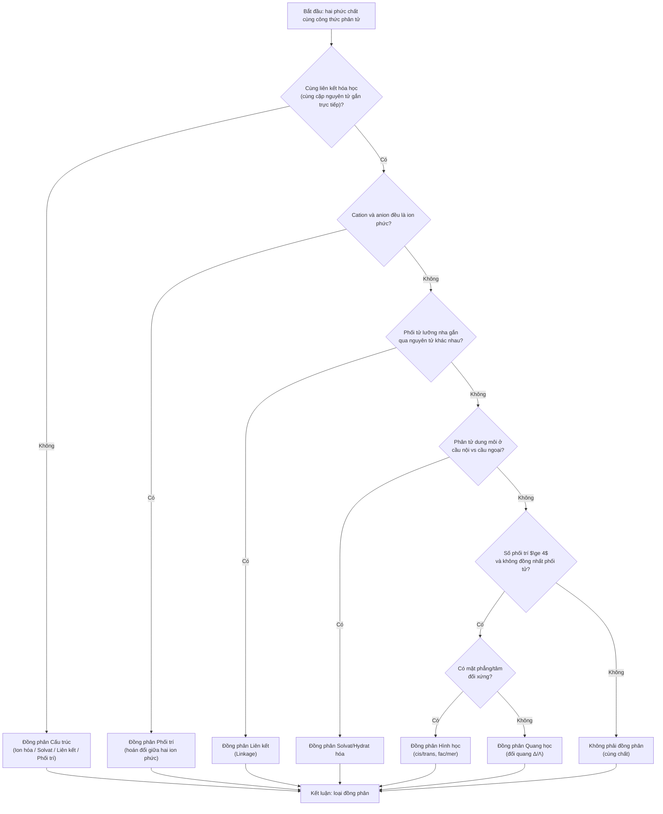

# Chương 7: Đồng phân Phức chất & Ý nghĩa Dược lý (tên tạm)

---

## 7.1. Tổng quan chương (Chapter Overview)

### 7.1.1. Tên chương, giới thiệu khái quát & phạm vi nội dung

Chương 6 đã trình bày hóa học phối trí: cấu trúc cầu nội/cầu ngoại, số phối trí, phân loại phối tử, thuyết trường tinh thể và ứng dụng y dược. Chương 7 chuyển sang **đồng phân phức chất** — hiện tượng các phức chất có cùng công thức phân tử nhưng khác nhau về cấu trúc hoặc sự sắp xếp trong không gian, dẫn đến các tính chất vật lý, hóa học và đặc biệt là **hoạt tính sinh học–dược lý** hoàn toàn khác biệt `[SRC: S-07.1]` `[ADDED: bridge from Ch06]`.

Đồng phân phức chất là lĩnh vực cốt lõi trong thiết kế thuốc hiện đại: cisplatin (hoạt tính chống ung thư) và transplatin (không hoạt tính) là ví dụ trực tiếp về cách hình học phân tử làm thay đổi hoạt tính thuốc `[SRC: S-07.1, S-07.8]` `[ADDED: pharmaceutical relevance]`.

Chương trình bày phân loại tổng thể (cấu trúc & lập thể), đồng phân ion hóa, solvat/hydrat, liên kết, phối trí, hình học và quark học, ý nghĩa dược lý tổng hợp `[ADDED: scope summary]`.

Tên chương tạm thời: **"Đồng phân Phức chất & Ý nghĩa Dược lý"** (chưa có tên chính thức trong file nguồn D-07, chỉ có tại `MANIFEST.md`) `[VERIFY: chapter title (V-07.01)]`.

### 7.1.2. Phạm vi, Kiến thức Tiên quyết & Thời lượng Học tập

- **Kiến thức tiên quyết:**
  1. Cấu trúc phức chất, cation/anion, số oxy hóa tại Chương 1.
  2. Số phối trí CN, hình học phức chất (vuông phẳng, bát diện) tại `T-06.4.2` (Chương 6).
  3. Thuyết trường tinh thể CFT, bước nhảy $d-d$, màu sắc tại `T-06.4.7` (Chương 6) — cơ sở cho tính chất quark học và màu sắc của đồng phân `[ADDED: cross-reference to Ch06]`.
- **Thời lượng dự kiến:** ~**3 giờ** (khoảng 2 giờ 20 phút cho ~2.700 từ lý thuyết + ví dụ tại Mục 1–6, tương đương 2.700 / 1.500 ≈ 1,8 giờ; cộng 40 phút cho 10 bài tập ≈ 2 giờ 20 phút), theo `STUDY_TIME_RULE` `[ADDED: study time estimate]`.

---

## 7.2. Mục tiêu học tập (Learning Objectives)

### 7.2.1. Chuẩn đầu ra Kiến thức, Kỹ năng, Vận dụng và Đánh giá mô hình (LO-1..LO-4)

Sau chương này, sinh viên có thể `[ADDED: learning objectives]`:

- **`LO-1` (Kiến thức):** Phát biểu định nghĩa đồng phân phức chất, phân loại đồng phân cấu trúc (ion hóa, solvat/hydrat, liên kết, phối trí) và đồng phân lập thể (hình học, quark học).
- **`LO-2` (Kỹ năng):** Phân loại loại đồng phân từ công thức và cấu trúc; đọc tên cis/trans, fac/mer, Δ/Λ; dự đoán tính chất quark hoạt.
- **`LO-3` (Vận dụng):** Vận dụng đồng phân để giải thích hoạt tính dược lý (cisplatin vs transplatin, oxaliplatin, tương tác đích sinh học).
- **`LO-4` (Đánh giá mô hình):** Đánh giá vai trò của hình ảnh phân tử trong thiết kế thuốc, kiểm soát dạng đồng phân, dược động học và độc tính `[ADDED: LO-4 definition]`.

---

## 7.3. Đặt vấn đề & Ý nghĩa thực tiễn (Introduction)

### 7.3.1. Từ công thức tổng giống nhau đến khác biệt cấu trúc & hoạt tính

Hai phức chất có cùng công thức phân tử tổng thể nhưng có thể khác nhau về cách các nguyên tử được liên kết (đồng phân cấu trúc) hoặc cách các nguyên tử được sắp xếp trong không gian (đồng phân lập thể) `[SRC: S-07.1]` `[ADDED: conceptual bridge]`.

Khi đó, chúng có thể có:
- **Độ tan khác nhau:** các ion giải phóng khác nhau khi phân ly trong nước `[SRC: S-07.2, S-07.3]`.
- **Tốc độ phản ứng khác nhau:** độ bền liên kết kim loại–phối tử khác nhau `[SRC: S-07.4]`.
- **Màu sắc khác nhau:** bước nhảy $d-d$ khác nhau do trường sắc khác nhau `[SRC: S-06.7, S-07.7]`.
- **Hoạt tính sinh học khác biệt hoàn toàn:** cisplatin trị ung thư, transplatin không `[SRC: S-07.6, S-07.8]` `[ADDED: pharmaceutical relevance]`.

---

## 7.4. Nội dung bài giảng chính (Main Content)

### 7.4.1. Tổng quan & Phân loại Tổng thể Đồng phân Phức chất

Đồng phân phức chất là hiện tượng các phức chất có cùng công thức phân tử nhưng khác nhau về cấu trúc hoặc sự sắp xếp trong không gian, dẫn đến các tính chất vật lý, hóa học và đặc biệt là hoạt tính sinh học–dược lý hoàn toàn khác biệt `[SRC: S-07.1]` `[ADDED: definition]`.

**Bảng 7.1.** Sơ đồ phân loại tổng thể đồng phân phức chất. `[SRC: S-07.1]`

| Nhánh lớn | Loại đồng phân | Tiêu chí phân biệt |
|---|---|---|
| **I. Đồng phân Cấu trúc (Structural Isomerism)** | Ion hóa (Ionization) | Anion cầu nội ⇌ cầu ngoại đổi chỗ → ion hóa khác nhau khi phân ly |
| | Solvat hóa / Hydrat hóa (Solvate) | Phân tử dung môi ($H_2O$) ở cầu nội hay cầu ngoại |
| | Liên kết (Linkage) | Phối tử lưỡng nha gắn qua nguyên tử khác nhau |
| | Phối trí (Coordination) | Hoán đổi phối tử giữa hai ion phức cation & anion |
| **II. Đồng phân Lập thể (Stereo-isomerism)** | Hình học (Geometric) – cis/trans, fac/mer | Cùng liên kết, khác vị trí tương đối các phối tử trong không gian |
| | Quang học (Optical) – Δ/Λ, R/S | Phân tử không có tâm/mặt phẳng đối xứng → ảnh gương không chồng khít |

**Ý nghĩa:** Phân loại đồng phân giúp chọn tiêu chí nhận diện đúng, rồi dự đoán khác biệt về cấu tạo, hình học và tính chất dược học dù công thức tổng giống nhau `[SRC: S-07.1]` `[ADDED: interpretation]`.

### 7.4.2. Đồng phân Ion hóa (Ionization Isomerism)

**Nguyên lý:** Xảy ra khi một anion (hoặc cation) nằm ở **cầu ngoại** và một phối tử trung tính đang phối trí ở **cầu nội** có thể hoán đổi vị trí cho nhau. Do đó cùng một công thức phân tử tổng thể nhưng ion phức có điện tích khác nhau `[SRC: S-07.2]` `[ADDED: definition]`.

**Ví dụ phân tích sâu** `[SRC: S-07.2]`:

| Công thức phức | Màu sắc | Thêm $BaCl_2$ | Thêm $AgNO_3$ | Giải thích |
|---|---|---|---|---|
| $[Co(NH_3)_5Br]SO_4$ | Đỏ tím | ↓ Trắng $BaSO_4$ | Không tủa | $SO_4^{2-}$ ở cầu ngoại → bị kết tủa bởi $Ba^{2+}$; $Br^-$ bị giữ trong cầu nội |
| $[Co(NH_3)_5(SO_4)]Br$ | Đỏ hồng | Không tủa | ↓ Vàng $AgBr$ | $Br^-$ ở cầu ngoại → bị kết tủa bởi $Ag^+$; $SO_4^{2-}$ phối trí trong cầu nội |

**Ý nghĩa Dược lý:** Phân biệt đồng phân ion hóa thông qua phản ứng hóa học đặc trưng (kết tủa) là phương pháp kiểm nghiệm cơ bản trong Dược điển `[SRC: S-07.2]` `[ADDED: pharmaceutical relevance]`.

**Ý nghĩa:** Vị trí anion trong hay ngoài cầu phối trí quyết định ion nào được giải phóng, ảnh hưởng phản ứng định tính, độ tan và dạng ion có mặt trong dung dịch `[SRC: S-07.2]` `[ADDED: interpretation]`.

### 7.4.3. Đồng phân Solvat hóa / Hydrat hóa (Solvate / Hydrate Isomerism)

**Nguyên lý:** Phân tử dung môi (đặc biệt là $H_2O$) có thể đóng vai trò phối tử trong **cầu nội** hoặc phân tử dung môi kết tinh nằm ở **cầu ngoại**. Điều này thay đổi số lượng ion $Cl^-$ tự do có thể bị kết tủa `[SRC: S-07.3]` `[ADDED: definition]`.

**Ba đồng phân hydrat của Chromium(III) chloride** `[SRC: S-07.3]`:

| Công thức đầy đủ | Viết gọn | Màu | Cl⁻ tự do kết tủa với Ag⁺ |
|---|---|---|---|
| $[Cr(H_2O)_6]Cl_3$ | Violet (tím) | 🟣 | 3 ion $Cl^-$ (tất cả) |
| $[Cr(H_2O)_5Cl]Cl_2 \cdot H_2O$ | Lục nhạt | 🟢 | 2 ion $Cl^-$ |
| $[Cr(H_2O)_4Cl_2]Cl \cdot 2H_2O$ | Lục đậm | 🟩 | 1 ion $Cl^-$ |

**Ứng dụng:** Xác định số lượng phối tử trong cầu nội bằng cách đo độ dẫn điện hoặc lượng $AgCl$ kết tủa — phương pháp kiểm tra cổ điển trong hóa phân tích Dược `[SRC: S-07.3]` `[ADDED: application]`.

**Ý nghĩa:** Nước ở cầu nội hay cầu ngoại làm đổi số ion tự do, trạng thái hydrat và tính chất tinh thể; các khác biệt này ảnh hưởng kiểm nghiệm và đặc tính hòa tan của nguyên liệu `[SRC: S-07.3]` `[ADDED: interpretation]`.

### 7.4.4. Đồng phân Liên kết (Linkage Isomerism)

**Nguyên lý:** Xảy ra với các **phối tử lưỡng nha (ambidentate ligands)** — phối tử có thể gắn vào kim loại qua **hai nguyên tử khác nhau** trong cùng phân tử. Ví dụ phổ biến nhất là $NO_2^-$ và $SCN^-$ `[SRC: S-07.4]` `[ADDED: definition]`.

**Phối tử $NO_2^-$: Nitro vs Nitrito** `[SRC: S-07.4]`:

| Loại liên kết | Tên phối tử | Nguyên tử gắn vào kim loại | Ví dụ | Màu & Tính chất |
|---|---|---|---|---|
| $M{-}N{=}O_2$ (N-gắn) | Nitro ($\eta^1$-N) | Nguyên tử **N** | $[Co(NH_3)_5(NO_2)]Cl_2$ | Vàng, bền hơn về nhiệt động |
| $M{-}O{-}N{=}O$ (O-gắn) | Nitrito ($\eta^1$-O) | Nguyên tử **O** | $[Co(NH_3)_5(ONO)]Cl_2$ | Đỏ, kém bền, chuyển dần sang dạng Nitro |

**Phối tử $SCN^-$: Thiocyanato vs Isothiocyanato** `[SRC: S-07.4]`:
- Gắn qua $S$: Phối tử **Thiocyanato** ($M\text{-}S\text{-}C\equiv N$) — ưu tiên với kim loại mềm ($Pt^{2+}, Pd^{2+}$).
- Gắn qua $N$: Phối tử **Isothiocyanato** ($M\text{-}N=C=S$) — ưu tiên với kim loại cứng ($Co^{3+}, Cr^{3+}$).
- → **Nguyên lý HSAB của Pearson** giải thích sự chọn lọc này: Kim loại mềm ái lực với nguyên tử phối trí mềm (S); kim loại cứng ái lực với nguyên tử phối trí cứng (N) `[SRC: S-07.4]` `[ADDED: HSAB connection]`.

**Ý nghĩa:** Nguyên tử cho khác nhau làm đổi liên kết kim loại–phối tử, độ bền và khả năng phản ứng của phức; HSAB giúp lý giải xu hướng chọn vị trí gắn `[SRC: S-07.4]` `[ADDED: interpretation]`.

### 7.4.5. Đồng phân Phối trí (Coordination Isomerism)

**Nguyên lý:** Chỉ xảy ra khi **cả cation lẫn anion của muối phức đều là ion phức**. Các phối tử hoán đổi qua lại giữa hai ion phức với nhau, tạo ra các phức chất mới `[SRC: S-07.5]` `[ADDED: definition]`.

**Ví dụ** `[SRC: S-07.5]`:
$$[Co(NH_3)_6][Cr(CN)_6] \quad \text{và} \quad [Cr(NH_3)_6][Co(CN)_6]$$
$$[Pt^{II}(NH_3)_4][Pt^{IV}Cl_6] \quad \text{và} \quad [Pt^{IV}(NH_3)_4Cl_2][Pt^{II}Cl_4]$$

**Phân tích:** Dù cùng công thức phân tử $Co(NH_3)_6Cr(CN)_6$, hai phức chất có màu sắc, cấu trúc tinh thể và tính chất hóa học hoàn toàn khác nhau do bản chất trung tâm kim loại gắn kết với mỗi loại phối tử khác nhau `[SRC: S-07.5]` `[ADDED: interpretation]`.

**Ý nghĩa:** Phân biệt cách phối tử phân bố giữa hai ion phức giúp xác định cấu trúc và dự đoán tính chất hóa học, màu sắc, độ tan của muối phức `[SRC: S-07.5]` `[ADDED: interpretation]`.

### 7.4.6. Đồng phân Hình học (Geometric Isomerism)

**Nguyên lý:** Các phối tử giống nhau được sắp xếp ở các vị trí khác nhau trong không gian quanh tâm kim loại, dù không thay đổi liên kết hóa học. Xuất hiện khi phức có **số phối trí $\ge 4$** và **không đồng nhất các phối tử** `[SRC: S-07.6]` `[ADDED: definition]`.

**A. Hệ Vuông phẳng — $[MA_2B_2]$ và $[MA_2BC]$** `[SRC: S-07.6]`:

| Hệ | Dạng cis | Dạng trans | Ví dụ lịch sử |
|---|---|---|---|
| $[MA_2B_2]$ Vuông phẳng | 2 phối tử A **kề nhau** (góc $90^\circ$) | 2 phối tử A **đối diện nhau** (góc $180^\circ$) | **Cisplatin** $cis\text{-}[Pt(NH_3)_2Cl_2]$ → Thuốc chống ung thư mạnh. **Transplatin** $trans\text{-}[Pt(NH_3)_2Cl_2]$ → Không có hoạt tính vì không thể tạo liên kết chéo với DNA |
| $[MA_2BC]$ Vuông phẳng | 2 phối tử A kề nhau | 2 phối tử A đối diện | |

**B. Hệ Bát diện — Các kiểu đồng phân hình học** `[SRC: S-07.6]`:

| Công thức | Dạng cis | Dạng trans | Ví dụ |
|---|---|---|---|
| $[MA_4B_2]$ | 2 phối tử B góc $90^\circ$ (liền kề) | 2 phối tử B góc $180^\circ$ (đối diện) | $[Co(NH_3)_4Cl_2]^+$: cis (tím), trans (xanh lục) |
| $[MA_3B_3]$ — **fac/mer** | **Facial (fac):** 3 phối tử B chiếm 3 đỉnh cùng mặt tam giác → tất cả góc $90^\circ$ | **Meridional (mer):** 3 phối tử B cùng nằm trên mặt phẳng xích đạo → tạo thành hàng thẳng (1 góc $180^\circ$ + 2 góc $90^\circ$) | $[Co(NH_3)_3Cl_3]$, $[IrCl_3(PMe_3)_3]$ |
| $[MA_2B_2C_2]$ | \multicolumn{2}{c}{Có thể có nhiều đồng phân hình học do sự kết hợp phức tạp hơn} | $[Pt(NH_3)_2(Cl)_2(NO_2)_2]$ có ít nhất 5 đồng phân hình học |

**Ứng dụng Dược học then chốt — Cisplatin vs Transplatin** `[SRC: S-07.6]` `[ADDED: pharmaceutical relevance]`:
- **Cisplatin** $cis\text{-}[Pt(NH_3)_2Cl_2]$: Hai nhóm $Cl^-$ ở vị trí cis, khoảng cách 3.3 Å phù hợp chính xác để **tạo liên kết chéo nội chuỗi** với hai base Guanine liền kề trên DNA, uốn cong chuỗi DNA 30–40°, ngăn cản polymerase sao chép → gây apoptosis tế bào ung thư.
- **Transplatin** $trans\text{-}[Pt(NH_3)_2Cl_2]$: Hai nhóm $Cl^-$ ở vị trí trans, khoảng cách 6.6 Å quá lớn, không thể đồng thời kết nối với 2 base liền kề → Không có cơ chế gây độc tế bào → Không có tác dụng chống ung thư.

**Ý nghĩa:** Vị trí tương đối của phối tử có thể quyết định khả năng gắn đồng thời vào đích sinh học. Cisplatin/transplatin là ví dụ trực tiếp về hình ảnh phân tử làm thay đổi hoạt tính thuốc `[SRC: S-07.6]` `[ADDED: interpretation]`.

### 7.4.7. Đồng phân Quang học (Optical Isomerism / Chirality)

**Điều kiện phát sinh:** Phân tử phức chất **không có tâm đối xứng ($i$), mặt phẳng đối xứng ($\sigma$) hoặc trục quay nghịch đảo ($S_n$)** nào. Hai đồng phân là **ảnh gương qua gương nhưng không thể chồng khít** lên nhau, gọi là cặp đối quang (enantiomers) `[SRC: S-07.7]` `[ADDED: definition]`.

**Ký hiệu quay phực (Configuration Descriptors)** `[SRC: S-07.7]`:
- **Δ (Delta):** Ký hiệu cấu hình helicity của một số phức bát diện có phối tử càng; mô tả chiều xoắn phải của các vòng chelat theo quy ước quan sát dọc trục thích hợp.
- **Λ (Lambda):** Cấu hình ảnh gương với Δ, có chiều xoắn trái theo cùng quy ước. Δ/Λ mô tả cấu hình không gian, **không tự cho biết** chất làm quay ánh sáng phân cực sang phải (+) hay sang trái (−); dấu quay phải đo thực nghiệm bằng phân cực kế.

**Các hệ phức quark hoạt điển hình** `[SRC: S-07.7]`:

| Phức chất | Cấu hình | Phối tử | Tính chất quark học |
|---|---|---|---|
| $[Co(en)_3]^{3+}$ | Bát diện | 3 ethylenediamine (en) chelat 2 càng | Tồn tại cặp đối quang Δ và Λ; phân giải được bằng tác nhân chiral (tartrate) |
| $[Fe(ox)_3]^{3-}$ | Bát diện | 3 oxalate ($ox^{2-}$) chelat 2 càng | Cặp Δ/Λ; nghịch từ (Low-spin $d^5$) |
| $[Cr(bipy)_3]^{3+}$ | Bát diện | 3 bipyridyl chelat 2 càng | Quang hoạt; ổn định cấu hình do vòng chelat cứng nhắc |
| $[Co(EDTA)]^-$ | Bát diện bất đối xứng | EDTA 6 càng | Phức chelat dị vòng tạo cấu hình bất đối xứng; quan trọng trong chuẩn độ complexon chọn lọc |

**Phân biệt cấu hình và tính quark hoạt:** Một cặp enantiomer tinh khiết thường quay mặt phẳng ánh sáng phân cực với độ lớn bằng nhau, chiều ngược nhau trong cùng điều kiện đo; không thể suy dấu (+)/(−) chỉ từ nhãn Δ/Λ. Hỗn hợp hai enantiomer bằng nhau (hỗn hợp racemic) có độ quay tổng bằng 0 do triệt tiêu, dù từng phân tử vẫn là chiral. Mẫu không quay ánh sáng cũng có thể do cấu trúc achiral hoặc do bù trừ hỗn hợp; vì vậy phép đo quark học không thay thế việc xác định cấu hình và độ tinh khiết lập thể `[SRC: S-07.7]` `[ADDED: nuanced explanation]`.

**Ý nghĩa:** Đối quang có thể tương tác khác nhau với protein, enzyme và receptor bất đối xứng; xác định cấu hình giúp đánh giá hoạt tính, độ chọn lọc và độ tinh khiết lập thể `[SRC: S-07.7]` `[ADDED: interpretation]`.

### 7.4.8. Ý nghĩa Dược lý Tổng hợp

**Bảng 7.2.** Liên hệ loại đồng phân với ý nghĩa dược lý / lâm sàng. `[SRC: S-07.8]`

| Loại đồng phân | Ý nghĩa Dược lý / Lâm sàng | Ví dụ tiêu biểu |
|---|---|---|
| Hình học (cis/trans) | Quyết định hình ảnh phân tử → Khả năng khớp với ổ tiếp nhận (receptor) hoặc DNA → Hoạt tính ung thư hoàn toàn khác biệt | Cisplatin (hoạt tính) vs Transplatin (không hoạt tính) |
| Quang học (Δ/Λ) | Môi trường sinh học là bất đối xứng (enzyme, receptor đều là protein chiral) → Chỉ một đối quang gắn được → Hoạt tính, độc tính, dược động học khác nhau | Oxaliplatin dùng dạng thuần quang ($1R,2R$-DACH); đối quang còn lại không có hoạt tính |
| Liên kết (Linkage) | Nguyên tử gắn khác nhau → Độ bền phức, tốc độ thủy phân, vị trí gắn DNA/protein khác nhau | Phức $Pt\text{-}SCN^-$ (gắn qua S, bền) vs $Pt\text{-}NCS^-$ (gắn qua N, kém bền) |
| Ion hóa (Ionization) | Ảnh hưởng đến dạng ion tự do trong dung dịch sinh lý → độ tan, hoạt động sinh học, tương tác với màng tế bào | Muối Cobalt dạng ion hóa khác nhau cho thử nghiệm kết tủa Dược điển |
| Hình học fac/mer | Ảnh hưởng đến hình dạng tổng thể phức chất → Khả năng thẩm thấu màng tế bào và tương tác enzyme | Phức $IrCl_3(PR_3)_3$ fac vs mer có phản ứng trao đổi phối tử khác nhau |

**Ý nghĩa:** Bảng tổng hợp liên hệ loại đồng phân với thay đổi về tương tác đích, độ tan, ion hóa và dược động học; hỗ trợ đánh giá vì sao cần kiểm soát dạng đồng phân của phức thuốc `[SRC: S-07.8]` `[ADDED: summary table]`.

---

## 7.5. Ví dụ minh họa & Quy trình thực hành (Examples & Illustrations)

### 7.5.1. Ví dụ 7.1: cisplatin và transplatin: cùng công thức, khác số phận

> **Example 7.1.** Phân tích tại sao cisplatin có hoạt tính chống ung thư trong khi transplatin không. `[SRC: S-07.6, S-07.8]`
>
> - **Given (Dữ kiện đã cho):** Cả hai đều là $[Pt(NH_3)_2Cl_2]$ với $Pt^{2+}$ ($5d^8$), cấu trúc **vuông phẳng**. `cis`: hai $NH_3$ nằm *kề nhau*, hai $Cl$ kề nhau → vào tế bào, thủy phân mất $Cl^-$, rồi liên kết với N7 của guanine trên DNA tạo **cầu nối nội sợi** → ức chế sao chép DNA, chữa ung thư. `trans`: hai $NH_3$ nằm **đối nhau** → khoảng cách hình học không cho phép tạo cầu nối chéo đúng kiểu, lại bị thải nhanh → **không có hoạt tính chống ung thư** `[SRC: S-07.6]`.
> - **Find (Yêu cầu):** Giải thích cơ chế phân tử tại sao chỉ dạng *cis* có hoạt tính chống ung thư.
> - **Approach (Phương pháp giải):** So sánh hình ảnh không gian của hai dạng; xác định khoảng cách giữa hai vị trí liên kết $Cl$; liên hệ với khoảng cách giữa hai base Guanine liền kề trên DNA.
> - **Solution (Giải):**
>   1. Dạng *cis*: hai $Cl^-$ ở vị trí kề nhau (góc $90^\circ$), khoảng cách khoảng 3.3 Å, phù hợp để liên kết với 2 base Guanine liền kề trên cùng một mắt xích DNA.
>   2. Dạng *trans*: hai $Cl^-$ ở vị trí đối diện (góc $180^\circ$), khoảng cách khoảng 6.6 Å, quá lớn để cùng lúc liên kết với 2 base liền kề.
>   3. Chỉ dạng *cis* tạo được liên kết chéo nội chuỗi DNA → uốn cong DNA → ngăn sao chép → apoptosis tế bào ung thư.
> - **Check (Kiểm tra):** Cả hai đều là $[Pt(NH_3)_2Cl_2]$, cùng công thức phân tử, nhưng khác hình ảnh → khác hoạt tính `[SRC: S-07.6]`.
> - **Interpretation (Nhận xét):** Hình ảnh phân tử (các phối tử nằm kề hay đối nhau) quyết định khả năng tương tác với đích sinh học. Đây là bài học cốt lõi về đồng phân hình học trong dược lý `[ADDED: conclusion]`.

### 7.5.2. Ví dụ 7.2: Đồng phân quark học Δ/Λ

> **Example 7.2.** Phân tích đồng phân quark học của $[Co(en)_3]^{3+}$ (en = ethylenediamine, 2 càng). `[SRC: S-07.7]`
>
> - **Given (Dữ kiện đã cho):** $[Co(en)_3]^{3+}$: 3 phối tử 2 càng xoắn quanh Co tạo hai dạng **Δ và Λ** như hai bàn tay, không chồng khít lên nhau. Phức này không có mặt phẳng đối xứng → quark hoạt, hai đồng phân xoay mặt phẳng ánh sáng phân cực ngược chiều nhau `[SRC: S-07.7]`.
> - **Find (Yêu cầu):** Giải thích tại sao $[Co(en)_3]^{3+}$ quark hoạt trong khi $[Co(NH_3)_4Cl_2]^+$ dạng *trans* không quark hoạt.
> - **Approach (Phương pháp giải):** Kiểm tra sự tồn tại của mặt phẳng đối xứng ($\sigma$) trong mỗi dạng; liên hệ với đối quang Δ/Λ.
> - **Solution (Giải):**
>   1. $[Co(en)_3]^{3+}$: 3 vòng chelat en xoắn xung quanh Co tạo cấu trúc xoắn kép (helical), không có mặt phẳng đối xứng → tồn tại cặp Δ/Λ → quark hoạt.
>   2. $[Co(NH_3)_4Cl_2]^+$ dạng *trans*: hai $Cl$ đối diện tạo mặt phẳng đối xứng → không quark hoạt.
>   3. $[Co(NH_3)_4Cl_2]^+$ dạng *cis*: không có mặt phẳng đối xứng → quark hoạt (Δ/Λ).
> - **Check (Kiểm tra):** Quy tắc nhanh: có $\sigma$ → không quark hoạt; không có $\sigma$ → có cặp Δ/Λ `[SRC: S-07.7]`.
> - **Interpretation (Nhận xét):** Trong sản xuất thuốc, chỉ dạng đồng phân mong muốn mới được dùng; dạng còn lại có thể kém tác dụng hoặc độc hơn `[ADDED: conclusion]`.

### 7.5.3. Sơ đồ thuật toán xác định loại đồng phân (Mermaid)

Quy trình xác định loại đồng phân phức chất dựa trên đặc điểm cấu trúc `[ADDED: algorithm synthesizing S-07.1–S-07.7]`:

1. Cùng công thức phân tử tổng thể?
2. Cùng liên kết hóa học (cùng các cặp nguyên tử gắn trực tiếp)?
3. Có thành phần ion phức cả cation lẫn anion?
4. Có phối tử lưỡng nha gắn qua nguyên tử khác nhau?
5. Có phân tử dung môi ở cầu nội vs cầu ngoại?
6. Có số phối trí $\ge 4$ và không đồng nhất phối tử?
7. Không có mặt phẳng/tâm đối xứng?

**Hình 7.1.** Sơ đồ thuật toán xác định loại đồng phân phức chất. `[ADDED: Mermaid flowchart]` `[VERIFY: isomerism classification algorithm (V-07.02)]`.

### 7.5.4. Minh họa Trực quan (Placeholders)

Các khung dưới đây chỉ là giữ chỗ, **chưa được vẽ** `[ADDED: figure placeholder specifications]`.

**Hình 7.1.** Cơ cấu cisplatin (cis) và transplatin (khung giữ chỗ). `[ADDED: Figure 7.1 caption]`

**Hình 7.2.** Đối quang Δ/Λ của $[Co(en)_3]^{3+}$ (khung giữ chỗ). `[ADDED: Figure 7.2 caption]` `[VERIFY: optical isomerism (V-07.02)]`

**Hình 7.3.** Sơ đồ phân loại tổng thể đồng phân phức chất (khung giữ chỗ). `[ADDED: Figure 7.3 caption]`

---

## 7.6. Tóm tắt chương (Chapter Summary)

### 7.6.1. Tóm tắt Nội dung Trọng tâm & Quy tắc Ghi nhớ

Các luận điểm chính của chương 7 `[SRC: S-07.1–S-07.9]`:

1. **Đồng phân phức chất:** Cùng công thức phân tử, khác cấu trúc hoặc sắp xếp không gian → khác tính chất vật lý, hóa học và hoạt tính sinh học–dược lý `[SRC: S-07.1]`.
2. **Đồng phân cấu trúc:** Ion hóa (cầu nội/ngoại hoán đổi), Solvat/Hydrat (nước ở cầu nội/ngoại), Liên kết (phối tử lưỡng nha gắn khác nguyên tử), Phối trí (cation & anion đều ion phức) `[SRC: S-07.2–S-07.5]`.
3. **Đồng phân lập thể:** Hình học (cis/trans, fac/mer) và Quang học (đối quang Δ/Λ) `[SRC: S-07.6, S-07.7]`.
4. **Cisplatin vs Transplatin:** Dạng *cis* liên kết chéo DNA (chữa ung thư), dạng *trans* không (khoảng cách quá lớn) `[SRC: S-07.6]` `[ADDED: pharmaceutical mnemonic]`.
5. **Quark học:** Không có $\sigma$/$i$/$S_n$ → có cặp đối quang Δ/Λ; Δ/Λ không tự cho biết dấu quay (+)/(−) `[SRC: S-07.7]` `[ADDED: theoretical summary]`.
6. **Ý nghĩa dược lý:** Hình ảnh phân tử quyết định tương tác đích, độ tan, ion hóa, dược động học và độc tính `[SRC: S-07.8]` `[ADDED: clinical summary]`.

> **Quy tắc ghi nhớ (mnemonic):**
> - **"cis kề – trans đối; trans dễ có gương phẳng":** Dạng *cis* có các phối tử giống nhau kề nhau; dạng *trans* thường có mặt phẳng đối xứng → không quark hoạt `[ADDED: mnemonic]`.
> - **Quy trình 3 bước:** (1) đếm loại phối tử → đoán loại đồng phân; (2) vẽ *cis* = "kề nhau", *trans* = "đối nhau"; (3) tìm mặt phẳng đối xứng $\sigma$: có $\sigma$ → không quark hoạt, không có $\sigma$ → có cặp Δ/Λ `[SRC: S-07.7]` `[ADDED: mnemonic]`.

### 7.6.2. Bảng Tổng hợp Loại Đồng phân & Ý nghĩa Dược lý

**Bảng 7.3.** Tổng hợp loại đồng phân, tiêu chí phân biệt và ý nghĩa dược lý của chương 7. `[ADDED: Table 7.3]`

| Loại đồng phân | Tiêu chí phân biệt chính | Ý nghĩa Dược lý | Ví dụ điển hình |
|---|---|---|---|
| Ion hóa | Anion/cation ở cầu nội vs cầu ngoại | Dạng ion tự do trong dung dịch sinh lý → độ tan, hoạt động sinh học | Muối Cobalt (thử nghiệm kết tủa Dược điển) |
| Solvat/Hydrat | Nước ở cầu nội hoặc cầu ngoại | Số ion tự do, trạng thái hydrat, tính chất tinh thể | 3 đồng phân hydrat của $[Cr(H_2O)_6]Cl_3$ |
| Liên kết | Phối tử lưỡng nha gắn qua nguyên tử khác nhau | Độ bền phức, tốc độ thủy phân, vị trí gắn DNA/protein | $Pt\text{-}SCN^-$ vs $Pt\text{-}NCS^-$ |
| Phối trí | Cation & anion đều là ion phức, hoán đổi phối tử | Màu sắc, cấu trúc tinh thể, tính chất hóa học khác nhau | $[Co(NH_3)_6][Cr(CN)_6]$ vs $[Cr(NH_3)_6][Co(CN)_6]$ |
| Hình học (cis/trans) | Vị trí tương đối các phối tử (kề vs đối diện) | Khả năng khớp với DNA/receptor → hoạt tính ung thư | Cisplatin (hoạt) vs Transplatin (không) |
| Quang học (Δ/Λ) | Không có mặt phẳng đối xứng → ảnh gương không chồng khít | Tương tác khác với enzyme/receptor chiral → hoạt tính, độc tính, dược động học khác nhau | Oxaliplatin dạng thuần quang ($1R,2R$-DACH) |

---

## 7.7. Đánh giá & Bài tập tự lượng giá (Review & Assessment)

[ADDED: assessment section frame] Bộ câu hỏi và bài tập dưới đây được thiết kế theo thang nhận thức từ Nhận biết, Thông hiểu đến Vận dụng, Phân tích và Đánh giá mô hình, bao phủ bốn chuẩn đầu ra `LO-1`–`LO-4` đã phát biểu tại `T-07.2.1`. Mỗi câu đều ghi rõ chuẩn đầu ra và cấp độ nhận thức; đáp án chi tiết nằm tại `T-07.7.4`. Sinh viên nên tự làm bài đầy đủ trước khi đọc đáp án chi tiết.

### 7.7.1. Câu hỏi Lý thuyết: Nhận biết & Thông hiểu (LO-1)

[ADDED: knowledge and comprehension questions]

**Câu 1 (`LO-1` – Knowledge).** Đặc điểm chính của đồng phân phức chất là gì?

- **A.** Cùng công thức phân tử, khác cấu trúc hoặc sắp xếp không gian.
- **B.** Công thức phân tử khác, cấu trúc giống nhau.
- **C.** Chỉ khác về màu sắc, cấu trúc giống nhau hoàn toàn.
- **D.** Chỉ khác về số oxidation của kim loại trung tâm.

**Câu 2 (`LO-1` – Comprehension).** Loại đồng phân nào xảy ra khi một anion ở cầu ngoài và một phối tử ở cầu nội hoán đổi vị trí?

- **A.** Đồng phân solvat hóa.
- **B.** Đồng phân ion hóa.
- **C.** Đồng phân liên kết.
- **D.** Đồng phân phối trí.

**Câu 3 (`LO-1` – Comprehension).** Đại lượng nào quyết định xem một phân tử phức chất có quark hoạt hay không?

- **A.** Số oxy hóa của kim loại trung tâm.
- **B.** Sự tồn tại của mặt phẳng đối xứng ($\sigma$), tâm đối xứng ($i$) hoặc trục quay nghịch đảo ($S_n$).
- **C.** Số phối tử trong phức chất.
- **D.** Màu sắc của dung dịch phức chất.

**Câu 4 (`LO-1` – Comprehension).** Dạng *cis* của $[Pt(NH_3)_2Cl_2]$ có hoạt tính chống ung thư trong khi dạng *trans* không vì lý do gì?

- **A.** Dạng *trans* có công thức phân tử khác.
- **B.** Dạng *cis* có khoảng cách giữa hai $Cl^-$ phù hợp để liên kết với 2 base Guanine liền kề trên DNA.
- **C.** Dạng *trans* không tan trong nước.
- **D.** Dạng *cis* có số oxy hóa của Pt khác.

### 7.7.2. Bài tập Áp dụng: Phân loại & Tính chất (LO-2, LO-3)

[ADDED: application exercises]

**Bài tập 5 (`LO-2` – Application).** Cho hai công thức $[Co(NH_3)_5Br]SO_4$ và $[Co(NH_3)_5(SO_4)]Br$. Hãy:
1. Xác định loại đồng phân và giải thích cơ chế.
2. Dự đoán kết quả khi thêm $BaCl_2$ và $AgNO_3$ vào dung dịch của mỗi công thức.
3. Giải thích màu sắc khác nhau (đỏ tím vs đỏ hồng).

**Bài tập 6 (`LO-2` – Application).** Cho $[Cr(H_2O)_6]Cl_3$, $[Cr(H_2O)_5Cl]Cl_2 \cdot H_2O$, $[Cr(H_2O)_4Cl_2]Cl \cdot 2H_2O$. Hãy:
1. Xác định loại đồng phân và số ion $Cl^-$ tự do trong mỗi công thức.
2. Dự đoán thứ tự màu sắc (tím, lục nhạt, lục đậm) và liên hệ với số ion $Cl^-$ tự do.
3. Giải thích cách đo độ dẫn điện phân biệt ba đồng phân.

**Bài tập 7 (`LO-3` – Application).** Cho $[Co(en)_3]^{3+}$ và $[Co(NH_3)_4Cl_2]^+$ (dạng *trans*). Hãy:
1. Xác định dạng nào quark hoạt, dạng nào không.
2. Giải thích cơ chế dựa trên sự tồn tại của mặt phẳng đối xứng.
3. Nêu ý nghĩa trong sản xuất thuốc (chỉ dùng dạng đồng phân mong muốn).

### 7.7.3. Câu hỏi Phân tích & Vận dụng Nâng cao (LO-3, LO-4)

[ADDED: analytical and advanced questions]

**Câu 8 (`LO-3`, `LO-4` – Analysis).** Giải thích tại sao oxaliplatin được thiết kế dưới dạng thuần quark ($1R,2R$-DACH) trong khi đối quang còn lại không có hoạt tính. Liên hệ với môi trường sinh học là bất đối xứng (enzyme, receptor là protein chiral) `[SRC: S-07.8]` `[ADDED: critical thinking]`.

**Câu 9 (`LO-3` – Analysis).** Một dược phẩm phức chất kim loại có thể tồn tại dưới dạng đồng phân ion hóa (anion ở cầu ngoài) và đồng phân liên kết (phối tử lưỡng nha gắn khác nguyên tử). So sánh hai loại đồng phân này về: (a) cách phân ly trong nước, (b) tương tác với đích sinh học, (c) ý nghĩa trong thiết kế thuốc `[SRC: S-07.2, S-07.4]` `[ADDED: critical thinking]`.

**Câu 10 (`LO-4` – Advanced).** Đánh giá vai trò của kiểm soát dạng đồng phân trong sản xuất thuốc kim loại. Nêu một rủi ro nếu sản phẩm thuốc chứa hỗn hợp racemic (hai đối quang bằng nhau) thay vì dạng thuần quark `[SRC: S-07.7, S-07.8]` `[ADDED: critical thinking]` `[DOMAIN_RULES: chỉ giải thích cơ chế, không liều/chỉ định]`.

---

## 7.7.4. Đáp án & Hướng dẫn Giải Chi tiết (Answer Key)

[ADDED: step-by-step answer key]

**Câu 1 — `LO-1` · Knowledge. Đáp án A.** Đồng phân phức chất có cùng công thức phân tử tổng thể nhưng khác về cấu trúc (cách các nguyên tử được liên kết) hoặc sắp xếp không gian (hình ảnh phân tử), dẫn đến các tính chất khác nhau `[SRC: S-07.1]`.

**Câu 2 — `LO-1` · Comprehension. Đáp án B.** Đồng phân ion hóa xảy ra khi anion/cation ở cầu ngoài và phối tử ở cầu nội hoán đổi vị trí, làm thay đổi ion được giải phóng khi phân ly `[SRC: S-07.2]`.

**Câu 3 — `LO-1` · Comprehension. Đáp án B.** Một phân tử quark hoạt không có tâm đối xứng ($i$), mặt phẳng đối xứng ($\sigma$) hoặc trục quay nghịch đảo ($S_n$). Nếu có bất kỳ đối xứng nào trong số này → không quark hoạt `[SRC: S-07.7]`.

**Câu 4 — `LO-1` · Comprehension. Đáp án B.** Dạng *cis* có hai $Cl^-$ kề nhau (khoảng cách 3.3 Å), phù hợp để liên kết đồng thời với 2 base Guanine liền kề trên DNA. Dạng *trans* có hai $Cl^-$ đối diện (khoảng cách 6.6 Å), không thể làm vậy `[SRC: S-07.6]` `[ADDED: structural explanation]`.

**Bài tập 5 — `LO-2` · Application.**
1. Đồng phân ion hóa: anion $SO_4^{2-}$/$Br^-$ hoán đổi vị trí giữa cầu nội và cầu ngoài.
2. $[Co(NH_3)_5Br]SO_4$: thêm $BaCl_2$ → kết tủa trắng $BaSO_4$ (vì $SO_4^{2-}$ ở cầu ngoài); thêm $AgNO_3$ → không tủa (vì $Br^-$ ở cầu nội). Ngược lại cho $[Co(NH_3)_5(SO_4)]Br$.
3. Màu sắc khác nhau do cấu trúc điện tử khác nhau do liga khác nhau ở vị trí phối trí `[SRC: S-07.2]`.

**Bài tập 6 — `LO-2` · Application.**
1. Loại đồng phân solvat/hydrat hóa. $[Cr(H_2O)_6]Cl_3$: 3 ion $Cl^-$ tự do; $[Cr(H_2O)_5Cl]Cl_2 \cdot H_2O$: 2 ion $Cl^-$; $[Cr(H_2O)_4Cl_2]Cl \cdot 2H_2O$: 1 ion $Cl^-$.
2. Màu sắc: Violet (tím) > Lục nhạt > Lục đậm, tương ứng với số ion $Cl^-$ tự do giảm dần.
3. Đo độ dẫn điện: $[Cr(H_2O)_6]Cl_3$ tạo 4 ion (dẫn điện cao nhất), $[Cr(H_2O)_5Cl]Cl_2 \cdot H_2O$ tạo 3 ion, $[Cr(H_2O)_4Cl_2]Cl \cdot 2H_2O$ tạo 2 ion `[SRC: S-07.3]`.

**Bài tập 7 — `LO-3` · Application.**
1. $[Co(en)_3]^{3+}$: không có mặt phẳng đối xứng → quark hoạt (cặp Δ/Λ). $[Co(NH_3)_4Cl_2]^+$ dạng *trans*: có mặt phẳng đối xứng → không quark hoạt.
2. Dạng *trans* của $[Co(NH_3)_4Cl_2]^+$ có hai $Cl$ đối diện, tạo mặt phẳng đối xứng qua Pt và hai $Cl$ → không quark hoạt. Dạng *cis* không có mặt phẳng đối xứng → quark hoạt `[SRC: S-07.7]`.
3. Trong sản xuất thuốc, chỉ dạng đồng phân mong muốn mới được dùng; dạng còn lại có thể kém tác dụng hoặc độc hơn `[ADDED: conclusion]`.

**Câu 8 — `LO-3`, `LO-4` · Analysis.**
- Môi trường sinh học (enzyme, receptor, DNA) là chiral (bất đối xứng). Chỉ một đối quang có cấu hình phù hợp để gắn vào ổ thụ thể/enzyme. Đối quang còn lại có cấu hình không khớp → kém hoạt tính hoặc không hoạt tính `[SRC: S-07.8]` `[ADDED: stereoselectivity explanation]`.

**Câu 9 — `LO-3` · Analysis.**
- (a) Đồng phân ion hóa: phân ly thành các ion tự do khác nhau (ví dụ $SO_4^{2-}$ tự do vs $Br^-$ tự do). Đồng phân liên kết: không phân ly thành ion khác nhau (cùng cation/anion phức), chỉ khác nguyên tử gắn.
- (b) Đồng phân ion hóa: ion tự do tương tác màng tế bào khác nhau. Đồng phân liên kết: phức độn nguyên vẹn đến đích, khác ở vị trí gắn.
- (c) Thiết kế thuốc cần chọn dạng đồng phân phù hợp để đảm bảo độ tan, hoạt động sinh học và độc tính mong muốn `[ADDED: comparative analysis]`.

**Câu 10 — `LO-4` · Analysis.**
- Kiểm soát dạng đồng phân đảm bảo thuốc có hoạt tính, độ chọn lọc và độ an toàn dự kiến. Hỗn hợp racemic có thể chứa một đối quang kém tác vụ hoặc độc hơn → rủi ro về hiệu quả và an toàn dược lý `[SRC: S-07.7, S-07.8]` `[ADDED: critical thinking]` `[DOMAIN_RULES: chỉ giải thích cơ chế, không liều/chỉ định]`.

---

## 7.8. Tài liệu tham khảo (References)

### 7.8.1. Danh mục Tài liệu Tham khảo & Đọc thêm

[ADDED: reference section structure] Nguồn `D-07` không có tài liệu tham khảo nào và `APPROVED_REFERENCE_LIST` là `none`. Theo R4, không tự điền tên sách, tác giả, năm, NXB, DOI hay số trang; ba thẻ dưới đây xác định loại tài liệu cần bổ sung.

1. **Giáo trình Hóa Vô cơ Dược (phần đồng phân phức chất):** `[VERIFY: reference needed for Inorganic Pharmaceutical Chemistry textbook covering coordination isomerism (V-07.04)]`.
2. **Giáo trình Hóa đại cương / vô cơ (đồng phân phức chất, quark học, HSAB):** `[VERIFY: reference needed for general/inorganic chemistry textbook covering coordination isomerism, optical isomerism, and HSAB theory (V-07.04)]`.
3. **Tài liệu Dược lý / Hóa dược (ứng dụng đồng phân trong thuốc, cisplatin, oxaliplatin):** `[VERIFY: reference needed for pharmacology / pharmaceutical chemistry textbook covering medical applications of coordination isomerism (V-07.04)]`.

> **Ghi chú tuân thủ R4.** Ba mục trên là thẻ giữ chỗ, không phải trích dẫn đã xác minh; khi có danh mục chuẩn sẽ định dạng Vancouver.

