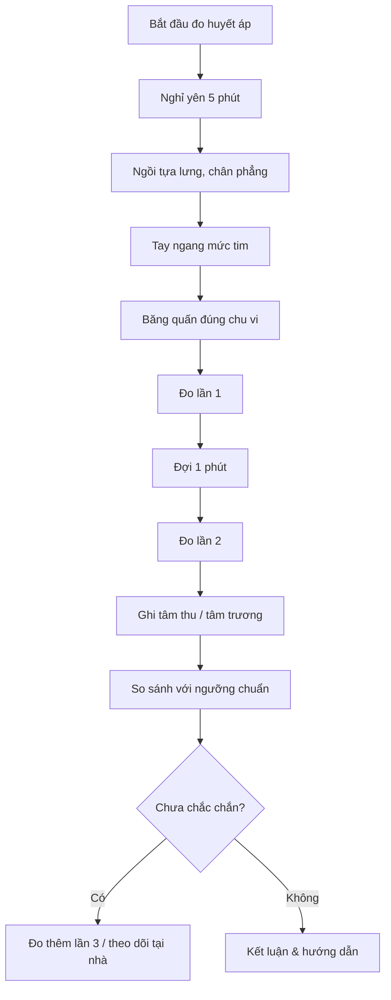

# Chương 6: Thực hành đo huyết áp và diễn giải kết quả

---

## 1. Tổng quan chương (Chapter Overview) {T-06.1}

### 1.1 Tên chương, giới thiệu khái quát & phạm vi nội dung {T-06.1.1}

Huyết áp là một trong những chỉ số sinh hiệu cơ bản nhất trong khám bệnh và theo dõi bệnh nhân. Đo huyết áp đúng quy trình không chỉ giúp phát hiện tăng huyết áp sớm mà còn tránh sai số dẫn đến chẩn đoán sai hoặc điều trị không cần thiết. Chương 6 trình bày quy chuẩn chuẩn bị và thao tác đo huyết áp, ý nghĩa của từng chỉ số, các sai số kỹ thuật phổ biến, và cách diễn giải kết quả đo trong thực hành dược lý và lâm sàng `[ADDED: structural frame and pedagogical overview]`.

Chương trình bao gồm ba phần chính: (1) chuẩn bị và thao tác đo huyết áp chuẩn, (2) ý nghĩa huyết áp tâm thu/tâm trương và các sai số kỹ thuật, (3) ý nghĩa và tác dụng lâm sàng của việc đo đúng `[ADDED: scope summary]`.

Tên chương tạm thời: **"Thực hành đo huyết áp và diễn giải kết quả"** (theo `MANIFEST.md`) `[VERIFY: chapter title (V-06.01)]`.

### 1.2 Phạm vi, Kiến thức Tiên quyết & Thời lượng Học tập {T-06.1.2}

- **Kiến thức tiên kỳ:**
  1. Hệ tim mạch cơ bản (tim, mạch máu, dòng máu) từ sinh lý đại cương `[ADDED: cross-reference to general physiology]`.
  2. Đơn vị áp lực mmHg và cách đọc chỉ số từ đồng hồ/apdate đo huyết áp `[ADDED: cross-reference to general physics]`.
  3. Khái niệm tăng huyết áp và ý nghĩa lâm sàng từ dược lý đại cương `[ADDED: cross-reference to general pharmacology]`.
- **Thời lượng dự kiến:** ~**2 giờ 30 phút** (khoảng 1 giờ 50 phút cho ~2.000 từ lý thuyết + ví dụ tại Mục 1–5, tương đương 2.000 / 1.500 ≈ 1,33 giờ; cộng 40 phút cho 10 bài tập ≈ 2 giờ 13 phút), theo `STUDY_TIME_RULE` `[ADDED: study time estimate]`.

---

## 2. Mục tiêu học tập (Learning Objectives) {T-06.2}

### 2.1 Chuẩn đầu ra Kiến thức, Kỹ năng, Vận dụng và Đánh giá mô hình (LO-1..LO-4) {T-06.2.1}

Sau chương này, sinh viên có thể `[ADDED: learning objectives]`:

- **`LO-1` (Kiến thức):** Phát biểu quy chuẩn chuẩn bị và thao tác đo huyết áp (nghỉ 5 phút, tư thế ngồi tựa, băng quấn đúng cỡ, tay ngang mức tim, ít nhất 2 lần đo cách 1 phút); phân biệt huyết áp tâm thu và tâm trương; liệt kê các sai số kỹ thuật phổ biến gây đo sai.
- **`LO-2` (Kỹ năng):** Đọc và ghi lại chỉ số huyết áp tâm thu/tâm trương đơn vị mmHg; phân loại mức độ tăng huyết áp dựa trên các lần đo lặp lại.
- **`LO-3` (Vận dụng):** Giải thích tại sao đo lặp lại cần thiết; liên hệ kết quả đo với nguy cơ tim mạch và đáp ứng điều trị.
- **`LO-4` (Đánh giá mô hình):** Đánh giá vai trò của chuẩn hóa tư thế, băng quấn và số lần đo trong việc giảm sai số, tránh chẩn đoán hoặc thay đổi thuốc dựa trên kết quả không đáng tin cậy `[ADDED: LO-4 definition]`.

---

## 3. Đặt vấn đề & Ý nghĩa thực tiễn (Introduction) {T-06.3}

### 3.1 Tại sao cần đo huyết áp đúng quy trình {T-06.3.1}

Huyết áp là áp lực của dòng máu áp lên tường mạch máu khi tim bơm và khi tim giãn. Đo huyết áp là bước đầu tiên trong khám sức khỏe, theo dõi bệnh nhân mắc bệnh tim mạch và đánh giá đáp ứng điều trị tăng huyết áp `[ADDED: conceptual bridge]`.

Tuy nhiên, kết quả đo huyết áp rất dễ bị ảnh hưởng bởi yếu tố kỹ thuật: bệnh nhân vừa vận động, băng quấn không đúng cỡ, tay thấp hơn mức tim, nói chuyện trong lúc đo, hoặc chỉ đo một lần — tất cả đều có thể làm chỉ số cao hơn thực tế (đo "cao giả") hoặc thấp hơn thực tế. Do đó, chuẩn hóa tư thế, băng quấn và số lần đo là điều then chốt để tránh chẩn đoán sai hoặc thay đổi thuốc không cần thiết `[ADDED: clinical relevance]`.

Nhiều trường hợp bệnh nhân được chẩn đoán tăng huyếtáp chỉ dựa trên một lần đo cao tại phòng khám, trong khi thực tế khi đo lại đúng quy trình tại nhà chỉ số lại bình thường. Đây gọi là現 tượng "áo bác sĩ trắng" (white coat hypertension) — một lý do tại sao quy chuẩn đo lặp lại rất quan trọng `[ADDED: clinical example]`.

---

## 4. Nội dung bài giảng chính (Main Content) {T-06.4}

### 4.1 Chuẩn Bị & Thao Tác Đo Huyết Áp {T-06.4.1}

**Bước 1: Nghỉ yên ít nhất 5 phút trước khi đo.** Bệnh nhân cần ngồi yên, tránh hút thuốc, uống caffeine và vận động trong 30 phút trước đo (nếu có thể) `[SRC: S-06.1]` `[ADDED: rationale]`. Lý do: các kích thích này có thể làm tăng tạm thời huyết áp do kích thích hệ thần kinh giao cảm.

**Bước 2: Tư thế ngồi đúng.** Bệnh nhân ngồi tựa lưng, bàn chân đặt phẳng lên sàn, không bắt chéo chân, cánh tay trần được đỡ ngang mức tim `[SRC: S-06.1]` `[ADDED: rationale]`. Nếu tay cao hơn hoặc thấp hơn mức tim, chỉ số đo sẽ sai do áp lực thủy static của cột máu.

**Bước 3: Chọn băng quấn đúng chu vi cánh tay.** Đặt mép dưới của băng quấn trên nếp khuỷu, không nói chuyện trong lúc đo `[SRC: S-06.1]` `[ADDED: rationale]`. Băng quấn quá nhỏ sẽ làm chỉ số đo cao hơn thực tế; băng quấn quá lớn sẽ làm chỉ số thấp hơn.

**Bước 4: Đo ít nhất hai lần cách nhau khoảng 1 phút.** Ghi cả huyết áp tâm thu, tâm trương, tư thế, tay đo và thời điểm `[SRC: S-06.1]` `[ADDED: rationale]`. Một lần đo đơn độc không đủ căn cứ để chẩn đoán tăng huyết áp.

---

### 4.2 Ý Nghĩa & Sai Số Kỹ Thuật Đo Huyết Áp {T-06.4.2}

**Huyết áp tâm thu** phản ánh áp lực khi thất co (tim b푸t máu ra); **huyết áp tâm trương** phản ánh áp lực khi tim giãn `[SRC: S-06.2]` `[ADDED: definition]`.

**Các sai số kỹ thuật phổ biến** gây chỉ số đo sai lệch `[SRC: S-06.2]` `[ADDED: enumeration]`:

| Sai số | Tác động đến kết quả đo | Nguyên nhân |
|---|---|---|
| Băng quấn quá nhỏ | Đo **cao hơn** thực tế | Băng quấn chật gây áp lực bổ sung lên động mạch |
| Tay thấp hơn mức tim | Đo **cao hơn** thực tế | Áp lực thủy static của cột máu tăng |
| Nói chuyện trong lúc đo | Đo **cao hơn** thực tế | Kích thích thần kinh giao cảm làm tăng huyết áp |
| Đau hoặc lo âu | Đo **cao hơn** thực tế | Căng thẳng làm tăng hormon adrenaline |
| Chỉ đo một lần | Không đủ căn cứ chẩn đoán | Biến thiên tự nhiên của huyết áp trong ngày |

Chẩn đoán tăng huyết áp dựa trên **đo lặp lại đúng quy trình** và hướng dẫn chuyên môn, **không dựa trên một lần đo đơn độc** `[SRC: S-06.2]` `[ADDED: clinical rule]`.

---

### 4.3 Ý Nghĩa & Tác Dụng Lâm Sàng {T-06.4.3}

Đo đúng giúp phát hiện và theo dõi tăng huyết áp, đánh giá nguy cơ tim mạch và đáp ứng điều trị `[SRC: S-06.3]` `[ADDED: clinical application]`.

Chuẩn hóa tư thế, băng quấn và số lần đo giảm sai số, tránh chẩn đoán hoặc thay đổi thuốc dựa trên kết quả không đáng tin cậy `[SRC: S-06.3]` `[ADDED: safety principle]`.

Nội dung thực tế phụ thuộc thành phần điều trị, tốc độ truyền và tình trạng người bệnh; bác sĩ hoặc dược sĩ cần tổng hợp kết quả đo với biểu chứng lâm sàng và các chỉ số khác trước khi quyết định can thiệp `[ADDED: interpretation]`.

---

## 5. Ví dụ minh họa & Quy trình thực hành (Examples & Illustrations) {T-06.5}

### 5.1 Ví dụ 1: Một Lần Đ Cao Chưa Phải Tăng Huyết Áp {T-06.5.1}

> **Example 1.** Bệnh nhân vừa leo cầu thang lên phòng khám, băng quấn nhỏ, tay thấp hơn mức tim $\Rightarrow 150/95$ mmHg `[SRC: S-06.3]`.
>
> Để lại yên 5 phút, ngồi tựa lưng, tay ngang mức tim, băng quấn đúng cỡ $\Rightarrow 132/84$ mmHg.
>
> Lần 3 cách 1 phút: $130/82$ mmHg.
>
> **Kết luận:** Kết quả đầu là sai số do kỹ thuật; chưa đủ căn cứ chẩn đoán tăng huyết áp, cần theo dõi thêm tại nhà/phòng khám theo hướng dẫn `[SRC: S-06.3]` `[ADDED: interpretation]`.
>
> **Bài học:** Luôn đo lặp lại và ghi đủ tư thế, tay đo, thời điểm trước khi kết luận `[SRC: S-06.3]` `[ADDED: takeaway]`.

### 5.2 Mẹo nhớ Đo Huyết Áp {T-06.5.2}

> **Mẹo nhớ — 4 bước chuẩn:** "Nghỉ — Thế — Quấn — Lặp": nghỉ 5 phút; tư thế ngồi tựa, chân phẳng, tay ngang tim; băng quấn đúng chu vi; đo ít nhất 2 lần cách 1 phút `[SRC: S-06.1]` `[ADDED: mnemonic]`.
>
> **Mẹo nhớ — 3 sai số hay gặp:** băng quấn nhỏ, tay thấp hơn tim, nói chuyện/lo âu — đều làm huyết áp "cao giả" `[SRC: S-06.2]$ `[ADDED: mnemonic]`.
>
> **Mẹo nhớ — Chẩn đoán:** Một con số không phải chẩn đoán; cần đo lặp lại và đánh giá nguy cơ tim mạch `[SRC: S-06.3]$ `[ADDED: mnemonic]`.

### 5.3 Sơ Quy Trình Đo Huyết Áp Chuẩn (Mermaid) {T-06.5.3}

### 5.4 Minh Họa Trực quan (Placeholders) {T-06.5.4}

- `[FIGURE: Thiết bị đo huyết áp (apdate/apdate điện tử) và cách đeo băng quấn đúng cỡ]`
- `[FIGURE: Tư thế ngồi đúng (tay ngang mức tim, chân phẳng, không bắt chéo chân)]`
- `[FIGURE: So sánh sai số do băng quấn nhỏ vs đúng cỡ]`

---

## 6. Tóm tắt chương (Chapter Summary) {T-06.6}

### 6.1 Tóm tắt Nội dung Trọng tâm & Quy tắc Ghi nhớ {T-06.6.1}

Các luận điểm chính của chương 6 `[SRC: S-06.1–S-06.3]`:

1. **Quy chuẩn chuẩn bị:** Nghỉ 5 phút, tránh thuốc/caffeine/vận động 30 phút trước đo `[SRC: S-06.1]`.
2. **Tư thế chuẩn:** Ngồi tựa lưng, bàn chân phẳng, tay ngang mức tim, cánh tay trần `[SRC: S-06.1]`.
3. **Băng quấn đúng cỡ:** Mép dưới trên nếp khuỷu, không nói chuyện trong lúc đo `[SRC: S-06.1]`.
4. **Đo ít nhất 2 lần cách 1 phút**, ghi đầy đủ tâm thu, tâm trương, tư thế, tay đo, thời điểm `[SRC: S-06.1]`.
5. **Huyết áp tâm thu:** áp lực khi tim co b푸t; **huyết áp tâm trương:** áp lực khi tim giãn `[SRC: S-06.2]`.
6. **Sai số phổ biến:** băng quấn nhỏ, tay thấp hơn tim, nói chuyện, lo âu — đều làm đo "cao giả" `[SRC: S-06.2]`.
7. **Chẩn đoán tăng huyết áp:** dựa trên đo lặp lại, không dựa trên một lần đo đơn độc `[SRC: S-06.2]`.
8. **Ý nghĩa lâm sàng:** phát hiện tăng huyết áp, đánh giá nguy cơ tim mạch, theo dõi đáp ứng điều trị `[SRC: S-06.3]`.

> **Quy tắc ghi nhớ (mnemonic):**
> - **4 bước:** Nghỉ — Thế — Quấn — Lặp `[ADDED: mnemonic]`.
> - **3 sai số:** băng quấn nhỏ, tay thấp hơn tim, nói chuyện/lo âu `[ADDED: mnemonic]`.
> - **Một con số không phải chẩn đoán** `[ADDED: mnemonic]`.

### 6.2 Bảng Tổng hợp Quy Chuẩn & Lưu ý {T-06.6.2}

**Bảng 6.1.** Tổng hợp quy chuẩn đo huyết áp và lưu ý lâm sàng `[ADDED: Table 6.1]`

| Mục | Quy chuẩn / Lưu ý | Đơn vị | Ý nghĩa |
|---|---|---|---|
| Thời gian nghỉ trước khi đo | Ít nhất 5 phút | phút | Cho hệ tim mạch ổn định sau hoạt động |
| Tư thế | Ngồi tựa lưng, chân phẳng, tay ngang mức tim | — | Tránh sai số do áp lực thủy static |
| Băng quấn | Đúng chu vi cánh tay, mép dưới trên nếp khuỷu | — | Băng quấn nhỏ → đo cao giả; lớn → đo thấp giả |
| Số lần đo | Ít nhất 2 lần cách 1 phút | lần | Tránh chẩn đoán dựa trên một lần đo đơn độc |
| Huyết áp tâm thu | Áp lực khi tim co b푸t | mmHg | Chỉ số trên (ví dụ 120 trong 120/80) |
| Huyết áp tâm trương | Áp lực khi tim giãn | mmHg | Chỉ số dưới (ví dụ 80 trong 120/80) |
| Sai số phổ biến | Băng quấn nhỏ, tay thấp hơn tim, nói chuyện, lo âu | — | Làm chỉ số đo sai lệch |
| Căn cứ chẩn đoán | Đo lặp lại đúng quy trình, không dựa một lần đơn độc | — | Tránh chẩn đoán sai và điều trị không cần thiết |

---

## 7. Đánh giá & Bài tập tự lượng giá (Review & Assessment) {T-06.7}

[ADDED: assessment section frame] Bộ câu hỏi và bài tập dưới đây được thiết kế theo thang nhận thức từ Nhận biết, Thông hiểu đến Vận dụng, Phân tích và Đánh giá mô hình, bao phủ bốn chuẩn đầu ra `LO-1`–`LO-4` đã phát biểu tại `T-06.2.1`. Mỗi câu đều ghi rõ chuẩn đầu ra & cấp độ nhận thức; đáp án chi tiết nằm tại `T-06.7.4`. Sinh viên nên tự làm bài đầy đủ trước khi đọc đáp án chi tiết.

### 7.1 Câu hỏi Lý thuyết: Nhận biết & Thông hiểu (LO-1) {T-06.7.1}

[ADDED: knowledge and comprehension questions]

**Câu 1 (`LO-1` – Knowledge).** Trước khi đo huyết áp, bệnh nhân cần nghỉ yên ít nhất bao nhiêu phút?

- **A.** 1 phút
- **B.** 3 phút
- **C.** 5 phút
- **D.** 10 phút

**Câu 2 (`LO-1` – Knowledge).** Khi đo huyết áp, tay bệnh nhân nên được đặt ở vị trí nào?

- **A.** Cao hơn mức tim
- **B.** Thấp hơn mức tim
- **C.** Ngang mức tim
- **B.** Đặt tùy ý, không ảnh hưởng kết quả

**Câu 3 (`LO-1` – Comprehension).** Băng quấn quá nhỏ sẽ làm kết quả đo huyết áp thay đổi thế nào?

- **A.** Đo thấp hơn thực tế
- **B.** Đo cao hơn thực tế
- **C.** Không ảnh hưởng
- **D.** Không thể đo được

**Câu 4 (`LO-1` – Comprehension).** Chẩn đoán tăng huyết áp dựa trên yếu tố nào?

- **A.** Một lần đo cao bất kỳ
- **B.** Đo lặp lại đúng quy trình và hướng dẫn chuyên môn
- **C.** Chỉ dựa trên biểu chứng lâm sàng
- **D.** Chỉ dựa trên tiền sử gia đình

### 7.2 Bài tập Áp dụng: Đọc chỉ số & phân loại huyết áp (LO-2, LO-3) {T-06.7.2}

[ADDED: application exercises]

**Bài tập 5 (`LO-2` – Application).** Một bệnh nhân đo được 3 lần: lần 1: 150/95 mmHg, lần 2: 132/84 mmHg, lần 3: 130/82 mmHg. Hãy ghi kết quả cuối cùng nên báo cáo và phân loại huyếtáp.

**Bài tập 6 (`LO-3` – Application).** Một bệnh nhân cao 1m70, nặng 80kg, được đo huyết áp lần đầu là 148/92 mmHg khi vừa đi thang bộ lên phòng khám. Bác sĩ chẩn đoán ngay tăng huyết áp và chỉ định thuốc. Hãy nhận xét về việc chẩn đoán này và đề xuất xử lý tiếp theo.

### 7.3 Câu hỏi Phân tích & Vận dụng Nâng cao (LO-3, LO-4) {T-06.7.3}

[ADDED: analytical and advanced questions]

**Câu 8 (`LO-3`, `LO-4` – Analysis).** Giải thích tại sao băng quấn quá nhỏ làm chỉ số đo huyết áp cao hơn thực tế, dựa trên nguyên lý áp lực và diện tích tiếp xúc `[SRC: S-06.2]$ `[ADDED: critical thinking]`.

**Câu 9 (`LO-3` – Analysis).** Tại sao cần ghi đầy đủ tư thế, tay đo và thời điểm mỗi lần đo huyết áp? Những thông tin này ảnh hưởng như thế nào đến việc diễn giải kết quả `[SRC: S-06.1]$ `[ADDED: critical thinking]`.

**Câu 10 (`LO-4` – Advanced).** Đánh giá vai trò của chuẩn hóa tư thế, băng quấn và số lần đo trong việc giảm sai số, tránh chẩn đoán hoặc thay đổi thuốc dựa trên kết quả không đáng tin cậy `[SRC: S-06.3]$ `[ADDED: critical thinking]` `[DOMAIN_RULES: chỉ giải thích cơ chế, không liều/chỉ định]`.

---

## 7.4 Đáp án & Hướng dẫn Giải Chi tiết (Answer Key) {T-06.7.4}

[ADDED: step-by-step answer key]

**Câu 1 — `LO-1` · Knowledge. Đáp án C.** Bệnh nhân cần nghỉ yên ít nhất 5 phút trước khi đo `[SRC: S-06.1]$ `[ADDED: definition]`.

**Câu 2 — `LO-1` · Knowledge. Đáp án C.** Tay bệnh nhân nên được đặt ngang mức tim để tránh sai số do áp lực thủy static của cột máu `[SRC: S-06.1]$ `[ADDED: rationale]`.

**Câu 3 — `LO-1` · Comprehension. Đáp án B.** Băng quấn quá nhỏ gây áp lực bổ sung lên động mạch, làm chỉ số đo cao hơn thực tế `[SRC: S-06.2]$ `[ADDED: rationale]`.

**Câu 4 — `LO-1` · Comprehension. Đáp án B.** Chẩn đoán tăng huyết áp dựa trên đo lặp lại đúng quy trình và hướng dẫn chuyên môn, không dựa trên một lần đo đơn độc `[SRC: S-06.2]$ `[ADDED: clinical rule]`.

**Bài tập 5 — `LO-2` · Application.**

Kết quả nên báo cáo: lấy trung bình các lần đo sau lần đầu (để loại sai số do lo âu ban đầu): $(132 + 130)/2 = 131$ mmHg tâm thu, $(84 + 82)/2 = 83$ mmHg tâm trương. Báo cáo: **131/83 mmHg**. Phân loại: huyết áp bình thường cao (elevated) hoặc hệ 1 tùy theo ngưỡng chuẩn được áp dụng `[SRC: S-06.3]$ `[ADDED: interpretation]`.

**Bài tập 6 — `LO-3` · Application.**

Không nên chẩn đoán tăng huyết áp dựa trên một lần đo khi bệnh nhân vừa vận động (đi thang bộ). Cần yêu cầu bệnh nhân nghỉ 5 phút, đo lại đúng quy trình ít nhất 2 lần cách 1 phút, và theo dõi thêm tại nhà trước khi kết luận `[SRC: S-06.1, S-06.2]$ `[ADDED: clinical reasoning]` `[DOMAIN_RULES: chỉ giải thích cơ chế, không liều/chỉ định]`.

**Câu 8 — `LO-3`, `LO-4` · Analysis.**

Băng quấn quá nhỏ không bao quát đầy đủ vùng động mạch, gây áp lực cắm thêm lên tường mạch để hủy áp lực của băng quấn, dẫn đến cần áp lực cao hơn để chặn dòng máu $\rightarrow$ chỉ số đo cao hơn thực tế `[SRC: S-06.2]$ `[ADDED: physical reasoning]`.

**Câu 9 — `LO-3` · Analysis.**

Tư thế ảnh hưởng đến áp lực thủy static của cột máu so với tim; tay đo khác nhau có thể có hiệu Doppler khác nhau; thời điểm ảnh hưởng đến biến thiên huyết áp trong ngày (caidian rhythm). Ghi đầy đủ các thông tin này giúp bác sĩ/dược sĩ so sánh đúng apples-to-apples giữa các lần đo và tránh kết luận sai do biến thiên kỹ thuật thay vì biến sinh lý thật sự `[SRC: S-06.1]$ `[ADDED: methodological reasoning]`.

**Câu 10 — `LO-4` · Analysis.**

Chuẩn hóa tư thế, băng quấn và số lần đo giảm các sai số kỹ thuật ngẫu nhiên và hệ thống. Khi kết quả đo chuẩn hóa, bác sĩ/dược sĩ có thể tin cậy hơn để quyết định chẩn đoán tăng huyết áp hoặc điều chỉnh thuốc, tránh việc thay đổi thuốc dựa trên một chỉ số sai do kỹ thuật đo kém `[SRC: S-06.3]$ `[ADDED: patient safety reasoning]` `[DOMAIN_RULES: chỉ giải thích cơ chế, không liều/chỉ định]`.

---

## 8. Tài liệu tham khảo (References) {T-06.8}

### 8.1 Danh mục Tài liệu Tham khảo & Đọc thêm {T-06.8.1}

[ADDED: reference section structure] Nguồn `D-06` không có tài liệu tham khảo nào & `APPROVED_REFERENCE_LIST` là `none`. Theo R4, không tự điền tên sách, tác giả, năm, NXB, DOI hay số trang; ba thẻ dưới đây xác định loại tài liệu cần bổ sung.

1. **Giáo trình Sinh lý (đo huyết áp, hệ tim mạch, chỉ số sinh hiệu):** `[VERIFY: reference needed for Physiology textbook covering blood pressure measurement and cardiovascular system (V-06.04)]`.
2. **Giáo trình Dược lý lâm sàng (tăng huyết áp, điều trị tăng huyết áp, theo dõi bệnh nhân):** `[VERIFY: reference needed for Clinical Pharmacology textbook covering hypertension and patient monitoring (V-06.04)]`.
3. **Hướng dẫn lâm sàng đo huyết áp (hội tim mạch, Bộ Y tế, hoặc tổ chức y tế chuyên môn):** `[VERIFY: reference needed for clinical guideline on blood pressure measurement (V-06.04)]`.

> **Ghi chú tuân thủ R4.** Ba mục trên là thẻ giữ chỗ, không phải trích dẫn đã xác minh; khi có danh mục chuẩn sẽ định dạng Vancouver.