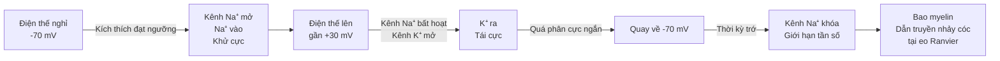

# Chương 8: Điện thế màng và điện thế hoạt động

---

## 1. Tổng quan chương (Chapter Overview) 1. Tổng quan chương (Chapter Overview)

### 1.1 Tên chuyên đề, giới thiệu khái quát & phạm vi nội dung 1.1 Tên chuyên đề, giới thiệu khái quát & phạm vi nội dung

Điện thế màng là hiện tượng điện cơ bản nhất trong tế bào sống, là nền tảng của dẫn truyền thần kinh, co cơ và nhịp tim. Tất cả các quá trình sinh học liên quan đến excitability (khả năng khử cực) của tế bào — từ truyền tín hiệu thần kinh, co bụng, nhịp tim, đến phân비 phân비 hormone — đều bắt đầu từ sự thay đổi điện thế màng `[ADDED: structural frame and pedagogical overview]`.

Chương 8 trình bày điện thế nghỉ và cách bơm Na⁺/K⁺ duy trì gradient ion; điện thế hoạt động (khử cực, tái cực, quá phân cực, thời kỳ trơ); điện thế hoạt động cơ tim (pha bình nguyên, dòng Ca²⁺); và liên hệ dược lý & lâm sàng (thuốc gây tê chẹn kênh Na⁺, thuốc chống loạn nhịp, rối loạn K⁺/Ca²⁺, ECG) `[ADDED: scope summary]`.

Tên chương tạm thời: **"Điện thế màng và điện thế hoạt động"** (theo `MANIFEST.md`) `[VERIFY: chapter title (V-08.01)]`.

### 1.2 Phạm vi, Kiến thức Tiên quyết & Thời lượng Học tập 1.2 Phạm vi, Kiến thức Tiên quyết & Thời lượng Học tập

- **Kiến thức tiên kỳ:**
  1. Ion, số hiệu ion, nồng độ molari từ hóa phổ thông `[ADDED: cross-reference to general chemistry]`.
  2. Màng tế bào (lớp lipid kép) từ sinh lý đại cương `[ADDED: cross-reference to general biology]`.
  3. Hệ nhiệt động (côlap/kín/mở), nguyên lý I & II nhiệt động học từ Chương 1 & Chương 4 ly-duoc `[ADDED: cross-reference to Ch01 & general biology]`.
- **Thời lượng dự kiến:** ~**2 giờ 30 phút** (khoảng 1 giờ 50 phút cho ~2.000 từ lý thuyết + ví dụ tại Mục 1–5, tương đương 2.000 / 1.500 ≈ 1,33 giờ; cộng 40 phút cho 10 bài tập ≈ 2 giờ 13 phút), theo `STUDY_TIME_RULE` `[ADDED: study time estimate]`.

---

## 2. Mục tiêu học tập (Learning Objectives) 2. Mục tiêu học tập (Learning Objectives)

### 2.1 Chuẩn đầu ra Kiến thức, Kỹ năng, Vận dụng và Đánh giá mô hình (LO-1..LO-4) 2.1 Chuẩn đầu ra Kiến thức, Kỹ năng, Vận dụng và Đánh giá mô hình (LO-1..LO-4)

Sau chương này, sinh viên có thể `[ADDED: learning objectives]`:

- **`LO-1` (Kiến thức):** Phát biểu định nghĩa điện thế nghỉ và điện thế hoạt động; phân biệt khử cực, tái cực và quá phân cực; liệt kê vai trò của kênh Na⁺, K⁺, Ca²⁺ trong điện thế hoạt động.
- **`LO-2` (Kỹ năng):** Tính toán điện thế cân bằng ion đơn lẻ bằng phương trình Nernst; phân biệt điện thế nghỉ (−70 mV) và điện thế hoạt động (lên gần +30 mV).
- **`LO-3` (Vận dụng):** Giải thích cơ chế điện thế hoạt động cơ tim liên quan đến dòng Ca²⁺; liên hệ thuốc gây tê/chống loạn nhịp với kênh ion.
- **`LO-4` (Đánh giá mô hình):** Đánh giá vai trò của điện thế màng trong dẫn truyền thần kinh, co cơ và nhịp tim; liên hệ rối loạn K⁺/Ca²⁺ với nguy cơ tim mạch `[ADDED: LO-4 definition]`.

---

## 3. Đặt vấn đề & Ý nghĩa thực tiễn (Introduction) 3. Đặt vấn đề & Ý nghĩa thực tiễn (Introduction)

### 3.1 Tại sao điện thế màng quan trọng trong y dược 3.1 Tại sao điện thế màng quan trọng trong y dược

Màng tế bào không chỉ là lớp bao bọc tế bào mà còn là một màng bán thấm chọn lọc, tạo ra sự khác biệt nồng độ ion hai bên màng. Sự khác biệt này cùng với tính thấm chọn lọc của màng sinh ra điện thế màng `[SRC: S-08.1]$ `[ADDED: conceptual bridge]`.

Điện thế màng là cơ sở của dẫn truyền thần kinh (tin học sinh học), co cơ (cơ xương kčka, tim) và nhịp tim. Khi điện thế màng thay đổi (khử cực hoặc tái cực), các kênh ion mở hoặc đóng, dẫn đến việc tế bào gửi tín hiệu đến tế bào khác hoặc co bóp `[SRC: S-08.1, S-08.2]$ `[ADDED: physiological relevance]`.

Nhiều thuốc hoạt động bằng cách tác động trực tiếp lên kênh ion hoặc bơm ion trên màng tế bào: thuốc gây tê tại chỗ chẹn kênh Na⁺ làm giảm khử cực; thuốc chống loạn nhịp tác động lên kênh ion hoặc dẫn truyền điện học của tim. Do đó, hiểu điện thế màng và điện thế hoạt động là điều kiện tiên quyết để hiểu cơ chế tác dụng của nhiều nhóm thuốc quan trọng `[SRC: S-08.3]$ `[ADDED: pharmacological relevance]`.

---

## 4. Nội dung bài giảng chính (Main Content) 4. Nội dung bài giảng chính (Main Content)

### 4.1 Điện Thế Nghĩa (Resting Membrane Potential) 4.1 Điện Thế Nghĩa (Resting Membrane Potential)

Điện thế màng phát sinh từ chênh lệch nồng độ ion hai bên màng và tính thấm chọn lọc của màng. Bơm Na⁺/K⁺ duy trì gradient ion; ở nhiều neuron, điện thế nghỉ xấp xỉ −70 mV, nhưng thay đổi theo loại tế bào `[SRC: S-08.1]$ `[ADDED: definition]`.

Bơm Na⁺/K⁺-ATPase mỗi chu kỳ thủy phân một ATP, đưa 3 Na⁺ ra và 2 K⁺ vào, tạo ra gradient ion ($Na^+$ cao ngoài, $K^+$ cao trong) duy trì điện thế nghĩ của tế bào `[SRC: S-08.1]$ `[ADDED: mechanism]`.

---

### 4.2 Điện Thế Hoạt Động (Action Potential) 4.2 Điện Thế Hoạt Động (Action Potential)

Điện thế hoạt động diễn ra theo ba giai đoạn chính `[SRC: S-08.2]$:

1. **Khử cực:** Kích thích đạt ngưỡng mở kênh Na⁺ phụ thuộc điện thế, Na⁺ đi vào tế bào theo cả gradient nồng độ và gradient điện thế, kéo điện thế màng từ −70 mV lên gần +30 mV `[SRC: S-08.2]$.
2. **Tái cực:** Kênh Na⁺ bất hoạt, kênh K⁺ mở; K⁺ đi ra tế bào gây tái cực và đôi khi quá phân cực ngắn `[SRC: S-08.2]$.
3. **Thời kỳ trơ:** Giới hạn tần số phát xung; bao myelin giúp dẫn truyền nhảy cóc tại các eo Ranvier `[SRC: S-08.2]$.

---

### 4.3 Cơ Tim & Liên Hệ Thuốc 4.3 Cơ Tim & Liên Hệ Thuốc

Điện thế hoạt động cơ tim có pha bình nguyên liên quan dòng Ca²⁺, hỗ trợ co bóp và thời kỳ trơ dài `[SRC: S-08.3]$.

Thuốc gây tê tại chỗ chẹn kênh Na⁺ làm giảm khử cực, nên mất cảm giác đau tại vùng được tiêm `[SRC: S-08.3]$.

Nhiều thuốc chống loạn nhịp tác động lên kênh ion hoặc dẫn truyền điện học của tim `[SRC: S-08.3]$.

Thay đổi K⁺, Ca²⁺ ngoài tế bào có thể làm biến đổi tính hưng phấn của tế bào tim và gây rối loạn nhịp `[SRC: S-08.3]$.

---

### 4.4 Ý Nghĩa & Ứng dụng Lâm Sàng 4.4 Ý Nghĩa & Ứng dụng Lâm Sàng

Điện thế màng là cơ sở của dẫn truyền thần kinh, co cơ và nhịp tim. Nắm cơ chế giúp hiểu ECG, rối loạn nhịp do thay đổi điện giải và cách thuốc gây tê/chống loạn nhịp tác động lên kênh ion; cũng giúp nhận biết vì sao rối loạn K⁺ hoặc Ca²⁺ có thể nguy hiểm `[SRC: S-08.4]$.

---

## 5. Ví dụ minh họa & Quy trình thực hành (Examples & Illustrations) 5. Ví dụ minh họa & Quy trình thực hành (Examples & Illustrations)

### 5.1 Ví dụ 1: Nernst với Na⁺ & Pha Khử Cực 5.1 Ví dụ 1: Nernst với Na⁺ & Pha Khử Cực

> **Example 1.** $Na^+$ ngoài $= 140$ mmol/L, trong $= 14$ mmol/L:
>
> $$E_{Na} = 61,5 \times \log\frac{140}{14} = 61,5 \times 1 = +61,5\text{ mV}$$ `[SRC: S-08.2]`.
>
> Khi kênh $Na^+$ mở, $Na^+$ ùa vào theo cả gradient nồng độ và điện thế, kéo điện thế màng từ $-70$ mV lên gần $+30$ mV `[SRC: S-08.2]$.
>
> Sau đó kênh $Na^+$ bất hoạt, $K^+$ đi ra, điện thế quay về phía $E_K \approx -95$ mV (tái cực) `[SRC: S-08.2]$.
>
> **Ứng dụng:** thuốc tê tại chỗ chẹn kênh $Na^+$ làm giảm khử cực, nên mất cảm giác đau tại vùng được tiêm `[SRC: S-08.3]$ `[ADDED: clinical application]`.

### 5.2 Mẹo nhớ Điện Thế Màng & Hoạt Động 5.2 Mẹo nhớ Điện Thế Màng & Hoạt Động

> **Mẹo nhớ — Khử cực / Tái cực:** $Na^+$ vào = khử cực; $K^+$ ra = tái cực; $Ca^{2+}$ vào = pha bình nguyên cơ tim `[SRC: S-08.2, S-08.3]$ `[ADDED: mnemonic]`.
>
> **Mẹo nhớ — Nernst:** ion ngoài càng nhiều so với trong → điện thế cân bằng càng dương `[SRC: S-08.2]$ `[ADDED: mnemonic]`.
>
> **Mẹo nhớ — Thời kỳ trớ:** "cửa $Na^+$ đang khóa" — giới hạn tần số phát xung, đặc biệt quan trọng ở tim `[SRC: S-08.2]$ `[ADDED: mnemonic]`.

### 5.3 Sơ Đồ Điện Thế Hoạt Động (Mermaid) 5.3 Sơ Đồ Điện Thế Hoạt Động (Mermaid)

### 5.4 Minh Họa Trực quan (Placeholders) 5.4 Minh Họa Trực quan (Placeholders)

- ``
- ``
- ``

---

## 6. Tóm tắt chương (Chapter Summary) 6. Tóm tắt chương (Chapter Summary)

### 6.1 Tóm tắt Nội dung Trọng tâm & Quy tắc Ghi nhớ 6.1 Tóm tắt Nội dung Trọng tâm & Quy tắc Ghi nhớ

Các luận điểm chính của chương 8 `[SRC: S-08.1–S-08.4]$:

1. **Điện thế màng** phát sinh từ chênh lệch nồng độ ion hai bên màng và tính thấm chọn lọc của màng; bơm Na⁺/K⁺ duy trì gradient ion `[SRC: S-08.1]$.
2. **Điện thế nghỉ** ở nhiều neuron xấp xỉ −70 mV, thay đổi theo loại tế bào `[SRC: S-08.1]$.
3. **Điện thế hoạt động** diễn ra theo 3 giai đoạn: khử cực (Na⁺ vào), tái cực (K⁺ ra), quá phân cực ngắn `[SRC: S-08.2]$.
4. **Thời kỳ trớ** giới hạn tần số phát xung; bao myelin giúp dẫn truyền nhảy cóc tại eo Ranvier `[SRC: S-08.2]$.
5. **Điện thế hoạt động cơ tim** có pha bình nguyên liên quan dòng Ca²⁺, hỗ trợ co bóp và thời kỳ trời dài `[SRC: S-08.3]$.
6. **Thuốc gây tê tại chỗ** chẹn kênh Na⁺, làm giảm khử cực, mất cảm giác đau `[SRC: S-08.3]$.
7. **Thuốc chống loạn nhịp** tác động lên kênh ion hoặc dẫn truyền điện học `[SRC: S-08.3]$.
8. **Thay đổi K⁺, Ca²⁺ ngoài tế bào** có thể làm biến đổi tính hưng phấn và gây rối loạn nhịp `[SRC: S-08.3]$.
9. **Điện thế màng** là cơ sở của dẫn truyền thần kinh, co cơ và nhịp tim; giúp hiểu ECG và rối loạn nhịp do thay đổi điện giải `[SRC: S-08.4]$.

> **Quy tắc ghi nhớ (mnemonic):**
> - **$Na^+$ vào = khử cực; $K^+$ ra = tái cực; $Ca^{2+}$ vào = pha bình nguyên cơ tim** `[ADDED: mnemonic]`.
> - **Nernst:** ion ngoài càng nhiều → điện thế cân bằng càng dương `[ADDED: mnemonic]`.
> - **Thời kỳ trớ:** "cửa $Na^+$ đang khóa" `[ADDED: mnemonic]`.

### 6.2 Bảng Tổng hợp Công thức & Lưu ý 6.2 Bảng Tổng hợp Công thức & Lưu ý

**Bảng 8.1.** Tổng hợp công thức, đơn vị và lưu ý của chương 8 `[ADDED: Table 8.1]`

| Công thức | Ý nghĩa | Đơn vị | Lưu ý |
|---|---|---|---|
| $E_{ion} = \frac{RT}{zF}\ln\frac{[ion]_o}{[ion]_i}$ | Điện thế cân bằng ion đơn lẻ (Nernst) | mV | $z$: hóa trị ion; ở $37^\circ\text{C}$, $\frac{RT}{zF}\ln(10) \approx 61,5\text{ mV}$ |
| $E_{Na} = 61,5 \times \log\frac{140}{14} = +61,5\text{ mV}$ | Ví dụ tính $E_{Na}$ | mV | $Na^+$ ngoài 140 mmol/L, trong 14 mmol/L |
| $E_K \approx -95\text{ mV}$ | Điện thế cân bằng kali | mV | Dùng cho tái cực; gần điện thế nghỉ |
| Điện thế nghỉ $\approx -70\text{ mV}$ | Điện thế màng ở trạng thái nghỉ | mV | Thay đổi theo loại tế bào |
| Điện thế hoạt động $\approx +30\text{ mV}$ | Đỉnh điện thế trong pha khử cực | mV | $Na^+$ ùa vào theo cả gradient nồng độ và điện thế |

---

## 7. Đánh giá & Bài tập tự lượng giá (Review & Assessment) 7. Đánh giá & Bài tập tự lượng giá (Review & Assessment)

[ADDED: assessment section frame] Bộ câu hỏi và bài tập dưới đây được thiết kế theo thang nhận thức từ Nhận biết, Thông hiểu đến Vận dụng, Phân tích và Đánh giá mô hình, bao phủ bốn chuẩn đầu ra `LO-1`–`LO-4` đã phát biểu tại `T-08.2.1`. Mỗi câu đều ghi rõ chuẩn đầu ra & cấp độ nhận thức; đáp án chi tiết nằm tại `T-08.7.4`. Sinh viên nên tự làm bài đầy đủ trước khi đọc đáp án chi tiết.

### 7.1 Câu hỏi Lý thuyết: Nhận biết & Thông hiểu (LO-1) 7.1 Câu hỏi Lý thuyết: Nhận biết & Thông hiểu (LO-1)

[ADDED: knowledge and comprehension questions]

**Câu 1 (`LO-1` – Knowledge).** Điện thế nghỉ ở nhiều neuron xấp xỉ bao nhiêu?

- **A.** −30 mV
- **B.** −70 mV
- **C.** +30 mV
- **D.** 0 mV

**Câu 2 (`LO-1` – Comprehension).** Trong pha khử cực của điện thế hoạt động, ion nào đi vào tế bào?

- **A.** $K^+$
- **B.** $Na^+$
- **C.** $Ca^{2+}$
- **D.** $Cl^-$

**Câu 3 (`LO-1` – Comprehension).** Trong pha tái cực, ion nào đi ra tế bào?

- **A.** $Na^+$
- **B.** $K^+$
- **C.** $Ca^{2+}$
- **D.** $Cl^-$

**Câu 4 (`LO-1` – Comprehension).** Thuốc gây tê tại chỗ tác động lên kênh ion nào?

- **A.** Kênh $K^+$
- **B.** Kênh $Na^+$
- **C.** Kênh $Ca^{2+}$
- **D.** Kênh $Cl^-$

### 7.2 Bài tập Áp dụng: Tính toán Nernst & điện thế màng (LO-2, LO-3) 7.2 Bài tập Áp dụng: Tính toán Nernst & điện thế màng (LO-2, LO-3)

[ADDED: application exercises]

**Bài tập 5 (`LO-2` – Application).** Tính điện thế cân bằng của ion natri ($Na^+$) biết $[Na^+]_o = 140$ mmol/L, $[Na^+]_i = 14$ mmol/L, $z = +1$, ở $37^\circ\text{C}$.

**Bài tập 6 (`LO-2` – Application).** Một tế bào có điện thế nghỉ −70 mV. Khi kênh $Na^+$ mở, điện thế màng tăng lên gần +30 mV. Chênh lệch điện thế trong pha khử cực là bao nhiêu?

**Bài tập 7 (`LO-3` – Application).** Một bệnh nhân có rối loạn kali máu: $[K^+]_o$ tăng từ 4 mmol/L lên 6 mmol/L, $[K^+]_i = 140$ mmol/L không đổi. Hãy tính điện thế cân bằng kali ($E_K$) trước và sau, và giải thích tại sao tình trạng này có thể gây rối loạn nhịp tim.

### 7.3 Câu hỏi Phân tích & Vận dụng Nâng cao (LO-3, LO-4) 7.3 Câu hỏi Phân tích & Vận dụng Nâng cao (LO-3, LO-4)

[ADDED: analytical and advanced questions]

**Câu 8 (`LO-3`, `LO-4` – Analysis).** Giải thích tại sao bơm $Na^+/K^+$-ATPase mỗi chu kỳ đưa 3 $Na^+$ ra và 2 $K^+$ vào là điều kiện cần thiết để duy trì điện thế nghĩ của tế bào `[SRC: S-08.1]$ `[ADDED: critical thinking]`.

**Câu 9 (`LO-3` – Analysis).** Giải thích cơ chế điện thế hoạt động (khử cực do $Na^+$ vào, tái cực do $K^+$ ra) dựa trên nền tảng điện thế nghĩ & bản chất ion của dòng điện sinh học `[SRC: S-08.2]$ `[ADDED: critical thinking]`.

**Câu 10 (`LO-4` – Advanced).** Đánh giá vai trò của điện thế màng trong dẫn truyền thần kinh, co cơ và nhịp tim; liên hệ rối loạn $K^+$ hoặc $Ca^{2+}$ với nguy cơ tim mạch `[SRC: S-08.1, S-08.3, S-08.4]$ `[ADDED: critical thinking]$ `[DOMAIN_RULES: chỉ giải thích cơ chế, không liều/chỉ định]`.

---

## 7.4 Đáp án & Hướng dẫn Giải Chi tiết (Answer Key) 7.4 Đáp án & Hướng dẫn Giải Chi tiết (Answer Key)

[ADDED: step-by-step answer key]

**Câu 1 — `LO-1` · Knowledge. Đáp án B.** Điện thế nghỉ ở nhiều neuron xấp xỉ −70 mV `[SRC: S-08.1]$ `[ADDED: definition]`.

**Câu 2 — `LO-1` · Comprehension. Đáp án B.** Trong pha khử cực, kênh $Na^+$ mở, $Na^+$ đi vào tế bào `[SRC: S-08.2]$ `[ADDED: mechanism]`.

**Câu 3 — `LO-1` · Comprehension. Đáp án B.** Trong pha tái cực, kênh $K^+$ mở, $K^+$ đi ra tế bào `[SRC: S-08.2]$ `[ADDED: mechanism]`.

**Câu 4 — `LO-1` · Comprehension. Đáp án B.** Thuốc gây tê tại chỗ chẹn kênh $Na^+$, làm giảm khử cực `[SRC: S-08.3]$ `[ADDED: mechanism]`.

**Bài tập 5 — `LO-2` · Application.**

$E_{Na} = 61,5 \times \log_{10}(140/14) = 61,5 \times \log_{10}(10) = 61,5 \times 1 = +61,5\text{ mV}$ `[SRC: S-08.2]$ `[ADDED: calculation]`.

**Bài tập 6 — `LO-2` · Application.**

Chênh lệch = $(+30) - (-70) = 100\text{ mV}$ `[SRC: S-08.2]$ `[ADDED: calculation]`.

**Bài tập 7 — `LO-3` · Application.**

1. $E_K^{trước} = 61,5 \times \log_{10}(4/140) = 61,5 \times (-1,54) \approx -95\text{ mV}$.
2. $E_K^{sau} = 61,5 \times \log_{10}(6/140) = 61,5 \times (-1,37) \approx -84,3\text{ mV}$.
3. Điện thế nghĩ bớt âm hơn $\rightarrow$ tế bào dễ khử cực hơn $\rightarrow$ nguy cơ rối loạn nhịp tim tăng `[SRC: S-08.1]$ `[ADDED: interpretation]`.

**Câu 8 — `LO-3`, `LO-4` · Analysis.**

Bơm $Na^+/K^+$-ATPase mỗi chu kỳ thủy phân một ATP, đưa 3 $Na^+$ ra và 2 $K^+$ vào, duy trì gradient ion ($Na^+$ cao ngoài, $K^+$ cao trong) và điện thế nghĩ của tế bào `[SRC: S-08.1]$ `[ADDED: energy coupling explanation]`.

**Câu 9 — `LO-3` · Analysis.**

- Khử cực: kích thích đạt ngưỡng mở kênh $Na^+$ phụ thuộc điện thế, $Na^+$ đi vào gây điện thế màng từ −70 mV lên gần +30 mV.
- Tái cực: kênh $Na^+$ bất hoạt, kênh $K^+$ mở, $K^+$ đi ra gây điện thế quay về phía $E_K \approx -95$ mV `[SRC: S-08.2]$ `[ADDED: mechanism explanation]`.

**Câu 10 — `LO-4` · Analysis.**

- Điện thế màng duy trì sự khác biệt nồng độ ion hai bên màng, tạo điều kiện cho dẫn truyền thần kinh và co cơ `[SRC: S-08.1]$.
- Rối loạn $K^+$ (hypo/hyperkalemia) hoặc $Ca^{2+}$ ngoài tế bào làm biến đổi tính hưng phấn tế bào tim, có thể gây rối loạn nhịp tim nguy hiểm `[SRC: S-08.3, S-08.4]$ `[ADDED: clinical relevance]` `[DOMAIN_RULES: chỉ giải thích cơ chế, không liều/chỉ định]`.

---

## 8. Tài liệu tham khảo (References) 8. Tài liệu tham khảo (References)

### 8.1 Danh mục Tài liệu Tham khảo & Đọc thêm 8.1 Danh mục Tài liệu Tham khảo & Đọc thêm

[ADDED: reference section structure] Nguồn `D-08` không có tài liệu tham khảo nào & `APPROVED_REFERENCE_LIST` là `none`. Theo R4, không tự điền tên sách, tác giả, năm, NXB, DOI hay số trang; ba thẻ dưới đây xác định loại tài liệu cần bổ sung.

1. **Giáo trình Sinh lý (điện thế màng, điện thế hoạt động, kênh ion):** `[VERIFY: reference needed for Physiology textbook covering membrane potential and action potential (V-08.04)]`.
2. **Giáo trình Vật lý dược (điện sinh học, ECG, thuốc chẹn kênh ion):** `[VERIFY: reference needed for Physical Pharmacy textbook covering bioelectricity, ECG, and ion channel blockers (V-08.04)]`.
3. **Tài liệu Dược lý (thuốc gây tê, thuốc chống loạn nhịp, liên hệ kênh ion với điều trị):** `[VERIFY: reference needed for Pharmacology textbook covering local anesthetics, antiarrhythmics, and ion channel pharmacology (V-08.04)]`.

> **Ghi chú tuân thủ R4.** Ba mục trên là thẻ giữ chỗ, không phải trích dẫn đã xác minh; khi có danh mục chuẩn sẽ định dạng Vancouver.